# Project Palletris

**스마트 물류창고 자율 팔레타이징 시스템** — Isaac Sim 디지털 트윈 위에서 컨베이어로
오는 택배 상자를 카메라로 인식하고, 6축 로봇 팔 3대가 3D 빈패킹 알고리즘이 계산한
자리에 쌓은 뒤, 가득 찬 팔레트를 컨베이어로 트럭까지 밀어 넣는다.

Isaac Sim 5.1 + ROS 2 Jazzy · 두산 H2017 3대 · 다중 PC ROS 2 통신.

> [두산로보틱스] 지능형 로보틱스 엔지니어 · 협동-3
> 디지털 트윈 기반 로봇 자동화 시뮬레이션 시스템 구현 (6일 캡스톤)

| 지표 | 결과 |
|---|---|
| 적재율 (Isaac 실측 · 3시드 평균) | **75.5 %** (시드별 80.3 / 73.1 / 73.2) |
| 베이스라인(단순 순차 DBLF) 대비 | **+30.6 %p** (39.7 % → 70.3 %, 시드 20개) |
| 사이클 타임 | **8.2 ~ 10.6 s** (초기 18.3 s) |
| 최고 적재 높이 | **1300 mm** (팔레트 상면 기준 · 9~10단) |
| 종료 조건 | 3시드 전부 `PALLET_FULL` — 자리 부족이 아니라 포화 |
| 계획 재현성 | 4/4 완전 동일 (개수·적재율·배치 좌표까지) |

---

## 제출 항목 대응표

| 요구 항목 | 어디에 |
|---|---|
| 시스템 설계 · 플로우차트 | [§1 시스템 설계](#1-시스템-설계) · [§2 플로우 차트](#2-플로우-차트) — 도해 12장 |
| 운영체제 환경 | [§3 운영체제 · 실행 환경](#3-운영체제--실행-환경) |
| 사용한 장비 목록 | [§4 사용 장비](#4-사용-장비) |
| 의존성 | [§5 의존성](#5-의존성) · [`requirements.txt`](requirements.txt) |
| 사용 설명 (launch 순서 · 스크립트) | [§6 설치](#6-설치--네-단계) · [§7 실행](#7-실행) |
| 시뮬레이션 Python 코드 | [`src/`](src/) · [`scripts/`](scripts/) |
| ROS 2 패키지 | [`src/`](src/) — colcon 패키지 **8개** + Isaac 측 `packing_sim/` (내장 파이썬 3.11 로 도는 코드라 ROS 패키지가 아니다) |
| 로봇 모델 (urdf) | [`src/packing_robot/urdf/`](src/packing_robot/urdf/) — `h2017.urdf` + 메시 21개 |
| 시뮬레이션 에셋 · 메인 실행 파일 (usd) | **저장소 밖** — [§6-③](#step3) 참고 (바이너리라 git 에 넣지 않는다) |

> [!IMPORTANT]
> **받은 그대로는 돌지 않는다. 설치 ②단계에서 생성물 2종을 반드시 만들어야 한다.**
>
> ```bash
> python3 scripts/gen_master_db.py --reset     # palletris.db  (정답지 150건)
> python3 scripts/gen_qr_labels.py             # qr_labels/    (QR 라벨 150장)
> ```
>
> `palletris.db` 와 `qr_labels/` 는 **소스가 아니라 생성물**이라 저장소에도
> 제출물에도 넣지 않았다. 시드가 42 로 고정돼 있고 입력 CSV 2개가
> `src/packing_db/packing_db/data/` 에 들어 있어, **누가 언제 돌려도 같은 것이
> 나온다.** 자세한 것은 [§6-②](#step2).
>
> ⚠ **안 만들어도 에러가 안 난다.** 프로그램은 멀쩡히 돌고 박스도 흘러가는데
> 인식이 하나도 등록을 못 해 **전 박스가 RETURN 으로 빠진다.** "인식 미구현"
> 처럼 보이지만 원인은 이 두 줄이다.

> 설계 근거와 규약은 [`CLAUDE.md`](CLAUDE.md), 실측 기록은 [`docs/`](docs/) 에 있다.
> **숫자의 정본은 `src/packing_bringup/config/system.yaml`** 이고, 시연 조건은
> `test_3.yaml` 오버레이가 덮어쓴다.

---

## 목차

1. [시스템 설계](#1-시스템-설계)
2. [플로우 차트](#2-플로우-차트)
3. [운영체제 · 실행 환경](#3-운영체제--실행-환경)
4. [사용 장비](#4-사용-장비)
5. [의존성](#5-의존성)
6. [설치 — 네 단계](#6-설치--네-단계)
7. [실행](#7-실행)
8. [잘 도는지 확인](#8-잘-도는지-확인)
9. [안 될 때](#9-안-될-때)
10. [저장소 구조](#10-저장소-구조)
11. [팀](#11-팀)

---

## 1. 시스템 설계

### 1-1. 전체 구조 — Isaac 안과 밖

Isaac Sim 내장 파이썬은 **3.11**, ROS 2 Jazzy 는 **3.12** 다. 같은 프로세스에서
섞을 수 없으므로 **판단 로직은 전부 Isaac 밖**에 둔다. 둘을 잇는 통로는
**ROS 2 하나뿐**이다 — Action Graph 의 C/rcl 백엔드가 파이썬 버전 차이를 우회한다.

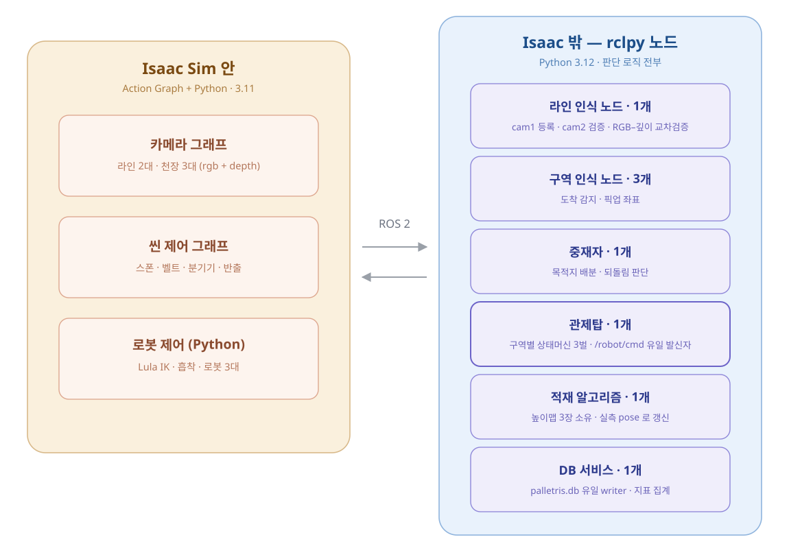

**구동은 그래프가, 판단은 전부 바깥 노드가** 맡는다. 안팎이 주고받는 것은 JSON
문자열이 아니라 전용 타입(`packing_msgs`)이다. 어느 노드가 어떤 토픽·서비스로
이어지는지는 [§1-3 인터페이스](#1-3-인터페이스--전용-타입만-쓴다)에 표로 있다.

### 1-2. 노드 구성

| 노드 | 개수 | 패키지 | 하는 일 | **하지 않는 일** |
|---|---|---|---|---|
| **관제탑** `orchestrator_node` | **1** | `palletris_orchestrator` | 구역 3개의 상태머신을 한 프로세스가 든다. **로봇 명령의 유일한 발신자** | 자리 계산 |
| 구역 인식 `zone_detector` | **3** | `packing_vision` | `pick_cam` 으로 픽업 좌표(x·y·yaw) 실측 → `BoxAtPickup` | 로봇 명령 |
| 라인 인식 `line_detector` | 1 | `packing_vision` | `cam1` 판독 → `RegisterBox`, `cam2` 재판독 → `VerifyBox` | 로봇 명령 |
| 적재 알고리즘 `algo_service_node` | 1 | `packing_algo` | heightmap 3장 소유 · 배치 좌표 계산 | **`/robot/cmd` 발행 금지** |
| DB + 중재자 `db_service_node` | 1 | `packing_db` | `palletris.db` 를 여는 **유일한** 프로세스 · 목적지 배분 | |

> **관제탑은 하나다.** 구역이 셋이어도 프로세스를 늘리지 않는다 — 상태머신이라
> 하나여야 명령이 겹치지 않는다. 반대로 **구역 인식은 셋으로 나눈다** — 이미지
> 추론이라 한 프로세스에 몰면 파이썬 GIL 때문에 세 구역이 줄을 서서 돈다.

### 1-3. 인터페이스 — 전용 타입만 쓴다

토픽에 `std_msgs/String` + JSON 을 쓰지 않는다. 전부 `packing_msgs` 전용 타입이다.

**토픽 8종**

| 토픽 | 타입 | 방향 |
|---|---|---|
| `/clock` | `rosgraph_msgs/Clock` | Isaac → 전원 |
| `/tf` · `/tf_static` | `tf2_msgs/TFMessage` | Isaac → 전원 |
| `/cam1/rgb` · `/cam2/rgb` · `/pick_cam_{a,b,c}/rgb` (+ `camera_info`) | `sensor_msgs/Image` · `CameraInfo` | Isaac → 인식 |
| `/zone_{a,b,c}/box_at_pickup` | `packing_msgs/BoxAtPickup` | 인식 → 관제탑 |
| `/zone_{a,b,c}/robot/cmd` | `packing_msgs/RobotCmd` | 관제탑 → 로봇 |
| `/zone_{a,b,c}/robot/event` | `packing_msgs/RobotEvent` | 로봇 → 관제탑 |
| `/zone_{a,b,c}/status` | `packing_msgs/ZoneStatus` (2 Hz) | 관제탑 → 중재자·모니터링 |
| `/metrics/summary` | `packing_msgs/MetricsSummary` (1 Hz) | DB → 모니터링 |

**서비스 17종**

| 서버 | 서비스 |
|---|---|
| `algo` | `/algo/plan_placement` · `/algo/update_heightmap` · `/algo/cancel_plan` · `/algo/reset_heightmap` |
| `db` | `/db/register_box` · `/db/get_box_info` · `/db/verify_box` · `/db/set_status` · `/db/mark_placed` · `/db/zone_queue` · `/db/report_miss` |
| 중재자 | `/diverter/request` · `/diverter/decide` |
| 씬(Isaac) | `/conveyor/set_velocity` · `/sim/despawn_box` · `/sim/set_spawn_enabled` · `/sim/swap_pallet` |

**반드시 지킬 규약 5개**

1. **모든 노드에 `use_sim_time:=true`.** 없으면 tf 조회가 전부 실패한다.
   ⚠ 반대로 `/clock` 발행자가 없는데 `true` 면 **모든 타이머가 멎는다** — 노드는
   살아 있고 에러도 없는데 로봇 20초 타임아웃 감시까지 죽는다. Isaac 을 먼저 띄운다.
2. **`RobotCmd.seq` 를 `RobotEvent.seq` 가 그대로 되돌려준다.** 없으면 타임아웃 뒤
   늦게 온 이전 응답을 새 박스의 결과로 오인한다.
3. **`has_actual == true` 일 때만 `actual_*` 를 `UpdateHeightmap` 에 넣는다.**
   계획값을 되보내면 오차가 누적돼 알고리즘은 1300 안이라 믿는데 실물이 넘는다.
4. **`DiverterRequest` 는 응답 제한 0.6 초.** 일반 서비스 타임아웃 2.0 초를 쓰면
   답이 올 때 박스가 이미 분기점을 지나 있다.
5. **카메라 토픽 QoS 는 `qos_profile_sensor_data`(BEST_EFFORT).** 기본 RELIABLE 로
   구독하면 이미지가 하나도 안 온다.

---

## 2. 플로우 차트

### 2-1. 박스 1개 사이클 (시나리오)

스폰부터 트럭 상차까지 **전 단계가 구현돼 있다** (2026-08-27 실측). 점선은 예외
경로 — 미등록·실패 박스가 리턴 라인으로 재순환하는 길이다.

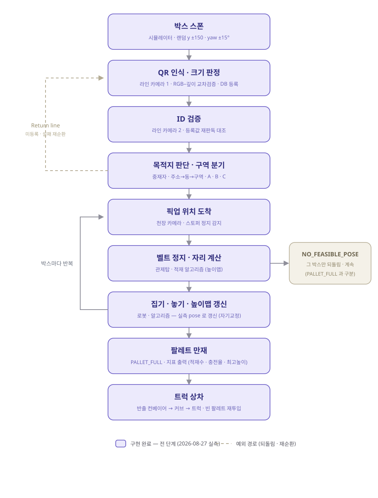

각 단계에서 오가는 서비스는 이렇다 — `RegisterBox` · `VerifyBox`(인식 → DB) →
`DiverterRequest`(중재자, 0.6초 제한) → `BoxAtPickup`(인식 → 관제탑) →
`SetVelocity(0)` → `PlanPlacement`(알고리즘) → `RobotCmd`/`RobotEvent`(로봇) →
`UpdateHeightmap` · `MarkPlaced` → `SetVelocity(0.7)`.

> **★ `NO_FEASIBLE_POSE` ≠ `PALLET_FULL`.** 앞은 *이 박스만* 자리가 없다는 뜻이고,
> 뒤는 가장 작은 박스로도 후보가 없다는 뜻이다. 첫 `NO_FEASIBLE_POSE` 에서
> 종료하면 팔레트가 반만 찬 채 데모가 멈춘다.

### 2-2. 관제탑 상태머신 (구역당 1벌, 총 3벌)

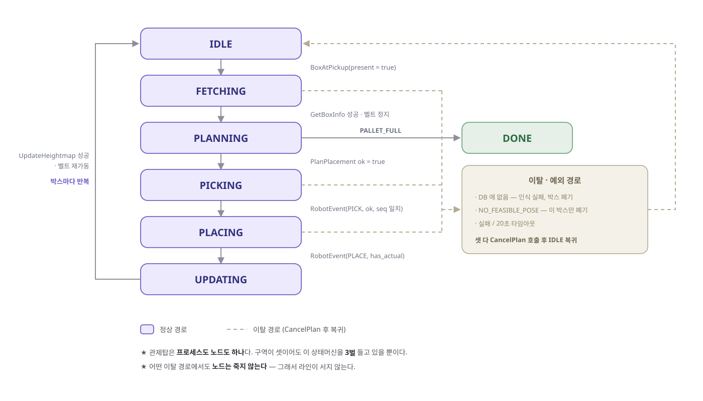

**이탈 3경로** — `NO_FEASIBLE_POSE` · `PALLET_FULL` · 실패/타임아웃(**20 초**).
셋 다 `CancelPlan` 을 호출한 뒤 복귀한다. **노드는 절대 죽지 않는다.**

### 2-3. 적재 알고리즘 (`PlanPlacement` 안에서 일어나는 일)

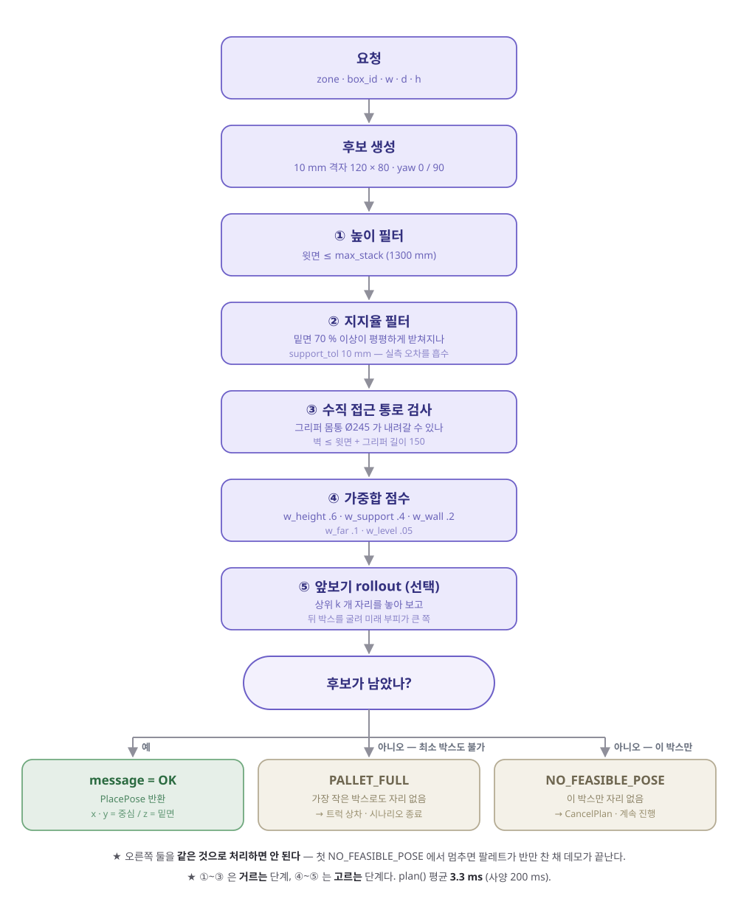

**①~③ 은 거르는 단계, ④~⑤ 는 고르는 단계다.** 아래는 그중 설명이 필요한 셋이다.

#### heightmap — 무엇을 기록하나

팔레트를 10 mm 격자 120×80 으로 나누고, 각 칸에 **그 자리의 현재 높이만** 적는다.
박스를 하나하나 3D 로 들고 있지 않으므로 후보 평가가 배열 연산 한 번으로 끝난다.

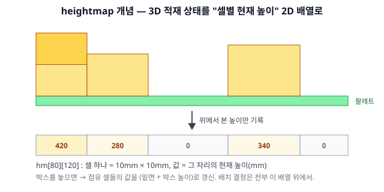

#### ② 지지율 — 왜 `tol` 이 필요한가

실측 상면이 계획값과 정확히 같을 수 없다. 210 을 목표로 놓아도 213 으로 앉는다.
허용 밴드(`support_tol_mm` 10) 없이 정확히 일치하는 셀만 세면 **2층부터
`NO_FEASIBLE_POSE` 만 나온다.**

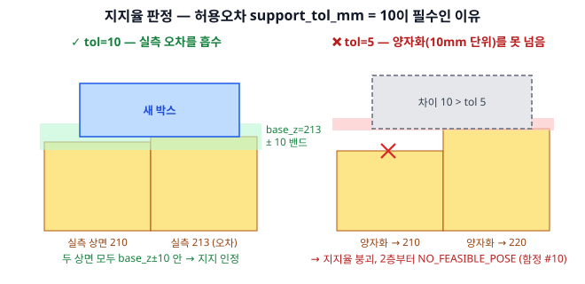

#### ③ 수직 접근 통로 — 이 알고리즘의 핵심

**"자리"만 보지 말고 "내려올 길"을 봐야 한다.** 박스가 들어갈 공간이 기하학적으로
남아 있어도, 그리퍼 몸통(Ø245)과 손목이 이웃 스택에 걸리면 못 놓는다. 이 검사가
없으면 계획은 성공인데 실기에서 `IK_FAIL` 이 난다.

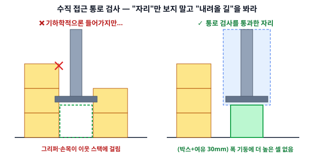

---

## 3. 운영체제 · 실행 환경

| 항목 | 값 | 비고 |
|---|---|---|
| OS | **Ubuntu 24.04 LTS** | |
| 미들웨어 | **ROS 2 Jazzy Jalisco** (Python **3.12**) | 시스템 설치 — `/opt/ros/jazzy` |
| 시뮬레이터 | **NVIDIA Isaac Sim 5.1** (내장 Python **3.11**) | `~/isaac-sim-5.1.0` 또는 `~/isaacsim` |
| DDS | Fast DDS + **유선 화이트리스트** | `scripts/fastdds_whitelist.xml` → `~/.ros/` |
| `ROS_DOMAIN_ID` | **115** (팀 전원 동일) | 틀리면 노드는 다 사는데 서로 안 보인다 |
| 워크스페이스 | `~/palletris_ws` | |
| 실행 형태 | **다중 PC** ROS 2 통신 (최대 4대) | 한 대에서도 돌아간다 ([§7](#7-실행)) |
| 빌드 | `colcon build --symlink-install` | |
| DB | SQLite 3 (**WAL 모드**) | `palletris.db` — writer 는 `db_service_node` 하나뿐 |

> ⚠ **Isaac 내장 ROS 2 를 쓰면 안 된다.** `packing_msgs` 는 `/opt/ros/jazzy` 로
> 빌드돼 있어서 내장 배포판에 물리면 fastcdr ABI 가 달라 죽는다
> (`undefined symbol: ...eprosima7fastcdr...`). `source install/setup.bash` 한 줄이
> `AMENT_PREFIX_PATH` · `LD_LIBRARY_PATH` · 배포판 일치 셋을 한꺼번에 해결한다.
> 실행 스크립트가 알아서 시스템 ROS 를 고르므로 **스크립트를 통해 실행할 것.**

---

## 4. 사용 장비

### 4-1. 로봇 · 엔드이펙터 (시뮬레이션 모델)

| 항목 | 값 | 근거 |
|---|---|---|
| 로봇 | **두산로보틱스 H2017** · 6축 협동로봇 | 두산 공식 대표 용도에 팔레타이징 포함 |
| 도달거리 | **1,700 mm** | 최원점 1,667 mm = 도달의 **86 %** (권장 상한 85 % 수준) |
| 가반하중 | 20 kg (그리퍼 자중 2 kg 제외 시 **유효 18 kg**) | |
| 자중 | 75 ~ 79 kg | 페데스탈 구조 설계에 반영 |
| 엔드이펙터 | **진공 흡착** Ø50 mm × **4 패드** | 실용 흡착력 **16 kgf** (진공 −60 kPa · 안전계수 3) |
| 그리퍼 치수 | 길이 **150 mm** · 몸통 **Ø245 mm** | ★ 통로 검사(`_corridor_ok`)의 기준값 |
| **실질 중량 상한** | **10 kg** | 가반이 아니라 **골판지 상판 강성**이 먼저 걸린다 |
| 페데스탈 | **900 mm** (test_3 씬은 1,700 mm) | 다층 적재 시 팔꿈치가 기둥을 치지 않는 최소 높이 |
| 대수 | **3 대** (구역 A · B · C) | |
| 모델 파일 | [`src/packing_robot/urdf/h2017.urdf`](src/packing_robot/urdf/) + 메시 21개 (`.dae`) | 저장소에 포함 |

> **왜 H2017 인가.** M0609(도달 900 mm)는 소요/도달 162 % 로 미달이고 유효 가반이
> 4 kg 이다. H2017 은 86 % 로 **팔레트 전체를 한 자세에서 덮어 턴테이블·리니어축이
> 필요 없다.**

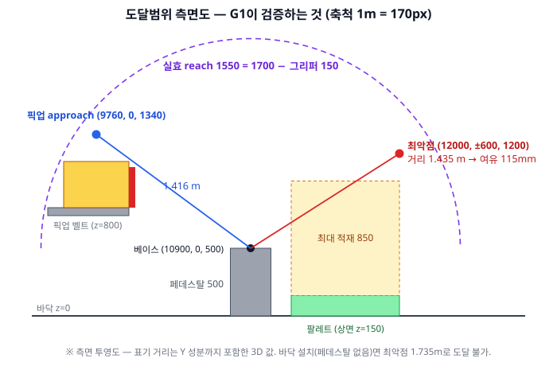

실효 reach 는 **1550 mm** 다 (1700 − 그리퍼 150). `z = 0` 을 야드 지면이 아니라
**도크 바닥**으로 잡은 것이 이 그림의 요점이다 — 그 덕에 "팔레트를 들지 않고 밀어서
트럭에 넣는다"가 높이차 0 으로 성립한다.

### 4-2. 센서

| 카메라 | 위치 | 역할 |
|---|---|---|
| `cam1` | 컨베이어 x = 600 | 투입부 판독 — 크기 측정 · QR 운송장번호 → DB 등록 |
| `cam2` | 컨베이어 x = 1400 | 투입부 재판독 · 교차 검증 |
| **`pick_cam`** ×3 | 스토퍼 위 (y 0, z **2300**) 하향 | **픽업 좌표 실측** (x · y · yaw) |
| **`wrist_cam`** | 그리퍼 몸통 · offset (170, 0, 30) · tilt 18° | hand-eye — 집는 순간 확인 |

- 모델: **Intel RealSense D455** 상정 (외형 124 × 26 × 29 mm 하우징)
- 해상도 **1280 × 720** · HFOV **60°** · **30 Hz**
- 조명: 돔 라이트 `intensity: 100` — 오프스크린 렌더는 GUI 조명 리그를 못 받는다.
  배경 씬을 쓸 때는 `PL_LIGHT=1` 을 준다 ([§7 스위치](#자주-쓰는-스위치))

### 4-3. 물류 설비 (씬 자산)

| 설비 | 사양 |
|---|---|
| 컨베이어 | 롤러 면 z = **800 mm** · 유효 폭 **1546 mm** · 속도 **0.5 m/s** (test_3: 0.7) |
| 소터 | 구역별 독립 컨베이어 3대 — 소터만 옆으로 돌려 지선으로 분기 |
| 리턴 라인 | 순환 루프 — 구역이 차면 한 바퀴 돌려 재도전 (**3바퀴 초과 시 폐기**) |
| 팔레트 | **1200(X) × 800(Y) × 두께 150 mm** · Y 로 3장 = 2400 |
| 최대 적재 | **1300 mm** (팔레트 **상면** 기준) = 트럭 내高 1600 − 팔레트 150 − 천장 여유 150 |
| 트럭 | 1톤 · 적재함 바닥 **2800 mm** · 내高 **1600 mm** · 바닥 높이(지면 대비) 850 |
| 가이드 벽 | 팔레트 바깥 5 mm · 두께 20 mm — **로봇 쪽과 픽업 쪽은 비운다** |

**적재 대상 — 우체국 표준 택배 상자 3종**

| 이름 | w × d × h (mm) | 질량 | 혼입비 |
|---|---|---|---|
| 3호 | 340 × 250 × 210 | 3 kg | 50 % |
| 4호 | 410 × 310 × 280 | 5 kg | 30 % |
| 5호 | 480 × 380 × 340 | 9 kg | 20 % |

> **z = 0 은 도크 바닥 = 트럭 적재함 바닥이다.** 야드 지면이 아니다(z = −850).
> 이 규약 덕분에 "팔레트를 들지 않고 밀어서 트럭에 넣는다"가 높이차 0 으로 이미
> 만족된다 — 79 kg 로봇을 1.6 m 구조물에 올리는 대안을 쓰지 않아도 된다.

**라인 평면도**

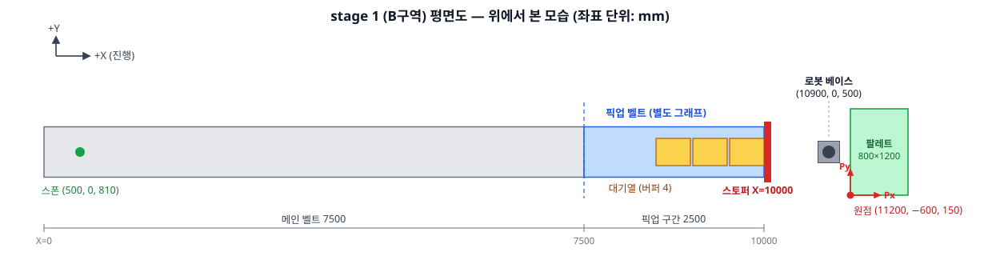

> 이 그림은 **stage 1(B구역 단독)** 기준이다. 시연 구성인 stage 2 는 같은 라인에
> 소터로 A·B·C 세 구역을 붙인 것이다.

**픽업 구간 — 스토퍼와 파지점**

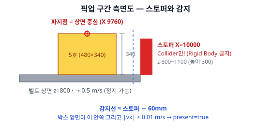

**팔레트 좌표계 — `PlacePose` 계약**

`x_mm` · `y_mm` 는 박스 **중심**, `z_mm` 은 박스 **밑면**이다. z 를 중심으로 쓰면
박스가 팔레트에 절반 파묻힌다. 트랙 B·C 가 반드시 합의해야 하는 지점이라 그림으로 둔다.

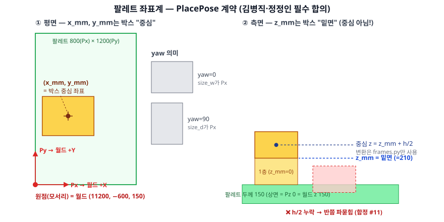

**스폰 z — `h/2` 를 더해야 한다**

벨트 상면이 800 이라고 `translate_z` 에 810 을 그대로 넣으면 박스 **중심**이 810 이
되어 밑면이 640 으로 내려간다. 벨트를 160 mm 관통해 물리가 터진다.

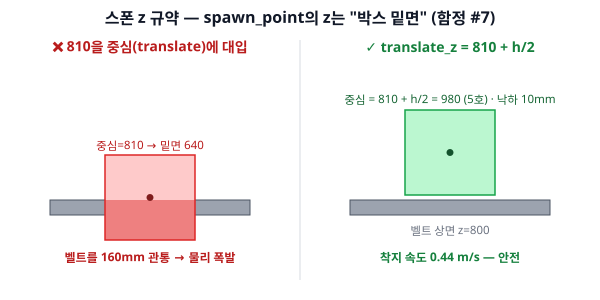

### 4-4. 컴퓨팅 · 네트워크

| 노드 | IP | 역할 |
|---|---|---|
| PC1 | `10.10.0.1` | **Isaac Sim 전용** (`packing_sim` + 로봇 구동) |
| PC2 | `10.10.0.2` | `packing_db` — DB 서비스 · 인식 · 중재자 |
| PC3 | `10.10.0.3` | `packing_algo` |
| PC4 | `10.10.0.4` | 모니터링 · rqt · 로그 |

- **2.5G 스위치 + 고정 IP** · FastDDS 유선 화이트리스트 (실측 ping **0.25 ms**)
- Isaac 머신 CPU 를 렌더링/물리에 집중시켜 카메라 FPS 게이트에 유리
- 트랙 C·D 는 Isaac 없이 노트북에서 개발 가능 → GPU 3대로 아무도 대기하지 않음

---

## 5. 의존성

전체 목록과 근거는 [`requirements.txt`](requirements.txt) 에 있다.

**Isaac 밖 (ROS 2 노드 · Python 3.12)**

```bash
# apt 판 권장 — rosdep 이 package.xml 의 <exec_depend> 를 이 이름으로 찾는다
sudo apt install -y python3-numpy python3-scipy python3-opencv \
                    python3-yaml python3-matplotlib python3-pytest \
                    ros-jazzy-cv-bridge

# 또는
pip install -r requirements.txt
```

`ros-jazzy-desktop` 을 설치했다면 대부분 들어 있다.

| 패키지 | 어디에 쓰나 |
|---|---|
| `numpy` ≥1.26 | heightmap 120×80 int32 격자 |
| `scipy` ≥1.11 | `maximum_filter1d` — 통로 검사의 슬라이딩 최대. `plan()` 평균 2 ms 가 여기서 나온다 |
| `opencv-python` ≥4.7 | HSV 마스크 · `minAreaRect`(yaw) · `QRCodeDetector` / `QRCodeEncoder` |
| `PyYAML` ≥6.0 | `system.yaml` 로더 |
| `matplotlib` ≥3.7 | 리포트 그림 · 실시간 적재 뷰어 (**실행에는 불필요**) |
| `pytest` ≥7.0 | 수용 테스트 |

**pip 로 넣지 않는 것**

| 이름 | 어디서 오나 |
|---|---|
| `rclpy` · `tf2_ros` · `sensor_msgs` · `geometry_msgs` | `sudo apt install ros-jazzy-desktop` |
| `packing_msgs` | 이 저장소 — `colcon build --packages-select packing_msgs` |
| `isaacsim` · `pxr`(USD) · `omni` | Isaac Sim 5.1 내장 (`python.sh` 로 실행할 때만 보인다) |
| `sqlite3` | 파이썬 표준 라이브러리 |

---

## 6. 설치 — 네 단계

### ① 클론 · 빌드

```bash
git clone <저장소 URL> ~/palletris_ws
cd ~/palletris_ws && source /opt/ros/jazzy/setup.bash && colcon build --symlink-install
mkdir -p ~/palletris_logs        # 실행 로그는 저장소 밖에 쌓인다
```

빌드가 `symbolic link ... Is a directory` 로 실패하면 예전 빌드 산출물이 남은 것이다:

```bash
rm -rf build install log && colcon build --symlink-install
```

<a id="step2"></a>

### ② 생성물 2종 만들기 — 안 만들면 **에러 없이** 전 박스가 폐기된다

> [!WARNING]
> **이 단계를 건너뛰면 시스템이 "돌아가는 것처럼 보이면서" 아무것도 적재하지
> 않는다.** 크래시도, 빨간 로그도 없다. 원인을 찾기 가장 어려운 실패다.

```bash
cd ~/palletris_ws
python3 scripts/gen_master_db.py --reset     # palletris.db (박스 150개 · 주소 · 구역표)
python3 scripts/gen_qr_labels.py             # qr_labels/BOX001.png ... 150장
```

**왜 저장소에 없나** — 소스가 아니라 **생성물**이기 때문이다. 정답지 CSV 2개
(`src/packing_db/packing_db/data/boxes_master.csv` 163줄 · `zone_map.csv` 21줄)와
고정 시드(`boxes.random_seed: 42`)에서 결정론적으로 만들어지므로, **누가 언제
돌려도 같은 것이 나온다.** 결과물 대신 **만드는 스크립트**를 커밋하는 것이 이
저장소의 규약이다 (USD 도 같은 이유로 뺐다 — [§10](#10-저장소-구조)).

**안 만들면 정확히 이렇게 된다**

| | 자동으로 되나 | 없을 때 |
|---|---|---|
| `palletris.db` | **빈 파일만** 자동 생성 — `db_service_node` 가 `schema.sql` 을 건다 | 정답지가 비어 `GetBoxInfo`·`VerifyBox` 가 전부 실패 → 관제탑이 **전 박스 폐기** |
| `qr_labels/` | **안 된다** | 박스 윗면에 QR 이 안 붙어 `cam1` 이 등록을 못 한다 → **전 박스 RETURN**. `spawner` 가 경고 한 줄만 찍고 라벨 없이 계속한다 |

라벨 한 변은 **217 mm** 다 (QR 175 + 여백 21×2). 제일 좁은 3호 윗면(250)에 좌우
16 mm 씩 빨간 테두리가 남는데, **그 테두리가 있어야 `find_box` 가 박스 바깥 윤곽을
잡는다** — 라벨은 인식 대상일 뿐 아니라 검출의 기준이기도 하다.

**어느 PC 에 두나** — `palletris.db` 는 **DB 노드를 띄우는 PC**, `qr_labels/` 는
**Isaac 을 띄우는 PC** 에 있어야 한다. 한 대에서 돌리면 둘 다 워크스페이스 루트에
생기므로 신경 쓸 것 없다.

**만들어졌는지 확인**

```bash
ls -l palletris.db && ls qr_labels | wc -l      # 150 이 나와야 한다
```

<a id="step3"></a>

### ③ Isaac 씬 배치

USD 는 바이너리라 git 에 넣지 않는다(`.gitignore`). 씬 묶음 `Collected_test_3/`
(약 1.1 GB, 에셋 포함) 안의 **`test_3.usd` 가 시뮬레이션 메인 실행 파일**이다.

```
Collected_test_3/test_3.usd                       ← ★ 메인 실행 파일 (220 KB)
Collected_test_3/isaac_assets/...                 ← 우리 에셋
Collected_test_3/omniverse-content-production.../ ← Isaac 기본 에셋 (약 1.1 GB)
```

**제출본(zip)에는 이 폴더가 워크스페이스 안에 같이 들어 있다.** 그대로 쓰려면
씬 경로를 한 번 지정해 준다:

```bash
cd ~/palletris_ws
export PL_STAGE=$PWD/Collected_test_3/test_3.usd
```

> ⚠ **이 한 줄을 빼면 씬을 못 찾는다.** 실행 스크립트의 기본 경로가
> `~/isaac_scenes/Collected_test_3/test_3.usd` 라 워크스페이스 안을 보지 않는다.
> 매번 export 하기 싫으면 폴더를 그쪽으로 옮겨도 된다:
>
> ```bash
> mkdir -p ~/isaac_scenes && mv Collected_test_3 ~/isaac_scenes/
> ```
>
> `PL_STAGE` 를 주면 `run_test3_ros.sh` · `run_all_local.sh` · `sim_main.py` 의
> 기본값을 **전부** 덮어쓴다. 스크립트마다 기본 경로가 조금씩 달라서
> (`Collected_test_3_share`, `/home/rokey/...`) `PL_STAGE` 로 고정하는 쪽이 확실하다.

> ⚠ **에셋 폴더를 통째로 가져와야 한다.** `test_3.usd` 만 복사하면 참조가 안 풀려
> 모든 프림이 `Selected Prim is not a Rigid Body` 로 죽고 로봇 아티큘레이션이
> 사라진다. `Collected_` 묶음은 참조가 **상대경로**로 박혀 있어서 폴더째 옮기는 건
> 괜찮지만 안을 헤집으면 깨진다. 팀 내부 배포는 `scripts/sync_scene.sh` (rsync).

<a id="step4"></a>

### ④ 네트워크 (다중 PC 로 돌릴 때만)

```bash
export ROS_DOMAIN_ID=115
export RMW_IMPLEMENTATION=rmw_fastrtps_cpp
export ROS_AUTOMATIC_DISCOVERY_RANGE=SUBNET
# 이미지가 커서 UDP 단편 손실이 난다 — 송수신 버퍼를 키운다
mkdir -p ~/.ros && cp scripts/fastdds_whitelist.xml ~/.ros/
export FASTRTPS_DEFAULT_PROFILES_FILE=$HOME/.ros/fastdds_whitelist.xml
sudo sysctl -w net.core.rmem_max=16777216 net.core.wmem_max=16777216
```

> ⚠ `fastdds_whitelist.xml` 은 인터페이스를 `10.10.0.1~4` 로 못 박아 뒀다.
> **다른 대역이면 그 파일의 `<address>` 를 자기 IP 로 고칠 것** — 안 고치면
> 에러 없이 토픽이 하나도 안 보인다. 한 대에서만 돌릴 거면 이 변수를 아예 빼고
> `ROS_AUTOMATIC_DISCOVERY_RANGE=LOCALHOST` 를 쓴다.

---

## 7. 실행

### 한 대에서 전부 (개발·검증용)

터미널 2개가 필요하다. **Isaac 을 먼저 띄운다** — 모든 노드가 `use_sim_time` 이라
`/clock` 발행자가 없으면 타이머가 하나도 안 돈다.

```bash
# 터미널 1 — Isaac
cd ~/palletris_ws && python3 scripts/kill_ros_nodes.py \
  && export PL_STAGE=$PWD/Collected_test_3/test_3.usd \
  && export ROS_AUTOMATIC_DISCOVERY_RANGE=LOCALHOST \
  && PL_GTPICK=2 PL_CAMROS=2 PL_SPUR_STOP=2 PL_RENDER_EVERY=10 PL_METER=2 PL_SPAWN=8 \
     ./scripts/run_test3_ros.sh
```

```bash
# 터미널 2 — 인식 · 관제탑 · 알고리즘 · DB
cd ~/palletris_ws && source install/setup.bash \
  && export ROS_DOMAIN_ID=115 ROS_AUTOMATIC_DISCOVERY_RANGE=LOCALHOST \
            RMW_IMPLEMENTATION=rmw_fastrtps_cpp \
            PL_CONFIG_OVERLAY=src/packing_bringup/config/test_3.yaml \
  && ros2 launch packing_bringup bringup.launch.py vision:=true depth:=true \
     2>&1 | tee ~/palletris_logs/bringup_$(date +%Y%m%d_%H%M%S).log
```

> `depth:=true` 는 **깊이 교차검증**(기본 모드 `crosscheck`)이다. 로봇이 쓰는
> 좌표·크기 판정에는 일절 안 끼어들고 — `cross_check` 의 `used` 가 언제나 RGB 다 —
> RGB 와 깊이의 어긋남을 `/zone_*/vision_check`·`/line/vision_check` 로 **채점만**
> 한다. 즉 `depth:=false` 와 로봇 동작이 같다.
> ⚠ `depth_mode:=prefer` 로 올리는 건 다른 얘기다 — 좌표 채택원이 프레임마다
> 바뀌어 픽업 안정화 필터(5 mm 일치)가 영영 안 잡히는 실측이 있다 (2026-08-27).
> CLAUDE.md §15 의 승격 조건 전까지 crosscheck 로 둘 것.

`scripts/run_all_local.sh` 는 위 두 단계를 한 번에 띄우는 런처다.

### 두 대로 나눠서 (시연 구성)

`ROS_AUTOMATIC_DISCOVERY_RANGE=SUBNET` + [§6-④](#step4) 를
양쪽에 적용한 뒤:

- **PC1 (Isaac)** — 위 터미널 1 과 같되 `LOCALHOST` 를 `SUBNET` 으로
- **PC2 (인식·관제탑·알고리즘·DB)** — 위 터미널 2 와 같되 `LOCALHOST` 를 `SUBNET` 으로

세 대로 나누려면 PC2 는 `vision:=true algo:=false db:=false orchestrator:=false`,
PC3 는 `vision:=false` 를 준다. 배치 근거는
[`docs/2026-08-27_시연_다중PC_배치.md`](docs/2026-08-27_시연_다중PC_배치.md).

### 자주 쓰는 스위치

| 변수 | 뜻 |
|---|---|
| `PL_RENDER_EVERY` | 렌더 건너뛰기. **10 = 약 2.2배속**(검증용) · **3 = 부드러움**(시연용) |
| `PL_OUTFEED=1` | 만재 팔레트를 컨베이어로 **트럭까지** 보내는 연출 (기본 꺼짐) |
| `PL_LIGHT=1` | 카메라용 조명 추가 (기본 꺼짐). **배경 씬에서는 필수** — 없으면 박스가 그늘에 들어가 크기를 작게 읽는다 |
| `PL_BG=0` | 장식 배경 끄기. 8 GB GPU 에서 씬이 OOM 으로 죽을 때 |
| `PL_ZONES=B` | 로봇 한 대만 |
| `PL_GUI=0` | 창 없이 (헤드리스) |
| `PL_SPAWN=8` | 박스 투입 간격 [초]. `0` 이면 투입 안 함 |

`bringup.launch.py` 인자: `vision` · `vision_zone` · `depth` · `depth_mode` ·
`algo` · `db` · `orchestrator` · `zone` · `log_level` · `use_sim_time`.

> ⚠ **`PL_GTPICK=2` 와 `vision_zone:=false` 를 같이 쓰면 안 된다.** 픽업 좌표를
> 낼 발행자가 사라져 전 구역이 굶는다. 둘 중 하나만 쓸 것.

### 주요 스크립트

| 스크립트 | 무엇 |
|---|---|
| `scripts/run_test3_ros.sh` | Isaac + 씬 + 로봇 3대 + ROS 브리지 기동 |
| `scripts/run_all_local.sh` | PC 한 대에서 Isaac + ROS 그래프를 전부 띄운다 |
| `scripts/start_demo.sh` | DB 를 비우고 시연 구성으로 기동 |
| `scripts/kill_ros_nodes.py` | 남은 노드 정리 (다음 실행 전에 돌린다) |
| `scripts/gen_master_db.py` · `gen_qr_labels.py` | 설치 ②단계 생성물 |
| `scripts/sync_scene.sh` | USD 씬 배포 (rsync) |
| `scripts/demo_stack15.py` | 적재 알고리즘 단독 실행 · 지표 측정 |
| `scripts/record_run.sh` | 실행 기록 (rosbag + DB 사본 + 메타) |
| `scripts/dashboard/server.py` | 관제탑 웹 대시보드 |
| `scripts/verify_*.py` | 검증 20여 종 — 아래 표 |

### 검증 스크립트

게이팅 검증(G1~G7)과 실측 하네스는 전부 `scripts/` 에 커밋한다.

| 스크립트 | 무엇을 재나 | Isaac 필요 |
|---|---|---|
| `verify_reach.py` | **G1** 도달범위 11점 (팔레트 코너·상단) | ✗ |
| `verify_reach_isaac.py` | G1 의 Isaac/Lula 판 | ✓ |
| `verify_lula_ik.py` | **B1** Lula IK 기동 — Isaac 배선의 단일 출처 | ✓ |
| `verify_suction.py` | **B3** 흡착 grasp/release/is_holding · 흡착면↔상판 간극 | ✓ |
| `verify_cycle.py` | 픽→이송→플레이스 사이클타임 · 간섭 · 툴 기울기 | ✓ |
| `verify_link_clearance.py` | **팔 링크 대 적재물 간섭** (특히 `link_2`) | ✗ |
| `verify_transit_sweep_isaac.py` | **궤적 전체** 스윕 — 정지 자세 검사로는 안 잡힌다 | ✓ |
| `verify_belt_speed.py` | 벨트 이송속도 게이트 | ✓ |
| `verify_vision.py` | **인식 전 구간** — Isaac 대역을 서서 카메라·tf 를 합성 | ✗ |
| `verify_db.py` | `/db/*` 7종 + 중재자. 실패 경로도 같이 친다 | ✗ |
| `verify_ros_graph.py` | **★ ROS 2 그래프 전 구간** — Isaac 이 하는 일 전부를 대신한다 | ✗ |
| `check_place_plan.py` | 배치 계획 프리플라이트 (`plan.json`) | ✗ |
| `summarize_runs.py` | `results/*.txt` → 조건·결과 비교표 한 줄 | ✗ |
| `report.py` | 종료 지표 — 발표의 "결과 수치" | ✗ |

```bash
# 수용 테스트 (회귀 방지)
colcon test --packages-select packing_algo packing_common packing_db packing_vision
colcon test-result --verbose
```

> **★ 계획 파라미터는 Isaac 으로 판정한다.** 데스크 지표와 Isaac 실측이 **부호까지
> 어긋난 적이 있다** — 데스크에서는 배치 실패가 박스 1개 손해지만, 실측에서는 실패
> 2건이 적재 3개를 깎았다(팔이 스택을 63 mm 밀고, 무너진 지형이 뒤 박스 자리까지
> 죽였다). **데스크 스윕은 후보를 좁히는 용도**이지 채택 판정이 아니다.

---

## 8. 잘 도는지 확인

```bash
source install/setup.bash && export ROS_DOMAIN_ID=115
ros2 topic info /clock                    # Publisher 1 (Isaac 이 살아 있다)
ros2 topic hz /pick_cam_a/rgb             # 이미지가 온다
ros2 topic echo /zone_a/status --once     # 관제탑 상태·적재 개수
```

정상이면 터미널 2 로그에 이런 줄이 이어진다:

```
[orchestrator.a] [①→②] 박스 도착: BOX008 (-7555, 4024) yaw 0.0°
[orchestrator.a] [④→⑤] 집기 성공 (1.5초)
[orchestrator.a] [⑥→①] 적재 3개 · 충전율 35.1% · 최고 280mm
[db_service_node] [지표] 적재 74 · 성공률 100.0% · 사이클 7.1s · 충전율 68.9%
```

---

## 9. 안 될 때

| 증상 | 원인 |
|---|---|
| 노드는 사는데 타이머가 안 돈다 | `/clock` 발행자 0 — Isaac 을 먼저 띄울 것 |
| 토픽이 안 보이는데 에러도 없다 | `ROS_DOMAIN_ID` 불일치 · 디스커버리 범위 · 화이트리스트 IP |
| 이미지가 하나도 안 온다 | 구독 QoS 가 RELIABLE (센서는 BEST_EFFORT 여야 한다) |
| 카메라 이미지가 캄캄하다 | 돔 라이트 없음 (오프스크린 렌더는 GUI 조명을 못 받는다) — `PL_LIGHT=1` |
| 모든 박스가 3호로 축소 등록된다 | 같은 원인 — 배경 씬의 그늘. `PL_LIGHT=1` 로 `SIZE_MISMATCH` 137 → 20건 |
| **박스가 흘러가는데 하나도 안 쌓인다 · 전 박스 RETURN** | **`qr_labels/` 또는 `palletris.db` 미생성** — [§6-②](#step2). 에러가 안 나므로 이걸 **가장 먼저** 의심할 것 |
| 로드 중 `Killed` | GPU 메모리 부족 — `PL_BG=0` |
| **씬이 안 열린다 · 빈 화면** | **`PL_STAGE` 미설정** — 스크립트 기본 경로가 `~/isaac_scenes/...` 라 워크스페이스 안의 `Collected_test_3/` 을 안 본다 ([§6-③](#step3)) |
| `Selected Prim is not a Rigid Body` 다발 | 씬 에셋 폴더 누락 · `Collected_test_3/` 안을 헤집었다 ([§6-③](#step3)) |
| `database is locked` | `db_service_node` 외의 프로세스가 `.db` 를 열었다 |

더 많은 증상·원인은 [`CLAUDE.md` §10](CLAUDE.md) 과 [`트러블슈팅.md`](트러블슈팅.md) 에 있다.

---

## 10. 저장소 구조

| 경로 | 트랙 | 무엇 |
|---|---|---|
| `src/packing_common/` | 공용 | `config.py` · `frames.py` · `units.py` (복사 금지, import) |
| `src/packing_msgs/` | 공용 | ROS 인터페이스. 수정하면 팀 전원 재빌드 |
| `src/packing_bringup/` | 공용 | launch · `config/system.yaml` · `config/test_3.yaml` |
| `src/packing_sim/isaac/` | A | `sim_main.py` · `spawner.py` · `ros_graph.py` · `conveyor_ctl.py` |
| `src/packing_robot/` | B | `rmpflow_controller.py` · `cycle.py` · `gripper.py` · **`urdf/`** |
| `src/palletris_orchestrator/` | B | 관제탑 (상태머신 7개, 로봇 명령의 유일한 발신자) |
| `src/packing_algo/` | C | `heightmap_core.py` · `algo_service_node.py` · `extreme_point.py` |
| `src/packing_vision/` | D | `vision_node.py` · `detect.py` · `geometry.py` · `depth.py` |
| `src/packing_db/` | D | `db_service_node.py` (`palletris.db` 유일 writer) · 중재자 · `metrics.py` |
| `scripts/` | — | 실행 · 생성 · 검증 스크립트 + `dashboard/` (관제탑 웹 대시보드) |
| `docs/` | — | 설계 결정과 실측 기록 · 발표 자료 |

**git 에 없는 것** (생성물이거나 바이너리라 제외한다)

| | 어떻게 얻나 |
|---|---|
| `*.usd` — 씬 `test_3.usd` · 로봇 · 그리퍼 | 별도 배포 (§6-③). 로봇·그리퍼는 `scripts/import_h2017_usd.py` · `build_gripper_usd.py` 로 생성 |
| `palletris.db` · `qr_labels/` | **★ `scripts/gen_master_db.py --reset` · `gen_qr_labels.py`** — [§6-②](#step2). 안 만들면 에러 없이 전 박스가 폐기된다 |
| `build/` · `install/` · `log/` | `colcon build` 산출물 |

### 하지 말 것

- ❌ **`system.yaml` · `packing_msgs/` · 씬 USD 를 승인 없이 수정** (= 팀 전원 재빌드)
- ❌ **코드에 숫자 상수 박기** — 전부 `system.yaml` 에서 읽는다
- ❌ **컨베이어 bbox 값(1970 · 1213)을 사양으로 쓰기** — 롤러 면은 1546 · 800 이다
- ❌ **관제탑을 구역마다 띄우기** — 하나다
- ❌ 알고리즘·인식 노드에서 `/robot/cmd` 발행
- ❌ `spin_until_future_complete` 사용 — 콜백 안에서 부르면 **에러 없이 조용히 멈춘다**
- ❌ 토픽에 `std_msgs/String` + JSON 사용 — 전용 타입이 있다
- ❌ `random_seed: 42` 변경 — 베이스라인 비교가 깨진다
- ❌ USD 를 git 에 커밋 — 대신 **만드는 스크립트**를 커밋한다

---

## 11. 팀

| 트랙 | 담당 | 범위 |
|---|---|---|
| **A** | 김학민 | Isaac 씬 · 컨베이어/소터 · 카메라 · tf/clock · USD |
| **B** | 김병직 | 로봇 팔 제어 · 흡착 · 관제탑 · 사이클 최적화 |
| **C** | 정정인 | 3D 빈패킹 알고리즘 · heightmap · 성능 검증 |
| **D** | 민범진 | 비전/인식 · DB · 중재자 · 인터페이스 설계 |

**공용 파일을 바꿨으면 반드시 보고한다** — 4명이 다시 빌드해야 한다.

---

## 문서

| 문서 | 무엇 |
|---|---|
| [`CLAUDE.md`](CLAUDE.md) | 프로젝트 컨텍스트 · 좌표/치수 정본 요약 · 규약 |
| [`docs/코드_리딩가이드.md`](docs/코드_리딩가이드.md) | 시나리오를 따라 코드를 읽는 법 |
| [`docs/발표/`](docs/발표/) | 발표 자료 · 알고리즘 개선 과정 · EP 대조군 비교 |
| [`트러블슈팅.md`](트러블슈팅.md) | 증상 → 원인 전체 기록 |
