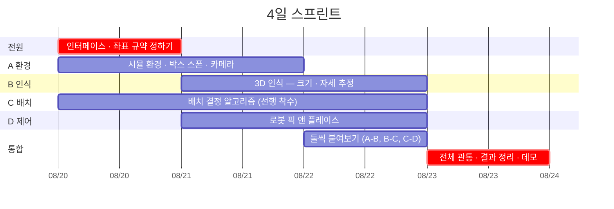

# 1차 목표 업무 분배안 — 4인 팀

> 대상: 캡스톤 팀원 전체 / 목적: 1차 목표 담당 확정 및 4일 스프린트 운영
> 관련: [시스템 사양서](C-3_0820_시스템_사양서.md) · 기획 근거: `C-3_0820_아침 브리핑 …md`
> 작성: 2026-08-20 · 상태: **§2 담당자 지명 · §8 확정 필요 항목은 팀 논의 후 확정**

---

## 1. 한 줄 요약

1차 목표 5개를 4명에게 1:1로 나누지 않는다.
**인터페이스 경계로 4개 역할을 자르고**, 브리핑에 빠져 있는 "시뮬레이션 환경 구축"에 담당자를 세운다.
배분은 **Isaac Sim 실행 가능 여부**가 먼저 결정한다.

---

## 2. 역할 배분

### 2-1. 장비 제약이 배분을 결정한다

GPU 노트북 2대만 Isaac Sim을 돌린다. **개인 노트북 2대는 Isaac Sim 사용 불가.**
따라서 4개 역할을 **Isaac 필수 2개 / Isaac 불요 2개**로 갈라야 한다.

| 역할 | Isaac Sim | 장비 | 근거 |
|---|---|---|---|
| **A · 환경 · 통합** | **필수** | GPU 노트북 | 씬 · 물리 · 브릿지가 전부 Isaac 안에 있음 |
| **D · 로봇 제어** | **필수** | GPU 노트북 | IK · 충돌 회피 검증에 물리 엔진 필요 |
| **B · 인식** | 데이터만 | 개인 노트북 | A가 뽑아준 depth 이미지로 오프라인 개발 |
| **C · 패킹 알고리즘** | **불필요** | 개인 노트북 | 순수 파이썬 — 치수 넣으면 좌표 나오는 함수 |

**C가 Isaac을 전혀 쓰지 않는다는 점이 이 팀에 특히 유리하다.** 가장 어렵고 오래 걸리는 작업이
장비 제약을 안 받으므로, 환경이 완성되기 전에 미리 끝내둘 수 있다.

### 2-2. 담당 지명 (확정)

| 담당 | 이름 | 역할 | 맡는 1차 목표 | 장비 |
|---|---|---|---|---|
| **A** | **김학민** | **환경 · 통합** | (§3 숨은 작업) + 5번 | **GPU 노트북** |
| **B** | **정정인** | **인식** | 1번 + 2번 판정부 | 개인 노트북 |
| **C** | **민범진** (팀장) | **패킹 알고리즘** | 3번 | 개인 노트북 |
| **D** | **김병직** | **로봇 제어** | 4번 + 2번 분기부 | **GPU 노트북** |

**장비 배정 확인 필요**: A(김학민) · D(김병직)는 Isaac Sim이 필수이므로 **GPU 노트북 2대를 이 둘이 써야 한다.**
B(정정인) · C(민범진)는 Isaac Sim 없이 진행 가능하므로 개인 노트북으로 충분하다.
이 대응이 실제 장비 보유 현황과 어긋나면 배분을 다시 조정해야 한다.

> 팀장(민범진)이 C를 맡으므로, **통합 조율 책임(A)과 임계 경로 담당(C)이 분리**된다.
> D3 통합일에 A(김학민)가 통합 진행을 주도하고, 팀장은 C 산출물 인계에 집중하는 구도로 운영한다.

### 2-3. 쪼개진 항목 처리

| 항목 | 나누는 기준 | 담당 |
|---|---|---|
| **2번** | "어느 구역인가" 판정 | B |
| | 2차 컨베이어 3라인으로 실제 분기 | A · D |
| **5번** | 롤러 · 도킹 물리 구현 | A |
| | "만재 → 상차 시작" 트리거 발행 | D |

---

## 3. 왜 1:1 배분이 아닌가

### 3-1. 5개 항목의 크기가 다르다

| 1차 목표 | 실제 부담 |
|---|---|
| 1. 실시간 3D 인식 | 1인분 |
| 2. A/B/C 분류 및 3라인 분기 | **판정 로직은 소규모**, 컨베이어 분기 물리는 환경 쪽 일 |
| 3. 온라인 패킹 알고리즘 | **1인분 이상 — 가장 어렵고 오래 걸림** |
| 4. 로봇 3대 병렬 적재 | 1인분 |
| 5. 트럭 측면 상차 연동 | 통합 작업 — 마지막에 붙음 |

### 3-2. 브리핑에 없는 6번째 작업이 있다

1~5번을 하려면 그 전에 **시뮬레이션 환경**이 있어야 한다.
박스 스폰(치수 랜덤화) · 컨베이어 물리 · 파렛트 · 1t 트럭 · 카메라 설치 · ROS 2 브릿지.

이 작업은 5개 목표 어디에도 적혀 있지 않은데 **팀원 4명 전원이 여기에 막힌다.**
주인을 정하지 않으면 각자 자기 씬을 만들다가 나중에 합쳐지지 않는다.

---

## 4. 4일 스프린트 일정 (8/20 목 ~ 8/23 일)



| | D1 8/20 목 | D2 8/21 금 | D3 8/22 토 | D4 8/23 일 |
|---|---|---|---|---|
| **전원 공동** | **인터페이스 · 좌표 규약** | | | **전체 관통 · 데모** |
| **A** 환경 | 시뮬 환경 · 박스 스폰 · 카메라 | → | | |
| **B** 인식 | | 3D 인식 — 크기 · 자세 | → | |
| **C** 배치 | **선행 착수** | → | → | |
| **D** 제어 | | 로봇 픽 앤 플레이스 | → | |
| **통합** | | | 둘씩 붙여보기 | |

### 4-1. 일정에서 읽어야 할 것

- **인터페이스 규약은 4명 공동 작업이다.** D1 오전은 전원이 규약 회의에 집중하고, 오후부터 각자 착수한다.
- **D1 오후에 코딩하는 사람은 A(김학민)와 C(민범진)뿐이다.** B·D는 D2부터 붙는다.
- **C(민범진)만 3일 내내 달린다.** 가장 긴 임계 경로다. 박스 치수는 사양서 §4-1에 잠정 확정해 두었으므로,
  D1 회의에서 승인만 하면 **대기 없이 착수**할 수 있다.
- **D3(토)이 통합일이다.** 이날 처음 붙이는 게 아니라, D2까지 각자 **더미 데이터로 단독 실행이 되는 상태**를 만들어 둬야 한다.
- **D3·D4는 주말이다.** 여기서 밀리면 회수할 시간이 없다.

---

## 5. 착수 전 필수 — 인터페이스 먼저 동결 (D1)

> **담당: 전원 공동.** 이 절만은 나눠서 하지 않는다.
> 인터페이스는 네 사람의 코드가 만나는 지점이므로, 한 명이 정해서 통보하면 나머지 셋이
> 자기 관점에서 빠진 필드를 D3 통합일에야 발견하게 된다. **D1에 넷이 한자리에서 합의한다.**

4명이 병렬로 일하려면 **첫날 ROS 2 토픽 · 메시지 규격을 합의하고 고정**해야 한다.


| 구간 | 내용 | 담는 값 |
|---|---|---|
| B → C | 박스 인식 결과 | 치수 W/L/H, 자세, 배정 구역 |
| C → D | 배치 지시 | 좌표 x/y/z, 회전 |
| D → A | 적재 완료 / 만재 | 상태 플래그 |

**이것만 정해지면 상대가 아직 만들지 못했어도 더미 데이터로 각자 진행할 수 있다.**
4명 병렬 작업의 유일한 전제조건이다.

### 5-1. 좌표계도 같이 정한다

사양서 §3-1의 파렛트 좌표를 **전원이 같은 원점으로 쓴다.**

```
파렛트 영역   x: 0 ~ 1200 mm,  y: 0 ~ 800 mm
파렛트 상면   z = 150 mm
적재 상단     z = 1450 mm
로봇 베이스   (600, −300, 700)
```

단위는 **mm로 통일**한다. Isaac Sim 내부가 m 단위이므로 **변환 지점을 한 곳으로 정해** 두 번 변환되는 사고를 막는다.

---

## 6. ROS_DOMAIN 운영

장비가 2쌍으로 묶여 있으므로 **쌍 안에서 먼저 붙이고, 통합 때 공용 도메인으로 올린다.**

| 도메인 | 구성 | 용도 |
|---|---|---|
| **116** | 1번 GPU 노트북 + 개인 노트북 | 쌍 내부 개발 · 둘씩 붙여보기 |
| **117** | 2번 GPU 노트북 + 개인 노트북 | 쌍 내부 개발 · 둘씩 붙여보기 |
| **115** | 공용 | **D3 통합 · D4 전체 관통** |

데이터 흐름이 A → B → C → D이므로 쌍은 이렇게 묶는 것이 자연스럽다.

- **116 = A(김학민, GPU) + B(정정인, 개인)** — B가 A의 카메라 출력을 받는다
- **117 = D(김병직, GPU) + C(민범진, 개인)** — D가 C의 배치 좌표를 받는다
- **B → C 구간만 쌍을 가로지른다.** 이 구간은 D3에 115에서 처음 붙으므로, D2까지 양쪽 모두 **더미로 검증**해 둔다

---

## 7. 작업 순서 — 3대 병렬은 나중에

브리핑에 "로봇 3대 병렬"이 명시되어 있으나, **처음부터 3대로 만들지 않는다.**

```
1단계) 로봇 1대로 전 구간 관통
       스폰 → 인식 → 패킹 → 적재  (수직 슬라이스 1개 완성)

2단계) 검증 후 3대로 복제
       + 충돌 회피 / 동기화
```

3대를 먼저 세우면 충돌·동기화 문제가 파이프라인 버그와 섞여 원인 파악이 불가능해진다.
**4일 스프린트 안에서는 1단계까지가 현실적인 목표다.**

박스도 같다. **3종 치수는 D1에 확정하되 스폰은 1종부터** 시작한다 (사양서 §4-1).

---

## 8. 확정 필요 — D1 오전에 결정할 것

전체 목록은 [사양서 §7](C-3_0820_시스템_사양서.md)에 있다. 이 중 **일정을 막는 것**만 아래에 옮긴다.

| # | 항목 | 막는 대상 | 마감 |
|---|---|---|---|
| ~~1~~ | ~~박스 3종 치수~~ → **3·4·5호 잠정 확정** ([사양서 §4-1](C-3_0820_시스템_사양서.md)) | C | D1 **승인만** |
| ~~2~~ | ~~혼입 비율~~ → **50/30/20 잠정 확정** | C | D1 **승인만** |
| 3 | 모션 경로: MoveIt2 vs Lula/RMPflow | D | D1 |

### 구역 기준은 배송지로 확정됐다 — 2차에 배분이 바뀐다

[사양서 §5-3](C-3_0820_시스템_사양서.md) 참조.

| | 1차 | 2차 |
|---|---|---|
| 구역 정보원 | **색 태그** (기존 `m0609_color_detector.py` 확장) | **송장 바코드** |
| B(정정인) 부담 | HSV 범위 1개 추가 — 거의 없음 | **1인분 신규** |

**2차 착수 시점에 B의 부담이 1인분 늘어난다.** 그때 배분을 다시 조정한다.
1차 스프린트 배분(§2-2)은 그대로 유지한다.

---

## 9. 착수 체크리스트 (D1)

- [x] §2-2 담당자 지명 — A 김학민 / B 정정인 / C 민범진 / D 김병직
- [ ] **GPU 노트북 2대를 김학민 · 김병직에게 배정** (§2-2)
- [x] 박스 3종 치수 · 혼입 비율 → 사양서 §4-1 잠정 확정 (3·4·5호 / 50·30·20)
- [ ] D1 회의에서 위 잠정안 **승인** → **C(민범진) 즉시 착수**
- [x] A/B/C 구역 기준 → **배송지 기준 확정**. 1차는 색 태그, 바코드는 2차
- [x] 파렛트 규격 → **1200×800, 트럭에 일자 3개** 확정 ([사양서 §5-2](C-3_0820_시스템_사양서.md))
- [ ] §5 인터페이스 3종 규격 합의 및 문서화 — **4명 전원 참석**
- [ ] §5-1 좌표계 · 단위(mm) 합의, 변환 지점 1곳 지정
- [ ] §6 ROS_DOMAIN 쌍 편성 확인 (116 / 117 / 115)
- [ ] 각자 더미 데이터로 단독 실행 가능한 상태 확보 (D2 종료까지)
