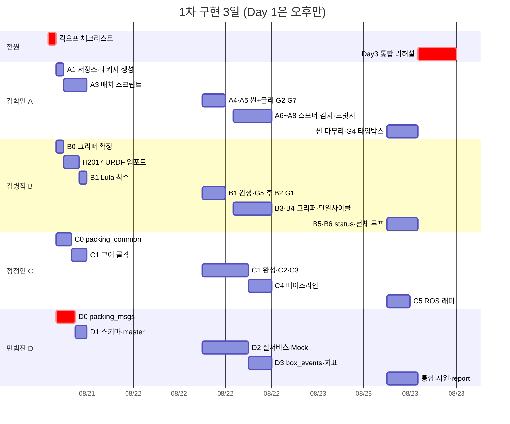
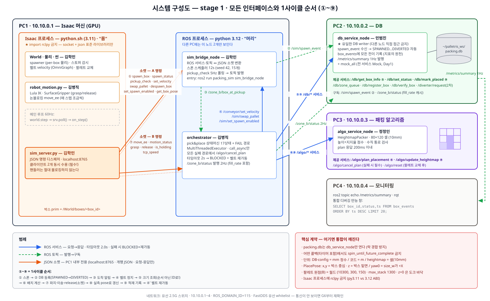
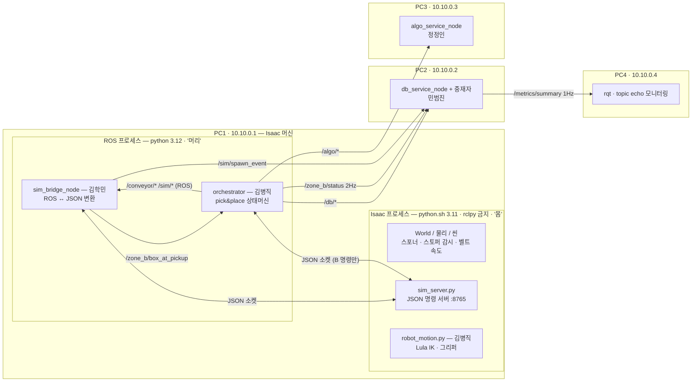
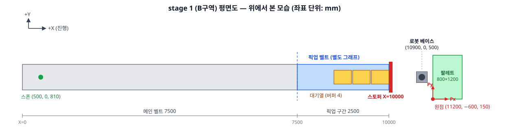
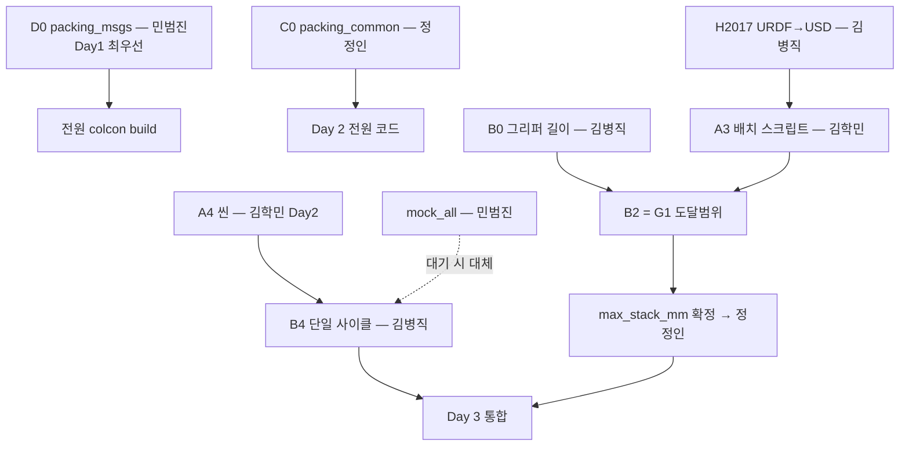
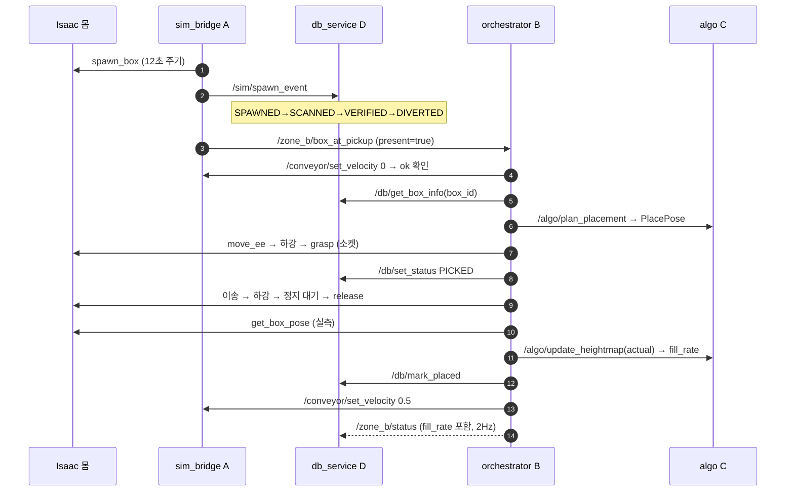

# 공통 가이드 — 전원 필독

> **1차 구현 3일 계획 · Day 1은 오후(13:00~18:00)만 가능**
> 정본 문서: `작업명세서.md` (인터페이스·수치) · `설계결정서.md` (근거)
> **이 가이드는 작업명세서 v3 위에 얹는 실행 문서다. 아래 §0의 변경점 외에는 명세서를 따른다.**

---

## 0. 작업명세서 v3 대비 변경점 (이 가이드가 최신)

| 항목 | 명세서 v3 | **이 가이드 (적용)** | 이유 |
|---|---|---|---|
| Day 1 시간 | 풀데이 | **오후 13:00~18:00만** | 일정 제약 |
| `packing_common` 담당 | 김학민 (A2) | **정정인 (C0)** | 순수 파이썬이라 Isaac 불필요. 김학민 Day 1이 절반이 됐으므로 재배분 |
| G2·G7 (물리/Z-up) | Day 1 | **Day 2 오전** | Day 1 오후에 씬이 아직 없음 |
| G1 (도달범위) 데드라인 | Day 2 09:00 | **Day 2 저녁** | 연쇄 지연. 정정인은 그동안 `max_stack_mm`을 파라미터로만 유지 |
| G4 (분기 제어) | Day 2 오후 고정 | **Day 3 오전 30분 타임박스** | 1차(단일 라인)에는 분기기가 필요 없음. 폴백(despawn→respawn)은 이미 문서화됨 |
| **PC1 내부 구조** | (미정) | **소켓 브릿지 아키텍처 (§3)** | Isaac 내장 Python 3.11 vs ROS2 Jazzy Python 3.12 — rclpy를 Isaac 안에서 import하면 ABI 불일치로 깨질 확률이 높다 |

**ROS2 인터페이스(토픽·서비스·메시지)는 명세서 §2 그대로 변경 없음.** 소켓 브릿지는 PC1 내부 구현일 뿐, 다른 PC에서 보이는 ROS 세계는 동일하다.

> 📷 **다이어그램 안내:** 이 문서들은 mermaid 다이어그램(GitHub이 자동 렌더링)과 `img/` 폴더의 SVG를 쓴다.
> **저장소에 `가이드/` 폴더를 통째로 커밋할 것 (`img/` 포함)** — 그래야 그림이 보인다.
> 로컬 미리보기: VS Code + "Markdown Preview Mermaid Support" 확장.

---

## 1. 3일 일정 — 담당별 세부 목표

### 한눈에 보는 3일



### Day 1 (오후만, 13:00~18:00)

**13:00~14:00 전원 킥오프 (§2 체크리스트로 진행)**

| 시간 | 김학민 (A) | 김병직 (B) | 정정인 (C) | 민범진 (D) |
|---|---|---|---|---|
| 14:00~18:00 | **A1** git 저장소 + 패키지 6개 `ros2 pkg create` + `scripts/` push<br>**A3** 로봇·팔레트 배치 스크립트 (H2017 USD가 늦으면 임시 큐브로)<br>(여유) Conveyor 튜토리얼 1회 재현 | **B0** 그리퍼 선정 + 길이 확정 → **전원 공지**<br>**★ H2017 URDF→USD 임포트** (`~/isaac_assets/h2017.usd` 생성 — 트랙B 가이드 Day 1 참조)<br>**B1** Lula `robot_descriptor.yaml` 착수 | **C0** `packing_common` (units·frames·config 로더) + 단위 테스트 push<br>**C1** heightmap 코어 골격 | **D0** `packing_msgs` 전체 (**msg 5 + srv 15**) push → 4대 빌드 확인 요청<br>**D1** DB 스키마 + `gen_master_db.py` |
| **18:00 체크 (15분)** | 저장소 4명 clone 완료? | **그리퍼 길이 공지됐나?** | common push 완료? | **msgs 4대 빌드 성공?** |

**Day 1 완료 기준 (DoD):** ① `packing_msgs`+`packing_common`이 4대에서 `colcon build` 성공 ② 그리퍼 길이 확정 공지 ③ 배치 스크립트로 Isaac 씬에 로봇+팔레트가 뜸 ④ G6 통과 (아래 §2)

### Day 2 (풀데이)

| 시간 | 김학민 (A) | 김병직 (B) | 정정인 (C) | 민범진 (D) |
|---|---|---|---|---|
| 오전 | **A4** 베이스 씬 (바닥·메인벨트 0~7500·픽업벨트 7500~10000·스토퍼)<br>**A5** 물리 설정 + **G2**(손쌓기 4단 30초) + **G7**(Z-up) | **B1** Lula 완성 → **G5**<br>**B2 = G1** 도달범위 11점 스크립트 실행 | **C1** 완성 — ±3mm 오차 주입 테스트 통과<br>**C2** 배치규칙 + 수직 통로 검사 | **D2** `db_service_node` 실서비스 6종 + ground truth 자동 등록 체인 |
| 오후 | **A6** 스포너 (per-box 물리 속성 포함)<br>**A7** 스토퍼 감지<br>**A8** sim 서버 명령 3종 + `sim_bridge_node` 연결 → `sync_scene.sh` 배포 | **B3** Gripper 래퍼 (grasp/release/is_holding)<br>**B4** 단일 사이클 (**Mock 상대**로 1개 성공) | **C3** 적재율 계산 + matplotlib 시각화<br>**C4 베이스라인** (생략 금지) | **D2** Mock 전체 완비<br>**D3** `box_events` + 지표 쿼리 + `/metrics/summary` |
| **저녁 체크** | G2·G7 결과 | **G1·G5 결과 → `max_stack_mm` 확정 (전원)** | 오차 주입 테스트 통과 | 지표 쿼리가 값 반환 |

**Day 2 DoD:** ① G1·G2·G5·G7 전부 판정 완료, `max_stack_mm` 확정 ② 각 트랙이 **Mock 상대로 자기 파트 완주** ③ 씬이 3대에 rsync 배포됨

### Day 3 (풀데이) — 통합

| 시간 | 전원 |
|---|---|
| 09:00~09:30 | (여유 시) **G4** 분기 `direction` 제어 30분 타임박스 — 김학민. 실패해도 1차에는 영향 없음, 폴백 확정만 |
| 오전 | **C5** algo ROS 래퍼 실연결 · **B5** status 발행 + **B6** 전체 루프/예외 · **A** 씬 마무리 + 실전 파라미터(12s/15개) · **D** 지표 검증 + 통합 지원 |
| 13:00~ | **통합 리허설 — §5의 실행 순서표대로.** 단계별로: ①씬+스포너만 → ②+DB 등록 흐름 → ③+로봇 1사이클 → ④15개 연속 |
| 목표 | **박스 15개 또는 PALLET_FULL까지 연속 처리 + fill_rate 수치 + DB 덤프 확보** |
| 저녁 | `main` 머지 · 결과 기록 · (여유) A12a 3구역 배치 확장 30분 |

**Day 3 DoD = 1차 구현 완료 기준:** ① B구역 라인에서 15개 연속 pick&place ② `/metrics/summary`에 fill_rate 출력 (경로: C의 update 응답 → B의 `/zone_b/status` → D가 구독·캐시) ③ `boxes_sorted` 덤프에 PLACED 행 15개(또는 PALLET_FULL 시점까지) ④ 영상 1개 녹화

---

## 2. Day 1 킥오프 체크리스트 (13:00, 사회: 김학민)

```
□ 1. 전원 ~/.bashrc 설정 (명세서 §1.1 그대로) → 각자 `echo $ROS_DOMAIN_ID` = 115 확인
□ 2. fastdds_whitelist.xml 복사: mkdir -p ~/.ros && cp scripts/fastdds_whitelist.xml ~/.ros/
□ 3. G6 통신 테스트: PC1에서 `ros2 run demo_nodes_py talker`,
     PC2~4에서 `ros2 run demo_nodes_py listener` — 셋 다 수신되면 통과
□ 4. GitHub 저장소 생성 → URL 공유 → 4명 clone (~/palletris_ws/src)
□ 5. box_id 규칙 합의: "BOX00000" ~ "BOX00014" (stage 1, 15개, zone 전부 "B")
□ 6. 그리퍼: 길이 150mm 가정으로 시작. 김병직이 오늘 중 확정해 공지 (바뀌면 §3.4 재계산)
□ 7. 인터페이스 낭독: 작업명세서 §2의 메시지/서비스 이름을 소리내어 확인. 이견은 지금만 접수
□ 8. 소켓 브릿지 아키텍처 공유 (아래 §3 그림) — A와 B가 특히 숙지
□ 9. 오늘 오후 각자 목표 확인 (§1의 Day 1 표)
```

---

## 3. ★ PC1 아키텍처 — 소켓 브릿지 (A·B 필독, 전원 이해)

### 왜 이렇게 하나

**Isaac Sim 5.1 내장 Python은 3.11, Ubuntu 24.04의 ROS2 Jazzy는 3.12다.**
`packing_msgs`를 colcon으로 빌드하면 Python 3.12용 C 확장이 나오는데, 이걸 Isaac의 3.11 인터프리터에서 import하면 **ABI 불일치로 깨진다.** 수업 자료(버전 체크 PDF)도 "스크립트는 반드시 python.sh 사용"이라고 경고하는 그 지점이다. 3일 일정에 이 벽을 Day 2 저녁에 만나면 복구가 불가능하므로, **처음부터 우회한다.**

### 구조 — "몸과 머리"

**시스템 구성도 한 장 (인터페이스 전체 + 1사이클 순서 ①~⑨):**





다른 PC에서는 PC1의 **ROS 노드 2개만** 보인다 — 소켓은 PC1 내부 구현이다.

- **Isaac 쪽 코드에는 `import rclpy`가 한 줄도 없다.** 표준 라이브러리 `socket` + `json`만 쓴다
- ROS 쪽 코드에는 `import omni`가 한 줄도 없다. 평범한 rclpy 노드다
- 소켓은 localhost라 지연 < 1ms — 사이클 10초에 비하면 0이다

### 소켓 프로토콜 (개행 구분 JSON, 요청-응답만, push 없음)

**모든 명령은 요청→응답 1:1. 비동기 이벤트 스트림 없음 — 브릿지가 주기적으로 폴링한다.**

| cmd | 파라미터 | 응답 | 제공 |
|---|---|---|---|
| `ping` | — | `{"ok":true}` | 김학민 |
| `spawn_box` | box_id, type("3호"/"4호"/"5호"), yaw_deg | `{"ok":true}` | 김학민 |
| `spawn_status` | — | `{"spawned":N, "enabled":true}` | 김학민 |
| `set_spawn_enabled` | enabled | `{"ok":true}` | 김학민 |
| `pickup_check` | zone | `{"present":bool, "box_id":str, "pose":{"pos_m":[x,y,z],"yaw_deg":f}}` | 김학민 |
| `set_velocity` | seg, mps | `{"ok":true, "actual":f}` | 김학민 |
| `get_box_pose` | box_id | `{"ok":true, "pos_m":[...], "yaw_deg":f}` | 김학민 |
| `swap_pallet` | zone | `{"ok":true}` | 김학민 |
| `despawn_box` | box_id | `{"ok":true}` | 김학민 |
| `move_ee` | target_m:[x,y,z], yaw_deg | `{"accepted":true}` — **논블로킹** | 김병직 |
| `motion_status` | — | `{"state":"IDLE"/"MOVING"/"REACHED"/"IK_FAIL"}` | 김병직 |
| `grasp` | box_id | `{"ok":bool}` | 김병직 |
| `release` | — | `{"ok":true}` | 김병직 |
| `is_holding` | — | `{"holding":bool}` | 김병직 |
| `tcp_speed` | — | `{"mps":f}` | 김병직 |

**규칙 6개:**
1. Isaac 쪽 핸들러는 **절대 블로킹하지 않는다.** `move_ee`는 목표만 등록하고 즉시 응답 — 실제 이동은 매 스텝 조금씩. 응답을 기다리며 sim 루프를 세우면 물리가 멈춘다
2. 알 수 없는 cmd에는 `{"ok":false,"error":"unknown_cmd"}` — 크래시 금지
3. **서버는 클라이언트 2개(브릿지 + 오케스트레이터)를 동시에 받는다** — 단일 연결로 짜면 Day 3에 오케스트레이터가 조용히 멈춘다
4. **오케스트레이터는 A 소유 명령을 소켓으로 직접 부르지 않는다.** 벨트·팔레트·스폰 제어는 ROS 서비스(`/conveyor/*`, `/sim/*`)를 경유한다 (Mock 테스트 가능성 유지). 소켓 직접 호출은 **B 소유 명령**(move_ee, motion_status, grasp, release, is_holding, tcp_speed)과 `get_box_pose`만
5. **박스 prim 경로 규칙: `/World/boxes/<box_id>`** — grasp 핸들러가 box_id를 이 규칙으로 변환한다
6. 프로토콜 변경은 김학민·김병직 합의 후 이 표를 먼저 수정

### 파일 소유권

| 파일 | 소유 | 내용 |
|---|---|---|
| `packing_sim/isaac/sim_main.py` | 김학민 | SimulationApp 기동, 씬 로드, 메인 루프, 모듈 등록 |
| `packing_sim/isaac/sim_server.py` | 김학민 | 소켓 서버 + cmd 디스패처 (dict 기반) |
| `packing_sim/isaac/spawner.py` 등 | 김학민 | A 명령 핸들러 |
| `packing_sim/isaac/robot_motion.py` | **김병직** | B 명령 핸들러 (Lula·그리퍼) — sim_main이 import해 등록 |
| `packing_sim/packing_sim/sim_bridge_node.py` | 김학민 | ROS ↔ 소켓 변환 |
| `packing_robot/packing_robot/orchestrator.py` | 김병직 | 상태머신 |

→ **같은 프로세스에서 돌지만 파일이 갈려 있어 git 충돌이 없다.**

---

## 4. 서로 맞춰야 하는 것 전부 (인터페이스 요약표)

> 상세 스키마는 작업명세서 §2가 정본. 여기는 "누가 누구에게"만 압축.

**전체 레이아웃 한 장 — 모든 좌표의 출처:**



### 4.1 ROS 서비스 — 누가 제공하고 누가 부르나

| 서비스 | 제공 | 호출 | 언제 |
|---|---|---|---|
| `/db/register_box` | 민범진 | 민범진 자신 (stage 1: spawn_event 수신 시 자동) | 스폰 직후 |
| `/db/get_box_info` | 민범진 | **김병직** | 집기 직전 (★ 순서 아닌 ID로) |
| `/db/set_status` | 민범진 | **김병직** (PICKED/PICK_FAILED) | grasp 직후 |
| `/db/mark_placed` | 민범진 | 김병직 | 적재 완료 |
| `/db/zone_queue` | 민범진 | 김병직 (status 발행용) | 2Hz |
| `/algo/plan_placement` | **정정인** | 김병직 | 배치 계산 |
| `/algo/update_heightmap` | 정정인 | 김병직 | **실측 pose로** 갱신 |
| `/algo/cancel_plan` | 정정인 | 김병직 | **모든 실패/이탈 경로에서** |
| `/algo/reset` | 정정인 | 김병직 | 팔레트 교체 후 |
| `/conveyor/set_velocity` | **김학민** (브릿지) | 김병직 | 픽업 전 정지/후 재가동 — **★ ROS 서비스로 호출 (소켓 직접 호출 금지, §3 규칙 4)** |
| `/sim/swap_pallet` `/sim/set_spawn_enabled` | 김학민 | 김병직 | PALLET_FULL 처리 |

### 4.2 토픽

| 토픽 | 발행 | 구독 |
|---|---|---|
| `/zone_b/box_at_pickup` | 김학민 (브릿지, 5Hz 폴링 결과) | 김병직 |
| `/zone_b/status` | 김병직 | 민범진 (Day 5 중재자) |
| `/sim/spawn_event` | 김학민 (브릿지) | 민범진 |
| `/metrics/summary` | 민범진 | 전원 (모니터링) |

### 4.3 숫자 계약 — 어기면 통합이 터지는 값

| 계약 | 값 | 어긋나면 |
|---|---|---|
| 단위: DB·config=mm 정수, 코드=m, heightmap=셀 | `packing_common/units.py`만 사용 | 셀 인덱스 1칸 어긋남 |
| `PlacePose.z_mm` = **박스 밑면** (x,y는 중심) | `frames.py`의 `h_mm//2` 변환만 사용 | 박스가 파묻히거나 공중부양 |
| 팔레트 원점 (B) | 월드 **(10300, 300, 150)** ← 2026-08-22 셀 90° 회전 | B·C가 다른 원점 → 팔레트 밖 배치 |
| yaw=0 의미 | `size_w`가 월드 +X | 90도 돌아간 배치 |
| `max_stack_mm` | **850 (G1 결과로 확정)** | heightmap이 트럭보다 높게 쌓음 |
| box_id | `BOX00000`~`BOX00014` | register 전부 실패 |
| 콜백 규약 | `spin_until_future_complete` 금지 (타이머 포함) | **조용한 데드락** |
| 상태 전이 | 명세서 §2.4 표. stage 1은 D가 등록 시 `DIVERTED`까지 | `zone_queue`가 항상 0 |

### 4.4 트랙 간 대기 관계 (누가 누구를 기다리나)



**대기가 생기면 Mock으로 진행한다 (명세서 §2.7).** "기다리는 중"은 금지 단어.

---

## 5. Day 3 통합 실행 순서 (터미널별)

| # | PC | 터미널 | 명령 |
|---|---|---|---|
| 1 | PC2 | 1 | `ros2 run packing_db db_service_node` |
| 2 | PC3 | 1 | `ros2 run packing_algo algo_service_node` |
| 3 | PC1 | 1 | `~/isaacsim/python.sh ~/palletris_ws/src/packing_sim/isaac/sim_main.py` (씬 로드까지 대기) |
| 4 | PC1 | 2 | `ros2 run packing_sim sim_bridge_node` (`ping` ok 로그 확인) |
| 5 | PC1 | 3 | `ros2 run packing_robot orchestrator` |
| 6 | PC4 | 1 | `ros2 topic echo /metrics/summary` |
| 7 | PC4 | 2 | `ros2 topic echo /zone_b/box_at_pickup` (디버깅) |

**스모크 테스트 순서 (한 번에 다 켜지 말 것):**
1. 1·2번만: `ros2 service list`에 `/db/*` 6개 + `/algo/*` 4개 = **10개** 보이는가
2. 3·4번 추가: `ros2 service call /conveyor/set_velocity ...` → 벨트가 실제로 멈추는가
3. 스포너 1개 스폰 → `/sim/spawn_event` echo → DB에 SPAWNED→DIVERTED 행 생겼는가
4. 5번 추가 → 1사이클 → `fill_rate` 로그
5. 15개 연속

### 1사이클 시퀀스 (정상 경로) — 누가 누구를 언제 부르나



---

## 6. AI 프롬프트 사용법 (전원)

각 트랙 가이드의 단계마다 `🤖 프롬프트` 블록이 있다. 사용 규칙:

1. **아래 [공통 머리말]을 항상 먼저 붙이고**, 그 뒤에 해당 단계의 프롬프트를 붙인다
2. 관련된 작업명세서 섹션(§ 번호가 명시돼 있음)을 함께 붙이면 정확도가 크게 오른다
3. 생성된 코드는 **그대로 믿지 말고** 가이드의 "확인 방법"으로 검증한다
4. 에러가 나면: 에러 전문 + 실행 명령 + 해당 코드 전체를 붙여 다시 질문한다

**[공통 머리말] — 복사해서 쓸 것:**

```
프로젝트 컨텍스트:
- Isaac Sim 5.1.0 (내장 Python 3.11) + ROS2 Jazzy (Ubuntu 24.04, Python 3.12) + 두산 H2017
- Isaac 프로세스에는 rclpy를 절대 import하지 않는다. ROS는 별도 프로세스(sim_bridge)가 담당하고
  둘은 localhost:8765 개행구분 JSON 소켓(요청-응답만)으로 통신한다.
- 단위: 설정/DB는 mm 정수, Isaac/ROS 코드는 m(float). 변환은 units.py 함수만 사용.
- 좌표: Z-up. 컨베이어 진행 = +X. 벨트 상면 z=0.8m. 스토퍼 x=10.0m.
  로봇 베이스 (10.9, 0, 0.5), 팔레트 원점(모서리) (11.2, -0.6, 0.15), 팔레트 800×1200mm, 최대 적재 850mm.
- 박스 3종(mm): 340×250×210/2kg, 410×310×280/4kg, 480×380×340/6kg. yaw=0이면 w가 +X 방향.
- rclpy 노드에서는 어떤 콜백(타이머 포함) 안에서도 spin_until_future_complete를 쓰지 않는다.
  ReentrantCallbackGroup + MultiThreadedExecutor 또는 call_async+done 폴링만 쓴다.
- 코드는 실행 가능한 완성본으로, 한국어 주석을 달아 작성한다.
```

---

## 7. 막혔을 때 (전원)

| 증상 | 원인 후보 | 먼저 볼 곳 |
|---|---|---|
| 토픽이 안 보이는데 에러도 없다 | DOMAIN_ID 불일치 / whitelist 파일 없음 | §2 체크 1·2, 명세서 함정 #2·3 |
| 서비스 응답이 영원히 안 온다 | 콜백 안 동기 호출 | 명세서 §1.5, 함정 #1 |
| 박스가 벨트를 뚫고 떨어진다 | 스폰 z에 h/2 안 더함 | 명세서 함정 #7 |
| 쌓은 박스가 가만히 있는데 무너진다 | solver iteration을 씬에 설정함 | 명세서 §5.4, 함정 #5 |
| `database is locked` | db_service 외 프로세스가 .db를 열었다 | 명세서 §8.5 |
| Isaac에서 import rclpy 에러 | 그렇게 하지 않기로 했다 | 이 문서 §3 |
| 2층부터 NO_FEASIBLE_POSE만 나온다 | support_tol < 양자화 간격 | 명세서 §7.4, 함정 #10 |

**30분 룰: 같은 문제로 30분 막히면 팀 채팅에 (증상 + 시도한 것 + 에러 전문)을 올린다. 혼자 3시간 쓰는 게 최악이다.**
