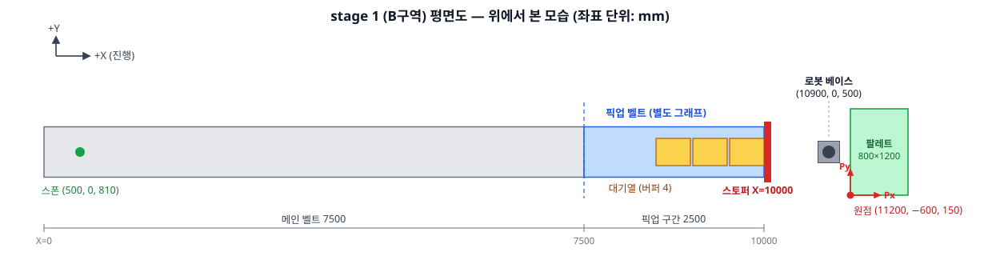
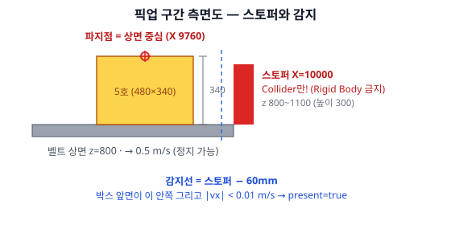
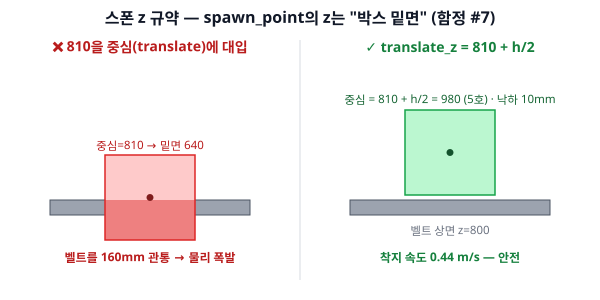

# 트랙 A 작업 가이드 — 김학민 (씬 / 스포너 / 컨베이어)

> 먼저 읽을 것: `공통가이드_전원필독.md` (특히 §3 소켓 브릿지) · `작업명세서.md` §3~§5
> **당신의 미션:** Isaac Sim 안에 "몸"을 만든다 — 컨베이어가 돌고, 박스가 태어나고, 스토퍼에 멈추고, 그 사실을 소켓으로 알려주는 세계.
> **당신을 기다리는 사람:** 김병직(배치 스크립트 A3, 씬 A4), 전원(git 저장소 A1)
> **당신이 기다리는 것:** 민범진의 `packing_msgs` (Day 2 브릿지 노드부터 필요)

---

## 0. 3일 목표 한눈에

| Day | 목표 | 완료 기준 |
|---|---|---|
| **1 (오후)** | A1 저장소 · A3 배치 스크립트 | 로봇+팔레트가 Isaac 씬에 뜬 스크린샷 |
| **2** | A4 씬 · A5 물리+G2+G7 · A6 스포너 · A7 스토퍼 감지 · A8 소켓 서버+브릿지 | `pickup_check`가 실제 박스를 보고하고, 벨트를 서비스로 멈출 수 있다 |
| **3** | 실전 파라미터 · 통합 · (30분) G4 | 15개 연속 데모에서 씬 쪽 이슈 0건 |

---

## Day 1 (14:00~18:00)

### A1. git 저장소 + 뼈대 (14:00~15:00)

```bash
# GitHub에서 빈 저장소 생성 후
mkdir -p ~/palletris_ws/src && cd ~/palletris_ws/src
git clone <URL> .

# ★ 빈 디렉터리가 아니라 진짜 ROS 패키지로 만들어야 colcon이 인식하고 ros2 run이 된다
ros2 pkg create --build-type ament_python packing_common
ros2 pkg create --build-type ament_python packing_sim
ros2 pkg create --build-type ament_python packing_robot
ros2 pkg create --build-type ament_python packing_algo
ros2 pkg create --build-type ament_python packing_db
mkdir -p packing_sim/isaac packing_bringup/config scripts
# (packing_msgs는 민범진이 ament_cmake로 직접 만든다 — 여기서 만들지 말 것)

# .gitignore, fastdds_whitelist.xml, sync_scene.sh 를 작업명세서 §1 내용대로 생성
git add -A && git commit -m "repo skeleton" && git push
```

**각자 자기 패키지의 `setup.py`에 실행 노드를 등록해야 `ros2 run`이 된다** (각 트랙 가이드에 자기 것이 적혀 있음). 당신 것:

```python
# packing_sim/setup.py 의 entry_points
entry_points={"console_scripts": [
    "sim_bridge_node = packing_sim.sim_bridge_node:main",
]},
```

`packing_bringup/config/system.yaml`은 **작업명세서 §4를 그대로 복사**해서 만든다. 이 파일이 전원의 숫자 출처다.

**확인:** 팀 채팅에 URL 공유 → 3명이 clone 성공이라고 답할 것.

### A3. 로봇·팔레트 배치 스크립트 (15:00~18:00)

**개념부터.** Isaac Sim의 씬은 USD라는 트리 구조다. "배치 스크립트"란 GUI로 드래그하는 대신 **파이썬으로 트리에 물체를 꽂는 것**이다. 이렇게 하면 위치가 코드(=git)에 남아서, 좌표 수정이 팀원과의 파일 주고받기가 아니라 커밋 한 줄이 된다.

`packing_sim/isaac/place_assets.py`:

```python
"""로봇 + 페데스탈 + 팔레트를 씬에 배치한다. sim_main.py가 import해서 호출."""
import yaml, os
from isaacsim.core.utils.stage import add_reference_to_stage
from isaacsim.core.api.objects import FixedCuboid   # 안 움직이는 상자(콜라이더 포함)

CFG = yaml.safe_load(open(os.path.expanduser(
    "~/palletris_ws/src/packing_bringup/config/system.yaml")))

H2017_USD = os.path.expanduser("~/isaac_assets/h2017.usd")
# ★ 이 파일은 김병직이 Day 1 오후에 URDF 임포트로 만든다 (트랙B 가이드 Day 1).
#   아직 없으면 아래 place_zone에서 로봇 대신 임시 큐브를 세워도 오늘 목표(팔레트+페데스탈 확인)는 달성된다:
#   if not os.path.exists(H2017_USD): FixedCuboid(prim_path=..., scale=[0.3,0.3,1.2], ...)

def mm(v): return v / 1000.0

def place_zone(world, zone: str):
    base = CFG["zones"]["robot_base_world_mm"][zone]      # [10900, 0, 700]
    porg = CFG["zones"]["pallet_origin_world_mm"][zone]   # [10300, 300, 150]
    # ★ 2026-08-22: 페데스탈 700, 셀 90도 회전(팔레트가 로봇 +Y 쪽)

    # 1) 페데스탈: 바닥(0)부터 base_z까지 기둥. 중심 z = base_z/2
    world.scene.add(FixedCuboid(
        prim_path=f"/World/pedestal_{zone}", name=f"pedestal_{zone}",
        position=[mm(base[0]), mm(base[1]), mm(base[2]) / 2],
        scale=[0.30, 0.30, mm(base[2])], color=None))

    # 2) 팔레트: 두께 150mm, 상면이 porg[2]. 중심 z = porg_z − 150/2
    #    porg는 '모서리'이므로 중심으로 환산: +width/2, +depth/2
    world.scene.add(FixedCuboid(
        prim_path=f"/World/pallet_{zone}", name=f"pallet_{zone}",
        position=[mm(porg[0] + CFG["pallet"]["width_mm"] // 2),
                  mm(porg[1] + CFG["pallet"]["depth_mm"] // 2),
                  mm(porg[2] - CFG["pallet"]["thickness_mm"] // 2)],
        scale=[mm(CFG["pallet"]["width_mm"]),
               mm(CFG["pallet"]["depth_mm"]),
               mm(CFG["pallet"]["thickness_mm"])]))

    # 3) 로봇: USD를 참조로 꽂고 베이스 위치 지정
    prim_path = f"/World/h2017_{zone}"
    add_reference_to_stage(usd_path=H2017_USD, prim_path=prim_path)
    from isaacsim.core.prims import SingleXFormPrim
    SingleXFormPrim(prim_path).set_world_pose(
        position=[mm(base[0]), mm(base[1]), mm(base[2])])
    return prim_path
```

임시 실행 파일 `packing_sim/isaac/day1_check.py` (오늘의 확인용):

```python
from isaacsim import SimulationApp
app = SimulationApp({"headless": False})
from isaacsim.core.api import World
import place_assets
world = World(stage_units_in_meters=1.0)
world.scene.add_default_ground_plane()
place_assets.place_zone(world, "B")
world.reset()
while app.is_running():
    world.step(render=True)
```

```bash
cd ~/palletris_ws/src/packing_sim/isaac && ~/isaacsim/python.sh day1_check.py
```

**확인:** 뷰포트에 페데스탈 위 로봇 + 옆에 팔레트. 스크린샷을 팀 채팅에. **김병직의 Day 2 G1이 이 스크립트를 그대로 쓴다.**

> ⚠️ Isaac 관련 import는 **반드시 `SimulationApp(...)` 생성 이후**에 해야 한다. 그 전에 하면 모듈이 없다고 나온다. 이건 Isaac의 규칙이다.

🤖 **프롬프트 (import 에러나 API 이름이 다를 때):**
```
[공통 머리말 붙이기]
Isaac Sim 5.1 standalone 스크립트에서 아래 에러가 났다. 5.1 기준의 올바른 import 경로와
수정된 전체 코드를 줘. (isaacsim.core.api 네임스페이스 기준, omni.isaac.core 구식 경로 금지)
에러: <전문 붙이기>
코드: <전체 붙이기>
```

---

## Day 2

### A4. 베이스 씬 — GUI 작업 (09:00~11:00)

**만들 것이 이 한 장이다 (좌표는 전부 여기서):**



수업 PDF 「공정 환경 구축: Conveyor Split 작동」 절차를 따르되, **우리 치수로**:

1. `Window > Extensions` → `isaacsim.asset.gen.conveyor.ui` 검색 → ENABLED
2. `Create > Physics > Ground Plane`
3. `Tools > Conveyor Track Builder`로 **직선 벨트 2개를 따로** 만든다:
   - **메인 벨트**: X 0 → 7.5m (직선 조각을 이어붙여 7.5m). 완성 후 Stage에서 그래프 이름을 `ConveyorBeltGraph_main`으로 rename
   - **픽업 벨트**: 새 트랙 시작으로 X 7.5 → 10.0m (2.5m). 그래프 이름 `ConveyorBeltGraph_b_pickup`
   - ★ **왜 두 개?** 픽업 구간만 따로 멈춰야 하니까. 트랙을 새로 시작해야 그래프(=속도 변수)가 분리된다
4. **스토퍼**: `Create > Shape > Cube` → Property에서 Translate **(10.05, 0, 0.95)**, Scale **(0.05, 0.35, 0.15)** (= 100×700×300mm 벽, 벨트 상면 0.8 위) → 우클릭 `Add > Physics > Colliders Preset` (**Rigid Body는 절대 추가하지 않는다** — 움직이지 않는 벽이어야 한다)

   
5. 두 벨트의 그래프 Variables에서 `Velocity` 초기값 = **0.5**
6. `File > Save As` → `~/isaac_scenes/warehouse_stage1.usd`

**확인:** Play 누르고 Cube 하나 벨트 위에 떨어뜨려(수업 PDF 6절 방식) 벨트를 타고 흘러가 스토퍼에 걸리는지.

### A5. 물리 설정 + G2 + G7 (11:00~12:00)

**⚠️ 명세서 §5.4가 이 프로젝트에서 제일 많이 틀리는 부분이다: solver iteration은 Physics Scene 속성이 아니다.** 씬에는 아래 3개만:

- Stage에서 `physicsScene` prim 선택 → Property: **Enable Stabilization ✓, Enable CCD ✗**, Time Steps Per Second 60
- `Create > Physics > Physics Material` → static 0.6 / dynamic 0.5 → 벨트 메쉬·팔레트·스토퍼에 바인딩 (박스는 스포너 코드가 처리)

**G7 (30초):** `Window > Script Editor`에 붙여넣고 실행:
```python
import omni.usd
from pxr import UsdGeom
print("upAxis =", UsdGeom.GetStageUpAxis(omni.usd.get_context().get_stage()))  # "Z" 여야 함
```

**G2 (정지 안정성):** `scripts/g2_stack_test.py`로 저장하고 `python.sh`로 실행:

```python
"""3호 박스 4단을 팔레트 위에 쌓고 30초 방치 → 이동량 출력"""
from isaacsim import SimulationApp
app = SimulationApp({"headless": False})
import numpy as np
from isaacsim.core.api import World
from isaacsim.core.api.objects import DynamicCuboid
from pxr import PhysxSchema
import omni.usd

world = World(stage_units_in_meters=1.0)
world.scene.add_default_ground_plane()
boxes = []
for i in range(4):                       # 3호 210mm 높이 × 4단 = 840mm
    b = world.scene.add(DynamicCuboid(
        prim_path=f"/World/box{i}", name=f"box{i}",
        position=[0, 0, 0.105 + i * 0.210],
        scale=[0.340, 0.250, 0.210], mass=2.0))
    prim = omni.usd.get_context().get_stage().GetPrimAtPath(f"/World/box{i}")
    rb = PhysxSchema.PhysxRigidBodyAPI.Apply(prim)         # ★ 박스마다!
    rb.CreateSolverPositionIterationCountAttr(24)
    rb.CreateSolverVelocityIterationCountAttr(4)
    boxes.append(b)
world.reset()
import math
def yaw_deg(q):                                            # (w,x,y,z) → yaw(도)
    w, x, y, z = q
    return math.degrees(math.atan2(2*(w*z + x*y), 1 - 2*(y*y + z*z)))

for _ in range(60): world.step(render=True)               # 착지 안정화 1초
p0 = np.array([b.get_world_pose()[0] for b in boxes])
y0 = np.array([yaw_deg(b.get_world_pose()[1]) for b in boxes])
for _ in range(60 * 30): world.step(render=True)          # 30초 방치
p1 = np.array([b.get_world_pose()[0] for b in boxes])
y1 = np.array([yaw_deg(b.get_world_pose()[1]) for b in boxes])
d  = np.linalg.norm(p1 - p0, axis=1) * 1000
dy = np.abs(y1 - y0)
print("이동량(mm):", d, " yaw변화(도):", dy)
print("→", "합격" if d.max() < 3 and dy.max() < 2 else "불합격")
app.close()
```

**합격선: 전 박스 이동 < 3mm 그리고 yaw 변화 < 2°** (명세서 §11 G2 — 두 조건 다 확인해야 판정 완료다). 불합격이면 iteration을 32로 올리고, 그래도 안 되면 팀에 공유(적재 단수 제한 논의).

### A6~A8. 스포너 + 스토퍼 감지 + 소켓 서버 (오후)

**구조 요약:** `sim_main.py`가 전체를 묶는다. 매 프레임: 물리 1스텝 → 소켓 명령 처리 → 각 모듈의 on_step.

`packing_sim/isaac/sim_server.py` (소켓 서버 — 그대로 사용 가능):

```python
"""localhost JSON 명령 서버. 논블로킹 — 매 프레임 poll()만 호출하면 된다.
★ 클라이언트 2개(브릿지 + 오케스트레이터)를 동시에 받는다 — 공통가이드 §3 규칙 3."""
import socket, json

class SimServer:
    def __init__(self, port=8765):
        self.srv = socket.socket(); self.srv.setsockopt(socket.SOL_SOCKET, socket.SO_REUSEADDR, 1)
        self.srv.bind(("127.0.0.1", port)); self.srv.listen(4); self.srv.setblocking(False)
        self.conns = []                       # [ [sock, buf], ... ] — 연결별 버퍼
        self.handlers = {}                    # cmd이름 -> 함수(dict)->dict

    def register(self, cmd, fn): self.handlers[cmd] = fn

    def poll(self):
        while True:                           # 새 연결 전부 수락
            try:
                c, _ = self.srv.accept(); c.setblocking(False)
                self.conns.append([c, b""])
            except BlockingIOError:
                break
        for entry in self.conns[:]:           # 연결별로 처리
            sock, _ = entry
            try: data = sock.recv(65536)
            except BlockingIOError: continue
            if not data:
                self.conns.remove(entry); continue
            entry[1] += data
            while b"\n" in entry[1]:
                line, entry[1] = entry[1].split(b"\n", 1)
                try:
                    req = json.loads(line)
                    fn = self.handlers.get(req.get("cmd"))
                    resp = fn(req) if fn else {"ok": False, "error": "unknown_cmd"}
                except Exception as e:
                    resp = {"ok": False, "error": str(e)}
                sock.sendall((json.dumps(resp) + "\n").encode())
```

`packing_sim/isaac/spawner.py` — 핵심 로직 (완성은 프롬프트로):

```python
class Spawner:
    """spawn_box 명령을 받아 박스를 만든다. ★ per-box 물리 속성이 생명이다."""
    def __init__(self, world, cfg):
        self.world, self.cfg = world, cfg; self.count = 0; self.enabled = True

    def spawn(self, req):          # {"cmd":"spawn_box","box_id":...,"type":"3호","yaw_deg":0}
        t = next(x for x in self.cfg["boxes"]["types"] if x["name"] == req["type"])
        sp = self.cfg["conveyor"]["spawn_point_mm"]
        pos = [sp[0]/1000, sp[1]/1000, sp[2]/1000 + t["h_mm"]/2000]   # ★ 밑면→중심 h/2 (아래 그림!)
        box = self.world.scene.add(DynamicCuboid(
            prim_path=f"/World/boxes/{req['box_id']}", name=req["box_id"],
            position=pos, scale=[t["w_mm"]/1000, t["d_mm"]/1000, t["h_mm"]/1000],
            mass=t["mass_g"]/1000))
        # per-box 물리 (G2 스크립트와 동일 패턴) + box_id 어트리뷰트 + 물리 머티리얼 바인딩
        ...
        self.count += 1
        return {"ok": True}
```

**스폰 z를 그림으로 (함정 #7 — 제일 많이 틀리는 곳):**



`pickup_check` 핸들러 (스토퍼 감지 — 폴링 방식이라 단순하다):

```python
def pickup_check(self, req):
    """스토퍼 근처(x > stopper − w/2 − 60mm)이고 거의 정지(|v|<1cm/s)한 박스를 보고"""
    for box in self.world.scene.get_all_boxes():          # 스포너가 목록 유지
        pos, quat = box.get_world_pose(); vel = box.get_linear_velocity()
        w = box_w_m(box)
        if pos[0] > self.stopper_x_m - w/2 - 0.06 and abs(vel[0]) < 0.01:
            return {"present": True, "box_id": box.name,
                    "pose": {"pos_m": [float(p) for p in pos],
                             "yaw_deg": yaw_from_quat(quat)}}
    return {"present": False, "box_id": "", "pose": None}
```

`sim_main.py` 메인 루프:

```python
from isaacsim import SimulationApp
app = SimulationApp({"headless": False})
# ... world 생성, warehouse_stage1.usd 오픈, place_assets.place_zone(world,"B") ...
import sim_server, spawner, conveyor_ctl
import robot_motion                     # ★ 김병직 파일 — 없으면 try/except로 스킵
srv = sim_server.SimServer()
sp = spawner.Spawner(world, CFG); srv.register("spawn_box", sp.spawn)
srv.register("pickup_check", sp.pickup_check)
# set_velocity / swap_pallet / despawn_box / set_spawn_enabled / get_box_pose / ping 등록...
robot_motion.setup(world, srv, CFG)     # B의 명령들이 여기서 등록됨
world.reset()
while app.is_running():
    world.step(render=True)
    srv.poll()
    robot_motion.on_step()
```

**벨트 속도 제어** (`set_velocity`): 그래프 변수를 코드로 바꾼다.

```python
import omni.graph.core as og
GRAPHS = {"main": "/World/ConveyorTrack/ConveyorBeltGraph_main",
          "b_pickup": "/World/ConveyorTrack01/ConveyorBeltGraph_b_pickup"}  # 실제 경로 확인!

def set_velocity(req):
    path = GRAPHS[req["seg"]]
    og.Controller.set(og.Controller.attribute(path + ".graph:variable:Velocity"),
                      float(req["mps"]))
    return {"ok": True, "actual": float(req["mps"])}
```

> ⚠️ 그래프 경로와 변수 이름은 씬마다 다를 수 있다. Stage 창에서 그래프 prim을 클릭해 **Prim Path를 복사**하고, 안 먹히면 아래 프롬프트로 introspection 코드를 받아 실제 attribute 이름을 확인한다.

🤖 **프롬프트 (A6~A8 완성):**
```
[공통 머리말 붙이기] + 작업명세서 §4(config), §5.4(물리), 공통가이드 §3(소켓 프로토콜) 붙이기

Isaac Sim 5.1 standalone 파이썬으로 다음 3개 파일을 완성해줘. 골격은 아래에 준다.
1) spawner.py — spawn_box/spawn_status/set_spawn_enabled/despawn_box/get_box_pose 핸들러.
   ★ 반드시: 스폰 z는 밑면+h/2, 박스마다 PhysxRigidBodyAPI로 position iteration 24/velocity 4,
   restOffset 0 / contactOffset 0.002(m), 물리 머티리얼 바인딩, box_id를 커스텀 어트리뷰트로 저장.
2) pickup_check — 스토퍼 x=10.0 기준, 박스 앞면이 60mm 이내 & |vx|<0.01m/s면 present.
   쿼터니언→yaw(도) 변환 포함.
3) conveyor_ctl.py — OmniGraph 변수로 벨트 속도 설정. 그래프 attribute 이름을 못 찾을 때
   prim의 모든 attribute를 나열하는 debug 함수도 포함.
골격: <위 코드 붙이기>
```

**A8 후반: `sim_bridge_node.py`** (ROS 쪽, 시스템 파이썬) — 소켓 클라이언트 + ROS 서비스/토픽 변환:

```python
class SimLink:
    """개행 JSON 소켓 클라이언트. 로컬이라 요청-응답이 1ms 미만 → 콜백 안에서 불러도 안전.
    ★ Lock: MultiThreadedExecutor에서 타이머와 서비스 콜백이 동시에 부르면 응답이 뒤섞인다.
    ★ timeout: Isaac 프로세스가 죽으면 에러 없이 영원히 기다리게 되는 것을 방지."""
    def __init__(self, port=8765):
        import threading
        self.sock = socket.create_connection(("127.0.0.1", port))
        self.sock.settimeout(2.0)
        self.f = self.sock.makefile("rw")
        self.lock = threading.Lock()
    def call(self, **req):
        with self.lock:
            self.f.write(json.dumps(req) + "\n"); self.f.flush()
            return json.loads(self.f.readline())     # timeout 시 socket.timeout 예외 발생
```

브릿지 노드가 하는 일 (전부 단순 변환):
- `/conveyor/set_velocity` 서비스 수신 → `link.call(cmd="set_velocity", ...)` → 응답 반환
- `/sim/swap_pallet`, `/sim/set_spawn_enabled`, `/sim/despawn_box` 동일 패턴
- 5Hz 타이머: `pickup_check` → 결과가 바뀌면 `/zone_b/box_at_pickup` 발행
- **스폰 스케줄러**: 12초 타이머로 `spawn_box` 호출(BOX00000~14, seed 42로 크기 결정) + `/sim/spawn_event` 발행

🤖 **프롬프트 (브릿지):**
```
[공통 머리말] + 작업명세서 §2(인터페이스), 공통가이드 §3(프로토콜) 붙이기
rclpy 노드 sim_bridge_node.py를 작성해줘. 위 SimLink 클래스를 쓰고,
서비스 4종(/conveyor/set_velocity, /sim/swap_pallet, /sim/set_spawn_enabled, /sim/despawn_box)과
5Hz pickup_check 폴링→/zone_b/box_at_pickup 발행, 12초 간격 스폰 스케줄러(random.seed(42),
size_distribution [0.334,0.333,0.333], BOX00000~BOX00014)→/sim/spawn_event 발행을 구현.
ReentrantCallbackGroup + MultiThreadedExecutor. packing_msgs 타입은 <D0 결과 붙이기>.
```

**Day 2 확인:** 터미널 2개로 — ① `python.sh sim_main.py` ② `ros2 run packing_sim sim_bridge_node` → `ros2 topic echo /zone_b/box_at_pickup` 하고 수동으로 `ros2 service call /conveyor/set_velocity` 벨트 정지가 보이면 완료. `sync_scene.sh` 실행 + 채팅 공지.

---

## Day 3

- **09:00~09:30 (여유 시) G4**: 씬에 Sorter 에셋 임시 로드 → Script Editor에서 `direction` 값 변경 → 박스가 꺾이는지 15분 실험. 실패해도 기록만 하고 접는다 (1차 무관, 폴백 확정)
- 오전: 스포너 실전 파라미터 확인(12s/15개/seed 42), 잔버그
- 오후: **통합 리허설 — 공통가이드 §5 순서대로.** 씬 쪽에서 주로 터지는 것: 박스 관통(→h/2), 벨트 안 멈춤(→그래프 경로), pickup_check 오탐(→마진 60mm 조정)
- 저녁 (여유): A12a — `place_zone(world,"A")`, `place_zone(world,"C")` 호출 추가 (Day 4 준비, 30분)

---

## 자주 막히는 것

| 증상 | 처방 |
|---|---|
| import 에러 (`isaacsim.core...` 없음) | SimulationApp 생성 **이후**에 import했는지 확인 |
| 박스가 벨트를 뚫음 | 스폰 z에 `h/2` 누락 (함정 #7) |
| 스택이 저절로 무너짐 | iteration을 **박스마다** 넣었는지 (함정 #5) — G2 스크립트 패턴 |
| 벨트 속도 변경이 안 먹힘 | 그래프 경로/변수명 확인 — introspection 프롬프트 사용 |
| 소켓 `Address already in use` | 이전 sim_main이 살아있음 — `pkill -f sim_main` |
| GUI가 5분째 안 뜸 | 첫 실행은 셰이더 컴파일로 오래 걸림 — 기다린다 |
