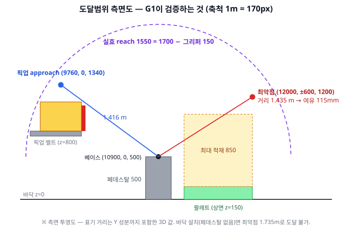
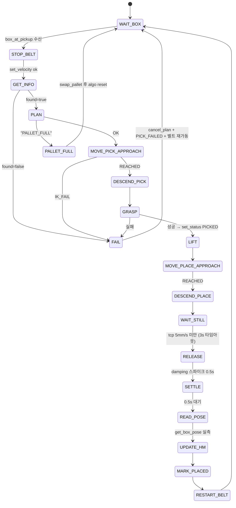
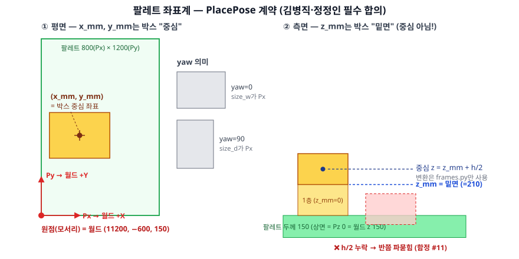

# 트랙 B 작업 가이드 — 김병직 (로봇 제어 / 그리퍼 / 오케스트레이터)

> 먼저 읽을 것: `공통가이드_전원필독.md` §3 (당신 코드는 **두 프로세스에 걸쳐 있다**) · `작업명세서.md` §3.4, §6
> **당신의 미션:** 로봇의 "손"(Isaac 안 모션 서버)과 "머리"(ROS 오케스트레이터)를 만든다. 손은 움직임만 알고, 머리는 순서만 안다.
> **당신을 기다리는 사람:** 정정인 (G1 결과 → `max_stack_mm` 확정), 전원 (Day 3 통합의 주인공이 당신 루프다)
> **당신이 기다리는 것:** 김학민의 A3 배치 스크립트 (G1용) — 늦으면 Mock으로 로직 먼저

---

## 0. 3일 목표 한눈에

| Day | 목표 | 완료 기준 |
|---|---|---|
| **1 (오후)** | B0 그리퍼 확정·공지 · H2017 재확인 · B1 Lula 착수 | 그리퍼 길이 숫자가 팀 채팅에 있다 |
| **2** | B1 완성+G5 · **B2=G1 도달범위** · B3 그리퍼 래퍼 · B4 단일 사이클(Mock) | G1 11점 결과 공유, Mock 상대 1사이클 성공 |
| **3** | B5 status · B6 전체 루프+예외 · 통합 | 15개 연속, 실패 경로에서도 안 죽음 |

**당신 코드의 지도 (파일 2개, 프로세스 2개):**

```
robot_motion.py   → Isaac 프로세스 안. Lula IK + 그리퍼. 소켓 명령(move_ee 등) 핸들러.
                    rclpy 금지. "어떻게 움직일지"만.
orchestrator.py   → ROS 프로세스. 상태머신. /db/* /algo/* 호출 + 소켓으로 몸에 지시.
                    omni 금지. "무엇을 할지"만.
```

---

## Day 1 (14:00~18:00)

### B0. 그리퍼 확정 (14:00~15:00) — 오늘 제일 중요한 30분

플랜지~흡착면 길이가 **도달범위 계산 전체의 전제**다 (명세서 §3.4는 150mm 가정).

1. 쓸 그리퍼를 정한다 — 후보: 단순 원통+흡착패드 직접 모델링(150mm, 추천) / Isaac 에셋 브라우저의 흡착 그리퍼 / 실물 스펙 모방
2. 길이를 잰다 (모델링이면 정한 값이 곧 길이)
3. **팀 채팅에 공지**: "그리퍼 확정: XXmm". 150이 아니면 → `system.yaml`의 `gripper_length_mm` 수정 + 명세서 §3.4 재계산 필요하다고 명시

### ★ H2017 URDF → USD 임포트 (15:00~17:00) — 당신이 만든다

**아직 아무도 `~/isaac_assets/h2017.usd`를 만들지 않았다.** 이 파일이 없으면 김학민의 배치 스크립트도, 당신의 G1도 안 돈다. 오늘 당신이 만든다:

1. **URDF 확보**: 팀이 확보해둔 H2017 자산에서 `h2017.urdf` + 메쉬 폴더를 찾는다 (없으면 `git clone https://github.com/DoosanRobotics/doosan-robot2` → `dsr_description2`에서 h2017 URDF/메쉬)
2. **URDF를 저장소에 커밋**: `packing_robot/urdf/h2017.urdf` + 메쉬 (Lula가 Day 2에 또 쓴다)
3. **Isaac에서 임포트**: Isaac Sim GUI → `File > Import` → URDF 선택 → 옵션에서 **Fix Base ✓** (바닥 고정), Joint Drive는 Position → Import
4. **USD로 저장**: 임포트된 로봇 prim을 `File > Save As` → `~/isaac_assets/h2017.usd`
5. 김학민에게 "USD 준비됨" 공지 (그의 A3가 이 경로를 참조한다)

🤖 **프롬프트 (임포트가 꼬일 때):**
```
[공통 머리말 붙이기]
Isaac Sim 5.1 URDF Importer로 두산 H2017을 임포트하는데 <증상: 메쉬가 안 보임 / 관절이 늘어짐 /
에러 전문>이 발생했다. URDF 경로 구조는 <ls -R 출력>. 원인 후보와 임포트 옵션(Fix Base,
joint drive type, merge fixed joints)을 어떻게 설정해야 하는지 단계별로 알려줘.
```

### H2017 관절 구동 확인 (17:00~17:30)

빈 스테이지에 방금 만든 USD를 열고(김학민 스크립트를 기다릴 필요 없음), Script Editor에서:

```python
from isaacsim.core.prims import SingleArticulation
import numpy as np
robot = SingleArticulation("/World/h2017_B"); robot.initialize()
print("DOF:", robot.num_dof, "관절:", robot.dof_names)     # ← 이 이름들을 메모! Lula에 쓴다
robot.set_joint_positions(np.deg2rad([0, -30, 60, 0, 60, 0]))
```

관절이 움직이면 통과. **`dof_names` 출력을 복사해 둔다.**

### B1. Lula 설정 착수 (17:30~18:00)

**Lula가 뭐냐:** Isaac에 내장된 IK(역기구학) 라이브러리. "그리퍼를 (x,y,z)에 두려면 관절 6개가 몇 도?"를 풀어준다. 준비물: ① 로봇 URDF ② `robot_descriptor.yaml` (관절 목록·한계 기술)

`packing_robot/config/h2017_descriptor.yaml`:

```yaml
api_version: 1.0
cspace:            # ← 아까 메모한 dof_names 순서 그대로
  - joint_1
  - joint_2
  - joint_3
  - joint_4
  - joint_5
  - joint_6
root_link: base_link          # URDF의 루트 링크명
default_q: [0.0, -0.5, 1.0, 0.0, 1.0, 0.0]
cspace_to_urdf_rules: []
composite_task_spaces: []
```

🤖 **프롬프트 (descriptor 작성):**
```
[공통 머리말 붙이기]
Isaac Sim Lula용 robot_descriptor.yaml을 작성해줘. 로봇은 두산 H2017 6축.
URDF의 관절/링크 이름은 다음과 같다: <dof_names 출력 + URDF의 joint/link 이름 목록 붙이기>
cspace 순서는 dof_names 순서와 일치해야 하고, default_q는 수직 하향 파지에 가까운 중립 자세로.
```

---

## Day 2

### B1 완성 + G5 (09:00~10:30)

```python
# robot_motion.py 안 (Isaac 프로세스)
from isaacsim.robot_motion.motion_generation import (
    LulaKinematicsSolver, ArticulationKinematicsSolver)

lula = LulaKinematicsSolver(
    robot_description_path=".../h2017_descriptor.yaml",
    urdf_path=".../h2017.urdf")
ik = ArticulationKinematicsSolver(robot_articulation, lula, end_effector_frame_name="link_6")
# ↑ ee 프레임명은 URDF의 마지막 링크(또는 tool 프레임). 모르면 lula.get_all_frame_names() 출력

action, ok = ik.compute_inverse_kinematics(
    target_position=np.array([1.0, 0.0, 1.0]),
    target_orientation=DOWN_QUAT)          # 아래 참조
if ok: robot_articulation.apply_action(action)
```

**"수직 하향" 자세 쿼터니언** — ee의 Z축이 월드 −Z를 보게. 프레임 정의에 따라 다르니 실험으로 잡는다:

```python
from isaacsim.core.utils.rotations import euler_angles_to_quat
DOWN_QUAT = euler_angles_to_quat(np.array([np.pi, 0, 0]))   # 후보 1: roll 180°
# 로봇이 이상한 방향을 보면 후보 2: [0, np.pi, 0]
```

**G5 판정:** 아무 도달 가능한 점 하나에서 IK가 `ok=True` + 관절이 이동하면 통과.

### ★ B2 = G1. 도달범위 11점 (10:30~12:00) — 오늘의 메인이벤트

**검증하려는 기하가 이것이다 — 왜 페데스탈이 필요하고, 왜 `max_stack` 이 **1300** 인지가 이 그림 안에 있다:**

> ★ `z = 0` 은 **도크 바닥 = 트럭 적재함 바닥**이다 (§3.1). 야드 지면이 아니다.
> 팔레트 밑면·반출 롤러 상면·트럭 바닥이 전부 이 면이라 팔레트를 들 필요가 없다.
> 페데스탈 **700** 도 이 규약에서 나온 값이다 — 야드 기준으로 잡으면 1700 이 필요해진다.



`scripts/verify_reach.py` — sim_main처럼 standalone으로 작성 (place_assets 재사용):

```python
# 11개 점 (작업명세서 §6.3 표). 팔레트 좌표 → 월드 변환: origin (10.3, 0.3, 0.15)
# ★ 2026-08-22 셀 90도 회전 + max_stack 1300 반영
POINTS_MM = [
    # 1~4: 팔레트 4코너 최하단 (z = 팔레트 상면 + approach는 안 더함, 파지 목표 그대로)
    (10300, 300, 150), (11500, 300, 150), (10300, 1100, 150), (11500, 1100, 150),
    # 5~8: 4코너 최상단 + approach = 150 + 1300 + 200
    (10300, 300, 1650), (11500, 300, 1650), (10300, 1100, 1650), (11500, 1100, 1650),
    # 9~11: 픽업점 = 박스 중심 (스토퍼 10000 − w/2), z = 800 + h + 200
    (9760, 0, 1340), (9795, 0, 1280), (9830, 0, 1210),
]
for i, p in enumerate(POINTS_MM, 1):
    target = np.array(p) / 1000.0
    action, ok = ik.compute_inverse_kinematics(target, DOWN_QUAT)
    print(f"점 {i:2d} {p} → {'OK' if ok else '★실패'}")
```

**전부 OK → 채팅에 "G1 통과, max_stack 1300 확정"라고 공지.** (정정인이 이 메시지를 기다린다)
**실패가 있으면** 명세서 §6.3 대응 순서: 짧은 그리퍼 → 페데스탈 700→750 → 팔레트 100mm 당김(원점 Y 300→200) → max_stack 하향(정정인과 협의). 무엇을 바꿨는지 반드시 `system.yaml` 커밋으로.

🤖 **프롬프트 (G1 스크립트 완성):**
```
[공통 머리말] + 위 골격 + 트랙A의 place_assets.py 붙이기
Isaac 5.1 standalone 스크립트 verify_reach.py를 완성해줘. place_assets로 B구역 배치 후
H2017에 Lula IK를 붙이고, 위 11개 점을 수직 하향 자세로 풀어 각 점의 성공/실패와
실패 시 (필요 거리 vs 실효 리치 1.55m)를 표로 출력. 마지막에 요약 판정.
```

### B3. 그리퍼 래퍼 (13:00~15:00)

**반드시 이 3개 함수 뒤에 숨긴다** — SurfaceGripper가 말썽이면 내부만 fixed joint로 바꾼다 (명세서 §6.4):

```python
# robot_motion.py 안
class Gripper:
    def __init__(self, stage, ee_prim_path):
        self.stage, self.ee = stage, ee_prim_path
        self.held = None
        self.mode = "surface"          # 실패 시 "joint"로 전환

    def grasp(self, box_prim_path: str) -> bool:
        if self.mode == "surface":
            try:
                return self._surface_grasp(box_prim_path)     # SurfaceGripper API
            except Exception as e:
                print("SurfaceGripper 실패 → fixed joint 폴백:", e)
                self.mode = "joint"
        return self._joint_grasp(box_prim_path)

    def _joint_grasp(self, box_path) -> bool:
        """폴백: ee와 박스 사이 FixedJoint 생성. 버전 무관하게 동작.
        ★ 현재 상대 자세를 조인트 로컬 프레임에 넣어야 한다 — 안 넣으면 조인트가
        두 물체의 '원점'을 일치시키려 해서 박스가 플랜지로 순간이동하며 터진다."""
        from pxr import UsdPhysics, UsdGeom, Sdf, Gf
        ee_m  = UsdGeom.Xformable(self.stage.GetPrimAtPath(self.ee)).ComputeLocalToWorldTransform(0)
        box_m = UsdGeom.Xformable(self.stage.GetPrimAtPath(box_path)).ComputeLocalToWorldTransform(0)
        rel = box_m * ee_m.GetInverse()                     # ee 기준 박스의 현재 상대 변환
        j = UsdPhysics.FixedJoint.Define(self.stage, Sdf.Path("/World/grasp_joint"))
        j.CreateBody0Rel().SetTargets([self.ee])
        j.CreateBody1Rel().SetTargets([box_path])
        j.CreateLocalPos0Attr(Gf.Vec3f(*rel.ExtractTranslation()))
        j.CreateLocalRot0Attr(Gf.Quatf(rel.ExtractRotationQuat()))
        # localPos1/Rot1은 기본(identity) 그대로 둔다
        self.held = box_path
        return True

    def release(self) -> bool:
        if self.mode == "joint" and self.held:
            self.stage.RemovePrim("/World/grasp_joint")
        else:
            self._surface_release()
        self.held = None
        return True

    def is_holding(self) -> bool: ...
```

🤖 **프롬프트 (SurfaceGripper 5.1 API):**
```
[공통 머리말 붙이기]
Isaac Sim 5.1의 SurfaceGripper를 사용해 위 Gripper 클래스의 _surface_grasp / _surface_release /
is_holding을 구현해줘. 5.1에서 바뀐 최신 import 경로와 생성 파라미터(최대 파지력, 최대 거리,
개폐 API)를 사용하고, 파라미터 값은 6kg 박스를 들 수 있게. API가 확실하지 않은 부분은
주석으로 표시하고 확인 방법(속성 나열 코드)도 함께 줘.
```

### 모션 서버 완성 — `robot_motion.py`의 소켓 명령 (15:00~16:00)

★ **원칙: 핸들러는 절대 블로킹하지 않는다.** `move_ee`는 목표를 저장만 하고, 실제 이동은 `on_step()`이 매 프레임 조금씩:

```python
_state = {"motion": "IDLE", "target": None}

def cmd_move_ee(req):                       # {"cmd":"move_ee","target_m":[..],"yaw_deg":0}
    action, ok = ik.compute_inverse_kinematics(np.array(req["target_m"]), DOWN_QUAT)
    if not ok: _state["motion"] = "IK_FAIL"; return {"accepted": False}
    _state["goal_q"] = action.joint_positions; _state["motion"] = "MOVING"
    robot.apply_action(action)              # 위치 타깃 명령 (드라이브가 알아서 수렴)
    return {"accepted": True}

def cmd_motion_status(req):
    if _state["motion"] == "MOVING":
        err = np.abs(robot.get_joint_positions() - _state["goal_q"]).max()
        if err < 0.01: _state["motion"] = "REACHED"        # ≈0.6°
    return {"state": _state["motion"]}

def cmd_tcp_speed(req):
    # ee 프레임 선속도. 간단히: 직전 스텝 ee 위치와의 차분/dt
    return {"mps": float(_ee_speed)}

def setup(world, srv, cfg):                 # sim_main이 호출
    for name in ["move_ee","motion_status","grasp","release","is_holding","tcp_speed"]:
        srv.register(name, HANDLERS[name])
def on_step(): ...                          # ee 속도 차분 갱신 등
```

### B4. 단일 사이클 — Mock 상대로 (16:00~18:00)

씬이 아직 불안해도 **Mock(`/db`, `/algo` 가짜 응답)만으로 오케스트레이터 로직을 완성할 수 있다.** 오늘은 상태머신 골격 + 1사이클:

```python
# orchestrator.py (ROS 프로세스). 핵심 패턴: 10Hz 타이머 + 상태머신 + call_async 폴링
class Orchestrator(Node):
    def __init__(self):
        super().__init__("orchestrator")
        cb = ReentrantCallbackGroup()
        self.link = SimLink()                                # 소켓 (공통가이드 §3)
        self.cli_info  = self.create_client(GetBoxInfo, "/db/get_box_info", callback_group=cb)
        self.cli_plan  = self.create_client(PlanPlacement, "/algo/plan_placement", callback_group=cb)
        # ... update / cancel / set_status / mark_placed / set_velocity / swap_pallet ...
        self.sub = self.create_subscription(BoxAtPickup, "/zone_b/box_at_pickup",
                                            self.on_box, 10, callback_group=cb)
        self.timer = self.create_timer(0.1, self.tick, callback_group=cb)
        self.state = "WAIT_BOX"; self.fut = None; self.box = None

    def on_box(self, msg):                                   # ★ 콜백은 저장만 (§1.5)
        if msg.present and self.state == "WAIT_BOX":
            self.box = msg

    def call(self, client, req):                             # 헬퍼: 호출 시작
        self.fut = client.call_async(req); self.t0 = time.time()

    def done(self):                                          # 헬퍼: 완료/타임아웃 확인
        if self.fut.done(): return self.fut.result()
        if time.time() - self.t0 > 2.0: raise TimeoutError()
        return None

    def fail(self, reason):                                  # FAIL 경로 (명세서 §2.6)
        self.get_logger().error(f"FAIL: {reason}")
        # cancel_plan → set_status(PICK_FAILED) → 벨트 재가동 → 초기화
        self.fut = None; self.box = None; self.state = "WAIT_BOX"

    def tick(self):
        try:
            self._tick()
        except (TimeoutError, socket.timeout) as e:          # ★ 예외를 밖으로 흘리면
            self.fail(f"TIMEOUT {e}")                        #   타이머가 0.1초마다 재폭발한다

    def _tick(self):
        s = self.state
        if s == "WAIT_BOX" and self.box:
            # ★ 벨트 제어는 ROS 서비스로 (공통가이드 §3 규칙 4 — 소켓 직접 호출 금지)
            self.call(self.cli_vel, SetVelocity.Request(seg="b_pickup", velocity_mps=0.0))
            self.state = "STOP_BELT"
        elif s == "STOP_BELT" and (r := self.done()):
            assert r.ok
            self.call(self.cli_info, GetBoxInfo.Request(box_id=self.box.box_id))
            self.state = "GET_INFO"
        elif s == "GET_INFO" and (r := self.done()):
            if not r.found: self.fail("BOX_NOT_IN_DB"); return
            self.info = r.info
            self.call(self.cli_plan, plan_req(self.info)); self.state = "PLAN"
        elif s == "PLAN" and (r := self.done()):
            if r.message == "PALLET_FULL": self.state = "PALLET_FULL"; return
            if not r.ok: self.fail(r.message); return
            self.place = r.pose                              # 배치 목표 — 나중에 사용
            # ★ 픽 목표는 plan이 아니라 '박스의 현재 위치'에서 나온다!
            p = self.box.pose.position                       # 박스 중심 (월드, m)
            top_z = p.z + self.info.size_h_mm / 2000.0       # 박스 상면
            self.pick_grasp = [p.x, p.y, top_z - 0.005]      # 5mm 살짝 누름
            self.link.call(cmd="move_ee",
                           target_m=[p.x, p.y, top_z + 0.2], yaw_deg=0.0)  # approach +200mm
            self.state = "MOVE_PICK_APPROACH"
        elif s == "MOVE_PICK_APPROACH":
            st = self.link.call(cmd="motion_status")["state"]
            if st == "REACHED": ...다음 상태 (DESCEND_PICK)
            if st == "IK_FAIL": self.fail("IK_FAIL")
        # ...
        # 배치 이동 상태에서의 목표 계산 (튜플이라 list()로 바꿔서 수정):
        #   tgt = list(pallet_place_to_world(self.place, self.info.size_h_mm, ORIGIN_MM))
        #   approach = [tgt[0], tgt[1], tgt[2] + 0.2]
        # DESCEND → GRASP(→set_status PICKED/PICK_FAILED) → LIFT → MOVE_PLACE_APPROACH
        # → DESCEND_PLACE → WAIT_STILL(tcp_speed<0.005, 타임아웃 3s) → RELEASE
        # → SETTLE(0.5s) → get_box_pose → UPDATE_HM → MARK_PLACED → 벨트 재가동 → WAIT_BOX
```

**상태 전체 목록 (명세서 §2.5 순서 그대로):**



**배치 좌표를 계산할 때 반드시 이 계약대로 (정정인과 공유하는 그림):**



🤖 **프롬프트 (오케스트레이터 완성):**
```
[공통 머리말] + 작업명세서 §2.4~2.6(시퀀스·예외·Mock) + 공통가이드 §3(소켓 명령표) 붙이기
위 골격의 orchestrator.py를 완성해줘. 요구:
- 상태 17개를 전부 구현 (위 목록). 각 상태 진입 시 self.get_logger().info로 로그
- 모든 ROS 호출은 call/done 헬퍼(타임아웃 2s)로. 타임아웃/실패 시 FAIL 경로:
  /algo/cancel_plan → /db/set_status(PICK_FAILED) → 벨트 재가동 → WAIT_BOX
- PALLET_FULL: /sim/set_spawn_enabled(false) → swap_pallet → /algo/reset → 재가동
- WAIT_STILL은 tcp_speed 폴링, 3초 타임아웃 시 경고 후 강제 진행
- pick 목표 z = 박스 상면(pose z + h/2) − 5mm(살짝 누름), approach는 +200mm
- 2Hz로 /zone_b/status 발행 (queue_len은 /db/zone_queue를 call_async로)
```

**Day 2 확인:** **민범진의 `mock_all.py` 하나만** 켜면 된다 (`/db/*` + `/algo/*` + 가짜 `/zone_b/box_at_pickup`까지 전부 포함). 김학민 씬에서 **1사이클** — 박스 하나가 팔레트 원점 근처에 놓이면 성공. 안 되면 상태 로그를 보고 어느 상태에서 멈췄는지부터.

**소켓 grasp 핸들러 주의:** 소켓 명령은 `box_id`를 받지만 Gripper는 prim 경로를 받는다. 변환 규칙은 **`/World/boxes/<box_id>`** (공통가이드 §3 규칙 5) — `robot_motion.py`의 grasp 핸들러에서 `f"/World/boxes/{req['box_id']}"`로 변환한다.

**`packing_robot/setup.py` entry_points:**
```python
entry_points={"console_scripts": ["orchestrator = packing_robot.orchestrator:main"]},
```

---

## Day 3

- 오전: **B5** status 발행 마무리, **B6** 예외 경로 전부 (일부러 grasp를 실패시켜 FAIL 경로 검증 — Mock의 `/db/get_box_info`가 `found=false`를 주게 해서 BLOCKED 경로도)
- 오후: 통합. 로봇 쪽에서 주로 터지는 것과 처방:

| 증상 | 처방 |
|---|---|
| 박스를 집을 때 벨트가 아직 돈다 | set_velocity 응답 확인 전에 하강함 — ok 확인 후 진행 |
| release 후 박스가 튄다 | WAIT_STILL 생략/타임아웃, damping 스파이크 미적용 (명세서 §6.5) |
| 배치가 팔레트 밖 | `pallet_place_to_world`의 h/2, 원점 (11.2,−0.6,0.15) 확인 (함정 #11) |
| 상태머신이 멈춤 | 로그로 마지막 상태 확인 → 그 상태의 done()/motion_status 조건 점검 |
| IK_FAIL 빈발 | DOWN_QUAT 후보 교체, 목표가 리치 밖인지 G1 표와 대조 |
