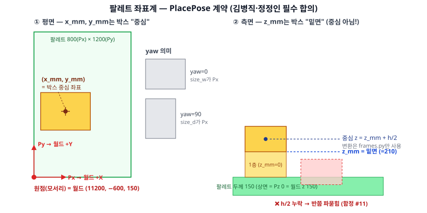
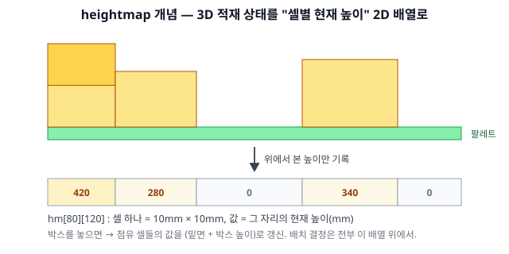
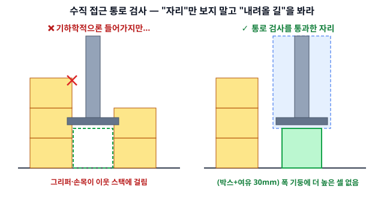
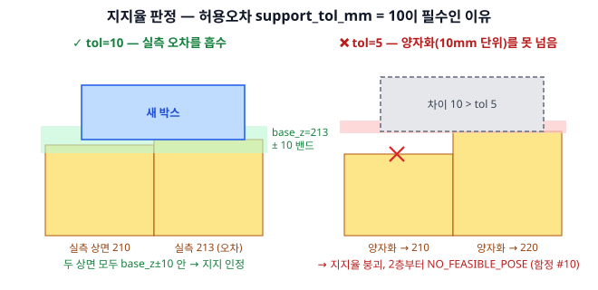

# 트랙 C 작업 가이드 — 정정인 (패킹 알고리즘 / heightmap)

> 먼저 읽을 것: `작업명세서.md` §7 (당신 섹션), §3.3 (좌표 계약), 공통가이드 §4.3
> **당신의 미션:** "이 박스를 어디에 놓을까"에 200ms 안에 답하는 두뇌. **Isaac Sim이 전혀 필요 없다** — 노트북에서 numpy로 개발하고, Day 3에 ROS 옷만 입힌다.
> **당신을 기다리는 사람:** 김병직 (Day 3에 `/algo/*` 실서비스), 발표 (베이스라인 비교 그래프는 당신 것이 유일한 "최적화 증명"이다)
> **당신이 기다리는 것:** G1 결과 (Day 2 저녁, `max_stack_mm` 확정) — 그 전엔 **파라미터로만** 다룬다

---

## 0. 3일 목표 한눈에

| Day | 목표 | 완료 기준 |
|---|---|---|
| **1 (오후)** | **C0** `packing_common` · **C1** heightmap 코어 골격 | common이 push되고 units 테스트 통과 |
| **2** | C1 완성(±3mm 테스트) · C2 배치규칙+통로검사 · C3 적재율+시각화 · **C4 베이스라인** | 가상 15박스 시퀀스로 fill_rate 곡선이 그려짐 |
| **3** | C5 ROS 래퍼 · 통합 | 김병직의 호출에 200ms 내 응답 |

---

## Day 1 (14:00~18:00)

### C0. `packing_common` — 전원이 쓰는 기반 (14:00~16:00)

**왜 당신이:** 순수 파이썬이고, 당신이 이 함수들의 최대 사용자다. Day 1 오후가 절반이라 김학민에게서 재배분됐다.

`packing_common/packing_common/units.py` — **작업명세서 §1.3 코드 그대로.**
`packing_common/packing_common/frames.py` — **작업명세서 §3.3 코드 그대로** (`world_to_pallet_place` / `pallet_place_to_world`, `h_mm//2` 포함).

**frames.py가 지키는 계약 — 이 그림이 김병직과 당신의 합의서다:**


`packing_common/packing_common/config.py`:

```python
import yaml, os
def load(path="~/palletris_ws/src/packing_bringup/config/system.yaml"):
    return yaml.safe_load(open(os.path.expanduser(path)))
```

**단위 테스트** `packing_common/test/test_units.py` — 이게 있어야 "전원이 믿고 쓴다":

```python
from packing_common.units import *
from packing_common.frames import *

def test_roundtrip():
    assert mm_to_cell(340) == 34 and mm_to_cell(480) == 48
    assert m_to_mm(mm_to_m(10300)) == 10300

def test_frames_center_bottom():
    origin = [10300, 300, 150]        # ★ 셀 90도 회전 (2026-08-22)
    # 3호(h=210) 박스 중심이 월드 (11.37, -0.475, 0.255+0.105)에 있으면
    # PlacePose는 x=170, y=125, z=105(밑면)여야 한다... 손계산 케이스 3개
    p = world_to_pallet_place([11.370, -0.475, 0.360], 0.0, 210, origin)
    assert (p.x_mm, p.y_mm, p.z_mm) == (170, 125, 105)
    back = pallet_place_to_world(p, 210, origin)
    assert abs(back[2] - 0.360) < 1e-9
```

`pytest` 통과 → push → 채팅 공지 "common 올라감".

### C1. heightmap 코어 골격 (16:00~18:00)

**heightmap이 뭔지 한 장으로:**



`packing_algo/packing_algo/heightmap_core.py` — **ROS 한 줄도 없이** 이 클래스 하나가 전부다:

```python
import numpy as np
from scipy.ndimage import maximum_filter1d

class HeightmapPacker:
    """팔레트 1개의 상태 + 배치 결정. 단위: 내부는 전부 mm 정수, 격자 10mm."""

    def __init__(self, cfg):
        hm_cfg = cfg["heightmap"]; pal = cfg["pallet"]
        self.cell = hm_cfg["cell_mm"]                       # 10
        self.W = pal["width_mm"]  // self.cell              # 120 (Px)  ← 셀 90도 회전으로 바뀜
        self.D = pal["depth_mm"]  // self.cell              # 80  (Py)
        self.hm = np.zeros((self.W, self.D), dtype=np.int32)
        self.max_stack = pal["max_stack_mm"]                # ★ G1 전까지 이 값만 바꿔가며 실험
        self.w_h, self.w_s = hm_cfg["w_height"], hm_cfg["w_support"]
        self.tol = hm_cfg["support_tol_mm"]                 # 10 (= cell_mm! 5로 줄이지 말 것)
        self.clr = hm_cfg["gripper_clearance_mm"] // self.cell   # 3셀
        self.min_sup = hm_cfg["min_support_ratio"]          # 0.7
        self.topk = hm_cfg["topk_support_check"]            # 50
        self.plans = {}                                      # (zone,box_id) -> PlacePose
        self.placed = []                                     # [(x,y,z,w,d,h,yaw), ...]

    # ---------- 핵심 유틸 ----------
    @staticmethod
    def _sliding_max(a, w, axis):
        """길이 w 윈도의 시작 인덱스별 최대. maximum_filter1d는 중심 기준이므로 슬라이스로 보정."""
        mf = maximum_filter1d(a, size=w, axis=axis, mode="constant", cval=0)
        start = w // 2
        return np.take(mf, np.arange(start, start + a.shape[axis] - w + 1), axis=axis)

    def _base_z(self, wc, dc):
        """모든 배치 시작셀 (i,j)에 대한 밑면 높이 = 점유영역 최대. shape (W-wc+1, D-dc+1)"""
        return self._sliding_max(self._sliding_max(self.hm, wc, 0), dc, 1)

    def plan(self, box_id, w_mm, d_mm, h_mm):
        """→ (ok, PlacePose, score, message)"""
        best = None
        for yaw in (0, 90):
            w, d = (w_mm, d_mm) if yaw == 0 else (d_mm, w_mm)
            wc, dc = w // self.cell, d // self.cell
            bz = self._base_z(wc, dc)                       # ① 경계는 shape가 처리
            ok_h = bz + h_mm <= self.max_stack              # ② 높이
            corridor = self._corridor_ok(wc, dc, bz)        # ④ 통로 (전 후보, 필터로 싸다)
            cand = ok_h & corridor
            if not cand.any(): continue
            score = (self.w_h * (1 - bz / self.max_stack)) * cand   # 지지율 전 1차 점수
            # ③ 지지율: 상위 K개만 정밀 계산 (전 후보는 너무 비쌈 — 명세서 §7.9)
            flat = np.argsort(score, axis=None)[::-1][: self.topk]
            for idx in flat:
                i, j = np.unravel_index(idx, score.shape)
                if not cand[i, j]: continue
                sup = self._support_ratio(i, j, wc, dc, int(bz[i, j]))
                if sup < self.min_sup: continue
                s = self.w_h * (1 - bz[i, j] / self.max_stack) + self.w_s * sup
                key = (s, -(i + j))                          # 동점 → 좌하단 우선
                if best is None or key > best[0]:
                    best = (key, i, j, int(bz[i, j]), yaw, w, d)
        if best is None:
            msg = "PALLET_FULL" if self.hm.min() + min(210, h_mm) > self.max_stack else "NO_FEASIBLE_POSE"
            return False, None, 0.0, msg
        _, i, j, z, yaw, w, d = best
        pose = dict(x_mm=i * self.cell + w // 2, y_mm=j * self.cell + d // 2,
                    z_mm=z, yaw_deg=float(yaw))              # ★ x,y=중심 / z=밑면
        self.plans[box_id] = (pose, w_mm, d_mm, h_mm)
        return True, pose, float(best[0][0]), "OK"

    def _support_ratio(self, i, j, wc, dc, base_z):
        foot = self.hm[i:i + wc, j:j + dc]
        return float((np.abs(foot - base_z) <= self.tol).mean())   # ★ tol=10 필수

    def _corridor_ok(self, wc, dc, bz):
        """그리퍼 여유 포함 확장 윈도의 최대가 밑면 이하인가 — 패딩으로 경계 처리"""
        c = self.clr
        pad = np.pad(self.hm, c, mode="constant", constant_values=0)
        big = self._sliding_max(self._sliding_max(pad, wc + 2 * c, 0), dc + 2 * c, 1)
        return big <= bz + self.tol

    def update(self, box_id, w_mm, d_mm, h_mm, actual):
        """★ 실측 pose로 갱신 — 이게 자기교정의 핵심 (명세서 §7.6)"""
        planned = self.plans.pop(box_id, None)
        ok = True
        # yaw가 계획에서 tol 이상 벗어나면 AABB 팽창 기록 + ok=False ... (TODO)
        w, d = (w_mm, d_mm) if round(actual["yaw_deg"] / 90) % 2 == 0 else (d_mm, w_mm)
        i = (actual["x_mm"] - w // 2) // self.cell
        j = (actual["y_mm"] - d // 2) // self.cell
        top = actual["z_mm"] + h_mm
        top_q = round(top / self.cell) * self.cell           # ★ 셀 격자로 양자화
        i0, j0 = max(i, 0), max(j, 0)
        self.hm[i0:i + w // self.cell, j0:j + d // self.cell] = \
            np.maximum(self.hm[i0:i + w // self.cell, j0:j + d // self.cell], top_q)
        self.placed.append((actual, w_mm, d_mm, h_mm))
        return ok, self.fill_rate(), len(self.placed)

    def cancel(self, box_id): self.plans.pop(box_id, None)
    def reset(self): self.hm[:] = 0; self.plans.clear(); self.placed.clear()

    def fill_rate(self):
        vol = sum(w * d * h for _, w, d, h in self.placed) / 1e9      # m³
        hmax = max(1, int(self.hm.max()))                              # ★ 실제 최고 높이!
        return vol / (0.8 * 1.2 * hmax / 1000.0)
```

> 위 코드는 뼈대 + 핵심 알고리즘까지 채워져 있다. 오늘은 이걸 이해하며 타이핑하고, `plan` 한 번이 돌아가는 것까지.

**`_corridor_ok`가 검사하는 것 — "자리"가 아니라 "내려올 길":**



---

## Day 2

### C1 완성 — 수용 테스트 2개 (09:00~11:00)

`packing_algo/test/test_core.py`:

```python
import numpy as np, random
from packing_algo.heightmap_core import HeightmapPacker
from packing_common.config import load

CFG = load()          # ★ 이게 없으면 첫 실행에서 NameError.
                      #   사전에 colcon build + source install/setup.bash 필요
                      #   (packing_common을 import하려면 빌드가 먼저다)

BOXES = [(340,250,210), (410,310,280), (480,380,340)]

def run_sequence(pk, n=15, noise_mm=0):
    random.seed(42); placed = 0
    for k in range(n):
        w,d,h = random.choice(BOXES)
        ok, pose, _, msg = pk.plan(f"B{k}", w, d, h)
        if not ok: return placed, msg
        actual = dict(pose)                                   # 계획 = 실측 + 노이즈
        actual["x_mm"] += random.randint(-noise_mm, noise_mm)
        actual["y_mm"] += random.randint(-noise_mm, noise_mm)
        actual["z_mm"] += random.randint(-noise_mm, noise_mm)
        pk.update(f"B{k}", w, d, h, actual)
        placed += 1
    return placed, "OK"

def test_no_noise():          # 기본 동작
    pk = HeightmapPacker(CFG); n, _ = run_sequence(pk)
    assert n >= 12

def test_noise_3mm():         # ★ 수용 기준: ±3mm 오차에서 5층까지 배치 (명세서 §7.4)
    pk = HeightmapPacker(CFG); n, msg = run_sequence(pk, noise_mm=3)
    assert n >= 12, f"{n}개에서 {msg} — support_tol 확인!"

def test_speed():             # ★ 수용 기준: 40% 찬 상태에서 plan < 200ms
    import time
    pk = HeightmapPacker(CFG); run_sequence(pk, n=8)
    t0 = time.time(); pk.plan("SPD", 480, 380, 340)
    assert time.time() - t0 < 0.2
```

**`test_noise_3mm`이 실패하면 십중팔구 `support_tol_mm`이 10이 아니거나 양자화를 빼먹은 것이다 (명세서 함정 #10):**



🤖 **프롬프트 (update의 yaw 처리 등 TODO 완성):**
```
[공통 머리말] + 작업명세서 §7.4~7.6 + 위 heightmap_core.py 전체 붙이기
TODO를 완성해줘: (1) update에서 |actual.yaw − planned.yaw| > 5°면 회전된 박스의 AABB
(축정렬 외접 사각형)로 footprint를 팽창시켜 기록하고 ok=False 반환
(2) 배열 경계를 벗어나는 실측 좌표의 안전한 클리핑
(3) PALLET_FULL 판정 개선: 세 박스 종류 중 최소 높이로도 어떤 후보도 없을 때만 PALLET_FULL,
아니면 NO_FEASIBLE_POSE. 테스트가 전부 통과해야 한다.
```

### C2~C3. 시각화 (11:00~15:00)

`packing_algo/packing_algo/viz.py` — matplotlib 3종: ① `plt.imshow(hm.T)` 히트맵 ② `bar3d` 박스 배치도 ③ 적재율 vs 박스 수 곡선. 디버깅과 발표 자료를 겸한다.

### ★ C4. 베이스라인 (15:00~18:00) — 절대 생략 금지

**구현 요령: `HeightmapPacker`를 상속해서 `plan`만 갈아끼운다.** 그러면 `update()` / `fill_rate()` / `hm` 상태 관리를 전부 공짜로 재사용하고, 비교 실험 코드가 두 패커를 같은 인터페이스로 돌릴 수 있다:

```python
class BaselinePacker(HeightmapPacker):
    """단순 순차: 회전 없음(yaw 0 고정), 좌하단부터 훑어서 '처음 들어가는 곳'.
    점수/지지율/통로 없음 — '아무 생각 없이 쌓기'의 대조군.
    update/fill_rate/reset은 부모 것을 그대로 쓴다."""
    def plan(self, box_id, w_mm, d_mm, h_mm):
        wc, dc = w_mm // self.cell, d_mm // self.cell
        bz = self._base_z(wc, dc)                        # 부모의 base_z 재사용
        for i in range(bz.shape[0]):
            for j in range(bz.shape[1]):
                if bz[i, j] + h_mm <= self.max_stack:
                    pose = dict(x_mm=i * self.cell + w_mm // 2,
                                y_mm=j * self.cell + d_mm // 2,
                                z_mm=int(bz[i, j]), yaw_deg=0.0)
                    self.plans[box_id] = (pose, w_mm, d_mm, h_mm)
                    return True, pose, 0.0, "OK"
        return False, None, 0.0, "PALLET_FULL"
```

**비교 실험** `scripts/compare_baseline.py`: seed 42의 동일 15박스 시퀀스를 두 패커에 넣고 (각각 `run_sequence` 재사용) fill_rate 곡선 두 개를 한 그래프에. **이 그래프가 발표의 "최적화 증명"이다.**

**Day 2 저녁:** G1 은 통과했고 `max_stack_mm` 은 **1300 으로 확정**됐다 (작업명세서 §3.4 · `system.yaml`). 이 값으로 테스트를 재실행한다.
> 850 은 트럭 내高를 1000 으로 가정하던 옛 값이다 — 구 사양서 §5-1 의 1600 을 채택하며 폐기됐다.

---

## Day 3

### C5. ROS 래퍼 (09:00~12:00)

코어는 손대지 않는다. 노드는 **번역만**:

```python
class AlgoService(Node):
    def __init__(self):
        super().__init__("algo_service_node")
        cb = ReentrantCallbackGroup()
        self.pk = {z: HeightmapPacker(CFG) for z in ["A", "B", "C"]}   # 구역별 인스턴스
        self.create_service(PlanPlacement, "/algo/plan_placement", self.on_plan, callback_group=cb)
        # update / cancel / reset 동일 패턴
    def on_plan(self, req, res):
        ok, pose, score, msg = self.pk[req.zone].plan(req.box_id, req.size_w_mm, ...)
        res.ok, res.message, res.score = ok, msg, score
        if ok: res.pose = PlacePose(x_mm=pose["x_mm"], ...)
        return res

def main():
    rclpy.init(); rclpy.spin(AlgoService(), executor=MultiThreadedExecutor())
```

**`packing_algo/setup.py` entry_points (이게 있어야 `ros2 run`이 된다):**
```python
entry_points={"console_scripts": ["algo_service_node = packing_algo.algo_service_node:main"]},
```

🤖 **프롬프트 (래퍼):**
```
[공통 머리말] + 작업명세서 §2.2의 /algo/* 4개 서비스 정의 + packing_msgs의 srv 파일 붙이기
위 골격으로 algo_service_node.py를 완성해줘. 서비스 4개 전부, 구역별 패커 인스턴스,
MultiThreadedExecutor, 각 호출을 소요시간(ms)과 함께 info 로그.
```

### 오후: 통합

당신 자리에서 확인할 것: 로그에 `plan 12ms` 식으로 찍히는가, `PALLET_FULL`이 15개 근처에서 나오는가, 통합 끝나면 `fill_rate` 최종값 기록.

| 증상 | 처방 |
|---|---|
| 2층부터 NO_FEASIBLE_POSE | `support_tol_mm=10` + 양자화 (함정 #10) |
| 박스가 팔레트 밖에 놓임 | 김병직과 frames.py 같은 것 import? 원점 **(10300, 300, 150)**? (함정 #11) |
| plan이 느림 | sliding_window_view 썼는지 → maximum_filter1d로 (함정 #25) |
| fill_rate가 이상하게 낮음 | 분모가 850 고정 아닌지 — 실제 최고 높이 (함정 #19) |
| 90° 배치가 이상함 | yaw=90이면 (w,d) 스왑 — plan과 update 양쪽 다 |
