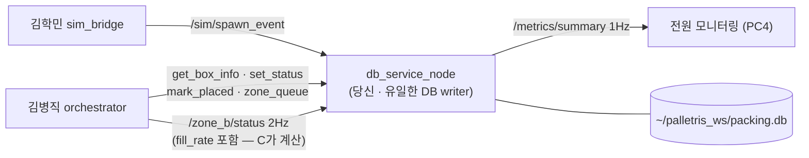
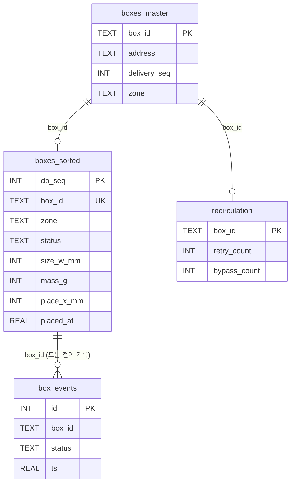
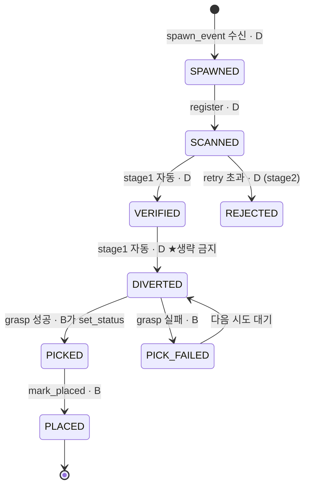

# 트랙 D 작업 가이드 — 민범진 (packing_msgs / DB / 지표)

> 먼저 읽을 것: `작업명세서.md` §2 (전체가 당신 것), §8 · 공통가이드 §4
> **당신의 미션:** 팀의 공용어(`packing_msgs`)와 기억(DB)을 만든다. **Day 1의 D0은 프로젝트 전체의 첫 블로커다** — 이게 push돼야 3명이 코딩을 시작한다.
> **당신을 기다리는 사람:** Day 1 오후의 전원 (msgs), Day 2~3의 김병직 (`/db/*`)
> **당신이 기다리는 것:** 없음. 전부 Isaac 없이 노트북에서 된다

---

## 0. 3일 목표 한눈에

| Day | 목표 | 완료 기준 |
|---|---|---|
| **1 (오후)** | **D0 `packing_msgs` push (최우선, msg 5 + srv 15)** · D1 스키마 + master 생성 | 4대에서 `colcon build` 성공 통보 받음 |
| **2** | D2 실서비스 + ground truth 등록 체인 + **Mock 전체** · D3 `box_events` + 지표 | 김병직이 Mock으로 1사이클 완주 |
| **3** | 통합 지원 · 지표 검증 | `/metrics/summary`에 fill_rate·처리량이 흐름 |

**당신에게 흘러드는 데이터 전부:**



---

## Day 1 (14:00~18:00)

### ★ D0. `packing_msgs` (14:00~16:30) — 오늘 이것만 끝나도 성공

**개념:** ROS2에서 노드끼리 주고받는 데이터의 "서식 용지". `.msg`(단방향)와 `.srv`(요청---응답) 파일을 정의하면 colcon이 파이썬 클래스를 생성해 준다. **필드 이름이 곧 팀의 계약**이므로 작업명세서 §2에서 한 글자도 바꾸지 않는다.

**파일 트리 (전부 만들 것):**

```
packing_msgs/
├── package.xml
├── CMakeLists.txt
├── msg/
│   ├── BoxInfo.msg          # §2.1 그대로
│   ├── SpawnEvent.msg
│   ├── PlacePose.msg
│   └── ZoneStatus.msg
│   └── BoxAtPickup.msg
└── srv/
    ├── RegisterBox.srv      # §2.2 그대로 — 요청과 응답 사이에 '---' 한 줄
    ├── VerifyBox.srv
    ├── GetBoxInfo.srv
    ├── SetStatus.srv
    ├── MarkPlaced.srv
    ├── ZoneQueue.srv
    ├── DiverterRequest.srv
    ├── PlanPlacement.srv
    ├── UpdateHeightmap.srv
    ├── CancelPlan.srv
    ├── AlgoReset.srv
    ├── SetVelocity.srv
    ├── SwapPallet.srv
    ├── SetSpawnEnabled.srv
    └── DespawnBox.srv
```

**개수 확인: msg 5개 + srv 15개** (db 7, algo 4, conveyor 1, sim 3). **15개보다 적게 만들면 김병직의 PALLET_FULL 경로와 김학민의 브릿지가 Day 2~3에 깨진다** — msgs는 그때쯤 "동결"이라 고치기 부담스러워진다. 지금 다 만든다.

`package.xml` 핵심 (이 세 줄이 없으면 생성이 안 된다):

```xml
<buildtool_depend>rosidl_default_generators</buildtool_depend>
<exec_depend>rosidl_default_runtime</exec_depend>
<member_of_group>rosidl_interface_packages</member_of_group>
<depend>geometry_msgs</depend>
```

`CMakeLists.txt` 핵심:

```cmake
find_package(rosidl_default_generators REQUIRED)
find_package(geometry_msgs REQUIRED)
rosidl_generate_interfaces(${PROJECT_NAME}
  "msg/BoxInfo.msg" "msg/SpawnEvent.msg" "msg/PlacePose.msg"
  "msg/ZoneStatus.msg" "msg/BoxAtPickup.msg"
  "srv/RegisterBox.srv" ... # 전부 나열
  DEPENDENCIES geometry_msgs)
```

```bash
cd ~/palletris_ws && colcon build --packages-select packing_msgs
source install/setup.bash
ros2 interface show packing_msgs/srv/GetBoxInfo    # 정의가 출력되면 성공
```

**push 후 팀 채팅: "msgs 올라감 — 전원 pull + 빌드 확인 부탁". 4명 성공 답장 = D0 완료.**

🤖 **프롬프트 (D0):**
```
[공통 머리말] + 작업명세서 §2.1~2.2 전체 붙이기
ROS2 Jazzy용 인터페이스 패키지 packing_msgs를 만들어줘. 위 명세의 메시지 5개와 서비스
15개(/db 7, /algo 4, /conveyor 1, /sim 3)를 .msg/.srv 파일로 정확히 옮기고
(필드명·타입 그대로, BoxAtPickup은 geometry_msgs/Pose 사용), package.xml과
CMakeLists.txt 완성본까지. 파일별로 경로를 명시해서 출력해줘.
```

### D1. 스키마 + master 생성 (16:30~18:00)

`packing_db/packing_db/schema.sql` — **작업명세서 §8.2 그대로** (4개 테이블):



`scripts/gen_master_db.py` — **작업명세서 §8.3 그대로.** stage 1 핵심:

```python
if cfg["stage"] == 1:
    N = cfg["boxes"]["stage1"]["total_count"]        # 15
    zones = [cfg["boxes"]["stage1"]["zone"]] * N     # ★ 전부 "B" — 랜덤 금지!
box_ids = ["BOX%05d" % i for i in range(N)]          # 킥오프에서 합의한 규칙
```

**★ DB 경로는 절대경로 `~/palletris_ws/packing.db`로 통일한다** — 생성 스크립트와 서비스 노드가 상대경로를 쓰면 실행 위치에 따라 서로 다른 빈 DB를 보게 된다.

**확인:** `python3 scripts/gen_master_db.py && sqlite3 ~/palletris_ws/packing.db "SELECT * FROM boxes_master"` → BOX00000~14, zone 전부 B.

---

## Day 2

### D2. `db_service_node` (09:00~15:00)

**설계 원칙 (명세서 §8.5): 이 노드만 `.db` 파일을 연다.** 다른 모두는 서비스로만.

```python
# packing_db/packing_db/db_service_node.py
import sqlite3, time, rclpy, json, os, threading
from rclpy.node import Node
from rclpy.callback_groups import ReentrantCallbackGroup
from rclpy.executors import MultiThreadedExecutor
from packing_msgs.srv import RegisterBox, GetBoxInfo, SetStatus, MarkPlaced, ZoneQueue, VerifyBox
from packing_msgs.msg import SpawnEvent, BoxInfo

DB_PATH = os.path.expanduser("~/palletris_ws/packing.db")   # ★ 절대경로 — 상대경로면 실행 위치마다
                                                       #   다른 빈 DB가 생겨 "master에 없는 박스"만 나온다

class DbService(Node):
    def __init__(self):
        super().__init__("db_service_node")
        self.db = sqlite3.connect(DB_PATH, check_same_thread=False)   # + 쓰기는 Lock으로 직렬화
        self.db.execute("PRAGMA journal_mode=WAL")
        n = self.db.execute("SELECT COUNT(*) FROM boxes_master").fetchone()[0]
        if n == 0:
            raise SystemExit(f"boxes_master가 비어있음 — gen_master_db.py를 먼저 실행 ({DB_PATH})")
        self.fill_rate_last = 0.0                      # /zone_b/status에서 캐시 (아래)
        cb = ReentrantCallbackGroup()
        for srv_type, name, fn in [
            (RegisterBox, "/db/register_box", self.on_register),
            (GetBoxInfo,  "/db/get_box_info", self.on_get_info),
            (SetStatus,   "/db/set_status",   self.on_set_status),
            (MarkPlaced,  "/db/mark_placed",  self.on_mark_placed),
            (ZoneQueue,   "/db/zone_queue",   self.on_zone_queue),
            (VerifyBox,   "/db/verify_box",   self.on_verify)]:
            self.create_service(srv_type, name, fn, callback_group=cb)
        self.create_subscription(SpawnEvent, "/sim/spawn_event",
                                 self.on_spawn, 10, callback_group=cb)
        # ★ fill_rate의 유일한 유입 경로: C의 update 응답 → B의 status → 여기서 캐시
        from packing_msgs.msg import ZoneStatus
        self.create_subscription(ZoneStatus, "/zone_b/status",
                                 lambda m: setattr(self, "fill_rate_last", m.fill_rate),
                                 10, callback_group=cb)
        self.create_timer(1.0, self.publish_metrics, callback_group=cb)

    # ---- 상태 변경은 전부 이 함수로 (box_events 자동 기록 — 명세서 §8.6) ----
    def _set_status(self, box_id, status):
        now = time.time()
        self.db.execute("UPDATE boxes_sorted SET status=? WHERE box_id=?", (status, box_id))
        self.db.execute("INSERT INTO box_events(box_id,status,ts) VALUES(?,?,?)",
                        (box_id, status, now))
        col = {"SPAWNED": "spawned_at", "SCANNED": "scanned_at",
               "PICKED": "picked_at", "PLACED": "placed_at"}.get(status)
        if col:
            self.db.execute(f"UPDATE boxes_sorted SET {col}=? WHERE box_id=?", (now, box_id))
        self.db.commit()

    # ---- ★ stage 1 ground truth 체인: 스폰 즉시 SPAWNED→SCANNED→VERIFIED→DIVERTED ----
    def on_spawn(self, msg):
        m = self.db.execute("SELECT zone FROM boxes_master WHERE box_id=?",
                            (msg.box_id,)).fetchone()
        if m is None:
            self.get_logger().error(f"master에 없는 박스: {msg.box_id}")   # 함정: id 불일치
            return
        self.db.execute(
            "INSERT OR IGNORE INTO boxes_sorted(box_id,zone,size_w_mm,size_d_mm,size_h_mm,"
            "mass_g,status) VALUES(?,?,?,?,?,?,'SPAWNED')",
            (msg.box_id, m[0], msg.size_w_mm, msg.size_d_mm, msg.size_h_mm, msg.mass_g))
        for st in ("SPAWNED", "SCANNED", "VERIFIED", "DIVERTED"):   # ★ DIVERTED까지!
            self._set_status(msg.box_id, st)                        # 없으면 zone_queue가 0 (함정 #8)
```

**상태 전이 — 누가 어떤 상태를 올리는가 (`zone_queue`는 DIVERTED·PICKED만 센다):**



```python
    def on_get_info(self, req, res):
        row = self.db.execute(
            "SELECT zone,size_w_mm,size_d_mm,size_h_mm,mass_g,db_seq "
            "FROM boxes_sorted WHERE box_id=?", (req.box_id,)).fetchone()
        res.found = row is not None
        if row:
            res.info = BoxInfo(box_id=req.box_id, zone=row[0], size_w_mm=row[1],
                               size_d_mm=row[2], size_h_mm=row[3], mass_g=row[4], db_seq=row[5])
        return res

    def on_zone_queue(self, req, res):
        res.count = self.db.execute(
            "SELECT COUNT(*) FROM boxes_sorted WHERE zone=? AND status IN "
            "('DIVERTED','PICKED')", (req.zone,)).fetchone()[0]
        res.placed_count = self.db.execute(
            "SELECT COUNT(*) FROM boxes_sorted WHERE zone=? AND status='PLACED'",
            (req.zone,)).fetchone()[0]
        return res
    # on_register / on_set_status / on_mark_placed / on_verify → 프롬프트로 완성

def main():
    rclpy.init()
    rclpy.spin(DbService(), executor=MultiThreadedExecutor())
```

> **sqlite3와 MultiThreadedExecutor:** 기본 커넥션은 생성 스레드 밖에서 쓰면 에러가 난다.
> `sqlite3.connect("packing.db", check_same_thread=False)` + 쓰기 함수를 `threading.Lock`으로
> 감싸는 방식으로 해결한다 (아래 프롬프트에 포함).

🤖 **프롬프트 (D2 완성):**
```
[공통 머리말] + 작업명세서 §2.2(/db 서비스), §2.4(상태 전이표), §8.2(스키마) + 위 골격 붙이기
db_service_node.py를 완성해줘. 요구:
- on_register(SCANNED 처리 + zone/db_seq 반환), on_set_status(요청 status를 _set_status로),
  on_mark_placed(place_x/y/z/yaw 저장 + PLACED), on_verify(found/zone/retry_count)
- sqlite3는 check_same_thread=False + threading.Lock으로 쓰기 직렬화
- 모든 서비스 응답에 소요시간 debug 로그
- main에 --db-path 인자 (기본 packing.db)
```

### D2 후반. Mock 노드 (15:00~16:00)

`packing_db/packing_db/mock_all.py` — **하나의 파일로 팀 전체의 Mock을 제공** (명세서 §2.7의 자기 몫 + 아직 없는 남의 것도 임시로): `/db/*` 6개(고정 응답) + `/algo/*` 4개(원점 배치, fill 0.5) + **가짜 `/zone_b/box_at_pickup` 발행기(15초마다)** — 김학민의 A7이 늦어도 김병직이 막히지 않게. 김병직이 Day 2 오후 이걸로 산다.

**`packing_db/setup.py` entry_points:**
```python
entry_points={"console_scripts": [
    "db_service_node = packing_db.db_service_node:main",
    "mock_all = packing_db.mock_all:main",
]},
```

### D3. 지표 (16:00~18:00)

`publish_metrics` (1Hz): 명세서 §8.6 쿼리들로 JSON 만들어 `/metrics/summary` 발행:

```python
{"placed": 7, "spawned": 9, "fill_rate_last": 0.42,
 "cycle_avg_s": 11.2, "queue_b": 2}
```

`scripts/report.py`: 실행 종료 후 같은 쿼리로 표 출력 + `boxes_sorted` CSV 덤프. **Day 3 저녁의 "결과 수치"가 이 스크립트에서 나온다.**

---

## Day 3

- 오전: `report.py` 마무리, 통합 스모크 1·2단계(공통가이드 §5) 주도 — `/db/*`가 제일 먼저 떠야 한다
- 오후: 통합 — 당신 화면엔 `/metrics/summary` echo를 항상 띄워둔다. placed가 안 오르면 어느 상태에서 멈췄는지 `box_events`로 즉시 확인 가능:
  ```sql
  SELECT box_id, status, ts FROM box_events ORDER BY ts DESC LIMIT 20;
  ```
  **이 쿼리가 통합 디버깅의 만능 창이다** — 어떤 박스가 어떤 단계까지 갔는지 한눈에 보인다.

| 증상 | 처방 |
|---|---|
| register가 전부 실패 | box_id 불일치 — master의 id와 스포너 id 대조 (함정 #13) |
| zone_queue가 항상 0 | on_spawn에서 DIVERTED까지 올렸는지 (함정 #8) |
| `database is locked` | 다른 프로세스가 .db를 열었다 — report.py를 실행 중 돌렸는지 (§8.5) |
| 인식률이 100%로만 나옴 | SPAWNED 행 선생성 여부 (함정 #22) |
| 서비스가 응답 안 함 | 콜백 안 동기 호출 (함정 #1) / executor가 MultiThreaded인지 |
