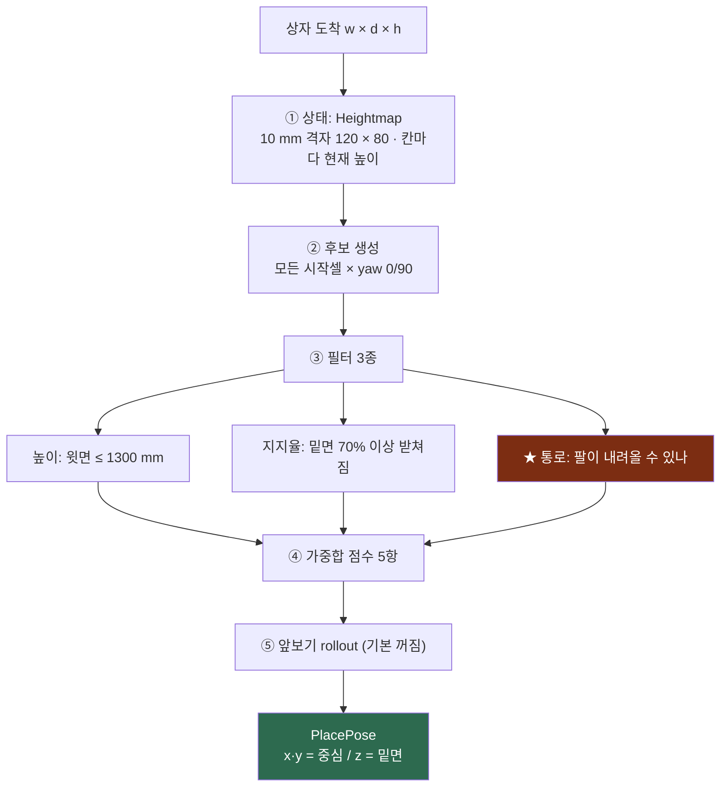

# 적재 알고리즘 — 발표 슬라이드 5장

> Project Palletris · 트랙 C · 2026-08-28
> **PPT 한 장 = 이 문서의 `## 슬라이드 N` 하나.** 표·다이어그램을 그대로 옮긴다.
> 수치 표기: `[실측]` 재현 확인 · `[정본]` 설정 확정값 · `[문서]` 기존 팀 문서 인용

---

# 슬라이드 1 — 왜 교과서 알고리즘이 그대로 안 되나

## 우리 문제는 3D Bin Packing 이 아니다 (정확히는, 그것만이 아니다)

| | 교과서 (offline BPP) | **우리 문제** |
|:---|:---|:---|
| 박스 목록 | 전부 미리 안다 | **하나씩 도착한다** — 확률분포만 안다 |
| 되돌리기 | 배치를 바꿔 가며 최적화 | **한 번 놓으면 끝** |
| 배치 주체 | 없음 (기하만 본다) | **6축 로봇 팔** — 기하가 허용해도 **팔이 못 가는 자리**가 있다 |

## ★ 세 번째가 이 프로젝트의 본체다

```
        [ 기하학적으로 들어가는 자리 ]
                    ⊃
        [ 로봇 팔이 실제로 갈 수 있는 자리 ]   ← 우리가 골라야 하는 것
```

다층으로 쌓으면 상자 사이에 **폭 250 mm 협곡**이 생긴다.
흡착 그리퍼 몸통은 **Ø245 mm** `[정본]`.

> 알고리즘은 **"자리 있음"** 이라 답하고, 로봇은 **`IK_FAIL`** 을 낸다.

### 발표 문장

> ## **"놓을 수 있는 자리"와 "갈 수 있는 자리"는 다르다.**

## 계열별 검토 — 무엇을 쓸 수 있었나

| 계열 | 대표 문헌 | 우리 문제에 |
|:---|:---|:---|
| Wall building | George & Robinson (1980) | ✗ 오프라인 전제 |
| Layer building | Bischoff & Ratcliff (1995) | △ 같은 높이 상자가 모여야 한다 (우리는 210/280/340 혼입) |
| **DBLF** | Karabulut & İnceoğlu (2004) | ✅ **대조군 채택** |
| **Extreme Point** | Crainic, Perboli, Tadei (2008) | ✅ **학술 대조군 채택** → 슬라이드 4 |
| Maximal Space | Parreño et al. (2008) | △ 코어 재작성 규모 |
| **Heightmap + 가중합** | 팔레타이징 실무 표준 | ✅ **채택** |
| 심층강화학습 | Zhao et al. (2021) | ✗ 6일 일정 · **재현성 요구와 충돌** |

> ⚠ 문헌의 **보고 적재율은 옮기지 않았다.** 대부분 BR1–BR7 같은 오프라인 벤치마크
> 수치라 우리 조건(온라인 + 로봇 제약)과 직접 비교하면 오해를 부른다.

---

# 슬라이드 2 — 제안 알고리즘 구조

## Heightmap + 가중합 + 로봇 통로 검사



## 왜 Heightmap 인가 — 한 가지 이유로 정해졌다

칸마다 **현재 높이**만 들고 있으면, *"이 자리 주변 벽이 얼마나 높은가"* 를
**슬라이딩 최대 한 번**으로 잰다. **그게 곧 로봇 통로 검사다.**

$$
z_b(i,j) = \max_{\text{발자국}} H[p,q] \qquad\text{(모든 } (i,j) \text{ 에 대해 한 번에)}
$$

> 다른 표현(극점 목록·최대공간 목록)으로는 이 검사를 얹기가 훨씬 어렵다.
> **알고리즘 선택이 곧 로봇 제약을 표현할 수 있느냐의 문제였다.**

## 점수 함수 — 5항 가중합

$$
S = \underbrace{w_h\Big(1-\tfrac{z_b}{H_{\max}}\Big)}_{\text{낮은 자리}}
+ \underbrace{w_s\,\rho}_{\text{지지}}
+ \underbrace{w_w\,\kappa}_{\text{벽 밀착}}
+ \underbrace{w_f\,\phi}_{\text{먼 쪽}}
+ \underbrace{w_l\,\lambda}_{\text{평면 유지}}
- \varepsilon\,\sigma
$$

| 항 | 값 | 역할 | 빼면 무슨 일이 `[실측]` |
|:-:|:-:|:---|:---|
| $w_h$ | 0.6 | 바닥부터 채운다 | 위로만 쌓는다 |
| $w_s$ | 0.4 | 잘 받쳐지는 자리 | 외팔보로 걸쳐 놓고 무너진다 |
| $w_w$ | **0.2** | 가장자리 밀착 | 자투리가 흩어져 5호가 들어갈 자리가 사라진다 (**48.1 → 54.9 %**) |
| $w_f$ | **0.1** | 로봇에서 먼 쪽부터 | 팔이 놓인 상자 위를 넘는다 (**넘김 5.3 → 3.1회**, 적재율 손해 0) |
| $w_l$ | **0.05** | 이웃과 평평하면 가점 | **절벽**이 생겨 지지율에 걸린다 (3집합 교차검증 **+1.3~2.3 %p**) |

> **★ `w_level` 이 왜 필요한가.** 상자 높이가 210/280/340 뿐이라 단차는 **늘 60 mm 이상**이다.
> 이 팔레트의 표면은 "조금 울퉁불퉁"해지지 않는다 — **평평 아니면 절벽**이다.
> 절벽이 생기면 지지율에 걸려 **자리가 있는데도 못 놓는다**:
> 계획 실패 26.6회 중 **19.6회가 지지율 미달**, 그때도 셀의 **27 %** 가 남아 있었다 `[문서]`.

## 응답 시간 — 계산 예산이 남는다

| | 평균 | 중앙 | 95 % | 최악 | 명세 상한 |
|:---|:-:|:-:|:-:|:-:|:-:|
| `plan()` (앞보기 꺼짐) | **3.3 ms** | 2.4 ms | 11.9 ms | 24.0 ms | 200 ms |

<sub>468회 호출 · 시드 1~10 · 이번 세션 재측정 `[실측]`</sub>

> 로봇 모션이 **8초**다. 계산 예산이 **1000배** 남는다 → 앞보기(rollout)를 만든 근거.

## ★ 앞보기(Lookahead) — `k=4` 는 **미래 박스 4개가 아니다**

> ### 시연에서 반드시 나오는 질문: *"온라인 패킹이라면서 미래를 아는 것 아닌가?"*

```yaml
lookahead: {k: 4, rollouts: 3, depth: 8}
#           │      │            └ 상상으로 굴려 볼 가상 박스 수
#           │      └ 상상 시퀀스를 몇 벌 뽑아 평균 낼지
#           └ ★ 지금 박스를 놓을 후보 "자리" 수  (미래 박스 수가 아니다!)
```

**테트리스로 비유하면**

| | 하는 일 | 문제 |
|:---|:---|:---|
| **그리디** (`k=1`) | 지금 블록을 **지금 제일 좋아 보이는 자리**에 바로 놓는다 | 그 자리가 **다음 블록이 들어올 표면을 망칠 수** 있다 → 기둥·협곡 |
| **앞보기** (`k=4`) | 후보 **자리 4곳**을 각각 가상으로 놓아 보고, 그 뒤 가상 박스를 굴려 **미래 부피가 가장 잘 들어가는 자리**를 고른다 | 계산 비용 |

## ★ 이게 반칙(오프라인)이 아닌 이유

**온라인 패킹의 정의**: *아직 안 온 박스의 **실물 정보**(크기·순서)를 쓰지 않는다.*

| 우리가 쓰는 정보 | 반칙인가 |
|:---|:---|
| 지금 스토퍼에 있는 상자의 크기 | ❌ 눈앞에 있으니 당연히 안다 |
| 상자 **종류 3종과 혼입비** (0.5 / 0.3 / 0.2) | ❌ **창고 운영 사양.** 실무에서도 아는 정보다 |
| 컨베이어에 실제로 오고 있는 다음 상자들 | ✅ **안 쓴다** |

> **미래는 아는 게 아니라 사양의 확률에서 상상으로 뽑아 굴려 본다.**
> 문헌 기준으로 미리보기 **0개 = BPP-1**, 가장 엄격한 온라인 조건이다.

**재현성도 안전하다** — 상상 박스의 난수 씨앗을 **heightmap 상태에서 결정적으로**
만든다. 같은 상황이면 항상 같은 계획이 나온다 (평가 항목 "Play/Stop 재현성").
`hash()` 를 쓰면 파이썬 문자열 해시가 프로세스마다 무작위라 그 자리에서 깨진다.

## 문헌에서 우리 위치 — "다른 데는 k 를 몇으로 쓰나"

> ⚠ 문헌의 `k` 는 우리와 **의미가 다르다.** 두 갈래로 나뉜다.

| 갈래 | 뜻 | 문헌 관례 | 우리 |
|:---|:---|:---|:---|
| **① BPP-k** | **미리 보이는 실물 상자 수** | Zhao et al. (AAAI 2021) 정의. 실험 대부분 k=1~5, 이득이 빠르게 포화. 완전 탐색은 k=8부터 계산 불능(100초+), MCTS 는 k=20 도 3.6초지만 최적 대비 ~3 % 손해 | **BPP-1** (미리보기 0개) |
| **② 후보 자리 수** | 롤아웃할 후보 개수 = **우리 k** | 휴리스틱+롤아웃 하이브리드의 빔 폭 관례 **3~5** | **k = 4** |

> ### **"실물 미리보기 없음(BPP-1) + 후보 4개 롤아웃(표준 빔 폭)"** — 두 축 모두 문헌 표준 범위 안이다.
>
> 참고: BPP-1 기본형만으로도 Zhao et al. 은 적재율 66.9~68.9 % 로 **사람을 이겼다**
> (현직 팔레타이징 작업자 포함 1,851판 · AI 1,339승 vs 인간 406승).
> k 를 8로 올려도 문헌상 이득은 몇 %p 미만인데 계산은 2배다 → **k:4 유지가 합리적.**

---

# 슬라이드 3 — 핵심 차별점: 로봇 통로 검사

## 무엇을 보는가

그리퍼 몸통을 **반경 122 mm 수직 원기둥**으로 근사하고,
발자국을 그만큼 부풀린 영역의 **최고 벽 높이**를 본다:

$$
\boxed{\;\max_{\mathcal{N}_{r_a}(i,j)} H \;\le\; \underbrace{z_b + h}_{\text{내 윗면}} + \underbrace{L_{\text{grip}}}_{150\text{ mm}} + \tau\;}
$$

## ★ 여기서 두 번 틀렸다 — 발표의 핵심 서사

| 시도 | 무슨 생각이었나 | 결과 `[문서]` |
|:---|:---|:---|
| 여유폭 30 → 60 mm | "여유를 늘리면 협곡이 준다" | 협곡 2.55 → 2.50 (**거의 그대로**) · **적재율 −4.6 %p** |
| 통로 반경 122 → 200 mm | "반경을 키우면 확실하다" | 팔 걸림 0회, 그러나 **적재 26 → 22개** |
| 2단 통로 (122 / 320) | "팔은 위로 갈수록 굵다" | 팔 걸림 1회 · 25개 |
| **기준을 밑면 → 윗면+150 으로** | **비교 대상 자체가 틀렸다** | ✅ **채택** |

> ### 진짜 원인은 여유폭이 아니라 **"무엇과 비교하느냐"** 였다.
>
> 구 코드는 링 최대를 상자 **밑면**과 비교했다. 그게 둘을 동시에 망쳤다:
>
> **① 너무 빡빡하다** — 상자는 자기보다 높은 이웃 **옆에 미끄러져 들어가도** 문제없다.
> 밑면 기준은 그걸 금지한다. 그래서 여유폭만 올리면 적재율만 떨어졌다.
>
> **② 정작 부딪히는 걸 못 본다** — 실제로 닿는 것은 윗면 **위**를 지나는
> 팔뚝(link_4, 594 mm)인데, 밑면 기준으로는 **그 높이가 시야에 없다.**

## 그리고 — 제약을 없애는 대신 **우회**한다 (낙하 완화)

통로 검사가 존재하는 이유는 **팔이 상자를 따라 내려가야** 하기 때문이다.
**그런데 떨어뜨리면 팔이 안 내려간다.**

| 항목 | 값 `[정본]` |
|:---|:---|
| 대상 | **3.5 kg 이하** (= 3호만). 무거우면 낙하 충격이 스택을 친다 |
| 방식 | 윗면을 `협곡 입구 − 그리퍼 길이(150)` 까지 내리고 놓는다 |
| 결과 | 480 mm 낙하(이탈 22.3 mm) → **120 mm 낙하(이탈 1.5 mm)** |
| **적재율** | **70.8 % → 75.5 %** ← **단일 최대 개선** |

> **흥미로운 점**: 실제 낙하는 실행당 **1~3회뿐**이었다.
> 완화가 한 일은 *"떨어뜨리게"* 가 아니라 **"괜히 막던 자리를 풀어준"** 것이다 —
> 통로 모델이 원래 **보수적**이었다는 뜻이다 `[문서]`.

## ⚠ 사건 기록 — 협곡의 진짜 원인은 앞보기가 아니었다 (2026-08-27)

한동안 협곡이 많이 생겨 "앞보기 `k` 가 부족한 것 아니냐"는 의심이 있었다.
**아니었다. 기둥 억제 규칙 `tower_ring_mm: 500` 이 범인이었다.**

| Isaac 실측 (그 값이 켜진 판) | 결과 |
|:---|:---|
| `NO_FEASIBLE_POSE` | **58건** |
| A존 적재 | 16개 · 최고 1250 mm · 충전율 **36.3 %** |
| 지형 | **바닥이 빈 탑** = 협곡 |

**역설의 구조**: *"링 최저점 + 500 초과 금지"* 규칙이 **낮은 곳 옆자리를 전부 막아서**,
갈 수 있는 곳이 **더미 꼭대기밖에 안 남았다.** 기둥을 막으려던 규칙이 기둥을 만들었다.

> → 오버레이에서 **해제**(0)했다. 남은 기둥 예방 장치는 **앞보기**다.
>
> **★ 교훈: 제약을 더 거는 것이 항상 안전한 방향은 아니다.**
> 후보를 좁히는 규칙은 "무엇을 막는가"보다 **"무엇까지 같이 막는가"** 를 봐야 한다.

---

# 슬라이드 4 — ★ Extreme Point (EP) 알고리즘과의 비교

## 4-1. EP 는 무엇인가

**Crainic, Perboli, Tadei (2008), *INFORMS Journal on Computing*** — 3D BPP 학술 표준 대조군.

| | **Extreme Point (EP)** | **제안 (Heightmap)** |
|:---|:---|:---|
| 상태 표현 | 놓을 때마다 생기는 **극점(모서리) 목록** | 격자 **표면 높이 배열** |
| 후보 | 극점 위 (이산적·희소) | 모든 시작셀 (조밀) |
| 선택 | Bottom-Left-Deepest 정렬에서 **첫 적합** | **가중합 점수 최댓값** |
| 강점 | 자투리 파편화에 강하다 · 후보가 적어 빠르다 | **표면 지형을 직접 본다** |
| 구조적 한계 | **표면 평탄도 개념이 없다** | 후보가 많아 필터가 필요 |

> **★ 핵심 차이 한 줄:**
> EP 는 **"빈 공간이 어디 있나"** 를 보고, 우리는 **"표면이 어떻게 생겼나"** 를 본다.
> 로봇 팔 제약은 **표면의 성질**이라 EP 의 표현으로는 얹을 자리가 없다.

## 4-2. ⚠ 먼저 정정 — 기존 문서의 "EP 적재율 132.5 %" 는 측정 버그다

발표 전에 반드시 고쳐야 한다. **적재율은 부피비라 100 %를 넘을 수 없다.**

**원인**: `ExtremePointPacker.plan()` 이 `self.placed` 에 배치를 기록하는데,
상속받은 `update()` 가 **같은 상자를 한 번 더** 기록한다 → **모든 상자가 2번 계산됨.**

```
시드 42 · plan 성공 27회
  제안  : len(placed) = 27   ✅ 일치
  EP    : len(placed) = 54   ★ 중복 (2배)
```

**중복을 걷어내고 다시 재면:**

| | 문서의 값 | **정정된 값** `[실측]` |
|:---|:-:|:-:|
| EP 적재율 | ~~132.5 %~~ | **68.3 %** |
| EP 실제 겹침 | (붕괴 주장) | **0 쌍** — 배치 자체는 유효하다 |

> **★ 발표에서 이걸 그대로 두면 질의응답에서 무너진다.**
> "적재율이 어떻게 100 %를 넘습니까?" 라는 질문 하나로 표 전체의 신뢰가 사라진다.
> **정직하게 정정하고, 진짜 차이를 보여주는 편이 훨씬 강하다.**

### 기존 문서와 대조 — 발표 전 팀에서 확인할 것

| 항목 | `트랙C_알고리즘_개선과정.md` | 이번 재현 `[실측]` | 판정 |
|:---|:---|:---|:---|
| EP 적재율 | 132.5 % | **68.3 %** (시드42) · **70.0 %** (15시드) | ❗ 문서 값은 **중복 기록** 때문 |
| EP 적재 개수 | 24 개 | 27 개 (시드42) · 25.7 개 (15시드) | 조건 차이로 보임 |
| 제안 적재 개수 | 25 개 / 74.3 % | 27 개 / 67.8 % (시드42·기본설정) | **설정이 다르다** — 문서는 최종 튜닝 |
| "EP 탑 붕괴 발생" | 주장 | **데스크로는 판정 불가 · Isaac 에서 확인됨** | ✅ §4-5 |

> ⚠ **데스크 계산에는 물리가 없다.** 이번 재현으로 확인한 것은 **EP 의 배치가
> 기하학적으로는 유효하다**(3D 겹침 0쌍)는 것까지다.
> **붕괴는 기하 문제가 아니라 물리 문제**라 Isaac 에서만 답이 나온다 — 그리고
> Isaac 에서 실제로 나왔다 (§4-5).

## 4-3. ★ 같은 조건 직접 비교 — 시드 15개 · 동일 시퀀스 · 포화까지 `[실측]`

**⚠ 먼저 알아야 할 것: EP 는 두 가지 제약을 안 지킨다.**

| 제약 | 왜 필수인가 | EP 원본 |
|:---|:---|:-:|
| **계획 간격 10 mm** | 간격 0 은 슬롯이 상자와 **정확히 같은 크기**. 콜라이더 offset 2 mm/면 · 배치오차 7.6 mm · yaw 4° → **Isaac 에서 9 kg 5호가 막히고 이웃을 1046 mm 밀어 떨어뜨렸다** | ❌ 미적용 |
| **로봇 통로 검사** | 팔이 내려올 수 있는 자리인가 | ❌ 기본 꺼짐 |

**그래서 EP 는 종이 위에서 더 촘촘해 보인다.** 같은 제약을 걸고 다시 재면:

| 알고리즘 | 적재 개수 | 적재율 | 통로 위반 | 3D 겹침 |
|:---|:-:|:-:|:-:|:-:|
| EP 원본 <sub>(간격 0 · 통로 안 봄)</sub> | **25.7** ±4.8 | **70.0 %** ±10.9 | 5.5건 | 0 |
| EP + 계획간격 10 | 26.2 ±3.7 | 71.3 % ±5.8 | 7.2건 | 0 |
| EP + 통로검사 | 24.5 ±4.7 | 67.6 % ±9.5 | 4.5건 | 0 |
| **EP + 통로검사 + 계획간격 10** ← **공정 비교** | **21.1** ±4.5 | **62.8 %** ±9.1 | **3.1건** | 0 |
| **제안 (Heightmap, 최종 튜닝)** | **21.2** ±4.2 | **64.0 %** ±8.8 | **1.3건** | 0 |
| 제안 (기본 설정 · 앞보기 끔) | 20.4 ±3.4 | 59.6 % ±5.1 | **0.0건** | 0 |
| 베이스라인 (DBLF 순차) | 15.3 ±2.4 | 46.5 % ±6.0 | 0.4건 | 0.7 |

### 읽는 법 — 세 줄

1. **제약을 안 걸면 EP 가 앞선다** (70.0 % vs 64.0 %). 숨기지 않는다.
2. **같은 제약을 걸면 사실상 동률이다** — 적재 21.1 vs 21.2개, 적재율 62.8 vs 64.0 %.
   **EP 의 우위는 전략의 우위가 아니라 "물리를 안 지킨 값"이었다.**
3. **차이는 밀도가 아니라 실행 가능성에서 난다** — 통로 위반 **3.1건 vs 1.3건**.
   제안의 1.3건은 대부분 **의도된 낙하 완화** 배치다 (낙하 완화를 끈 기본 설정은 **0.0건**).

## 4-4. 왜 EP 에 통로 검사를 붙여도 위반이 남나 — 구조적 이유

EP 에 통로 검사를 켜도 위반이 **4.5 → 3.1건**으로만 줄고 0 이 되지 않는다.
**버그가 아니라 표현의 한계다.**

```
EP 의 배치 높이  =  극점 목록에서 온 ep_z      ← 점(point)에서 온다
통로 검사의 기준 =  표면 높이맵의 base_z        ← 면(surface)에서 온다
                        ↑
              두 값이 다를 수 있다 — 모서리에 걸쳐 뜬 배치
```

> **★ 통로 검사는 "표면의 성질"이다.** 극점 목록은 표면을 들고 있지 않으므로,
> 검사를 **덧붙일 수는 있어도 정합하게 붙지 않는다.**
> Heightmap 은 표면 그 자체라 같은 배열에서 밑면 높이와 주변 벽 높이가 **동시에** 나온다.

### → 알고리즘 선택의 진짜 근거

> **"어느 쪽이 더 촘촘한가"가 아니라 "로봇 제약을 표현할 수 있는가"였다.**

## 4-5. ★★ Isaac 실측 — 여기서 결론이 갈린다

**같은 조건으로 EP 계획을 실제 H2017 에 물려 돌렸다.**

> ### **EP 계획은 적재 안정성이 떨어졌고, 쌓은 상자가 넘어지는 현상이 나타났다.** `[Isaac 실측]`

| | 데스크 (기하) | **Isaac (물리)** |
|:---|:---|:---|
| EP | 촘촘하다 (70.0 %) · 겹침 0 | **불안정 — 전도 발생** |
| 제안 | 62.8~64.0 % | 안정 · 3시드 전부 `PALLET_FULL` |

### 왜 데스크에서는 안 보였나 — 이 프로젝트의 핵심 교훈

```
데스크가 보는 것 :  박스끼리 겹치나?  높이 넘나?      → EP 통과 ✅
데스크가 못 보는 것:  놓은 뒤 그 자리에 그대로 있나?    → EP 실패 ❌
                     팔이 지나가며 건드리면 어떻게 되나?
```

**EP 는 "지지"를 극점 아래 접촉 면적으로만 본다.** 표면 평탄도 개념이 없으니
자투리를 촘촘히 메우는 대신 **접촉이 얕고 무게중심이 뜬 배치**가 섞인다.
기하학적으로는 완벽히 유효한데, **물리를 켜면 넘어진다.**

우리가 `w_level`(평면 유지)과 `min_support_ratio` 를 넣은 이유가 정확히 이것이다 —
**"들어가는가"가 아니라 "놓고 나서 그대로 있는가"** 를 점수에 넣은 것.

> **📌 발표 전 채울 것** — `demo_stack15.py --plan-mode ep` 의 RESULT 네 줄을
> 아래 표에 넣으면 슬라이드가 완성된다. 지금은 현상만 기록돼 있다.
>
> | | 적재/버림/실패 | 최대 knock | 팔레트 밖 | 판정 |
> |:---|:-:|:-:|:-:|:-:|
> | EP (`--plan-mode ep`) | ___ | ___ mm | ___ mm | ___ |
> | 제안 (`--plan-mode algo`) | 28/1/0 | 3.8 mm | 4.5 mm | 통과 |

## 4-6. ⚠ 데스크 수치로 채택을 결정하지 않는다

이 표는 전부 **데스크(기하) 지표**다. 우리 프로젝트에서 데스크와 Isaac 은
**부호까지 어긋난 적이 있다** `[문서]`:

| 실험 | 데스크 예측 | Isaac 실측 |
|:---|:---|:---|
| 방향성 통로 | 적재율 **−0.8 %p** (손해) | **+3개** (이득) — **부호 반대** |
| 여유 50 vs 0 | 50 이 낫다 (56.1 vs 34.9 %) | **0 이 낫다** (20 vs 17) — **순위 반대** |

**원인: 데스크에서는 실패가 공짜다.** 배치 실패 1건을 상자 1개 손해로 센다.
실측에서는 **실패 2건이 적재 3개를 깎았다** — 팔이 헤집어 스택을 63 mm 밀고,
무너진 지형이 뒤 상자 자리까지 죽였다. **기하 프록시는 그 연쇄를 원리적으로 못 본다.**

### 발표 전에 돌릴 것 — 이것이 결정적 근거다

```bash
python3 scripts/demo_stack15.py --plan-mode ep   --seed 42 --gui   # EP 계획을 실제 로봇에
python3 scripts/demo_stack15.py --plan-mode algo --seed 42 --gui   # 제안 계획을 실제 로봇에
```

볼 것 네 줄: **적재 / 버림 / 실패 · 최대 knock · 팔레트 밖 · 최종 높이**

## 4-7. 정리 — 네 문장

1. **EP 는 좋은 알고리즘이다.** 제약 없이 기하만 보면 우리보다 촘촘하다 (70.0 vs 64.0 %).
   이 사실을 숨기지 않는다.
2. **그러나 그 밀도는 Isaac 이 필수라고 증명한 두 제약을 안 지켜서 나온 값이다.**
   같은 제약(계획 간격 10 mm + 통로 검사)을 걸면 **동률**이 된다 (62.8 vs 64.0 %).
3. **그리고 물리를 켜면 갈린다** — EP 계획은 **불안정했고 넘어졌다.**
   데스크에서 유효했던 배치가 실물에서 서 있지 못했다.
4. **우리 기여는 "더 촘촘히 쌓는 법"이 아니라 "쌓을 수 있고, 쌓고 나서 서 있는 것만
   쌓는 법"이다.** 그 제약을 **표현할 수 있는 상태 표현을 고른 것**이 알고리즘 선택의 근거다.

> ### 발표 한 줄
> **"EP 는 종이 위에서 이기고, 우리는 팔레트 위에서 이긴다."**

---

# 슬라이드 5 — 결과 종합

## 5-1. 단계별 기여도 (시드 20개 · 동일 시퀀스 · 통로 검사 양쪽 동일 적용) `[문서]`

| 알고리즘 | 적재 개수 | 적재율 | 표준편차 | 대조군 대비 |
|:---|:-:|:-:|:-:|:-:|
| ① 대조군 — 단순 순차 (DBLF) | 15.6 | 39.7 % | ±8.9 | — |
| ② Heightmap 그리디 (가중합) | 23.1 | 62.1 % | ±5.9 | +22.4 %p |
| ③ + 앞보기 (rollout) | 23.8 | 64.3 % | ±5.9 | +24.6 %p |
| ④ **+ 낙하 완화 (최종)** | **26.5** | **70.3 %** | **±5.4** | **+30.6 %p** |

> **★ 표준편차 8.9 → 5.4.** 평균만 오른 게 아니라 **상자가 어떤 순서로 와도 비슷하게 잘한다.**
> 온라인 알고리즘에서는 이쪽이 더 중요한 지표다.
>
> **공정성**: 대조군에도 **통로 검사를 똑같이 걸었다.** 안 그러면 비교가
> "전략 대 전략"이 아니라 **"물리를 지킴 대 안 지킴"** 이 된다.

## 5-2. Isaac 실측 최종 (3시드 · 로봇이 실제로 쌓은 결과)

| 시드 | 적재/투입 | 적재율 | 최상단 | 사이클 | 종료 |
|:---|:-:|:-:|:-:|:-:|:-:|
| 42 | 28/29 | **80.3 %** | 1300 mm | 10.6 s | `PALLET_FULL` |
| 7 | 28/32 | 73.1 % | 1300 mm | 9.6 s | `PALLET_FULL` |
| 99 | 29/32 | 73.2 % | 1300 mm | 9.9 s | `PALLET_FULL` |
| **평균** | — | **75.5 %** | — | — | **3/3 포화** |

> **3시드 전부 `PALLET_FULL` 로 끝났다** — 자리를 못 찾아서가 아니라 **꽉 차서** 끝났다.

## 5-3. 적재율 천장 — 우리 결과의 위치

| 조건 | 적재율 |
|:---|:-:|
| 3종 혼입 (우리 조건, 기하 상한 추정) | 59.9 % |
| 종류별로 나눠 쌓을 때 | 72.5 % |
| **★ 우리 최종 (섞인 채로 · Isaac 실측)** | **75.5 %** |

> **섞인 채로, 종류별로 나눠 쌓은 것을 넘었다.**

## 5-4. 강건성 — 로봇에 요구할 정밀도 `[문서]`

| 배치 오차 | 적재율 | 변화 |
|:---|:-:|:-:|
| 오차 없음 | 59.9 % | — |
| 위치 ±10 mm | 60.1 % | +0.2 %p |
| 위치 ±3 mm · yaw ±5° | 59.9 % | 0.0 %p |
| 위치 ±3 mm · yaw **±8°** | 57.5 % | **−2.4 %p** |
| 위치 ±3 mm · yaw **±15°** | 54.1 % | **−5.8 %p** |

> **★ 위치는 널널하고 yaw 가 아프다.**
> 갱신이 셀 격자(10 mm)로 반올림하므로 위치 ±3 mm 는 **계획과 같은 칸**에 떨어진다.
> 반면 yaw 는 허용치를 넘는 순간 **외접 사각형으로 부풀려 기록**돼 실제보다 넓은 자리를 먹는다.
>
> ### → 로봇에 요구할 값: **yaw 오차 ±5° 이내 · 위치 ±10 mm 여유**
> 이것이 트랙 C → 트랙 B 로 넘긴 **정량 요구사항**이다.

## 5-5. 한계와 남은 것 — 정직하게

| 항목 | 상태 |
|:---|:---|
| 앞보기(rollout) | **채택 (`k:4`)**. 비용 300~800 ms 는 로봇 모션 5~10 s 대비 무시할 수준 → **CI 200 ms 게이트를 완화해 해소** (2026-08-27). ⚠ 시간 예산으로 **잘라 내는** 방식은 금지 — 결과가 기계 속도에 따라 달라져 **재현성이 깨진다** |
| ⚠ **정본 불일치** | `system.yaml` 은 아직 `lookahead: {k: 1}` · `min_support_ratio: 0.7` 이고, `drop_relief_mm` · `drop_max_kg` 는 **키 자체가 없다.** 발표 수치(75.5 %)는 **런타임 오버라이드** 조건이다 → **정본화 필요** |
| 다음 상자 정보 | 진짜로 알려 줘도 이득 거의 없음 (추측 59.0 % vs 진짜 2개 59.4 %) → **인터페이스 추가 불필요** |
| EP 대조군 코드 | `self.placed` **중복 기록 버그** 발견 (§4-2). 지표 산출 시 보정 필요 |
| 하중 순서 로직 | 미적용. 재개 근거였던 붕괴 3건이 **로봇 이송 고도 버그**였음이 밝혀짐 |

---

## 부록 A — 시연 예상 질문 → 답변

| 질문 | 답 |
|:---|:---|
| **"온라인 패킹이라면서 미래를 아는 것 아닌가?"** | 실물은 전혀 모릅니다. 상자 **종류 비율**(창고 사양)만 알고, 그 확률에서 **가상 시퀀스**를 뽑아 굴려 봅니다. 문헌 기준 미리보기 0개인 **BPP-1**, 가장 엄격한 온라인 조건입니다 |
| **"`k=4` 는 어떻게 정했나?"** | 문헌에서 빔 폭·미리보기 모두 **3~5가 관례**이고 이득이 그 근처에서 포화합니다. 계산 비용 300~800 ms 는 로봇 모션(5~10 s) 대비 충분히 작습니다 |
| **"효과가 있긴 한가?"** | 교차검증 적재율 **+2 %p**. 그리고 그리디의 고질병인 *"지금만 좋은 자리가 미래 표면을 망치는"* **기둥·협곡 생성을 구조적으로 억제**합니다 |
| **"상상 박스가 랜덤이면 매번 결과가 달라지지 않나?"** | 씨앗을 **팔레트 상태에서 결정적으로** 만듭니다. 같은 상황 → 같은 계획. Play/Stop 재현성이 유지됩니다 |
| **"EP 가 더 촘촘한데 왜 안 썼나?"** | **같은 제약을 안 걸었기 때문입니다.** 계획 간격과 통로 검사를 똑같이 걸면 동률이고(62.8 vs 64.0 %), **물리를 켜면 EP 는 넘어집니다** |
| **"적재율이 어떻게 100 %를 넘나?"** (기존 문서의 132.5 %) | **측정 버그였습니다.** EP 대조군 코드가 상자를 두 번 기록했습니다. 정정값은 68.3 % 입니다 (§4-2) |
| **"왜 강화학습을 안 썼나?"** | 6일 일정 · 학습 데이터 없음 · **재현성 요구와 충돌**. 학습 정책은 같은 입력에 같은 결과를 보장하기 어렵습니다 |

---

## 부록 B — 문헌 출처

| # | 문헌 | 무엇을 인용했나 |
|:-:|:---|:---|
| 1 | Zhao et al., **Online 3D Bin Packing with Constrained Deep Reinforcement Learning**, *AAAI 2021* | **BPP-k 정의** · MCTS k=20 · 인간 대결(1,851판) · BPP-1 적재율 66.9~68.9 % |
| 2 | **Learning Efficient Online 3D Bin Packing on Packing Configuration Trees**, *ICLR 2022* | PCT 계열 후보 수십~수백 개 채점 |
| 3 | **Deliberate Planning of 3D Bin Packing on Packing Configuration Trees** (2025) | 온라인 탐색 계열 후속 |
| 4 | **DeepPack3D: online 3D bin packing by DRL and constructive heuristics** (2024) | 휴리스틱+롤아웃 하이브리드 **빔 폭 3~5** 관례 |
| 5 | **RoboBPP: Benchmarking Robotic Online Bin Packing with Physics-based Simulation** | **물리 시뮬 기반 벤치마크** — 기하 지표만으로는 부족하다는 근거 |
| 6 | Crainic, Perboli, Tadei, *INFORMS JoC* (2008) | **Extreme Point** 대조군 (§4) |
| 7 | Karabulut & İnceoğlu (2004) | **DBLF** 베이스라인 |
| 8 | George & Robinson (1980) · Bischoff & Ratcliff (1995) · Parreño et al. (2008) | 계열 검토 (§1) |

> ⚠ **문헌의 보고 적재율은 슬라이드에 옮기지 않았다.** 대부분 BR1–BR7 같은
> **오프라인 벤치마크** 수치라 우리 조건(온라인 + 로봇 제약)과 직접 비교하면 오해를 부른다.
> 인용하려면 원문에서 조건을 확인하고 **"조건이 다르다"를 함께 밝힐 것.**

---

## 부록 C — 재현 방법

```bash
# 제안 vs EP vs 베이스라인 (여러 시드 평균)
python3 -m packing_algo.compare_baseline --seeds 30

# EP 계획으로 로봇을 실제로 돌린다
python3 scripts/demo_stack15.py --plan-mode ep   --seed 42 --gui
python3 scripts/demo_stack15.py --plan-mode algo --seed 42 --gui

# 나란히 비교 영상
python3 scripts/make_ep_compare_video.py -o docs/발표/05_compare_ep.mp4
```

| 시각 자료 | 경로 |
|:---|:---|
| 제안 vs EP 비교 영상 | `docs/발표/05_compare_ep.mp4` |
| 베이스라인 비교 차트 | `docs/트랙C_결과/03_compare_baseline.png` |
| 강건성 차트 | `docs/트랙C_결과/04_robustness.png` |
| 포화 최종 상태 | `docs/트랙C_결과/02_stage_21.png` |
