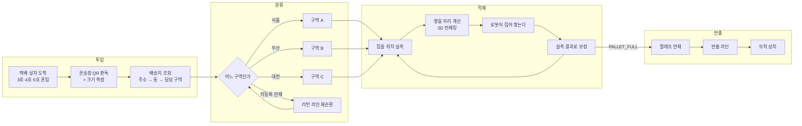
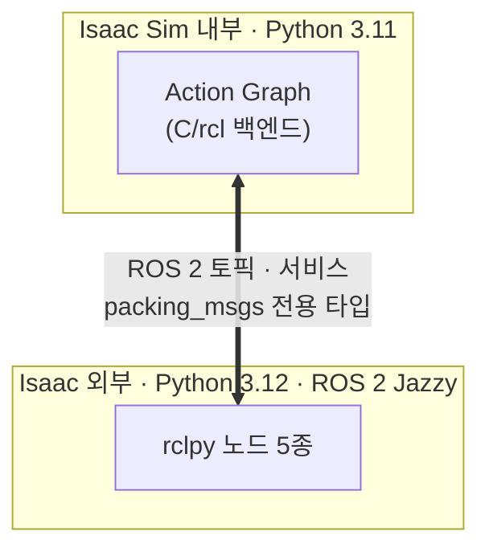
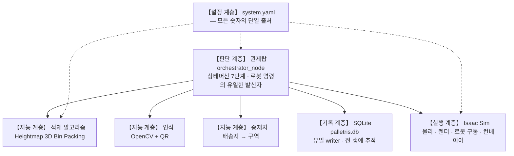
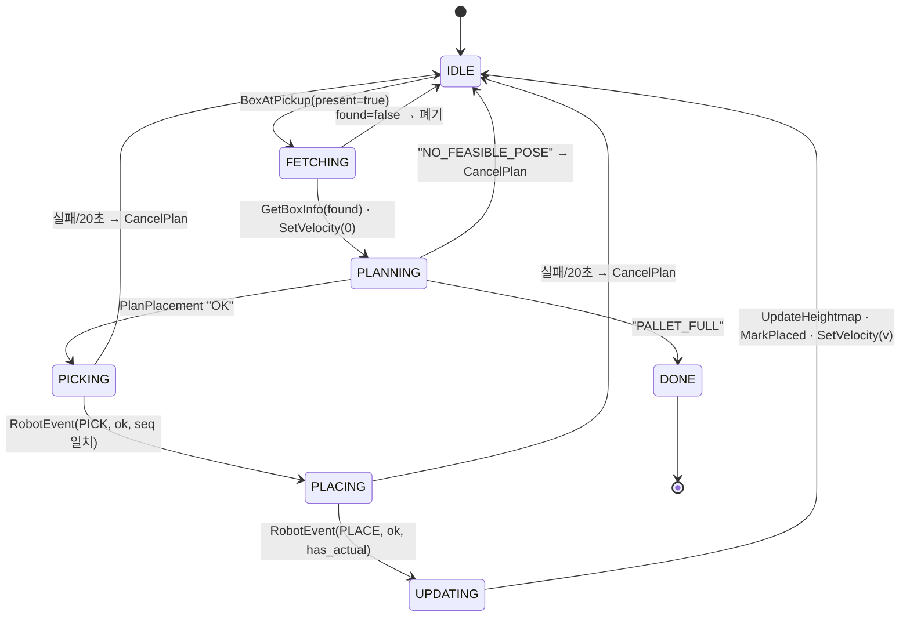
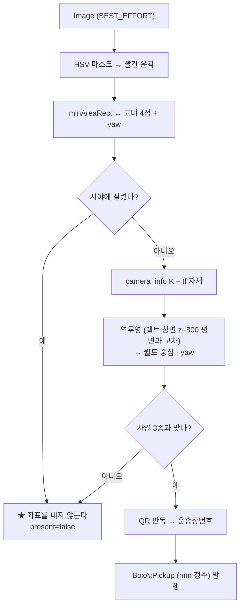
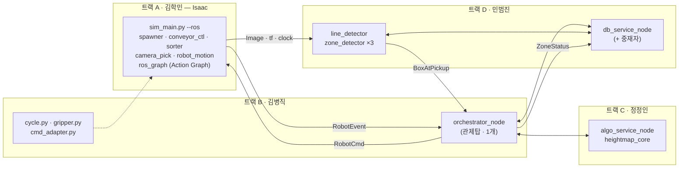
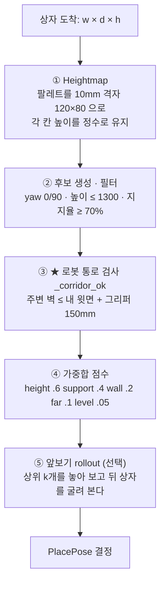

# Project Palletris — 최종 발표 상세 문서

> **2026-08-28 · 최종 구조 기준.** PPT 슬라이드를 만들 때 여기서 문장·표·다이어그램을
> 가져다 쓴다. `발표_내용정리.md`(슬라이드 골격)와 짝이다.
>
> **★ 이 문서의 규칙 — 숫자 출처를 밝힌다.**
> - `[실측]` = 우리가 Isaac 또는 코드로 직접 잰 값. 발표에 그대로 써도 된다.
> - `[정본]` = `system.yaml` · 사양서에 확정된 설계값.
> - `[출처 확인 필요]` = 발표에 쓰려면 **인용 출처를 붙여야 하는 외부 수치**다.
>   저장소에 근거가 없으므로 지어내지 않고 자리만 비워 뒀다.

---

## 목차

- **Part 1. 비즈니스** — [1. 비즈니스 요구사항](#1-비즈니스-요구사항) · [2. 시나리오 플로우](#2-비즈니스-플로우-차트--프로젝트-시나리오)
- **Part 2. 아키텍처** — [3. H/W](#3-시스템-아키텍처--hw-관점) · [4. 통신](#4-시스템-아키텍처--통신-관점) · [5. S/W](#5-시스템-아키텍처--sw-관점)
- **Part 3. 화면** — [6. 화면 정의서(UI)](#6-화면-정의서-ui)
- **Part 4. 개발자용** — [7. 세부 기능 flow](#7-세부-기능-flow--개발자용) · [8. 노드 아키텍처·인터페이스](#8-노드-아키텍처--인터페이스--개발자용)
- **Part 5. 기술 심화** — [9. 적재 알고리즘](#9-적재-알고리즘) · [10. 로봇 모델링·주요 모션](#10-로봇-모델링과-주요-모션)
- **Part 6. 결과** — [11. 검증 결과](#11-검증-결과) · [12. 방법론에서 배운 것](#12-검증-방법론에서-배운-것) · [13. 자체 평가](#13-자체-평가와-남은-과제)

---

# Part 1. 비즈니스

## 1. 비즈니스 요구사항

### 1-1. 문제 정의 — 무엇을 자동화하는가

**대상 공정: 물류센터 상차(적재) 공정.**
분류가 끝난 택배 상자를 **팔레트에 쌓아 트럭에 싣는** 마지막 구간이다.

이 공정이 자동화 대상이 되는 이유는 세 가지다.

| | 왜 문제인가 | 로봇이 왜 유리한가 |
|---|---|---|
| **신체 부담** | 3~9 kg 상자를 허리를 굽혀 반복 들어올린다. 근골격계 질환의 전형적 작업 형태다 | 가반 20 kg · 자세 무관 · 피로 없음 |
| **인력 수급** | 야간·심야 근무 비중이 높고 이직률이 높은 직군이다 | 24시간 동일 성능 |
| **적재 품질 편차** | 사람마다 쌓는 방식이 달라 팔레트 충전율과 붕괴 위험이 갈린다 | **결정적 알고리즘** — 같은 입력에 같은 결과 |

> **★ 우리가 실제로 푼 문제는 세 번째다.**
> 앞의 둘은 "로봇을 쓰면 된다"로 끝나지만, 세 번째는 로봇을 놓고도 남는다.
> **"어디에 쌓을 것인가"** 를 정하는 것이 이 프로젝트의 본체다.

### 1-2. 시장·현황 분석 (발표용 서술)

우리 저장소에는 시장 규모 수치가 없다. 아래는 **정성적 논거**이고, 숫자를 붙일
자리에는 출처 표시를 남겼다.

**① 이커머스 성장 → 물동량 증가, 그러나 인력은 그만큼 안 는다**
- 택배 물동량은 이커머스와 함께 증가해 왔다 `[출처 확인 필요 — 통계청/한국통합물류협회 택배 물동량 추이]`
- 반면 상하차 인력은 야간 근무·신체 부담 때문에 수급이 어렵다 `[출처 확인 필요]`
- **결과**: 같은 인원이 더 많이 처리해야 한다 → 자동화 압력

**② 상자 규격은 표준화됐는데, 적재는 아직 사람 손이다**
- 국내는 **우체국 택배 3~5호**가 사실상 표준으로 유통된다 (6호 폐지)
- **규격이 몇 종으로 좁혀졌다는 것은 알고리즘이 풀 수 있는 문제가 됐다는 뜻이다.**
  임의 형상이면 3D 빈패킹이 성립하지 않지만, 3종 혼입이면 격자로 다룰 수 있다
- 우리 프로젝트가 **3호/4호/5호 혼입** 조건을 그대로 쓴 이유가 이것이다 `[정본]`

**③ 팔레타이징 로봇은 이미 상용이다 — 차별점은 하드웨어가 아니다**
- 팔레타이징은 협동로봇 제조사가 **공식 대표 용도**로 내세우는 성숙한 응용이다
- 즉 경쟁 지점은 팔이 아니라 **"무엇을 어디에 놓으라고 지시하는 소프트웨어"** 다
- → 우리는 로봇 팔을 만들지 않고, **적재 계획과 그 계획의 실행 가능성 검증**에 집중했다

### 1-3. 정책·규제 환경

| 근거 | 내용 | 이 프로젝트와의 연결 |
|---|---|---|
| **중대재해처벌법** (2022 시행 · 2024 소규모 사업장 확대) | 사업주에게 안전보건 확보 의무 | 반복 중량물 취급 공정의 **로봇 대체 유인**이 법적 리스크 관리 차원에서 커진다 |
| **산업안전보건법** — 근골격계부담작업 유해요인조사 | 반복·중량물 작업의 주기적 조사·개선 의무 | 상하차는 전형적 부담작업. **개선 수단**으로 자동화가 검토된다 |
| **생활물류서비스산업발전법** (2021 시행) | 생활물류 산업 육성·종사자 보호 근거법 | 종사자 안전·근로여건 개선 요구의 제도적 배경 |
| **국토교통부 스마트물류센터 인증제** | 자동화·정보화 수준을 평가해 인증 | 자동 적재 설비 도입이 **인증 항목**과 직결된다 |

> `[출처 확인 필요]` — 슬라이드에 조문 번호나 인증 등급 기준을 넣으려면
> 법제처·국토교통부 원문을 인용할 것. 위 표는 **법령의 존재와 취지**만 적었다.

### 1-4. 기술 이슈 — 왜 "로봇만 놓으면 되는" 문제가 아닌가

이 프로젝트가 실제로 부딪힌 세 가지다. **발표의 핵심 논거이므로 그대로 쓸 것.**

| 이슈 | 교과서 가정 | 현실 |
|---|---|---|
| **온라인 문제** | 쌓을 상자 목록을 미리 다 안다 | **하나씩 도착한다.** 다음에 뭐가 올지 확률분포만 안다 |
| **되돌릴 수 없다** | 배치를 바꿔 가며 최적화한다 | **한 번 놓으면 끝.** 다시 집어 옮기는 사이클을 쓸 수 없다 |
| **★ 팔이 갈 수 있어야 한다** | 기하학적으로 들어가면 놓을 수 있다 | **기하학적으로 들어가도 팔이 못 내려가는 자리가 있다** |

세 번째가 가장 크다. 우리는 다층으로 쌓다가 **박스 사이에 폭 250 mm 짜리 협곡**을
만들었는데, 흡착 그리퍼 몸통이 **Ø245 mm** 라 팔이 그 안으로 못 내려갔다 `[정본]`.
알고리즘은 "여기 자리 있음"이라고 답하고 로봇은 `IK_FAIL` 을 냈다.

> **"놓을 수 있는 자리"와 "갈 수 있는 자리"는 다르다.**
> 이 한 문장이 우리 알고리즘에 `_corridor_ok`(로봇 통로 검사)가 들어간 이유다.

### 1-5. 요구사항 명세 (기능 / 비기능)

**기능 요구사항 (FR)**

| # | 요구사항 | 어디서 구현 | 검증 |
|---|---|---|---|
| FR-1 | 컨베이어로 오는 상자를 인식해 식별한다 | `line_detector` (cam1·cam2 + QR) | `verify_vision.py` |
| FR-2 | 배송지에 따라 3개 구역으로 분류한다 | 중재자 + 소터 | `verify_db.py` |
| FR-3 | 집을 위치를 **실측**한다 (스폰이 랜덤하다) | `zone_detector` (pick_cam) | `verify_vision.py` |
| FR-4 | 3D 적재 위치를 계산한다 | `algo_service_node` | `test_core.py` · Isaac |
| FR-5 | 로봇이 집어 계산된 자리에 놓는다 | 관제탑 + `Cycle` | `verify_cycle.py` |
| FR-6 | **실측 결과로 다음 계획을 보정한다** | `UpdateHeightmap` | Isaac 실측 |
| FR-7 | 만재 시 팔레트를 트럭으로 반출한다 | `SwapPallet` + 반출 라인 | Isaac |
| FR-8 | 처리 못 하는 상자는 리턴 라인으로 재순환한다 | 중재자 `RETURN` (3바퀴 상한) | Isaac |

**비기능 요구사항 (NFR)**

| # | 요구사항 | 목표 | 결과 |
|---|---|---|---|
| NFR-1 | **크래시 없음** — 어떤 예외에도 노드가 죽지 않는다 | 0회 | 입력 검증 + 20초 타임아웃 + `CancelPlan` 복귀 |
| NFR-2 | **재현성** — 같은 시드면 같은 결과 | 100 % | 계획 4/4 완전 동일 `[실측]` |
| NFR-3 | 사이클 타임 | ≤ 10.0 s | **8.2 s** `[실측]` |
| NFR-4 | 배치 계획 응답 | < 200 ms | 평균 **2 ms** (앞보기 끔) `[실측]` |
| NFR-5 | 중재자 응답 | ≤ 0.6 s | 응답 지연을 매 호출 계측·경고 |
| NFR-6 | 다중 PC 분산 실행 | 4대 | ROS 2 DDS · 실측 ping 0.25 ms |

---

## 2. 비즈니스 플로우 차트 — 프로젝트 시나리오

### 2-1. 한 장으로 보는 시나리오 (발표 메인 슬라이드)



### 2-2. 비즈니스 관점의 3가지 판단 지점

발표에서 이 셋만 설명하면 시나리오가 전달된다.

| 판단 | 무엇을 정하나 | 누가 | 제한 시간 | 틀리면 |
|---|---|---|---|---|
| **① 어디로 보낼까** | 상자 → 구역 A/B/C/리턴 | 중재자 | **0.6 초** | 답이 늦으면 상자가 이미 분기점을 지나 있다 |
| **② 어디에 쌓을까** | 팔레트 위 좌표 (x·y·z·yaw) | 적재 알고리즘 | 200 ms | 계획이 늦으면 벨트를 그만큼 세워 둔다 |
| **③ 지금 집어도 되나** | 로봇 사이클 시작·중단 | 관제탑 | 20 초 | 죽으면 라인 전체가 선다 |

> **★ 세 판단이 서로 다른 시간 척도를 가진다.** 0.6 초 / 200 ms / 20 초.
> 이것이 노드를 나눈 기준이다 — 하나로 묶으면 가장 느린 것이 나머지를 붙잡는다.

### 2-3. 예외 시나리오 — "안 되는 경우"를 설계에 넣었다

| 상황 | 시스템의 대응 | 왜 이렇게 |
|---|---|---|
| QR 을 못 읽었다 | 등록하지 않고 흘려보낸다 → 중재자가 **리턴 라인**으로 | 번호를 지어내면 **남의 박스 기록을 덮어쓴다.** 에러 없이 전부 틀린다 |
| 이 상자만 자리가 없다 (`NO_FEASIBLE_POSE`) | **그 상자만** 되돌리고 라인은 계속 | 여기서 종료하면 팔레트가 반만 찬 채 데모가 멈춘다 |
| 가장 작은 상자도 못 넣는다 (`PALLET_FULL`) | 팔레트 반출 → 트럭 상차 | 위와 **반드시 구분해야 한다** |
| 로봇이 20초 안에 답이 없다 | 계획 취소 후 IDLE 복귀. **노드는 안 죽는다** | 죽으면 나머지 두 구역까지 멈춘다 |
| 구역이 꽉 찼다 | 리턴 라인 한 바퀴 → 재도전 | 본선을 세우면 뒤 상자가 전부 밀린다 |
| 리턴 3바퀴 초과 | 폐기(`DespawnBox`) | 안 끊으면 **영원히 돈다** — prim 이 쌓여 프레임이 떨어진다 `[실측]` |
| 스토퍼에 상자가 12초째 서 있다 | 관제탑이 치운다 | 아무도 안 치우면 **라인이 통째로 막힌다** |

---

# Part 2. 시스템 아키텍처

## 3. 시스템 아키텍처 — H/W 관점

### 3-1. 셀 구성 (구역 1개 기준 · 3개 동일)

```
        ┌──────── 메인 컨베이어 (진행 ←X) ─────────┐
        │  cam1(등록)      cam2(검증)              │
        │        ↓             ↓                   │
   투입 ─────────────────────── 소터 ──┐            → 다음 구역
                                       │ 분기
                                  지선 컨베이어
                                       │
                                   [스토퍼]  ← pick_cam (상공 2300, 하향)
                                       │
                                    ▣ 로봇 H2017 (페데스탈 위)
                                       │  ← wrist_cam (그리퍼에 동승)
                                 팔레트 1200×800
                                       │
                                  셀 컨베이어 → 코너 커브 → 합류 라인 → 트럭
```

### 3-2. 로봇 선정 근거 — 왜 H2017 인가 `[정본]`

| 모델 | 도달 | 소요/도달 | 판정 | 이유 |
|---|---|---|---|---|
| M0609 | 900 mm | 162 % | ✗ | 도달 미달 + 유효 가반 4 kg |
| **H2017** | **1,700 mm** | **86 %** | **✓** | **팔레트 전체를 한 자세에서 덮는다 → 턴테이블 불필요** |
| P3020 | 2,030 mm | 72 % | △ | 팔레타이징 전용이나 시뮬 에셋(USD) 미제공 |

**팔레타이징 권장 상한은 최대 도달의 85 % 수준**이다. 그 이상에서는 팔이 펴져
자세 자유도와 가반하중이 함께 떨어진다. H2017 의 최원점은 **1,667 mm = 86 %** 다.

### 3-3. 엔드이펙터 — 실질 상한은 가반하중이 아니다 `[정본]`

| 항목 | 값 |
|---|---|
| 방식 | 진공 흡착 · Ø50 mm **4 패드** |
| 실용 흡착력 | **16 kgf** (진공 −60 kPa · 안전계수 3) |
| 그리퍼 자중 | 2 kg → 유효 가반 **18 kg** |
| **실질 중량 상한** | **10 kg** |

> **★ 병목이 팔이 아니라 골판지다.** 유효 가반 18 kg, 흡착력 16 kgf 인데
> **상한은 10 kg** 이다. 그 이상이면 상자 상판(골판지)이 먼저 찢어진다.
> 실무에서 흡착식이 다루는 중량이 보통 10 kg 이하인 이유다.
> 우리 최대 상자(5호)가 9 kg 인 것은 이 상한 안에 들어가도록 정한 것이다.

**그리퍼 치수가 알고리즘 제약이 된다** — 발표에서 반드시 연결할 것.

| 치수 | 값 | 알고리즘에서 하는 일 |
|---|---|---|
| 몸통 지름 | **Ø245 mm** | `_corridor_ok` 의 **통로 반경**(122 mm) |
| 길이 | **150 mm** | 벽 높이 기준 = "내 상자 윗면 + 150" |

### 3-4. 좌표계 설계 — 도크 규약 `[정본]`

> **z = 0 은 도크 바닥 = 트럭 적재함 바닥이다.** 야드 지면이 아니다 (z = −850).

이 한 줄이 두 가지를 한꺼번에 해결한다.

1. **"팔레트를 들지 않고 밀어서 트럭에 넣는다"** 가 높이차 0 으로 이미 만족된다.
2. **페데스탈이 작아진다.** 지면 기준으로 풀면 팔레트 상면 1,000 · 적재 상단 2,300 이
   되어 받침대가 **약 1,580 mm** 필요하다 — 79 kg 로봇을 1.6 m 구조물에 올리는 것은
   비현실적이다. 도크로 풀면 **900 mm** 로 끝난다.

### 3-5. 컴퓨팅 · 네트워크

| PC | IP | 역할 | 왜 나누나 |
|---|---|---|---|
| PC1 | 10.10.0.1 | **Isaac Sim 전용** | 렌더·물리에 CPU/GPU 를 몰아준다 (카메라 FPS 게이트) |
| PC2 | 10.10.0.2 | DB · 인식 · 중재자 | |
| PC3 | 10.10.0.3 | 적재 알고리즘 | Isaac 없이 노트북에서도 개발 가능 |
| PC4 | 10.10.0.4 | 모니터링 · rqt · 로그 | |

**2.5G 스위치 + 고정 IP + FastDDS 유선 화이트리스트** · 실측 ping **0.25 ms** `[실측]`

---

## 4. 시스템 아키텍처 — 통신 관점

### 4-1. 통로는 ROS 2 **하나뿐**이다



**문제**: Isaac Sim 내장 파이썬은 3.11, ROS 2 Jazzy 는 3.12 다.
같은 프로세스에서 `packing_msgs` 를 import 할 수 없다.

**해결**: **Action Graph 가 직접 ROS 2 로 말한다.** Action Graph 의 백엔드는
C/rcl 이라 파이썬 버전 차이를 우회한다. 별도 브리지 프로세스가 필요 없다.

**★ 폐기한 방식 — 발표에서 "개선 과정"으로 쓸 것**

| 폐기 | 무엇이 문제였나 | 대체 |
|---|---|---|
| JSON 소켓 브리지 (`localhost:8765`) | **다중 PC 실행이 불가능하다.** localhost 는 한 대 안에서만 산다 | Action Graph 가 직접 ROS 2 발행 |
| `std_msgs/String` + JSON 문자열 | 타입이 없어 필드 오타가 **런타임에도 안 잡힌다** | `packing_msgs` 전용 타입 17종 |
| `json.dumps/loads` 로 메시지 조립 | 단위(mm/m) 혼동이 조용히 통과한다 | 필드에 직접 대입 |
| 브리지 폴링 | 지연이 폴링 주기에 묶인다 | 구독 콜백 |

### 4-2. 왜 어떤 것은 토픽이고 어떤 것은 서비스인가

| | 토픽 | 서비스 |
|---|---|---|
| **쓰는 곳** | 로봇 명령·결과 · 상태 · 이미지 · tf · clock | 계획 · DB · 씬 제어 |
| **기준** | **응답까지 5~10초 걸리는 것** | 즉답이 오는 것 |

> **로봇 명령이 서비스가 아닌 이유:** 모션이 5~10초 걸린다. 서비스로 묶으면 그동안
> 응답을 붙들고 있어야 하고 타임아웃 관리가 복잡해진다. 대신 **`seq` 일련번호**로
> 요청-응답을 짝짓는다.

### 4-3. 통신 규약 5개 — 어기면 "에러 없이" 고장난다

이 표가 발표에서 가장 실무적인 슬라이드다.

| # | 규약 | 어기면 나타나는 증상 |
|---|---|---|
| 1 | 모든 노드에 `use_sim_time:=true` | tf 조회 전부 실패 (`extrapolation`) |
| 1' | 단, **`/clock` 발행자가 없으면 절대 켜지 마라** | **모든 타이머가 멎는다.** 노드는 살아 있고 에러도 없는데 로봇 20초 감시까지 죽는다 |
| 2 | `RobotCmd.seq` 를 `RobotEvent.seq` 가 그대로 되돌린다 | 타임아웃 뒤 늦게 온 답이 **다음 상자의 결과로 둔갑**한다 |
| 3 | `has_actual == true` 일 때만 실측값을 되먹인다 | 오차가 누적돼 알고리즘은 1300 안이라 믿는데 실물이 넘는다 |
| 4 | 중재자는 **0.6 초**, 일반 서비스는 2.0 초 | 2.0 초를 쓰면 답이 올 때 상자가 이미 분기점을 지나 있다 |
| 5 | 카메라 QoS 는 **BEST_EFFORT** | 이미지가 **하나도** 안 온다 |

> **★ 공통점: 전부 "에러가 안 나는" 고장이다.**
> 그래서 통신 계약을 문서로 못 박고, `ros_health.sh` 로 매 실행 검사한다.

### 4-4. 그래프 헬스체크 — `sub0` 이 제일 위험하다

| 표시 | 뜻 | 위험도 |
|---|---|---|
| `OK` | 발행자·구독자 둘 다 있다 | — |
| `pub0` | 내는 쪽이 안 떴다 | 중간 — 데이터가 없으니 곧 알아챈다 |
| **`sub0`** | **데이터는 나가는데 아무도 안 듣는다** | **높음 — 에러가 안 난다** |

---

## 5. 시스템 아키텍처 — S/W 관점

### 5-1. 계층 구조



### 5-2. 설계 원칙 5개

| 원칙 | 무엇 | 지키면 얻는 것 |
|---|---|---|
| **① 단일 출처** | 모든 숫자는 `system.yaml` 하나. 코드에 상수를 박지 않는다 | 팔레트를 90° 돌려도 조용히 틀린 값이 안 생긴다 |
| **② 코어와 껍데기 분리** | 알고리즘·비전 코어는 **ROS 의존성 0** | Isaac 없이 노트북에서 시드 스윕 · 병렬 개발 |
| **③ 명령 발신자 하나** | `/robot/cmd` 는 관제탑만 낸다 | 명령 순서가 보장된다 |
| **④ 비동기 일관성** | 전부 `call_async` + 콜백. `spin_until_future_complete` 금지 | executor 가 자기 자신을 기다려 멈추는 사고가 없다 |
| **⑤ 새 기능은 기본 꺼짐** | 새 가중치·규칙은 `0` 이 기존 동작 | **같은 코드로 A/B 를 잰다.** 회귀가 안 생긴다 |

> ⑤ 가 이 프로젝트의 실질적 무기였다. `w_wall` · `w_far` · `w_level` · 앞보기 ·
> 낙하 완화 · 방향성 통로가 **전부 기본 0/꺼짐**으로 들어왔다. 그래서 "켜기 전 결과"를
> 언제든 재현할 수 있고, 개선분을 정확히 그 항의 몫으로 귀속할 수 있다.

### 5-3. 안정성 설계 — 크래시 없음(NFR-1)을 어떻게 보장했나

| 위험 | 대응 |
|---|---|
| 콜백 예외를 rclpy 가 **삼킨다** | 모든 구독·서비스 콜백이 입력을 먼저 검증한다 |
| 잘못된 치수(0·NaN)가 알고리즘을 죽인다 | `_bad_size` 가 걸러 `NO_FEASIBLE_POSE` 로 **답한다** |
| 로봇이 응답하지 않는다 | 20초 타임아웃 → `CancelPlan` → IDLE |
| 서비스 응답이 안 온다 | 2초 타임아웃 · 재시도 1회 → 계획 버리고 복귀 |
| 재시도로 같은 요청이 두 번 온다 | `UpdateHeightmap` 을 **멱등**으로 |
| 상자가 스토퍼에 끼었다 | 12초 감시 → `DespawnBox` |
| 상자가 리턴 라인을 영원히 돈다 | 3바퀴 상한 → 폐기 |
| DB 를 두 프로세스가 연다 | **writer 는 `db_service_node` 하나.** 도구는 `mode=ro` |

---

# Part 3. 화면

## 6. 화면 정의서 (UI)

> 이 프로젝트는 별도 웹/데스크톱 UI 를 만들지 않았다. 대신 **운영자가 보는 화면 6개**를
> 목적별로 나눠 두었다. 발표에서는 ①②③ 세 개만 보여 주면 충분하다.

### 6-1. 화면 목록

| # | 화면 | 도구 | 주 사용자 | 갱신 |
|---|---|---|---|---|
| **①** | **디지털 트윈 뷰** | Isaac Sim GUI 뷰포트 | 전원 (발표) | 실시간 |
| **②** | **실시간 적재 뷰어** | `ros2 run packing_algo live_view` | 알고리즘 | 스냅샷 폴링 |
| **③** | **운영 지표 대시보드** | `scripts/report.py --watch` | 운영·발표 | 2 초 |
| ④ | 그래프 헬스체크 | `scripts/ros_health.sh` | 통합 담당 | 수동/`watch` |
| ⑤ | 상자 이력 조회 | `scripts/db_peek.py --box BOX001` | 디버깅 | 요청 시 |
| ⑥ | 카메라 뷰 | `rqt_image_view` | 비전 | 30 Hz |

### 6-2. ① 디지털 트윈 뷰 — 화면 정의

```
┌──────────────────────────────────────────────────────────┐
│  Isaac Sim 뷰포트                                         │
│                                                          │
│   [메인 컨베이어] ──▶ 소터 ──▶ 지선 ──▶ 스토퍼            │
│                                          │                │
│                                       ▣ 로봇              │
│                                          │                │
│                                    ▤▤▤ 팔레트 (적재 중)    │
│                                                          │
│  ┌ 카메라 전환 ─────────────────────────────────────┐    │
│  │ perspective / cam1 / cam2 / pick_cam / wrist_cam │    │
│  └──────────────────────────────────────────────────┘    │
└──────────────────────────────────────────────────────────┘
```

| 표시 항목 | 값 | 비고 |
|---|---|---|
| 구역 3개 동시 | A · B · C | 로봇이 **서로 기다리지 않고** 각자 돈다 |
| 상자 색상 | 3호/4호/5호 크기별 머티리얼 | 육안으로 혼입 확인 |
| 카메라 4종 | 뷰포트 전환 | **발표에서 pick_cam 을 한 번 보여줄 것** |

> ⚠ **오프스크린 렌더는 GUI 조명 리그를 못 받는다.** 뷰포트는 멀쩡한데 카메라
> 이미지만 캄캄한 상태가 실제로 있었다. 돔 라이트가 "사양"에 들어간 이유다.

### 6-3. ② 실시간 적재 뷰어 — 화면 정의

```
┌─────────────────┬──────────────────┬──────────────────┐
│  3D 적재 상태    │  Heightmap 히트맵 │  적재율 추이      │
│  (bar3d)        │  (120 × 80 격자)  │  (시간축 꺾은선)   │
│  색 = 상자 크기  │  색 = 높이[mm]    │                  │
│  3호 파랑        │                  │  ── fill_rate    │
│  4호 주황        │                  │  ── capacity     │
│  5호 초록        │                  │                  │
└─────────────────┴──────────────────┴──────────────────┘
```

| 항목 | 정의 |
|---|---|
| 입력 | `algo_service_node` 가 떨구는 JSON 스냅샷 (**구역마다 다른 파일**) |
| 갱신 | 파일 폴링 |
| **왜 ROS 를 안 쓰나** | algo 는 "아무것도 발행하지 않는다"가 계약이다. 파일이라 그 계약을 안 건드리고, 노드를 껐다 켜도 뷰어는 살아 있다 |

### 6-4. ③ 운영 지표 대시보드 — 화면 정의

| 지표 | 정의 | 함정 |
|---|---|---|
| 처리량 | 시간당 적재 개수 | |
| **인식률** | `scanned / (등록 성공 + 인식 실패)` | ★ **분모가 함정이다.** 등록된 것만 세면 **언제나 100 %** 다 |
| pick&place 성공률 | `placed / (placed + pick_failed)` | |
| 평균 사이클 | `AVG(placed_at − picked_at)` | |
| 로봇 유휴율 | `1 − 작업시간합 / 경과시간` | |
| **적재율** | 상자 부피합 / (바닥넓이 × **실제 최고높이**) | 분모를 1300 고정으로 쓰면 부당하게 낮게 나온다 |
| 최고 높이 | heightmap 최댓값 | |

> **★ 분모가 0 이면 `0.0` 이 아니라 `-1.0` 을 돌려준다.**
> "성공률 0 %" 와 "아직 잴 수 없음" 은 다르다. 0 으로 뭉개면 시작 직후 화면에
> 성공률 0 % 가 크게 찍혀서 **없는 문제를 쫓게 된다.**

> **★ 실시간 화면과 최종 보고서가 쿼리 함수 하나를 공유한다.**
> 복붙하면 발표 자리에서 두 숫자가 갈린다.

---

# Part 4. 개발자용

## 7. 세부 기능 flow — 개발자용

### 7-1. 관제탑 상태머신 (구역당 1 인스턴스 · 총 3)



**단계별 상세**

| 단계 | 트리거 | 하는 일 | 실패 시 |
|---|---|---|---|
| ① IDLE | `BoxAtPickup(present=true)` | **벨트를 먼저 세운다** — 안 세우고 흡착하면 상자가 끌려간다 | 12초 지나면 폐기 |
| ② FETCHING | 벨트 정지 확인 | `GetBoxInfo` 로 **치수**를 받는다 | `found=false` → 폐기 |
| ③ PLANNING | 치수 확보 | `PlanPlacement` | 3갈래 (표 참조) |
| ④ PICKING | 계획 확보 | `RobotCmd(PICK)` 발행 · `seq++` | 20초 → 취소·복귀 |
| ⑤ PLACING | `PICK` 성공 | `RobotCmd(PLACE)` 발행 | 20초 → 취소·복귀 |
| ⑥ UPDATING | `PLACE` 성공 + `has_actual` | `UpdateHeightmap`(**실측**) · `MarkPlaced` | 경고만, 계속 진행 |
| ⑦ → IDLE | 갱신 완료 | 벨트 재가동 · 빗장 설정 | — |

**★ 빗장 3개** — 셋 다 "**에러 없이 엉뚱하게 도는**" 버그를 막는다.

| 빗장 | 무엇을 막나 | 안 걸면 |
|---|---|---|
| `_rejected_id` | 방금 버린 상자를 또 집으려 든다 | 집고-버리고-집는 무한 루프. **라인만 선다** |
| `_done_id` | 방금 쌓은 상자를 또 쌓는다 | 큐에 남은 이전 프레임 때문에 **같은 상자를 두 번 쌓았다** `[실측]` |
| `seq` | 늦게 온 답을 새 상자 결과로 처리 | 실패가 다음 상자의 실패로 둔갑 |

### 7-2. 인식 파이프라인



**설계 판단 4개**

| 판단 | 내용 | 왜 |
|---|---|---|
| 카메라 파라미터를 **코드에 안 박는다** | K 는 `camera_info`, 자세는 tf, 프레임 이름은 이미지 헤더 | 씬 prim 이름이 바뀌어도 코드를 안 고친다 |
| 잘린 상자는 **좌표를 안 낸다** | `present=false` 를 낸다 | 잘린 사각형의 중심은 진짜 중심이 아니다. **틀린 좌표는 없는 것보다 나쁘다** |
| `box_id` 는 **QR 이 정본** | 세어서 만들지 않는다 | 하나만 놓쳐도 그 뒤 전부가 한 칸씩 밀려 남의 기록을 덮는다 |
| QR 은 **한 번 읽으면 기억한다** | 재시도하지 않는다 | 해독 실패는 무작위가 아니라 **자세에 따라 결정적**이다. 한 자세로 굳으면 몇 번을 봐도 계속 실패한다 `[실측: 0 % 아니면 100 %]` |

**추론 주기 제한 (평가 항목 "처리 효율")**
`zone_detector` 는 관제탑의 `ZoneStatus.state == IDLE` 일 때만 추론한다.
집는 중에는 새 좌표가 필요 없고, **오히려 팔이 화면에 들어와 오검출을 만든다.**

### 7-3. QR 라벨 규약

| 항목 | 값 | 근거 `[실측]` |
|---|---|---|
| 페이로드 | **운송장번호 하나뿐** (`BOX001`) | 실제 송장 바코드가 그렇다 — 번호만 있고 주소는 사람이 읽는 글자다 |
| 모듈 크기 | 7 mm (25×25 모듈 → QR 175 mm) | 6mm 97 % / **7mm 98 %** / 8mm 99 %(테두리 위험) |
| 여백 | 3 모듈 → 라벨 **217 mm** | 상자 윗면이 빨강이라 여백이 없으면 경계를 못 잡는다 |
| 왜 217 인가 | 3호 윗면이 250 mm | 더 키우면 **빨간 테두리가 사라져** 상자 윤곽을 못 잡는다 |

> **구역(A/B/C)을 QR 에 넣지 않는다.**
> `운송장번호 → boxes_master.address → 동 → zone_map → 구역`.
> 실제 택배 분류와 같은 순서다. 구역을 QR 에 박으면 물류센터가 담당 구역을 바꿀 때
> **라벨을 전부 다시 찍어야 한다.**

### 7-4. 데이터 모델

| 테이블 | 무엇 | 왜 필요한가 |
|---|---|---|
| `boxes_master` | 실행 **전에** 까는 정답지 | 이게 없으면 **놓친 상자를 셀 수 없다** |
| `zone_map` | 동(洞) → 구역 배정표 | 설정이 아니라 **데이터**다. 실행 중에도 바뀔 수 있다 |
| `boxes_sorted` | 실행 중 실제로 흘러간 상자 | 인식 실패하면 여기 행이 안 생긴다 |
| `box_events` | **상태 전이 이력** | 단일 컬럼은 덮어써진다. 인식률·성공률·사이클타임이 전부 여기서 나온다 |
| `scan_misses` | 인식 실패 기록 | **인식률의 분모** |
| `recirculation` | 재순환 횟수 | `retry_count`(실패)와 `bypass_count`(정상 우회)를 **절대 합치지 않는다** |

**상태 전이**
`SPAWNED → SCANNED → VERIFIED → DIVERTED → PICKED → PLACED`
(이탈: `PICK_FAILED` · `REJECTED`)

---

## 8. 노드 아키텍처 · 인터페이스 — 개발자용

### 8-1. 노드 배치와 소유



### 8-2. 노드별 계약 — "하지 않는 일" 이 더 중요하다

| 노드 | 개수 | 하는 일 | **하지 않는 일** |
|---|---|---|---|
| `orchestrator_node` | **1** | 구역 3개 상태머신 · **로봇 명령의 유일한 발신자** | 자리 계산 · DB 직접 접근 |
| `algo_service_node` | 1 | heightmap 3장 소유 · 배치 좌표 계산 | **`/robot/cmd` 발행 금지** · 아무것도 발행 안 함 |
| `db_service_node` | 1 | `.db` 유일 writer · 중재자 | 로봇 명령 |
| `line_detector` | 1 | cam1 등록 · cam2 검증 | 로봇 명령 · box_id 생성(QR 이 정본) |
| `zone_detector` | **3** | pick_cam 좌표 실측 | 로봇 명령 |

**왜 관제탑은 1개인데 인식은 3개인가** — 발표에서 반드시 대비할 것.

| | 관제탑 | 구역 인식 |
|---|---|---|
| 프로세스 | **1** | **3** |
| 이유 | 상태머신이라 **하나여야 명령이 안 겹친다** | 이미지 추론이라 **GIL 때문에 나눠야 코어를 실제로 나눠 쓴다** |
| 나누면/합치면 | 누가 먼저 보냈는지 알 수 없다 | 세 구역 추론이 줄을 서서 돈다 |

> ⚠ **정정**: `발표_내용정리.md` 슬라이드 4·13 의 "관제탑 3" 은 **틀렸다.**
> 최종 구조는 **관제탑 1개**다 (2026-08-26 이중화 해소).

### 8-3. 메시지 타입 (7종)

| 타입 | 발행 → 구독 | 핵심 필드 | 설계 근거 |
|---|---|---|---|
| `BoxAtPickup` | 인식 → 관제탑 | `present` · `x_mm` · `y_mm` · `yaw_deg` | `geometry_msgs/Pose` 를 안 쓴다 — 단위가 m float 라 경계마다 변환이 끼고, 쿼터니언에서 yaw 빼는 코드가 복붙된다 |
| `RobotCmd` | 관제탑 → 로봇 | `action` · **`seq`** · `x/y/z_mm` · `size_*` | `z_mm` 은 **밑면**. 토픽인 이유는 §4-2 |
| `RobotEvent` | 로봇 → 관제탑 | **`seq`** · `ok` · `reason` · **`has_actual`** · `actual_*` | `has_actual` 게이트가 자기교정의 안전장치 |
| `ZoneStatus` | 관제탑 → 중재자·모니터 | `state` · `fill_rate` · **`accepting`** | 중재자는 `accepting` **한 칸만** 본다 |
| `PlacePose` | (필드) | `x/y_mm` **중심** · `z_mm` **밑면** | z 를 중심으로 쓰면 팔레트에 절반 파묻힌다 |
| `BoxInfo` | (필드) | 치수 · `weight_g` · `retry_count` · `status` | |
| `MetricsSummary` | DB → 모니터 | 지표 11개 | **JSON 문자열이 아니라 전용 타입** → `rqt_plot` 이 바로 그린다 |

### 8-4. 서비스 (17종)

| 계열 | 서비스 | 요청 → 응답 |
|---|---|---|
| **algo** | `PlanPlacement` | `zone, box_id, w,d,h` → `ok, PlacePose, score, message` |
| | `UpdateHeightmap` | `+ actual_pose` → `ok, fill_rate, placed_count, max_height_mm` |
| | `CancelPlan` · `ResetHeightmap` | `zone[, box_id]` → `ok` |
| **db** | `RegisterBox` · `GetBoxInfo` · `VerifyBox` · `SetStatus` · `MarkPlaced` · `ZoneQueue` · `ReportMiss` | |
| **중재자** | `DiverterRequest` | `box_id` → `target("A"/"B"/"C"/"RETURN"), reason` |
| | `DiverterDecide` | `diverter_id, box_id` → `divert, target, reason` |
| **씬** | `SetVelocity` · `DespawnBox` · `SetSpawnEnabled` · `SwapPallet` | |

**`PlanPlacement.message` 는 3가지뿐이다** — `"OK"` · `"NO_FEASIBLE_POSE"` · `"PALLET_FULL"`.
코어가 예외를 던져도 서비스 계층이 `NO_FEASIBLE_POSE` 로 바꿔 **반드시 답한다.**
콜백에서 예외가 나가면 rclpy 는 응답을 아예 안 보내고, 관제탑은 2초 뒤 재시도해
같은 예외를 또 만난다 — **상자 하나가 라인을 영구히 막는다.**

### 8-5. 왜 중재자가 DB 노드 안에 사는가

중재자는 **0.6 초** 안에 답해야 한다. 별 프로세스로 빼면 판단에 필요한
`retry_count` · `dest` · `zone_map` 을 서비스로 왕복해서 가져와야 하고,
**그 왕복이 0.6 초를 잡아먹는다.** 같은 프로세스에서 커넥션을 공유하면 조회가
마이크로초다. 같은 이유로 `line_detector` 와 `zone_detector` 도 한 패키지에 둔다.

### 8-6. 동시성 설계

| 위치 | 설계 |
|---|---|
| 모든 rclpy 노드 | `MultiThreadedExecutor` + `ReentrantCallbackGroup` |
| 서비스 호출 | **전부** `call_async` + `add_done_callback` |
| algo | 구역마다 락 하나 — `plan`(읽기)/`update`(쓰기)가 겹치면 반쯤 쓰인 heightmap 위에서 자리를 고른다 |
| DB | `check_same_thread=False` + 쓰기 `Lock` 직렬화 · WAL |
| Isaac | **메인 스레드는 절대 블로킹 금지** — 모션은 워커 스레드 |

> **★ Isaac 스레드 규칙이 가장 위험하다.** 모션 판정을 내리는 `rm.step()` 도
> 메인 스레드다. 메인에서 모션 완료를 기다리면 **서로를 기다려 100 % 데드락**이다.

---

# Part 5. 기술 심화

## 9. 적재 알고리즘

### 9-1. 알고리즘 선택 — 왜 Heightmap 인가

| 계열 | 우리에게 맞나 | 이유 |
|---|---|---|
| Wall building | ✗ | 오프라인 전제 (전체 목록을 알아야 벽을 설계한다) |
| Layer building | △ | 같은 높이 상자가 모여야 한다. 3종 혼입에 안 맞는다 |
| **DBLF** (Deepest-Bottom-Left-Fill) | **대조군 채택** | 온라인에 쓸 수 있는 가장 단순한 기준선 |
| **Extreme Point** | **대조군 추가** | 문헌 표준 온라인 휴리스틱 |
| **Heightmap + 가중합** | **★ 채택** | 팔레타이징 실무 표준 · **로봇 제약을 자연스럽게 얹을 수 있다** |
| 심층강화학습 (DRL) | ✗ | 6일 일정 · 학습 데이터 없음 · **재현성(Play/Stop) 요구와 충돌** |

> **★ 채택 이유의 핵심은 마지막이다.** Heightmap 은 격자마다 높이를 들고 있으므로
> "이 자리 주변 벽이 얼마나 높은가"를 **슬라이딩 최대 한 번**으로 잰다.
> 그게 곧 `_corridor_ok`(로봇이 내려올 수 있나)다. 다른 표현으로는 이 검사를
> 얹기가 훨씬 어렵다.

### 9-2. 구조 5단계



### 9-3. 가중치 5항 — 각각 무엇을 막는가

| 항 | 값 | 역할 | 없으면 |
|---|---|---|---|
| `w_height` | 0.6 | 낮은 자리 우선 (바닥부터) | 위로만 쌓는다 |
| `w_support` | 0.4 | 밑면이 잘 받쳐지는 자리 | 외팔보로 걸쳐 놓고 무너진다 |
| `w_wall` | **0.2** | 가장자리 밀착 | **자투리 공간이 흩어져** 나중에 오는 5호(480×380)가 들어갈 연속 영역이 사라진다 `[실측 48.1 → 54.9 %]` |
| `w_far` | **0.1** | 로봇에서 **먼 쪽**부터 | 가까운 쪽을 먼저 채우면 뒤에 **팔이 이미 놓인 상자 위를 넘어야** 한다 `[실측 팔 넘김 5.3 → 3.1회]` |
| `w_level` | **0.05** | 윗면이 이웃과 평평하면 가점 | **절벽**이 생겨 지지율에 걸린다 |

> **★ `w_level` 이 필요한 이유 — 이 팔레트의 표면은 "조금 울퉁불퉁"해지지 않는다.**
> 상자 높이가 210 / 280 / 340 뿐이라 단차는 늘 60 mm 이상이다.
> **평평 아니면 절벽**이다. 절벽이 생기면 지지율 70 % 에 걸려 **자리가 있는데도**
> 못 놓는다 — 실측 계획실패 26.6회 중 **19.6회가 지지율 미달**이었고, 그때도
> 높이·통로로는 셀의 27 % 가 남아 있었다. 사후에 지지율을 낮추는 대신
> **절벽을 처음부터 안 만드는** 쪽으로 풀었다.

> ⚠ **`w_level` 은 0.05 여야 한다.** 0.1 이상은 튜닝 시드에서만 오르고 검증 시드에서
> 사라진다(과적합). 0.05 는 링 크기 2/4/8 어디서나 같이 오른다 — 과적합이 아니라는
> 신호다. **시드 3집합 교차검증**으로 확인했다 (튜닝 1–30 / 검증 31–70 / 2차 71–170).

### 9-4. ★ `_corridor_ok` — 이 프로젝트의 핵심 차별점

**무엇을 보나**: 배치 후보 주변 **그리퍼 몸통 반경(122 mm)** 안의 벽 높이가
**"내 상자 윗면 + 그리퍼 길이 150 mm"** 이하인가.

**두 번의 잘못된 시도와 실측**

| 시도 | 무슨 생각이었나 | 결과 `[실측]` |
|---|---|---|
| `gripper_clearance` 30 → 60 mm | "여유를 늘리면 협곡이 준다" | **협곡 2.55 → 2.50** (거의 그대로) · **적재율 −4.6 %p**. 방향이 틀렸다 |
| 통로 반경 122 → 200 mm 일괄 | "반경을 키우면 확실하다" | 팔 걸림 0회, 그러나 **적재 26 → 22개** |
| 2단 통로 (122 / 320) | "팔은 위로 갈수록 굵다" | 팔 걸림 1회 · 25개 |
| **기준을 밑면 → 윗면+150 으로** | **비교 대상 자체가 틀렸다** | ✓ **채택** |

> **★ 진짜 원인은 여유폭이 아니라 "무엇과 비교하느냐" 였다.**
> 구 코드는 반경 30 mm 링을 상자 **밑면**과 비교했다. 그게 두 가지를 동시에 망쳤다:
> ① **너무 빡빡하다** — 상자는 자기보다 높은 이웃 **옆에 미끄러져 들어가도** 문제없다.
>    밑면 기준은 그걸 금지한다.
> ② **정작 부딪히는 걸 못 본다** — 실제로 닿는 것은 상자 윗면 **위**를 지나는
>    팔뚝(link_4, 길이 594 mm)인데, 밑면 기준으로는 그 높이가 시야에 없다.

### 9-5. ★ 낙하 완화 — 단일 최대 개선 `[실측 +4.7 %p]`

**착상**: `_corridor_ok` 가 존재하는 이유는 **팔이 상자를 따라 내려가야** 하기
때문이다. **그런데 떨어뜨리면 팔이 안 내려간다.**

| 항목 | 값 |
|---|---|
| 대상 | **3.5 kg 이하** (= 3호만). 무거우면 낙하 충격이 스택을 친다 |
| 높이 기준 | 상자 윗면을 `협곡 입구 − 그리퍼 길이 150 mm` 까지 내리고 놓는다 |
| 효과 | 480 mm 낙하(이탈 22.3 mm) → **120 mm 낙하(이탈 1.5 mm)** |
| **적재율** | **70.8 % → 75.5 %** |

> 계획이 낙하를 몰랐을 때는, 시드 7 끝 시점에 z=560 · 0.14 m² · 여유 740 mm 짜리
> 자리가 **높이로는 3종이 다 들어가는데 통로가 막아** 비어 있었다 `[실측]`.

### 9-6. 앞보기 (Lookahead Rollout) — 만들어 놓고 **끈** 이유

**착상**: `plan()` 이 2 ms 인데 로봇 모션이 8초다. **계산 예산이 1000배 남는데
한 수만 보고 확정하고 있었다.**

**방식**: 상위 k개 후보를 각각 놓아 보고, 그 뒤 상자를 혼입비대로 굴려
depth 개까지 채운 뒤 **미래 부피가 큰 자리**를 고른다.

**효과** `[실측 교차검증]`: 검증 시드 59.0 → 60.2 % (**+1.2 %p**)

**그런데 껐다:**

| 설정 | 평균 | 95 % | 최악 | 명세 상한 200 ms |
|---|---|---|---|---|
| 꺼짐 | 2 ms | 7 ms | 22 ms | **OK** |
| k4/r3/d4 | 57 ms | 206 ms | 407 ms | **초과** |
| k4/r3/d8 | 131 ms | 436 ms | 719 ms | **초과** |

> **⚠ 시간 예산으로 잘라 내는 방법은 쓰면 안 된다.** 결과가 기계 속도에 따라 달라져
> **평가 항목 "재현성(Play/Stop)"이 그 자리에서 깨진다.**
> 그래서 수용기준을 낮춰 통과시키는 대신 **끄고 팀 판단으로 넘겼다.**

> **부수적 발견**: 진짜 다음 상자를 알려 줘도 이득이 거의 없다 (추측 59.0 % vs
> 진짜 2개 59.4 %). **`PlanPlacement` 에 upcoming 목록을 추가할 값어치가 없다** —
> 혼입비만으로 충분하다. 인터페이스를 안 늘려도 된다는 근거다.

### 9-7. 성능 — 단계별 기여도 `[실측 · 시드 20개 · 동일 상자 순서]`

| 알고리즘 | 적재 개수 | 적재율 | 표준편차 | 대조군 대비 |
|---|---|---|---|---|
| ① 대조군 — 단순 순차 (DBLF, 회전 없음) | 15.6 | 39.7 % | ±8.9 | — |
| ② Heightmap 그리디 (가중합) | 23.1 | 62.1 % | ±5.9 | +22.4 %p |
| ③ + Lookahead | 23.8 | 64.3 % | ±5.9 | +24.6 %p |
| ④ **+ 낙하 완화 (최종)** | **26.5** | **70.3 %** | **±5.4** | **+30.6 %p** |

> **★ 표준편차가 8.9 → 5.4 로 줄었다.** 평균만 오른 게 아니라 **어떤 상자 순서에도
> 안정적으로 잘 한다**는 뜻이다. 온라인 문제에서는 이쪽이 더 중요하다.
>
> **공정성**: 대조군에도 **통로 검사를 동일하게 적용**했다. 안 그러면 대조군이
> 로봇이 못 가는 자리에 쌓아 놓고 점수만 높게 나온다.

### 9-8. 적재율 천장 — 우리 결과의 위치 `[실측]`

| 조건 | 적재율 |
|---|---|
| 3종이 섞여서 올 때 (우리 조건, 기하 상한 추정) | 59.9 % |
| 종류별로 나눠 쌓을 때 | 72.5 % |
| 한 종류만 모아서 쌓을 때 | 70 ~ 79 % |
| **★ 우리 최종 (섞인 채로 · Isaac 실측)** | **75.5 %** |

> **섞인 채로, 종류별로 나눠 쌓은 것(72.5 %)을 넘었다.**

### 9-9. 강건성 — 로봇에게 요구할 정밀도 `[실측]`

| 배치 오차 조건 | 적재율 |
|---|---|
| 오차 없음 | 59.9 % |
| 위치 ±3 mm | 59.9 % |
| 위치 ±10 mm | 60.1 % |
| 위치 ±3 mm · yaw ±5° | 59.9 % |
| 위치 ±3 mm · yaw **±8°** | 57.5 % (−2.4 %p) |
| 위치 ±3 mm · yaw **±15°** | 54.1 % (−5.8 %p) |

> **★ 위치보다 yaw 에 훨씬 민감하다.**
> → 로봇에 요구할 값: **yaw 오차 ±5° 이내 · 위치는 ±10 mm 여유**.
> 이것이 트랙 C → 트랙 B 로 넘긴 정량 요구사항이다.

### 9-10. ★ 계획 간격 10 mm — 없으면 물리적으로 깨진다 `[실측]`

간격 0 은 슬롯이 상자와 **정확히 같은 크기**라 물리적으로 성립하지 않는다:
- 콜라이더 contact offset 이 면마다 2 mm
- 배치 XY 오차 실측 최대 7.6 mm · yaw 오차 4.0° (410 상자 모서리 14 mm)

**Isaac 20상자 실측**: 간격 0 이면 9 kg 5호가 338 mm 위에서 막히고 이웃을
**1046 mm 밀어 팔레트 밖으로 떨어뜨렸다** (판정 실패).
간격 10 을 넣자 **20/20 · 10단 1300 mm · knock 11.5 mm · 통과**.

> 이건 "튜닝 파라미터"가 아니라 **물리적 필요조건**이다.

---

## 10. 로봇 모델링과 주요 모션

### 10-1. 로봇 모델 구성

| 요소 | 내용 |
|---|---|
| 기구학 | **URDF (h2017.urdf)** — 관절 한계·속도·토크의 정본 |
| IK | **NVIDIA Lula** (`h2017_descriptor.yaml`) |
| 충돌 모델 | 링크별 **구체 근사** (`gen_collision_spheres.py` 로 메시에서 유도) |
| EE 프레임 | **`tool0`** — 흡착은 툴 z축이 접근 방향이고 tool0 의 z가 그 방향이다 |
| 그리퍼 | 흡착 패드 4개 · **D6 조인트** · `h2017_suction.usd` |
| 제어 | **Lula IK + 웨이포인트 보간** |

> ⚠ **URDF 를 반드시 h2017 것으로 물린다.** M0609 URDF 를 물린 채 descriptor 만
> 바꾸면 `joint_2` 한계가 ±2.18 대신 ±6.28 로 들어가 **IK 가 도달 불가능한 해를 낸다.**
> 한계는 descriptor 가 아니라 **URDF 에서 온다.**

**RMPflow 를 안 쓴 이유**: 반응형 모션 정책이라 장애물 회피는 되지만
**적분항이 없어 정상상태 오차가 15 mm 남는다.** 위치 오차로 상태를 전환하면
영원히 안 넘어간다. (설정은 H2017 로 맞춰 보관 중 — 회피가 필요해지면 그날 처음부터
만들지 않아도 된다.)

### 10-2. 흡착 그리퍼 모델링 — 3가지 실측 교훈

| 문제 | 원인 | 해결 |
|---|---|---|
| **흡착했는데 상자가 40 mm 떠서 붙는다** | 패드 **D6 조인트 6축을 전부 잠갔다** — 구속이 생긴 자세 그대로 굳는다 | **Z 만 5 mm 슬롯**을 열고 drive 스프링이 끌어당기게 한다 |
| **힘 한계를 걸었는데 재현이 안 된다** | 하드 리미트가 하중을 대신 받아버려 힘 값이 **아예 안 보인다** | 물리로 안 걸고 **컨트롤러가 규제한다** (16 kgf · 10 kg) |
| **팔이 최대 토크로 잡아채며 상자를 친다** | 웨이포인트 없이 **계단 입력** | 관절 속도한계 대비 배율로 보간 (`joint_speed_scale`) |

### 10-3. 픽 & 플레이스 모션 시퀀스


**★ ⑧이 이 프로젝트에서 가장 비싼 버그였다.**
돌아갈 때(배치→픽) 이송 고도가 **픽 높이만** 기준이라 적재 최상단을 안 넘었다.
갈 때는 `max(pick_top, put_top, stack_top)` 인데 **올 때만 `pick_top`** 이었다 —
실측에서 **300 mm 낮은 길**로 스택 위를 지나가며 팔이 상자를 쳤다.

고친 뒤 **knock 700.8 mm → 0.8 mm** `[실측]`.

### 10-4. 접촉 감지 — Lula IK 한계 우회

**문제**: Lula IK 는 `supports_collision_avoidance() == False` 다. 부딪히면 그냥 민다.

**해결**: **툴 정지 감지** — 목표에 도달하지 못했는데 TCP 속도가 0 에 수렴하면
"뭔가에 걸렸다"로 보고, **6틱 안에 지령을 현재 관절각으로 되돌려** 힘을 뺀다.

> **이전 방식이 왜 실패했나**: "잔차 < 50 mm 이면 도착" 이라는 절대 임계값을 썼는데,
> 잔차 **55.6 mm** 로 막히면 탈출 조건에 안 걸려 **2.5초를 그대로 밀었다.**
> 절대값이 아니라 **수렴 정체**로 판정해야 한다.

### 10-5. 사이클 타임 최적화 18.3 s → 8.2 s `[실측]`

| 고친 것 | 사이클 | 근거 |
|---|---|---|
| (시작) | 18.3 s | |
| 도착 판정: 절대오차 → **수렴 정체** | 12.6 s | 정착 잔차 실측 **1.03~2.05 mm** — **임계값 1 mm 가 최소값보다 작았다** |
| `REACH_TOL` 1 → **2 mm** | ↑ | 같은 실측 |
| **구간별** 허용오차 (이송 8 mm) | 11.7 s | 웨이포인트 8개 중 **6개가 이송**인데 하강과 같은 정밀도를 요구했다 |
| `joint_speed_scale` 0.8 → **1.0** | 10.6 s | 정격 상한 |
| 낙하 완화 도입 (경로 단축) | **8.2 s** | §9-5 |

**부작용은 오히려 줄었다** — 최대 knock 3.3 → **2.7 mm**, 실패 0, 9단 1300 mm 유지.

> **★ 계측이 없었으면 엉뚱한 데를 깎았을 것이다.**
> 한 사이클 19.5 s 중 **실제 관절 이동은 4.8 s** 뿐이었고 나머지 14.7 s 가
> 어디로 가는지 아무도 몰랐다.
>
> **재면서 틀린 것 둘** (같은 실수 반복 금지):
> - "폴링이 4초를 먹는다" → 실제로는 사이클당 **0.6 s**
> - "속도를 낮추면 뒤처짐이 줄어 총 시간이 준다"(U자 곡선) → 배출은 속도와
>   **무관하게 ~590 ms 로 일정**하다. 제어기의 고정 응답시간이지 추종 지연이 아니다.
>   느리게 하면 이동만 길어져 손해다 (0.5배속 → 15.9 s)

### 10-6. 레이아웃 검증 — 로봇 이격 거리 `[실측]`

**증상**: `joint_1` 이 픽(−X)에서 배치(+Y)로 90° 넘게 도는 동안 팔뚝이 수평 원호를
그리며 **근거리 기둥을 쓸어 밀었다.**

> **★ 웨이포인트 정지 자세 검사로는 안 잡힌다.** 끝점은 양쪽 다 깨끗하다.
> **궤적 전체 스윕**으로만 잡힌다 — 두 검사의 차이가 **280 mm** 였다.
> `scripts/verify_transit_sweep_isaac.py` 가 그 검사다.

최종 이격 **500 mm** — 2026-08-25 최종 채택 실행이 전부 이 값이었고,
발표 수치(적재율 80.3 % · 9단 1300 mm)가 이 조건에서 나왔다.

### 10-7. 페데스탈 높이 900 mm 의 근거 `[실측]`

사양 계산값은 700 이었으나 15상자 다층 실측에서 **두 가지가 같이 걸렸다**:

| 문제 | 700 에서 | 900 에서 |
|---|---|---|
| 다층 적재 시 팔꿈치가 기둥을 친다 | 560 기둥에 **−65 mm** | 해소 |
| 도달 여유가 위로 치우쳐 있다 | 먼 코너 상단 1572 / 바닥 1368 (상단 여유 **−22**) | 1460 / 1460 (**+90**) |

> 한때 **1,700 mm** 로 키운 판이 있었다 — 팔레트를 지면 기준 z=1000 으로 올렸기
> 때문이다. **도크 규약(§3-4)으로 되돌리면 900 으로 충분하다.**

---

# Part 6. 결과

## 11. 검증 결과

### 11-1. Isaac 최종 실측 (3시드) `[실측]`

| 실행 | 적재/투입 | 적재율 | 최상단 | 사이클 | 종료 조건 |
|---|---|---|---|---|---|
| 시드 42 | 28/29 | **80.3 %** | 1300 mm | 10.6 s | `PALLET_FULL` |
| 시드 7 | 28/32 | **73.1 %** | 1300 mm | 9.6 s | `PALLET_FULL` |
| 시드 99 | 29/32 | **73.2 %** | 1300 mm | 9.9 s | `PALLET_FULL` |
| **평균** | — | **75.5 %** | — | — | **3/3 포화** |

> **★ 3시드 전부 `PALLET_FULL` 로 끝났다.** "자리를 못 찾아서" 멈춘 게 아니라
> **팔레트가 꽉 차서** 끝났다는 뜻이다. 알고리즘이 공간을 다 쓴 것이다.

### 11-2. 재현성 검증 (시드 42 · 동일 설정 4회) `[실측]`

| 실행 | 적재/투입 | 적재율 | knock (mm) | 팔레트 밖 (mm) | 판정 |
|---|---|---|---|---|---|
| 1회 | 28/29 | 80.3 % | 31.7 | 30.2 | 실패 |
| 2회 | 28/29 | 80.3 % | 3.8 | 4.5 | 통과 |
| 3회 | 28/29 | 80.3 % | 6.5 | 7.2 | 통과 |
| 4회 | 28/29 | 80.3 % | 20.0 | 4.3 | 통과 |

- **계획은 4/4 완전히 같다** — 개수·적재율·배치 좌표까지 (재현성 평가 충족)
- **물리만 갈린다** — knock 3.8 ~ 31.7 mm (8.3배 편차)
- **원인**: 낙하 → 착지 차이 → 다음 낙하가 또 달라지는 **양의 되먹임**

> **★ 발표에서 정직하게 말할 것**: 적재율은 신뢰할 수 있는 값이고,
> **knock 같은 안정성 수치는 범위로 읽어야 한다.** 단일 실행 값을 대표값으로
> 쓰면 안 된다.

### 11-3. 통합 실행 상태 (2026-08-26 · `ros_health.sh` 실측 · 노드 20개)

| 구간 | 상태 |
|---|---|
| `/clock` (125 Hz · sim time 이 실제로 흐른다) · `/tf` (프레임 7) | **OK** |
| `/zone_{a,b,c}/robot/cmd` ↔ `/event` 왕복 | **OK** (pub 1 / sub 1) |
| `/zone_{a,b,c}/status` · `box_at_pickup` | **OK** |
| 씬 서비스 4 · algo 4 · db 7 | **OK** |
| `/pick_cam_*/rgb` | ✗ 발행자 0 — 카메라 레인 (트랙 A) |

### 11-4. 게이팅 검증 (Day 1)

| # | 항목 | 실패 시 파급 |
|---|---|---|
| G1 | 로봇 도달범위 (팔레트 11점 IK) | **레이아웃 전면 수정** |
| G2 | 정지 안정성 (3단 30초 방치) | 최대 단수 제한 |
| G3 | 카메라 FPS | 카메라 수·해상도 재설계 |
| G4 | 분기 런타임 제어 | 분류 시스템 성립 불가 |
| G5 | H2017 관절 구동 | 제어 스택 재선택 |
| G6 | `ROS_DOMAIN_ID` 통일 | **조용한 통신 불가** |
| G7 | Isaac stage Z-up | 좌표 변환 지옥 |

> **★ Day 1 에 인터페이스를 합의한 것이 4인 완전 독립 병렬 작업을 가능하게 했다.**
> 트랙 C·D 는 Isaac 없이 노트북에서 개발했다 (코어에 ROS 의존성 0).

---

## 12. 검증 방법론에서 배운 것

발표에서 가장 반응이 좋을 슬라이드다. **셋 다 우리가 실제로 틀렸던 것이다.**

### ① 데스크 계산과 시뮬 결과가 **부호까지** 다르다

| | 데스크 예측 | Isaac 실측 |
|---|---|---|
| 방향성 통로의 값 | 적재율 **−0.8 %p** (손해) | **+3개** (이득) — **부호 반대** |
| `near_gap` 50 vs 0 | 50 이 낫다 (56.1 vs 34.9 %) | **0 이 낫다** (20 vs 17) — **순위 반대** |

**원인**: **데스크에서는 실패가 공짜다.** 배치 실패 1건을 상자 1개 손해로 센다.
실측에서는 **실패 2건이 적재 3개를 깎았다** — 팔이 헤집어 스택을 63 mm 밀고,
무너진 지형이 뒤 상자 자리까지 죽였다. **기하 프록시는 그 연쇄를 원리적으로 못 본다.**

> **규칙**: 데스크 스윕은 **후보를 좁히는 용도**다. 채택 판정은 Isaac 이 한다.

### ② **사람 눈**을 한 번은 넣는다

§10-3 의 "돌아갈 때 이송 고도" 버그는 **계측이 아니라 화면이 잡았다.**
숫자만 봤을 때 이 버그는 **다른 결론으로 위장돼 있었다**:

| 관측 | 당시 결론 | 진짜 원인 |
|---|---|---|
| 높은 자리 상자가 낙하 (3회) | *"지지율 0.7 이 부족하다"* | **돌아갈 때 고도** |
| 궤적 스윕이 대조군까지 −6.5 mm | *"게이트가 너무 빡빡하다"* | 같음 |
| 배치 오차 +10.5 mm · 갱신 거부 | *"물리 잡음"* | 같음 |

> **"계측은 '무엇이 얼마나'를 답하고, 화면은 '무엇이 빠졌는지'를 답한다.**
> **빠진 것은 로그에 안 찍힌다 — 없는 동작은 없는 줄로 나타나지 않는다."**

### ③ 계측 없이 최적화하지 않는다

§10-5. 한 사이클 19.5 s 중 실제 관절 이동은 4.8 s 뿐이었다.
계측(`--diag-time`)이 없었으면 **엉뚱한 데를 깎았을 것이다.**
실제로 계측 전 가설 두 개가 **둘 다 틀렸다** (폴링 4초설 · U자 곡선설).

---

## 13. 자체 평가와 남은 과제

### 13-1. 평가 항목 대응

| 평가 항목 | 우리 대응 | 근거 |
|---|---|---|
| ROS2 연동 (clock · 이미지 · tf) | Action Graph 3종 발행 · 전용 타입 17종 | `ros_health.sh` OK |
| 동적 대응 (랜덤 스폰) | y ±150 · yaw ±15° · **`pick_cam` 실측 좌표** | 인식 파이프라인 |
| 다중 로봇 조율 | 로봇 3대 + 관제탑 1 + 중재자 | 3구역 동시 실행 |
| 예외 처리 (크래시 없음) | 입력 검증 · 20초 타임아웃 · `CancelPlan` · 빗장 3개 | §5-3 |
| 처리 효율 (추론 주기 제한) | 천장 카메라는 **IDLE 일 때만** 추론 | `ZoneStatus` 게이트 |
| 검증 및 분석 (정량) | 적재수 · 적재율 · 최고높이 · 사이클 · 인식률 · 성공률 | `report.py` |
| 재현성 (Play/Stop) | `seed=42` · **계획 4/4 완전 재현** | §11-2 |
| 챌린지 (개선 실증) | **베이스라인 대비 +30.6 %p** · 대조군 2종 | §9-7 |

### 13-2. 남은 과제

| 항목 | 담당 | 내용 |
|---|---|---|
| `pick_cam` ROS 발행 | 트랙 A | 씬에 카메라 Action Graph 를 붙이면 통합이 완결된다 |
| 소터 지시 통로 | 팀 | 중재자 판단을 Isaac 소터로 보낼 서비스가 없다. **인터페이스 추가라 팀 합의 필요** |
| `spawn_y/yaw` 지터 yaml 적용 | 트랙 A | 키만 넣으면 아무 일도 안 일어난다 |
| 앞보기 켜기 여부 | 팀 | +1.2 %p 대 응답 200 ms 초과. **재현성을 깨지 않는 방법**이 있어야 한다 |
| 하중 순서 로직 | C/B | 재개 근거였던 붕괴 3건이 §10-3 버그였다. **필요 없다는 증명은 아니다** |
| 적재율 표기 | 팀 | 실제높이 기준 vs 용량 기준 — 포화 시 66.9 vs 66.3 % 로 사실상 같다. 어느 곡선을 쓸지만 정하면 된다 |

### 13-3. 프로젝트를 수행하면서 (서술란 — 각자 채울 것)

- 김학민 (트랙 A):
- 김병직 (트랙 B):
- 정정인 (트랙 C):
- 민범진 (트랙 D):

---

## 부록 A. 발표 시 자주 나올 질문과 답

| 질문 | 답 |
|---|---|
| "왜 강화학습을 안 썼나" | 6일 일정 · 학습 데이터 없음 · **재현성(Play/Stop) 요구와 충돌.** 학습 정책은 같은 시드에 같은 결과를 보장하기 어렵다 |
| "적재율 75.5 % 면 높은 건가" | 3종 혼입 조건의 기하 상한 추정이 59.9 %, **종류별로 나눠 쌓아도 72.5 %** 다. 섞인 채로 그걸 넘었다 |
| "실제 로봇에 옮길 수 있나" | 알고리즘·관제탑은 그대로다. 바꿔야 할 것은 ① 실측 pose 회수를 씬 조회 → 비전으로 ② 흡착 판정을 시뮬 → 진공 센서로 ③ IK 를 Lula → 로봇 컨트롤러로 |
| "왜 관제탑이 하나인가" | 상태머신이라 **하나여야 명령 순서가 보장된다.** 셋으로 나누면 누가 먼저 보냈는지 알 수 없다 |
| "사이클 8.2 초가 실기에서도 나오나" | **아니다.** 헤드리스는 시뮬이 실시간의 ~7배로 돌고, 폴링이 벽시계 기준이라 사이클에 든 1~2 s 는 **실기에 없는 계측 인공물**이다. `--poll-ms` 로 걷어낼 수 있다 |
| "knock 편차가 8배인데 괜찮나" | **계획은 완전히 재현된다.** 갈리는 것은 물리뿐이고, 원인은 낙하 착지의 양의 되먹임이다. 낙하 대상을 3.5 kg 이하로 묶어 영향을 제한했다 |

## 부록 B. 슬라이드 매핑 제안

| 슬라이드 | 이 문서의 절 |
|---|---|
| 01 개요 · 문제 정의 | §1-1 · §1-4 |
| 02 비즈니스 배경 | §1-2 · §1-3 |
| 03 시나리오 | §2-1 · §2-2 |
| 04 H/W 아키텍처 | §3-1 · §3-2 · §3-3 |
| 05 통신 아키텍처 | §4-1 · §4-3 |
| 06 S/W 아키텍처 | §5-1 · §5-2 |
| 07 노드·인터페이스 | §8-1 · §8-2 |
| 08 알고리즘 (1) 구조 | §9-1 · §9-2 · §9-3 |
| 09 알고리즘 (2) 차별점 | **§9-4 · §9-5** ★ |
| 10 알고리즘 (3) 성능 | §9-7 · §9-8 · §9-9 |
| 11 로봇 제어 | §10-2 · §10-3 · §10-5 |
| 12 검증 결과 | §11-1 · §11-2 |
| 13 방법론 교훈 | **§12** ★ |
| 14 자체 평가 | §13-1 · §13-2 |
| (백업) UI · 예외 시나리오 | §6 · §2-3 · 부록 A |
