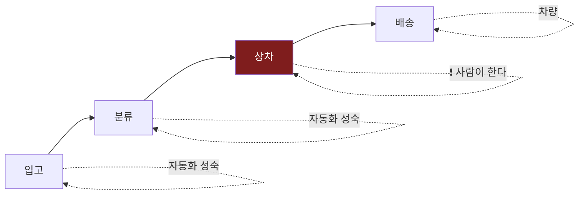
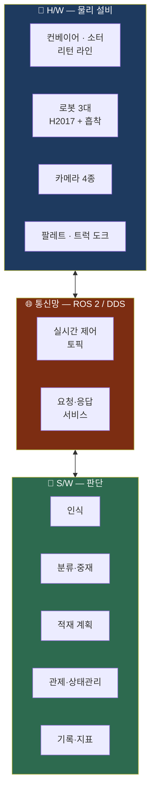
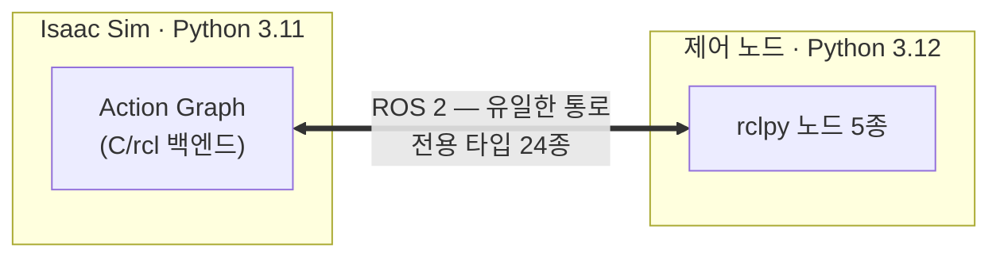
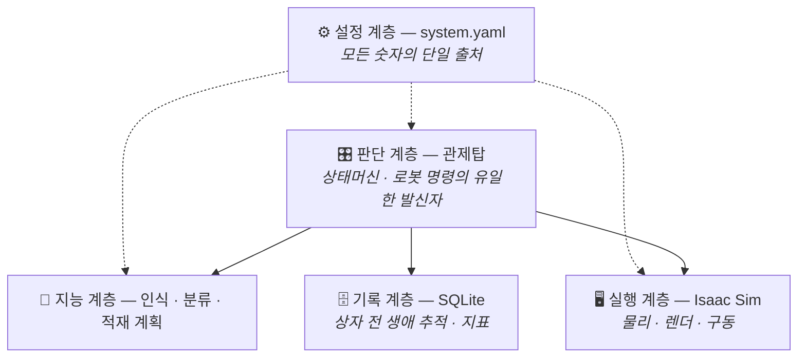
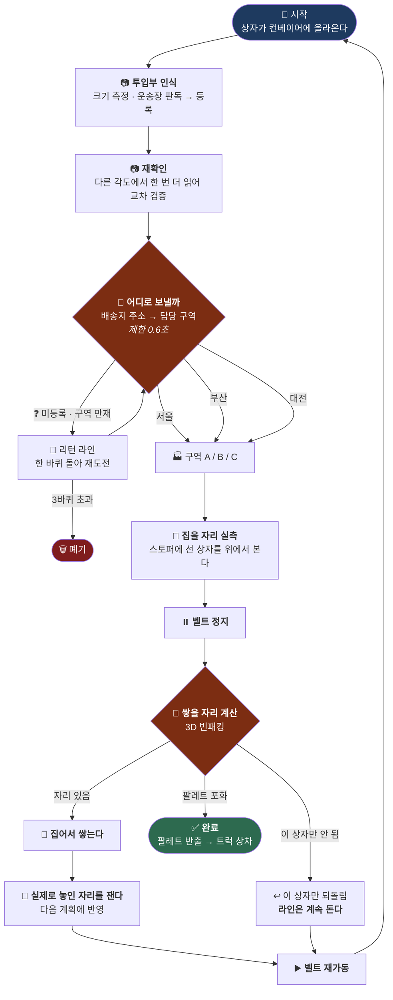
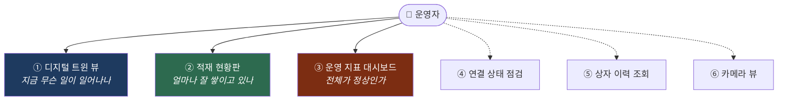
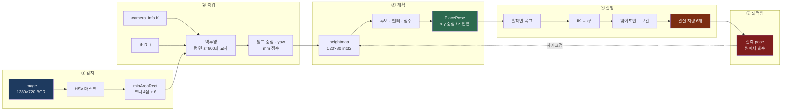
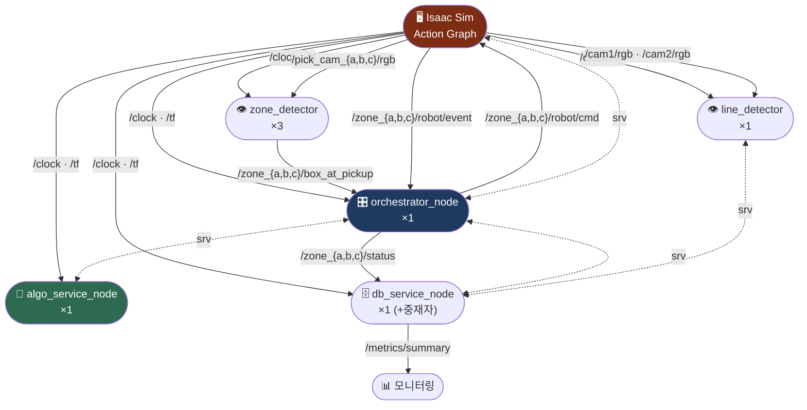

# Project Palletris — 발표 문서 v2

> **2026-08-28 · 최종 구조 기준.** 슬라이드에 바로 옮길 수 있는 텍스트다.
> v1(`최종발표_상세문서.md`)과의 차이: **비즈니스 트랙과 개발자 트랙을 완전히 분리**하고,
> 알고리즘·모션·로봇 모델링을 **수식 수준**으로 내렸다.

---

## 📑 문서 사용법

이 문서는 **두 개의 트랙**으로 되어 있다. 청중에 따라 읽는 길이 다르다.

<table>
<tr>
<th width="50%">💼 비즈니스 트랙 (경영진)</th>
<th width="50%">⚙️ 기술 트랙 (기술진)</th>
</tr>
<tr valign="top">
<td>

**질문: 왜 이걸 만들었고, 뭐가 좋아졌나**

- [1. 비즈니스 요구사항](#1-비즈니스-요구사항-)
- [2. 시스템 아키텍처 (비즈니스)](#2-시스템-아키텍처--비즈니스-관점-)
- [3. 프로젝트 시나리오](#3-프로젝트-시나리오-flow-chart-)
- [4. 화면 정의서 (UI)](#4-화면-정의서-ui-)
- [10. 성과](#10-성과-)

</td>
<td>

**질문: 어떻게 만들었고, 왜 그렇게 했나**

- [5. 세부 기능 Flow](#5-세부-기능-flow--개발자용-)
- [6. 노드 아키텍처·인터페이스](#6-노드-아키텍처--인터페이스--개발자용-)
- [7. 핵심 알고리즘](#7-핵심-알고리즘-)
- [8. 주요 모션](#8-주요-모션-)
- [9. 로봇 모델링](#9-로봇-모델링-)
- [11. 검증 방법론](#11-검증-방법론에서-배운-것-)

</td>
</tr>
</table>

**숫자 표기 규칙** — 발표에서 출처를 물으면 바로 답할 수 있게 표시했다.

| 표기 | 뜻 |
|:---|:---|
| `[실측]` | Isaac 또는 코드로 **직접 잰 값**. 그대로 써도 된다 |
| `[정본]` | `system.yaml` · 사양서에 확정된 설계값 |
| `[유도]` | 물리·기하 식에서 **계산으로 나온 값**. 이 문서에 유도 과정이 있다 |
| `[출처 필요]` | 발표에 쓰려면 **외부 인용을 붙여야 하는 값**. 저장소에 근거가 없어 비워 뒀다 |

---
---

# 💼 비즈니스 트랙

---

## 1. 비즈니스 요구사항 <sub>[슬라이드 3–5]</sub>

### 1-1. 한 문장

> **물류센터에서 사람이 밤새 상자를 들어 올리던 상차 공정을,
> 로봇 팔과 적재 알고리즘이 대신한다.**

### 1-2. 현황 분석 — 왜 지금 이 공정인가

물류 자동화는 **분류(sorting)까지는 이미 자동화됐고, 상차(palletizing)에서 멈춘다.**
그 경계에 이 프로젝트가 있다.



**상차가 마지막까지 남은 이유 3가지**

| # | 이유 | 설명 |
|:-:|:---|:---|
| 1 | **결정을 해야 한다** | 분류는 "어디로 보낼까"만 정하면 되지만, 상차는 **"어디에 놓을까"** 를 3차원으로 정해야 한다 |
| 2 | **되돌릴 수 없다** | 컨베이어는 잘못 보내면 되돌리면 된다. 팔레트는 **한 번 놓으면 끝**이다 |
| 3 | **품질이 사람마다 다르다** | 같은 상자를 줘도 쌓는 사람에 따라 팔레트 충전율과 붕괴 위험이 갈린다 |

> **★ 발표 포인트:** 1·2가 **기술적** 이유, 3이 **경제적** 이유다.
> 로봇을 놓는 것만으로는 3이 안 풀린다 — **알고리즘이 있어야 한다.**

### 1-3. 노동 환경 — 이 공정이 사람에게 어떤 일인가

| 특성 | 내용 |
|:---|:---|
| 취급 중량 | **3 ~ 9 kg** 상자를 반복 취급 `[정본]` |
| 자세 | 컨베이어 높이(약 800 mm)에서 팔레트로 **허리를 굽혀** 옮긴다 |
| 반복성 | 하루 수천 회 단위 `[출처 필요 — 센터별 물동량 기준]` |
| 근무 시간대 | **야간·심야 비중이 높다** (다음 날 배송을 위한 상차) |
| 위험의 성격 | **급성 사고가 아니라 누적 손상.** 근골격계 질환 |

> **★ "안전"의 의미가 다르다.**
> 이 공정의 위험은 사고로 오지 않는다. **10년에 걸쳐 온다.**
> 그래서 홍보영상의 메시지도 "사고를 막는다"가 아니라
> **"그 10년을 대신 든다"** 로 잡았다 (`홍보영상_기획프롬프트_v2.md`).

### 1-4. 관련 정책 · 규제

| 근거 | 내용 | 이 프로젝트와의 연결 |
|:---|:---|:---|
| **중대재해처벌법** <sub>(2022 시행 · 2024 소규모 확대)</sub> | 사업주의 안전보건 확보 의무 | 반복 중량물 취급 공정의 **로봇 대체 유인**이 법적 리스크 관리 차원으로 올라간다 |
| **산업안전보건법** — 근골격계부담작업 유해요인조사 | 반복·중량물 작업의 주기적 조사·개선 의무 | 상차는 전형적 부담작업. **개선 수단**으로 자동화가 검토된다 |
| **생활물류서비스산업발전법** <sub>(2021 시행)</sub> | 생활물류 산업 육성 · 종사자 보호 | 근로여건 개선 요구의 제도적 배경 |
| **국토교통부 스마트물류센터 인증제** | 자동화·정보화 수준을 평가해 인증 | 자동 적재 설비 도입이 **인증 평가 항목**과 직결 |

> [!NOTE]
> `[출처 필요]` — 슬라이드에 **조문 번호·인증 등급 기준·과태료 액수**를 넣으려면
> 법제처·국토교통부 원문을 인용할 것. 위 표는 **법령의 존재와 취지**만 적었다.
> 확인하지 않은 수치를 넣으면 질의응답에서 무너진다.

### 1-5. 기술 이슈 — 기존 접근이 왜 부족한가

| 접근 | 무엇 | 왜 부족한가 |
|:---|:---|:---|
| **① 전용 팔레타이저** | 정해진 패턴으로만 쌓는 기계 | **같은 크기 상자만** 다룬다. 3종이 섞여 오면 못 쓴다 |
| **② 로봇 + 고정 패턴** | 로봇 팔에 층 패턴을 미리 넣는다 | 도착 순서가 다르면 **패턴이 깨진다.** 온라인 문제를 못 푼다 |
| **③ 로봇 + 기하 알고리즘** | 3D 빈패킹으로 자리를 계산 | **팔이 갈 수 있는지를 안 본다.** 자리는 있는데 못 놓는다 ← **여기서 막힌다** |
| **④ 심층강화학습** | 정책망이 배치를 학습 | 학습 데이터·시간이 필요하고 **재현성을 보장하기 어렵다** |

### 1-6. ★ 우리의 해결책 — 세 문장

<table>
<tr><td width="33%">

**① 온라인으로 푼다**

상자를 미리 몰라도 된다.
도착하는 대로, 그 순간의 팔레트 상태만 보고 자리를 정한다.

</td><td width="33%">

**② 로봇을 알고리즘에 넣는다**

"기하학적으로 들어가는가"가 아니라
**"팔이 거기까지 갈 수 있는가"** 를 후보 조건에 넣는다.

</td><td width="33%">

**③ 실측으로 스스로 고친다**

계획대로 놓였다고 가정하지 않는다.
**실제로 놓인 좌표**를 되먹여 다음 계획을 보정한다.

</td></tr>
</table>

> **★ ②가 이 프로젝트의 유일한 차별점이다.**
> 다층으로 쌓으면 상자 사이에 폭 **250 mm** 짜리 협곡이 생기는데,
> 흡착 그리퍼 몸통이 **Ø245 mm** 라 팔이 그 안으로 못 내려간다 `[정본]`.
> 알고리즘은 "자리 있음"이라 답하고 로봇은 `IK_FAIL` 을 낸다.
>
> ### **"놓을 수 있는 자리"와 "갈 수 있는 자리"는 다르다.**

### 1-7. 성과 요약 <sub>(경영진용 한 장)</sub>

| 지표 | 결과 | 의미 |
|:---|:---:|:---|
| 팔레트 적재율 | **75.5 %** `[실측]` | 같은 트럭에 **더 많이** 싣는다 |
| 베이스라인 대비 | **+30.6 %p** `[실측]` | 단순 순차 방식 39.7 % → 70.3 % |
| 사이클 타임 | **8.2 s** `[실측]` | 초기 18.3 s 에서 **55 % 단축** |
| 종료 조건 | **3/3 `PALLET_FULL`** | 자리를 못 찾아서가 아니라 **꽉 차서** 끝났다 |
| 계획 재현성 | **4/4 완전 동일** | 같은 입력 → 같은 결과. 검증·감사 가능 |
| 안정성 | 크래시 **0회** | 예외·타임아웃에도 라인이 안 선다 |

---

## 2. 시스템 아키텍처 — 비즈니스 관점 <sub>[슬라이드 6–8]</sub>

### 2-1. 통합 구조 한 장



### 2-2. H/W 관점 — 로봇을 왜 이렇게 골랐나

**로봇 선정** `[정본]`

| 후보 | 도달거리 | 필요/도달 | 판정 |
|:---|:-:|:-:|:-:|
| M0609 | 900 mm | 162 % | ❌ 도달 미달 · 유효 가반 4 kg |
| **H2017** | **1,700 mm** | **86 %** | ✅ **채택** |
| P3020 | 2,030 mm | 72 % | ⚠️ 시뮬 에셋 미제공 |

> **선정 기준은 "닿느냐"가 아니라 "여유 있게 닿느냐"다.**
> 팔레타이징 권장 상한이 최대 도달의 **85 % 수준**이다. 그 이상은 팔이 펴져
> 자세 자유도와 가반하중이 함께 떨어진다. H2017 은 **86 %** 로 그 경계에 든다.
>
> **결과: 턴테이블·리니어축이 필요 없다.** 설비 항목 하나가 통째로 빠졌다.

**엔드이펙터 — 병목은 팔이 아니다**

| | 값 |
|:---|:---|
| 로봇 가반하중 | 20 kg |
| − 그리퍼 자중 | − 2 kg |
| = 유효 가반 | **18 kg** |
| 흡착력 한계 | **16 kgf** `[유도 — §9-5]` |
| **실질 상한** | **10 kg** ← **골판지 상판 강성** |

> **★ 병목이 로봇도 흡착도 아니라 상자 자체다.**
> 그 이상이면 상판이 먼저 찢어진다. 우리 최대 상자(5호)가 **9 kg** 인 것은
> 이 상한 안에 들어가도록 정한 것이다.

**좌표계 설계 — 설비비를 줄인 결정**

> **z = 0 을 "도크 바닥 = 트럭 적재함 바닥"으로 잡는다.**

| | 야드 지면 기준 | **도크 기준 (채택)** |
|:---|:---|:---|
| 팔레트 상면 | 1,000 mm | 150 mm |
| 필요 받침대 | **약 1,580 mm** | **900 mm** |
| 79 kg 로봇을 올릴 구조물 | 1.6 m — **비현실적** | 0.9 m — 표준 페데스탈 |
| "들지 않고 밀어서 상차" | 별도 리프트 필요 | **높이차 0 — 이미 만족** |

### 2-3. 통신망 관점 — 왜 ROS 2 하나로 갔나



**문제**: 시뮬레이터 내장 파이썬(3.11)과 ROS 2(3.12)는 **버전이 달라 같은 프로세스에서 못 섞인다.**

**해결**: Action Graph 의 백엔드가 C 라 버전 차이를 우회한다. **별도 브리지 프로세스가 필요 없다.**

**폐기한 방식 — 개선 사례로 발표**

| 폐기 | 무엇이 문제였나 | 대체 |
|:---|:---|:---|
| JSON 소켓 (`localhost:8765`) | **다중 PC 실행 불가** — localhost 는 한 대 안에서만 산다 | Action Graph 직접 발행 |
| JSON 문자열 토픽 | 타입이 없어 필드 오타가 **런타임에도 안 잡힌다** | **전용 타입 24종** |
| 브리지 폴링 | 지연이 폴링 주기에 묶인다 | 구독 콜백 |

**네트워크 구성**

| 노드 | IP | 역할 |
|:---|:---|:---|
| PC1 | 10.10.0.1 | **Isaac Sim 전용** — 렌더·물리에 자원 집중 |
| PC2 | 10.10.0.2 | DB · 인식 · 중재자 |
| PC3 | 10.10.0.3 | 적재 알고리즘 |
| PC4 | 10.10.0.4 | 모니터링 |

<sub>2.5G 스위치 · 고정 IP · FastDDS 유선 화이트리스트 · 실측 ping **0.25 ms** `[실측]`</sub>

### 2-4. S/W 관점 — 5개 계층



**설계 원칙 5개 — 발표에서 이 표 하나면 충분하다**

| 원칙 | 내용 | 얻은 것 |
|:---|:---|:---|
| **① 단일 출처** | 모든 숫자는 설정 파일 하나. 코드에 상수를 안 박는다 | 팔레트를 90° 돌려도 조용히 틀린 값이 안 생긴다 |
| **② 코어와 껍데기 분리** | 알고리즘·비전 코어는 **통신 의존성 0** | 시뮬레이터 없이 노트북에서 개발 → **4인 완전 병렬** |
| **③ 명령 발신자 하나** | 로봇 명령은 관제탑만 낸다 | 명령 순서가 보장된다 |
| **④ 비동기 일관성** | 전부 콜백. 동기 대기 금지 | 서로를 기다려 멈추는 사고가 없다 |
| **⑤ 새 기능은 기본 꺼짐** | 새 항은 `0` 이 기존 동작 | **같은 코드로 A/B 를 잰다** |

> **★ ⑤가 실질적 무기였다.** 가중치 3종 · 앞보기 · 낙하 완화 · 방향성 통로가
> 전부 기본 꺼짐으로 들어왔다. 그래서 "켜기 전 결과"를 언제든 재현하고,
> **개선분을 정확히 그 항의 몫으로 귀속**할 수 있다.

---

## 3. 프로젝트 시나리오 (Flow Chart) <sub>[슬라이드 9]</sub>

### 3-1. 시작부터 종료까지



### 3-2. 판단이 세 번 있다 — 그리고 시간 척도가 다 다르다

| 판단 | 무엇을 정하나 | 제한 시간 | 늦으면 |
|:---|:---|:---:|:---|
| **① 어디로 보낼까** | 상자 → 구역 | **0.6 초** | 상자가 이미 분기점을 지나 있다 |
| **② 어디에 쌓을까** | 팔레트 위 좌표 | **0.2 초** | 그만큼 벨트를 세워 둔다 |
| **③ 지금 집어도 되나** | 사이클 시작·중단 | **20 초** | 라인 전체가 선다 |

> **★ 이 세 척도가 노드를 나눈 기준이다.**
> 0.6 초짜리와 20 초짜리를 한 프로세스에 묶으면 **가장 느린 것이 나머지를 붙잡는다.**

### 3-3. 예외 시나리오 — "안 되는 경우"를 먼저 설계했다

| 상황 | 대응 | 왜 이렇게 |
|:---|:---|:---|
| 운송장을 못 읽었다 | 등록하지 않고 **리턴 라인** | 번호를 지어내면 **남의 기록을 덮어쓴다.** 에러 없이 전부 틀린다 |
| 이 상자만 자리가 없다 | **그 상자만** 되돌리고 계속 | 여기서 멈추면 팔레트가 **반만 찬 채** 끝난다 |
| 가장 작은 상자도 안 들어간다 | 팔레트 반출 → 상차 | 위와 **반드시 구분해야 한다** |
| 로봇이 20초간 응답 없음 | 계획 취소 후 복귀. **노드는 안 죽는다** | 죽으면 나머지 두 구역까지 멈춘다 |
| 구역이 꽉 찼다 | 리턴 라인 한 바퀴 | 본선을 세우면 뒤 상자가 전부 밀린다 |
| 리턴 3바퀴 초과 | 폐기 | 안 끊으면 **영원히 돈다** — 장시간 실행에서 프레임이 떨어진다 `[실측]` |
| 스토퍼에 12초째 정지 | 관제탑이 치운다 | 아무도 안 치우면 **라인이 통째로 막힌다** |

---

## 4. 화면 정의서 (UI) <sub>[슬라이드 10 · 백업]</sub>

> 별도 웹 UI 를 만들지 않았다. 대신 **운영자가 보는 화면 6개**를 목적별로 정의했다.
> 발표에서는 **①②③** 세 개만 보여주면 충분하다.

### 4-0. 화면 목록 · 정보 구조



| # | 화면 | 주 사용자 | 갱신 | 목적 |
|:-:|:---|:---|:---|:---|
| ① | 디지털 트윈 뷰 | 전원 · 발표 | 실시간 | **무슨 일이** 일어나나 |
| ② | 실시간 적재 뷰어 | 알고리즘 | 스냅샷 | **얼마나 잘** 쌓이나 |
| ③ | 운영 지표 대시보드 | 운영 · 발표 | 2 초 | **전체가 정상인가** |
| ④ | 그래프 헬스체크 | 통합 담당 | 수동/`watch` | **연결이 살아 있나** |
| ⑤ | 상자 이력 조회 | 디버깅 | 요청 시 | **이 상자에 무슨 일이** |
| ⑥ | 카메라 뷰 | 비전 | 30 Hz | **인식이 뭘 보나** |

### 4-1. ① 디지털 트윈 뷰 — 화면 정의서

```
┌────────────────────────────────────────────────────────────────────┐
│  [상단 바]  구역 A ● 적재중  |  구역 B ● 대기  |  구역 C ● 적재중    │
├────────────────────────────────────────────────────────────────────┤
│                                                                    │
│    ═══════════════ 메인 컨베이어 ═══════════════▶                  │
│      📷cam1    📷cam2         ▼소터A    ▼소터B    ▼소터C          │
│                                 │         │         │              │
│                              지선 A     지선 B     지선 C          │
│                                 ▪스토퍼   ▪         ▪              │
│                                📷pick_cam                          │
│                                 🦾A       🦾B       🦾C            │
│                                 ▤▤▤      ▤▤        ▤▤▤▤          │
│                                팔레트    팔레트    팔레트          │
│                                 │         │         │              │
│                            ═══ 합류 라인 ═══▶  🚚 트럭 도크        │
│                                                                    │
├────────────────────────────────────────────────────────────────────┤
│ [카메라] ⦿전체뷰 ○cam1 ○cam2 ○pick_cam ○wrist_cam                  │
└────────────────────────────────────────────────────────────────────┘
```

| 영역 | 구성 요소 | 표시 규칙 |
|:---|:---|:---|
| **상단 바** | 구역별 상태 표시등 | 🟢 적재중 / 🟡 대기 / 🔴 정지 · 만재 |
| **메인 뷰** | 3D 씬 | 상자 색 = 크기 구분 (3호/4호/5호) |
| | 로봇 3대 | **서로 기다리지 않고 각자 돈다** |
| | 팔레트 적재 상태 | 층이 올라가는 것이 육안으로 보인다 |
| **하단 바** | 카메라 전환 | ★ 발표에서 `pick_cam` 을 한 번 보여줄 것 |

> [!WARNING]
> **오프스크린 렌더는 화면 조명을 못 받는다.** 뷰포트는 멀쩡한데 인식용 카메라
> 이미지만 캄캄한 상태가 실제로 있었다. **화면이 전부 검으면 조명보다
> "카메라가 형상 안에 파묻혔는지"를 먼저 의심할 것** — 실제로 그랬다.

### 4-2. ② 실시간 적재 뷰어 — 화면 정의서

```
┌─────────────────────┬──────────────────────┬──────────────────────┐
│  [A] 3D 적재 상태    │  [B] 높이 히트맵      │  [C] 적재율 추이      │
│                     │                      │                      │
│      ▤▤▤            │   ████▓▓▓░░          │  %  ┌─────────────    │
│    ▤▤▤▤▤▤           │   ███▓▓▓▓░░          │  80 │      ╭──────    │
│   ▤▤▤▤▤▤▤▤          │   ██▓▓▓▓▓░░          │  60 │   ╭──╯          │
│  ▤▤▤▤▤▤▤▤▤▤         │   █▓▓▓░░░░░          │  40 │ ╭─╯             │
│                     │   120 × 80 격자       │  20 │╭╯               │
│  3호■ 4호■ 5호■     │   색 = 높이[mm]       │     └──────────────▶  │
│                     │                      │       상자 수         │
├─────────────────────┴──────────────────────┴──────────────────────┤
│ 구역 B │ 적재 23개 │ 적재율 71.2% │ 최고 1,180mm │ 경과 3분 12초    │
└────────────────────────────────────────────────────────────────────┘
```

| 영역 | 구성 요소 | 정의 |
|:---|:---|:---|
| **[A]** | 3D 막대 그래프 | 놓인 상자를 실제 좌표에 그린다. 색 = 크기 구분 |
| **[B]** | 히트맵 | 격자 한 칸(10 mm)의 **현재 높이**. 알고리즘이 보는 것과 **같은 자료** |
| **[C]** | 이중 곡선 | **실제높이 기준** 적재율 + **용량 기준** 적재율 |
| **하단** | 요약 수치 | 적재 개수 · 적재율 · 최고 높이 · 경과 시간 |

<details>
<summary><b>왜 적재율 곡선이 두 개인가</b> — 발표에서 물어볼 수 있다</summary>

<br>

| 지표 | 분모 | 성격 |
|:---|:---|:---|
| **실제높이 기준** | 바닥넓이 × **현재 최고높이** | "쌓은 만큼의 공간을 얼마나 알차게 썼나" — **정본** |
| **용량 기준** | 바닥넓이 × **최대 적재높이(1300)** | "트럭 한 칸을 얼마나 채웠나" — **단조 증가** |

실제높이 기준은 **층이 새로 올라가는 순간 분모가 계단처럼 뛰어** 적재율이
일시적으로 떨어져 보인다. 정의상 정상이지만 발표 곡선으로는 읽기 어렵다.
포화까지 채우면 두 값이 **1 %p 안쪽**으로 만난다 `[실측: 66.9 % vs 66.3 %]`.

</details>

### 4-3. ③ 운영 지표 대시보드 — 화면 정의서

```
┌────────────────────────────────────────────────────────────────────┐
│  Project Palletris — 운영 지표                    경과 00:12:34    │
├──────────────────────┬──────────────────────┬──────────────────────┤
│  처리량              │  인식률              │  적재 성공률          │
│    ▎▎▎ 142 개        │    ▎▎▎ 98.6 %        │    ▎▎▎ 96.5 %        │
│    (시간당 환산)      │    140 / 142         │    137 / 142         │
├──────────────────────┼──────────────────────┼──────────────────────┤
│  평균 사이클          │  로봇 유휴율          │  최고 적재 높이       │
│    8.2 s             │    12.4 %            │    1,300 mm          │
├──────────────────────┴──────────────────────┴──────────────────────┤
│  구역별 현황                                                        │
│  ┌──────┬────────┬────────┬────────┬──────────┬────────────────┐  │
│  │ 구역 │ 상태   │ 적재   │ 폐기   │ 적재율   │ 수용 가능      │  │
│  ├──────┼────────┼────────┼────────┼──────────┼────────────────┤  │
│  │  A   │ 적재중 │   23   │   1    │  71.2 %  │  ● 예          │  │
│  │  B   │ 대기   │   19   │   0    │  64.8 %  │  ● 예          │  │
│  │  C   │ 만재   │   28   │   2    │  80.3 %  │  ○ 아니오      │  │
│  └──────┴────────┴────────┴────────┴──────────┴────────────────┘  │
└────────────────────────────────────────────────────────────────────┘
```

**지표 정의 · 계산 근거**

| 지표 | 정의 | ⚠️ 함정 |
|:---|:---|:---|
| 처리량 | 시간당 적재 개수 | |
| **인식률** | `식별 성공 / (식별 성공 + 인식 실패)` | ★ **분모가 함정.** 등록된 것만 세면 **언제나 100 %** 다 |
| 적재 성공률 | `적재 / (적재 + 집기실패)` | |
| 평균 사이클 | `AVG(놓은시각 − 집은시각)` | |
| 로봇 유휴율 | `1 − 작업시간합 / 경과시간` | |
| **적재율** | 부피합 / (바닥넓이 × **실제 최고높이**) | 분모를 1300 고정으로 쓰면 부당하게 낮다 |
| 수용 가능 | 관제탑이 내는 `accepting` | 중재자가 보는 **유일한 근거** |

> [!IMPORTANT]
> **분모가 0 이면 `0.0` 이 아니라 `-1.0`("잴 수 없음")을 돌려준다.**
> "성공률 0 %"와 "아직 잴 수 없음"은 다르다. 0 으로 뭉개면 시작 직후 화면에
> 성공률 0 % 가 크게 찍혀서 **없는 문제를 쫓게 된다.**
>
> **실시간 화면과 최종 보고서가 쿼리 함수 하나를 공유한다.**
> 복붙하면 발표 자리에서 두 숫자가 갈린다.

### 4-4. ④ 그래프 헬스체크 — 화면 정의서

```
┌────────────────────────────────────────────────────────────────────┐
│  ROS 2 그래프 연결 상태                                             │
├────────────────────────────────────────────────────────────────────┤
│  [시계·좌표]                                                        │
│    /clock                          OK    pub 1 / sub 12            │
│    /tf                             OK    pub 1 / sub  4            │
│  [인식 → 관제탑]                                                    │
│    /zone_a/box_at_pickup           OK    pub 1 / sub  1            │
│    /pick_cam_a/rgb               pub0    pub 0 / sub  1  ← 카메라   │
│  [관제탑 ↔ 로봇]                                                    │
│    /zone_a/robot/cmd               OK    pub 1 / sub  1            │
│    /zone_b/robot/cmd             sub0    pub 1 / sub  0  ← ⚠ 위험  │
└────────────────────────────────────────────────────────────────────┘
```

| 표시 | 뜻 | 위험도 | 볼 곳 |
|:-:|:---|:-:|:---|
| `OK` | 발행·구독 둘 다 있다 | — | — |
| `pub0` | 내는 쪽이 안 떴다 | 🟡 | 그 토픽의 발행 노드 |
| **`sub0`** | **나가는데 아무도 안 듣는다** | 🔴 | 받는 쪽 · **구역 이름 오타** |

> **`sub0` 이 제일 위험하다 — 에러가 안 난다.**
> 관제탑이 명령을 계속 쏘는데 아무도 안 받고 있는 상태다.

### 4-5. ⑤⑥ 보조 화면

<details>
<summary><b>⑤ 상자 이력 조회 · ⑥ 카메라 뷰</b></summary>

<br>

**⑤ 상자 이력** — 한 상자의 전 생애를 시간순으로

```
BOX003  ─ 340×250×210 · 3.0 kg · 구역 A
  12:03:11  SPAWNED     투입
  12:03:19  SCANNED     cam1 등록
  12:03:22  VERIFIED    cam2 검증 OK
  12:03:31  DIVERTED    구역 A 로 분기
  12:03:48  PICKED      집기 성공
  12:03:56  PLACED      (275, 415, 630) yaw 90.0
```

상태 전이 이력을 **따로 쌓는다.** 단일 상태 컬럼은 덮어써져 이력이 안 남는데,
**인식률·성공률·사이클타임이 전부 그 이력에서 나온다.**

**⑥ 카메라 뷰** — 4종 실시간 영상. 인식이 실제로 무엇을 보는지 확인용.

</details>

---
---

# ⚙️ 기술 트랙

---

## 5. 세부 기능 Flow — 개발자용 <sub>[슬라이드 11]</sub>

### 5-1. 데이터 파이프라인 — 픽셀에서 관절각까지



### 5-2. 단계별 입출력 계약

| 단계 | 입력 | 출력 | 단위 | 실패 시 |
|:-:|:---|:---|:---|:---|
| ① 감지 | `Image` (BEST_EFFORT) | 코너 4점 · θ | px | 못 찾으면 **"없다"를 낸다** |
| ② 측위 | 코너 + `K` + `tf` | 월드 중심 · yaw | **mm 정수** | 시야에 잘렸으면 **좌표를 안 낸다** |
| ③ 계획 | `zone, box_id, w·d·h` | `PlacePose` + `message` | mm 정수 | 3가지 메시지로만 답한다 |
| ④ 실행 | `RobotCmd` | `RobotEvent` | 내부 **m float** | `seq` 를 복사해 **반드시 답한다** |
| ⑤ 되먹임 | 실측 pose | 갱신된 heightmap | mm 정수 | `has_actual` 일 때만 반영 |

> [!IMPORTANT]
> **단위 규칙: 설정·DB·인터페이스 = mm 정수 / 내부 계산 = m float.**
> 변환은 공용 함수 한 곳에서만 한다. 직접 `/1000` 을 쓰지 않는다 —
> 경계마다 변환이 끼면 **어디서 한 번 빠졌는지 못 찾는다.**

### 5-3. 세 가지 "안 낸다" 결정 — 틀린 값보다 없는 값이 낫다

| 상황 | 하는 일 | 왜 |
|:---|:---|:---|
| 상자가 시야에 잘렸다 | `present=false` | **잘린 사각형의 중심은 진짜 중심이 아니다.** 틀린 좌표는 로봇을 빗나간 자리로 보낸다 |
| 사양 3종과 안 맞는다 | `present=false` | 크기를 모르면 계획도 집기도 못 한다 |
| 운송장을 못 읽었다 | `box_id=""` 로 발행 | **지어내면 남의 기록을 덮어쓴다.** 관제탑이 DB 조회에서 막히는 게 맞는 동작이다 |

### 5-4. 처리 효율 — 추론을 언제 도는가

> **`zone_detector` 는 관제탑 상태가 `IDLE` 일 때만 추론한다.**

```
관제탑 상태:  IDLE ──────▶ FETCHING ─▶ PLANNING ─▶ PICKING ─▶ PLACING ─▶ IDLE
추론:         ✅ 켜짐        ❌ 꺼짐 ────────────────────────────────▶  ✅
```

이유가 둘이다.
1. 집는 중에는 **새 좌표가 필요 없다** — 이미 명령을 보냈다.
2. **팔이 화면에 들어와 오검출을 만든다** — 팔이 가장 높은 물체가 되면 그걸 상자로 잡는다.

---

## 6. 노드 아키텍처 · 인터페이스 — 개발자용 <sub>[슬라이드 12]</sub>

### 6-1. Pub/Sub 토픽 설계도



### 6-2. 토픽 명세 (8종)

| 토픽 | 타입 | Pub | Sub | QoS | 주기 |
|:---|:---|:---|:---|:---|:---|
| `/clock` | `rosgraph_msgs/Clock` | Isaac | 전원 | default | 125 Hz |
| `/tf` · `/tf_static` | `tf2_msgs/TFMessage` | Isaac | 인식 | default | — |
| `/cam1/rgb` `/cam2/rgb`<br/>`/pick_cam_{a,b,c}/rgb` | `sensor_msgs/Image` | Isaac | 인식 | **SENSOR_DATA<br/>(BEST_EFFORT)** | 30 Hz |
| `/zone_{a,b,c}/box_at_pickup` | `BoxAtPickup` | zone_detector | 관제탑 | RELIABLE·10 | 이벤트 |
| `/zone_{a,b,c}/robot/cmd` | `RobotCmd` | **관제탑만** | Isaac | RELIABLE·10 | 이벤트 |
| `/zone_{a,b,c}/robot/event` | `RobotEvent` | Isaac | 관제탑 | RELIABLE·10 | 이벤트 |
| `/zone_{a,b,c}/status` | `ZoneStatus` | 관제탑 | 중재자·모니터 | RELIABLE·10 | 2 Hz |
| `/metrics/summary` | `MetricsSummary` | DB | 모니터 | RELIABLE·10 | 1 Hz |

> [!CAUTION]
> **카메라 토픽만 BEST_EFFORT 다.** 기본 RELIABLE 로 구독하면 **이미지가 하나도 안 온다.**
> 발행자가 BEST_EFFORT 인데 구독자가 RELIABLE 이면 QoS 가 호환되지 않아 **매칭 자체가 안 된다.**
> 에러는 안 뜬다 — 그냥 조용하다.

### 6-3. 왜 로봇 명령이 서비스가 아니라 토픽인가

| | 서비스로 했다면 | **토픽 (채택)** |
|:---|:---|:---|
| 모션 시간 | 5~10 초 동안 **응답을 붙들고 있어야 한다** | 즉시 반환 |
| 타임아웃 | 서비스 타임아웃을 20초로 늘려야 하는데, 그러면 **다른 서비스와 정책이 갈린다** | 관제탑이 자체 감시 |
| 짝짓기 | 서비스가 보장 | **`seq` 일련번호로 직접 맞춘다** |

**★ `seq` 규약이 이 설계의 대가다.**

```
관제탑  ──RobotCmd(seq=7)──▶  로봇
        ◀─RobotEvent(seq=7)──        ← 이 값이 같아야 "방금 그 명령의 결과"
```

> 없으면 **타임아웃 후 늦게 온 이전 응답이 새 상자의 결과로 둔갑한다.**
> 에러도 안 나고 엉뚱하게 도는 버그다. 관제탑은 `seq` 가 다르면 **무조건 버린다.**

### 6-4. 서비스 명세 (17종)

<details open>
<summary><b>펼쳐 보기</b></summary>

| 계열 | 서비스 | 요청 → 응답 |
|:---|:---|:---|
| **algo** | `PlanPlacement` | `zone, box_id, w, d, h` → `ok, PlacePose, score, message` |
| | `UpdateHeightmap` | `+ actual_pose` → `ok, fill_rate, placed_count, max_height_mm` |
| | `CancelPlan` | `zone, box_id` → `ok` |
| | `ResetHeightmap` | `zone` → `ok` |
| **db** | `RegisterBox` | `box_id, w, d, h, color, dest, qr_payload` → `ok, message` |
| | `GetBoxInfo` | `box_id` → `found, BoxInfo` |
| | `VerifyBox` | `box_id, qr_payload` → `match, registered_id` |
| | `SetStatus` | `box_id, status, reason` → `ok` |
| | `MarkPlaced` | `box_id, zone, actual_pose` → `ok` |
| | `ZoneQueue` | `zone` → `count, placed_count` |
| | `ReportMiss` | `where_at, reason` → `ok, miss_count` |
| **중재자** | `DiverterRequest` | `box_id` → `target, reason` |
| | `DiverterDecide` | `diverter_id, box_id` → `divert, target, reason` |
| **씬** | `SetVelocity` | `seg, velocity_mps` → `ok, actual_mps` |
| | `DespawnBox` | `box_id` → `ok` |
| | `SetSpawnEnabled` | `enabled` → `ok` |
| | `SwapPallet` | `zone` → `ok` |

</details>

**응답 값이 열려 있으면 안 된다** — 계약으로 닫아 둔 것 둘:

| 필드 | 허용 값 |
|:---|:---|
| `PlanPlacement.message` | `"OK"` · `"NO_FEASIBLE_POSE"` · `"PALLET_FULL"` — **3가지뿐** |
| `DiverterRequest.target` | `"A"` · `"B"` · `"C"` · `"RETURN"` — **4가지뿐** |

### 6-5. 노드 계약 — 하지 않는 일

| 노드 | 수 | 하는 일 | ❌ 하지 않는 일 |
|:---|:-:|:---|:---|
| `orchestrator_node` | **1** | 구역 3개 상태머신 · **로봇 명령의 유일한 발신자** | 자리 계산 · DB 직접 접근 |
| `algo_service_node` | 1 | heightmap 3장 소유 | **로봇 명령 금지 · 아무것도 발행 안 함** |
| `db_service_node` | 1 | `.db` **유일 writer** · 중재자 | 로봇 명령 |
| `line_detector` | 1 | cam1 등록 · cam2 검증 | 로봇 명령 · **`box_id` 생성** |
| `zone_detector` | **3** | pick_cam 좌표 실측 | 로봇 명령 |

<details>
<summary><b>왜 관제탑은 1개인데 인식은 3개인가</b> — 정반대 이유</summary>

<br>

| | 관제탑 | 구역 인식 |
|---|---|---|
| 이유 | **상태머신** — 하나여야 명령이 안 겹친다 | **이미지 추론** — 한 프로세스에 몰면 GIL 때문에 줄을 선다 |
| 반대로 하면 | 누가 먼저 보냈는지 알 수 없다 | 코어를 실제로 나눠 쓰지 못한다 |

구역이 셋이어도 관제탑은 프로세스도 노드도 하나다. 늘어나는 것은 **상태 객체**뿐이다.

</details>

### 6-6. 동시성 설계

| 위치 | 설계 | 안 지키면 |
|:---|:---|:---|
| 모든 rclpy 노드 | `MultiThreadedExecutor` + `ReentrantCallbackGroup` | 콜백이 서로를 막는다 |
| 모든 서비스 호출 | `call_async` + 완료 콜백 | **동기 대기는 executor 가 자기 자신을 기다려 조용히 멈춘다** |
| algo | 구역마다 락 하나 | 반쯤 쓰인 heightmap 위에서 자리를 고른다 |
| DB | 스레드 공유 커넥션 + 쓰기 직렬화 (WAL) | `database is locked` |
| **Isaac** | **메인 스레드는 절대 블로킹 금지** | 모션 판정을 내리는 물리 스텝도 메인이라 **100 % 데드락** |

---

## 7. 핵심 알고리즘 <sub>[슬라이드 13–15]</sub>

### 7-1. 객체 인식 — 픽셀에서 월드 좌표까지

#### (a) 색 분할 — 왜 HSV 인가

RGB 는 밝기와 색상이 **섞여 있어** 조명이 조금만 바뀌어도 임계값이 무너진다.
HSV 는 색상(H)·채도(S)·명도(V)가 분리돼 **H 만 보면 조명에 둔감**하다.

빨강은 색상환의 **0° 부근에 걸쳐 있어** 구간이 둘로 갈린다:

$$
M(u,v) = \mathbb{1}\big[H \in [0, h_1]\big] \;\lor\; \mathbb{1}\big[H \in [h_2, 179]\big]
$$

> **한 구간만 쓰면 절반을 놓친다.** 이어서 열림(open) → 닫힘(close) 형태학 연산으로
> 잡음 점과 구멍을 정리한다 — 안 하면 먼지 한 점을 상자로 잡는다.

#### (b) 자세 추정 — 최소면적 회전 사각형

윤곽점 집합에 대해 **면적이 최소가 되는 회전 사각형**을 찾는다.

$$
(c_x, c_y, w, h, \theta) = \arg\min_{\theta} \; \text{Area}\big(\text{AABB}(R(-\theta)\,\mathcal{C})\big)
$$

축정렬 경계상자(AABB)를 쓰면 상자가 15° 틀어졌을 때 **폭이 실제보다 커진다.**
회전 사각형이어야 크기 판정과 yaw 를 동시에 얻는다.

**yaw 는 0~180° 로 접는다.** 사각형은 180° 대칭이라 $\theta$ 와 $\theta+180°$ 가 같은 자세인데,
접지 않으면 같은 상자가 프레임마다 0°/180° 를 오가며 **로봇이 손목을 반 바퀴씩 헛돌린다.**

#### (c) ★ 역투영 — 단안 카메라로 3D 좌표를 얻는 방법

카메라 한 대로는 깊이를 모른다. 그런데 **상자가 놓인 평면의 높이를 안다**
(벨트 상면 $z_{\text{belt}} = 800$ mm). 이 **한 개의 구속조건**이 깊이를 결정한다.

**1단계 — 픽셀을 광선으로.** 내부 파라미터 $K$ 의 역변환:

$$
\mathbf{d}_{\text{cam}} = \begin{bmatrix} (u - c_x)/f_x \\ (v - c_y)/f_y \\ 1 \end{bmatrix}
$$

**2단계 — 월드 좌표계로 회전.** tf 에서 얻은 자세 $(R, \mathbf{t})$:

$$
\mathbf{d}_{w} = R\,\mathbf{d}_{\text{cam}}
$$

**3단계 — 평면과 교차.** 광선 $\mathbf{P}(s) = \mathbf{t} + s\,\mathbf{d}_w$ 가 $z = z_{\text{belt}}$ 를 만나는 $s$:

$$
\boxed{\;s = \frac{z_{\text{belt}} - t_z}{d_{w,z}}\;,\qquad \mathbf{P} = \mathbf{t} + s\,\mathbf{d}_w\;}
$$

**두 가지 예외를 반드시 잡는다:**

| 조건 | 뜻 | 원인 |
|:---|:---|:---|
| $\lvert d_{w,z}\rvert \approx 0$ | 광선이 평면과 **평행** | 카메라가 수평을 본다 — 자세 오류 |
| $s \le 0$ | 평면이 **카메라 뒤** | tf 방향이 뒤집혔다 (월드←카메라여야 한다) |

> **★ 상자 윗면을 재려면 평면을 올려야 한다.**
> 코너 4점을 $z_{\text{belt}}$ 로 투영하면 **밑면 크기**가 나온다.
> 실제로는 윗면을 보고 있으므로, 3종의 높이를 각각 가정해 투영하고
> **사양과 가장 잘 맞는 것**을 고른다:
>
> $$k^\star = \arg\min_{k \in \{3호,4호,5호\}} \big\lVert (w_{\text{meas}}, d_{\text{meas}}) - (w_k, d_k) \big\rVert$$
>
> 맞춤 오차가 임계를 넘으면 **"3종 어느 것과도 안 맞는다"로 좌표를 안 낸다.**

**실측 정확도**: 위치 오차 **0.14 mm** · yaw 오차 **0.05°** `[실측 — verify_vision.py]`

---

### 7-2. 배치 제어 — 어디에 놓을 것인가

> 원 요청의 *"주행 제어"* 에 해당하는 것이 이 시스템에서는 **배치 결정 + 궤적 제어**다.
> 주행하는 로봇이 "어디로 갈까"를 푸는 자리에서, 이 로봇은 **"어디에 놓을까"** 를 푼다.

#### (a) 상태 표현 — Heightmap

팔레트를 $c = 10$ mm 격자로 나눠 각 칸의 **현재 높이**를 정수로 유지한다.

$$
H \in \mathbb{Z}^{W \times D}, \qquad W = \frac{1200}{10} = 120, \quad D = \frac{800}{10} = 80
$$

**왜 이 표현인가**: "이 자리 주변 벽이 얼마나 높은가"를 **슬라이딩 최대 한 번**으로 잰다.
그게 곧 로봇 통로 검사다. 다른 표현으로는 이 검사를 얹기가 훨씬 어렵다.

#### (b) 밑면 높이 — 놓으면 어디에 앉나

시작셀 $(i,j)$ 에 $w_c \times d_c$ 칸을 차지하는 상자를 놓으면, 밑면은 **점유 영역의 최댓값**에 앉는다:

$$
z_b(i,j) = \max_{\substack{i \le p < i + w_c \\ j \le q < j + d_c}} H[p, q]
$$

이것을 **모든** $(i,j)$ 에 대해 한 번에 구하는 것이 2차원 슬라이딩 최대다.
파이썬 루프로 짜면 100배 느려진다 — 여기서 `plan()` 평균 **2 ms** 가 나온다.

#### (c) 지지율 — 밑면이 얼마나 받쳐지나

$$
\rho(i,j) = \frac{\big|\{(p,q) \in \text{footprint} : \lvert H[p,q] - z_b \rvert \le \tau \}\big|}{w_c \cdot d_c}
\;\ge\; \rho_{\min} = 0.7
$$

> [!WARNING]
> **$\tau$ 는 반드시 격자 크기와 같아야 한다** ($\tau = c = 10$ mm).
> 높이가 격자로 양자화돼 저장되므로 **같은 평면이어도 한 칸까지 어긋난다.**
> $\tau$ 를 5 로 줄이면 **2층부터 전부 지지율 미달**이 되어 `NO_FEASIBLE_POSE` 만 나온다.

#### (d) ★★ 로봇 통로 검사 — 이 프로젝트의 차별점

**기하학적으로 들어가도 팔이 못 내려가면 소용없다.**
그리퍼 몸통을 반경 $r_a$ 의 수직 원기둥으로 근사하고, 발자국을 그만큼 부풀린 영역의
**최고 벽 높이**가 상자 윗면보다 그리퍼 길이 이상 높으면 안 된다:

$$
\boxed{\;\max_{(p,q) \in \mathcal{N}_{r_a}(i,j)} H[p,q] \;\le\; z_b + h + L_{\text{grip}} + \tau\;}
$$

$$
r_a = \frac{\varnothing_{\text{body}}}{2} = \frac{245}{2} = 122\text{ mm} \;(= 12\text{ 칸}), \qquad L_{\text{grip}} = 150\text{ mm}
$$

**★ 여기서 두 번 틀렸다 — 발표의 핵심 서사**

| 시도 | 생각 | 결과 `[실측]` |
|:---|:---|:---|
| 여유폭 30 → 60 mm | "여유를 늘리면 협곡이 준다" | 협곡 2.55 → 2.50 (**거의 그대로**) · **적재율 −4.6 %p** |
| 통로 반경 122 → 200 mm | "반경을 키우면 확실하다" | 팔 걸림 0회, 그러나 **적재 26 → 22개** |
| **기준을 밑면 → 윗면+150 으로** | **비교 대상 자체가 틀렸다** | ✅ **채택** |

> **진짜 원인은 여유폭이 아니라 "무엇과 비교하느냐" 였다.**
> 구 코드는 링 최대를 상자 **밑면** $z_b$ 와 비교했다. 그게 둘을 동시에 망쳤다:
>
> **① 너무 빡빡하다** — 상자는 자기보다 높은 이웃 **옆에 미끄러져 들어가도** 문제없다.
> 밑면 기준은 그걸 금지한다. 그래서 여유폭을 올려도 적재율만 떨어졌다.
>
> **② 정작 부딪히는 걸 못 본다** — 실제로 닿는 것은 상자 윗면 **위**를 지나는
> 팔뚝(link_4, 길이 594 mm)인데, 밑면 기준으로는 그 높이가 **시야에 없다.**

#### (e) 점수 함수 — 5개 항의 가중합

후보가 여럿 남으면 점수로 고른다.

$$
S(i,j,\psi) = \underbrace{w_h\Big(1 - \tfrac{z_b}{H_{\max}}\Big)}_{\text{낮은 자리}}
+ \underbrace{w_s \rho}_{\text{지지}}
+ \underbrace{w_w \kappa}_{\text{벽 밀착}}
+ \underbrace{w_f \phi}_{\text{먼 쪽}}
+ \underbrace{w_l \lambda}_{\text{평면 유지}}
- \underbrace{\varepsilon\,\sigma}_{\text{동점 처리}}
$$

| 항 | 값 | 정의 | 없으면 무슨 일이 |
|:-:|:-:|:---|:---|
| $w_h$ | 0.6 | $1 - z_b/H_{\max}$ | 바닥부터 안 채우고 위로만 쌓는다 |
| $w_s$ | 0.4 | 지지율 $\rho$ | 외팔보로 걸쳐 놓고 무너진다 |
| $w_w$ | **0.2** | $\kappa$ = 둘레 중 팔레트 가장자리에 닿는 비율 | **자투리가 흩어져** 5호(480×380)가 들어갈 연속 영역이 사라진다 |
| $w_f$ | **0.1** | $\phi = (j + d_c)/D$ (로봇에서 멀수록 1) | 가까운 쪽을 먼저 채우면 **팔이 놓인 상자 위를 넘어야** 한다 |
| $w_l$ | **0.05** | $\lambda = 1 - \lvert z_b + h - \text{ringmax} \rvert / H_{\max}$ | **절벽**이 생겨 지지율에 걸린다 |
| $\varepsilon$ | 극소 | $\sigma = i + (D-1-j)$ | 동점일 때 순서가 뒤죽박죽 (DBLF 안 지켜짐) |

**측정된 기여도** `[실측]`

| 항 | 효과 |
|:---|:---|
| `w_wall` 0 → 0.2 | 적재율 **48.1 % → 54.9 %** (시드 20개 평균) |
| `w_far` 0 → 0.1 | 팔 넘김 **5.3회 → 3.1회**, 적재율 65.6 → 66.9 % (**손해 없음**) |
| `w_level` 0 → 0.05 | 58.5 → 60.8 / 59.5 → 61.3 / 58.5 → 59.8 % (**3집합 교차검증**) |

> [!NOTE]
> **`w_level` 이 왜 필요한가 — 이 팔레트의 표면은 "조금 울퉁불퉁"해지지 않는다.**
> 상자 높이가 210 / 280 / 340 뿐이라 단차는 **늘 60 mm 이상**이다.
> **평평 아니면 절벽**이다. 절벽이 생기면 지지율에 걸려 **자리가 있는데도 못 놓는다** —
> 실측 계획실패 26.6회 중 **19.6회가 지지율 미달**이었고, 그때도 높이·통로로는
> 셀의 **27 %** 가 남아 있었다. 사후에 지지율을 낮추는 대신
> **절벽을 처음부터 안 만드는** 쪽으로 풀었다.
>
> **⚠ 0.05 여야 한다.** 0.1 이상은 튜닝 시드에서만 오르고 검증 시드에서 사라진다(과적합).
> 0.05 는 이웃 반경 2/4/8 칸 어디서나 같이 오른다 — **과적합이 아니라는 신호다.**

#### (f) 앞보기 (Lookahead Rollout) — 만들어 놓고 **끈** 이유

**착상**: 계획이 2 ms 인데 로봇 모션이 8 초다. **계산 예산이 1000배 남는데 한 수만 보고 확정하고 있었다.**

상위 $k$ 개 후보 각각에 대해, 가상의 다음 상자를 혼입비대로 $m$ 회 굴려 깊이 $n$ 까지 채운 뒤
**기대 미래 부피**가 가장 큰 자리를 고른다:

$$
i^\star = \arg\max_{i \in \text{top-}k} \; \mathbb{E}_{\pi}\big[\,V(\text{place}(i) \to n\,\text{단계})\,\big]
\;\approx\; \arg\max_i \frac{1}{m}\sum_{r=1}^{m} V_r
$$

**효과** `[실측 교차검증]`: 검증 시드 59.0 → **60.2 %** (+1.2 %p)

**그런데 껐다:**

| 설정 | 평균 | 95 % | 최악 | 상한 200 ms |
|:---|:-:|:-:|:-:|:-:|
| 꺼짐 | 2 ms | 7 ms | 22 ms | ✅ |
| $k$4/$m$3/$n$4 | 57 ms | 206 ms | 407 ms | ❌ |
| $k$4/$m$3/$n$8 | 131 ms | 436 ms | 719 ms | ❌ |

> [!CAUTION]
> **시간 예산으로 잘라 내는 방법은 쓰면 안 된다.**
> 결과가 기계 속도에 따라 달라져 **재현성이 그 자리에서 깨진다.**
> 수용기준을 낮춰 통과시키는 대신 **끄고 팀 판단으로 넘겼다.**

> **부수적 발견**: 진짜 다음 상자를 알려 줘도 이득이 거의 없다
> (추측 59.0 % vs **진짜 2개 59.4 %**). **인터페이스에 upcoming 목록을 추가할 값어치가 없다** —
> 혼입비만으로 충분하다.

#### (g) 계획 간격 — 튜닝이 아니라 물리적 필요조건

발자국을 $g = 10$ mm 부풀려 **상자 사이에 실제 틈**을 남긴다.

$$
(w', d') = (w + g,\; d + g)
$$

**왜 0 이면 안 되나** — 간격 0 은 슬롯이 상자와 **정확히 같은 크기**라 물리적으로 성립하지 않는다:

| 오차원 | 크기 |
|:---|:---|
| 콜라이더 contact offset | 면마다 2 mm |
| 배치 XY 오차 | 실측 최대 **7.6 mm** |
| yaw 오차 4.0° | 410 mm 상자 모서리 **14 mm** |

**Isaac 실측**: 간격 0 이면 9 kg 5호가 338 mm 위에서 막히고 이웃을
**1046 mm 밀어 팔레트 밖으로 떨어뜨렸다** (판정 실패).
간격 10 을 넣자 **20/20 · 10단 1300 mm · 통과.**

> **⚠ 계획과 갱신에 똑같이 걸어야 한다.** 한쪽만 부풀리면 갱신 시 셀 인덱스가
> 어긋나 발자국이 실제와 다른 자리에 찍힌다.

---

## 8. 주요 모션 <sub>[슬라이드 16]</sub>

### 8-1. 모션 정의 8종

| # | 모션 | 트리거 | 정의 | 종료 조건 |
|:-:|:---|:---|:---|:---|
| **M1** | `APPROACH` | PICK 명령 | 픽 지점 상공 + 접근 오프셋(200 mm)으로 이동 | 위치 수렴 |
| **M2** | `DESCEND` | M1 완료 | 흡착면을 상자 윗면 **위 2 mm** 로 하강 | 위치 수렴 |
| **M3** | `GAP_FIX` | M2 완료 | 간극을 **실측해 1회 보정** | 오차 < 0.5 mm |
| **M4** | `GRASP` | M3 완료 | 흡착 · 물림 확인 | `is_holding` 또는 타임아웃 |
| **M5** | `TRANSIT` | M4 성공 | 상승 → 수평 이송 → 하강 | 구간별 허용 오차 |
| **M6** | `RELEASE` | M5 완료 | 흡착 해제 · 정착 대기 | 이동량 < 임계 |
| **M6′** | `DROP_RELEASE` | 조건부 | **협곡 입구에서 놓고 떨어뜨린다** | 질량 ≤ 3.5 kg |
| **M7** | `RETREAT` | M6 완료 | 적재물 위로 후퇴 | 위치 수렴 |
| **M8** | `HOLD_OFF` | **접촉 감지** | 지령을 현재 관절각으로 되돌려 **힘을 뺀다** | 6틱 내 |

### 8-2. ★ M5 `TRANSIT` — 이송 고도가 이 프로젝트에서 가장 비싼 버그였다

이송 고도는 **세 후보의 최댓값**이어야 한다:

$$
z_{\text{transit}} = \max\big(z_{\text{pick,top}},\; z_{\text{put,top}},\; z_{\text{stack,top}}\big) + \text{margin}
$$

**갈 때는 맞았는데 올 때만 $z_{\text{pick,top}}$ 하나였다.**
실측에서 **300 mm 낮은 길**로 스택 위를 지나가며 팔이 상자를 쳤다.

| 관측 | 당시 결론 | 진짜 원인 |
|:---|:---|:---|
| 높은 자리 상자가 낙하 (3회) | *"지지율 0.7 이 부족하다"* | **돌아갈 때 고도** |
| 궤적 스윕이 대조군까지 −6.5 mm | *"게이트가 너무 빡빡하다"* | 같음 |
| 배치 오차 +10.5 mm · 갱신 거부 | *"물리 잡음"* | 같음 |

**고친 뒤 최대 충격량 700.8 mm → 0.8 mm** `[실측]`

> **★ 이걸 잡은 것은 계측이 아니라 화면이었다.**
> "배치하고 돌아갈 때 위로 올라가는 걸 설정했는데 적용이 안 되어 있다"는
> 육안 지적에서 찾았다. 숫자만 봤을 때 이 버그는 **다른 결론으로 위장돼 있었다.**

### 8-3. ★ M6′ `DROP_RELEASE` — 제약을 없애는 대신 우회한다

**착상**: 통로 검사가 존재하는 이유는 **팔이 상자를 따라 내려가야** 하기 때문이다.
**그런데 떨어뜨리면 팔이 안 내려간다.**

| 항목 | 값 |
|:---|:---|
| 대상 | **3.5 kg 이하** (= 3호만). 무거우면 낙하 충격이 스택을 친다 |
| 높이 기준 | 상자 윗면을 `협곡 입구 − 그리퍼 길이(150)` 까지 내리고 놓는다 |
| 계획 쪽 완화 | 그 자리에 한해 통로 벽 허용을 `drop_relief` 만큼 높여 준다 |
| 결과 | 480 mm 낙하(이탈 22.3 mm) → **120 mm 낙하(이탈 1.5 mm)** |
| **적재율** | **70.8 % → 75.5 %** ← **단일 최대 개선** |

> **⚠ 계획의 완화폭이 로봇의 낙하 상한보다 크면 안 된다.**
> 계획이 "놓을 수 있다"고 한 자리를 로봇이 못 놓는다.

### 8-4. ★ M8 `HOLD_OFF` — 긴급 정지에 해당하는 동작

**문제**: 사용 중인 IK 는 **충돌 회피를 지원하지 않는다.** 부딪히면 그냥 민다.

**해결 — 수렴 정체로 접촉을 감지한다:**

$$
\text{접촉} \iff \big(\lVert \dot{\mathbf{p}}_{\text{tcp}} \rVert \to 0\big) \;\land\; \big(e > \tau_{\text{reach}}\big)
$$

즉 **"목표에 못 갔는데 더 이상 안 움직인다"** 를 걸린 것으로 본다.
감지되면 **6틱 안에 지령을 현재 관절각으로 되돌려** 힘을 뺀다.

> **★ 이전 방식이 왜 실패했나**: "잔차 < 50 mm 이면 도착" 이라는 **절대 임계값**을 썼는데,
> 잔차 **55.6 mm** 로 막히면 탈출 조건에 안 걸려 **2.5초를 그대로 밀었다.**
> **절대값이 아니라 변화율로 판정해야 한다.**

### 8-5. 도착 판정 — 사이클 타임의 심장

$$
\text{도착} \iff \underbrace{e < \tau_{\text{seg}}}_{\text{구간별 허용}} \;\lor\; \underbrace{\big(\Delta e < \epsilon \text{ 가 } K \text{틱 지속}\big)}_{\text{수렴 정체}}
$$

| 개선 | 사이클 | 근거 `[실측]` |
|:---|:-:|:---|
| (시작) | 18.3 s | |
| 절대오차 → **수렴 정체** | 12.6 s | 정착 잔차가 **1.03~2.05 mm** 인데 임계값이 **1 mm** — **최소값보다 작았다** |
| $\tau$ 1 → **2 mm** | ↑ | 같은 실측 |
| **구간별** 허용 (이송 8 mm) | 11.7 s | 웨이포인트 8개 중 **6개가 이송**인데 하강과 같은 정밀도를 요구했다 |
| 속도 배율 0.8 → **1.0** | 10.6 s | 정격 상한 |
| 낙하 완화 (경로 단축) | **8.2 s** | §8-3 |

**부작용은 오히려 줄었다** — 최대 충격량 3.3 → **2.7 mm**, 실패 0, 9단 1300 mm 유지.

> **★ 계측 없이 최적화하지 않는다.** 한 사이클 19.5 s 중 **실제 관절 이동은 4.8 s** 뿐이었다.
> 계측 전 가설 두 개가 **둘 다 틀렸다**:
> - *"폴링이 4초를 먹는다"* → 실제로는 사이클당 **0.6 s**
> - *"속도를 낮추면 뒤처짐이 줄어 총 시간이 준다"* → 배출은 속도와 **무관하게 일정**하다.
>   제어기의 고정 응답시간이지 추종 지연이 아니다. 느리게 하면 이동만 길어져 손해다.

---

## 9. 로봇 모델링 <sub>[슬라이드 17]</sub>

### 9-0. ⚠ 먼저 — 왜 차동 구동 모델이 아닌가

원 요청은 예시로 **차동 구동(Differential Drive)** 을 들었다. 이 시스템에는 적용되지 않는다.

| | 차동 구동 이동로봇 | **이 시스템의 로봇** |
|:---|:---|:---|
| 베이스 | 바퀴 2개 — **움직인다** | 페데스탈에 **고정** |
| 자유도 | 평면 3 DOF, **비홀로노믹 구속** | 공간 **6 DOF, 홀로노믹** |
| 상태 | $(x, y, \theta)$ | 관절각 $\mathbf{q} \in \mathbb{R}^6$ |
| 지배식 | $\dot{x}=v\cos\theta,\; \dot{y}=v\sin\theta,\; \dot\theta=\omega$ | $\mathbf{T}_0^6(\mathbf{q})$ (동차변환 곱) |
| 제어 입력 | 바퀴 각속도 $(\omega_L, \omega_R)$ | 관절 각도 지령 6개 |
| 어려운 점 | 옆으로 못 간다 (비홀로노믹) | **여러 해가 있다** (IK 다중해) |

> **차동 구동의 핵심 난점은 "갈 수 없는 방향이 있다"** 는 것이고,
> **직렬 매니퓰레이터의 핵심 난점은 "같은 곳에 가는 방법이 여러 개"** 라는 것이다.
> 아래는 후자의 모델이다.

---

### 9-1. 순기구학 (Forward Kinematics)

6축 직렬 로봇의 관절각 $\mathbf{q} = (q_1,\dots,q_6)$ 에서 툴 자세를 구한다.
링크 $i-1 \to i$ 변환은 **URDF 원점(고정) × 관절 회전(가변)** 의 곱이다:

$$
A_i(q_i) = \underbrace{\text{Trans}(\mathbf{p}_i)\,\text{Rot}(\text{rpy}_i)}_{\text{URDF 고정 원점}} \cdot \underbrace{\text{Rot}(\hat{\mathbf{a}}_i, q_i)}_{\text{관절 회전}}
$$

관절 회전은 **로드리게스 공식**으로 축-각 표현에서 직접 만든다
($\hat{\mathbf{a}} = (a_x,a_y,a_z)$, $c=\cos q$, $s=\sin q$, $t = 1-\cos q$):

$$
R(\hat{\mathbf{a}}, q) =
\begin{bmatrix}
t a_x^2 + c & t a_x a_y - s a_z & t a_x a_z + s a_y \\
t a_x a_y + s a_z & t a_y^2 + c & t a_y a_z - s a_x \\
t a_x a_z - s a_y & t a_y a_z + s a_x & t a_z^2 + c
\end{bmatrix}
$$

전체 변환은 **베이스에서 툴까지 누적곱**:

$$
\mathbf{T}_0^{\text{tool0}}(\mathbf{q}) = \prod_{i=1}^{6} A_i(q_i) \cdot A_{\text{tool}}
$$

> **★ DH 파라미터를 따로 만들지 않는다.** URDF 원점을 그대로 쓴다.
> DH 로 다시 유도하면 **정본이 둘**이 되고, 한쪽만 고쳐졌을 때 알아챌 방법이 없다.

**흡착면 위치** — 툴 $+Z$ 가 접근 방향이므로, tool0 에서 그리퍼 길이만큼 나간다:

$$
\mathbf{p}_{\text{face}} = \mathbf{p}_{\text{tool0}} + L_{\text{grip}} \cdot R_0^6\,\hat{\mathbf{e}}_z, \qquad L_{\text{grip}} = 150\text{ mm}
$$

> [!IMPORTANT]
> **명령의 목표는 흡착면이지 tool0 가 아니다.**
> 이 150 mm 를 빠뜨리면 팔이 상자를 그만큼 파고들거나 공중에서 놓는다.

---

### 9-2. 역기구학 (Inverse Kinematics) — 어려운 점은 "해가 여럿"이다

$$
\mathbf{q}^\star = \text{IK}\big(\mathbf{p}_{\text{target}},\, R_{\text{target}}\big)
$$

구형 손목을 가진 6R 로봇은 같은 툴 자세에 대해 **최대 8개의 해**를 갖는다:

$$
2\,(\text{어깨 좌/우}) \times 2\,(\text{팔꿈치 상/하}) \times 2\,(\text{손목 뒤집기}) = 8
$$

> **★ "어느 가지를 고르느냐"가 성패를 가른다.**
> 같은 지점에 가는 8가지 자세 중 어떤 것은 팔꿈치가 적재물을 친다.
> 여기서는 **놓인 상자들의 경계상자를 IK 에 함께 넘겨** 가지를 고른다 —
> IK 자체는 충돌 회피를 못 하므로 **선택 단계에서 거른다.**

**yaw 등가각 선택** — 흡착은 축대칭이라 $\psi$ 와 $\psi \pm 180°$ 가 같은 결과다.
손목 회전량을 줄이는 쪽을 고른다:

$$
\psi^\star = \arg\min_{\psi' \in \{\psi,\,\psi\pm 180°\}} \lvert \psi' - \psi_{\text{current}} \rvert
$$

> 이걸 안 하면 손목이 **먼 쪽으로 180° 헛돌아** 사이클이 늘고 매달린 상자가 흔들린다.

---

### 9-3. 궤적 생성 — 왜 계단 입력을 쓰면 안 되나

목표 관절각으로 **한 번에** 지령하면(계단 입력), 제어기가 최대 토크로 잡아채며
오버슈트해 **상자를 친다.** 그래서 관절 공간에서 선형 보간한다:

$$
\mathbf{q}(k) = \mathbf{q}_{\text{start}} + \frac{k}{N}\big(\mathbf{q}_{\text{goal}} - \mathbf{q}_{\text{start}}\big), \qquad k = 0,\dots,N
$$

스텝 수 $N$ 은 **관절 속도한계**에서 유도한다:

$$
N = \max_{i} \left\lceil \frac{\lvert \Delta q_i \rvert}{\dot{q}_{i,\max} \cdot s \cdot \Delta t} \right\rceil
$$

$s$ 는 정격 대비 배율(속도 스케일)이다. **$s = 1.0$ 이 정격 상한**이고, 여기서 더 못 올린다.

> [!NOTE]
> **H2017 의 joint 1~3 은 M0609 보다 35~45 % 느리다.**
> 사이클 타임 계산에 다른 기종의 속도한계를 재사용하면 안 된다.
> 그래서 URDF 의 `limit/velocity` 를 직접 읽어 쓴다.

---

### 9-4. 작업공간과 도달성 검증

로봇 베이스 $\mathbf{b}$ 에서 목표점 $\mathbf{p}$ 까지의 거리가 도달반경 안이어야 한다:

$$
d = \sqrt{(p_x - b_x)^2 + (p_y - b_y)^2 + (p_z - b_z)^2} \;\le\; R_{\max} = 1700\text{ mm}
$$

**그러나 "닿는다"로는 부족하다.** 팔레타이징 권장 상한은 $0.85\,R_{\max}$ 다 —
그 이상에서는 팔이 펴져 **자세 자유도와 가반하중이 함께 떨어진다.**

$$
\eta = \frac{d_{\max}}{R_{\max}} \le 0.85 \;(\text{권장})
$$

| 후보 | $R_{\max}$ | $\eta$ | 판정 |
|:---|:-:|:-:|:-:|
| M0609 | 900 mm | **162 %** | ❌ |
| **H2017** | **1,700 mm** | **86 %** `[실측]` | ✅ |

검증은 팔레트의 **최악 지점 11개**(코너 × 바닥/상단 + 픽 지점)에 대해
IK 를 실제로 풀어 확인한다 — 거리 계산만으로는 **관절 한계에 걸리는 경우를 못 본다.**

**★ 결과: 턴테이블·리니어축이 필요 없다.** 설비 항목 하나가 통째로 빠졌다.

---

### 9-5. 페데스탈 높이 — 두 제약의 교집합

페데스탈 높이 $P$ 는 두 가지를 **동시에** 만족해야 한다.

**제약 ① 도달 여유를 상·하단에 고르게 편다**

팔레트 바닥($z_{\text{pal}}$)과 적재 상단($z_{\text{pal}} + H_{\max}$)까지의 거리:

$$
d_{\text{bottom}} = \sqrt{h^2 + (z_{\text{pal}} - P)^2}, \qquad
d_{\text{top}} = \sqrt{h^2 + (z_{\text{pal}} + H_{\max} - P)^2}
$$

$P$ 가 낮으면 **상단이 멀고**, 높으면 **하단이 멀다.** 둘이 균형을 이루는 값이 최적이다.

**제약 ② 팔꿈치가 기둥 위를 넘어야 한다**

근거리 기둥의 상단이 베이스보다 일정 이상 높아지면 팔꿈치(link_2)가 닿는다.
즉 **쌓을 수 있는 높이의 상한**이 $P$ 에 묶인다.

$$
z_{\text{stack,max}} \;\lesssim\; P
$$

**실측 결과** `[실측 — 15상자 다층]`

| $P$ | 문제 |
|:-:|:---|
| 700 mm | ① 팔꿈치가 560 mm 기둥에 **−65 mm** ② 상단 도달 여유 **−22 mm** |
| **900 mm** | **둘 다 해소.** 상·하단 여유가 고르게 펴져 **+90 mm** |
| 1,700 mm | 팔레트를 지면 기준으로 올렸을 때의 값 — **도크 규약으로 되돌리면 불필요** |

> **★ 사양 계산값은 700 이었다. 실측이 900 으로 올렸다.**
> 계산은 정지 자세의 도달만 봤고, 실측은 **다층 적재 중 팔꿈치**를 봤다.

---

### 9-6. 흡착 그리퍼 모델 — 힘과 구속

#### (a) 흡착력 유도

패드 하나가 내는 힘은 **압력차 × 유효 면적**이다:

$$
F_1 = \Delta P \cdot A = \Delta P \cdot \pi r^2
$$

$$
= 6.0\times10^4\,\text{Pa} \times \pi (0.025\,\text{m})^2 = 6.0\times10^4 \times 1.9635\times10^{-3} = 117.8\,\text{N}
$$

패드 $n=4$ 개, 안전계수 $\text{SF}=3$:

$$
\boxed{\;F_{\text{suc}} = \frac{n \cdot F_1}{\text{SF}} = \frac{4 \times 117.8}{3} = 157.1\,\text{N} \approx \mathbf{16.0\ kgf}\;}
$$

**계산값이 사양의 16 kgf 와 일치한다** `[유도 ↔ 정본]`.

#### (b) 실질 상한은 흡착력도 가반하중도 아니다

$$
m_{\max} = \min\big(\underbrace{18\,\text{kg}}_{\text{유효 가반}},\; \underbrace{16\,\text{kgf}}_{\text{흡착력}},\; \underbrace{10\,\text{kg}}_{\text{골판지 상판 강성}}\big) = \mathbf{10\ kg}
$$

> **★ 병목이 로봇도 흡착도 아니라 상자 자체다.** 그 이상이면 상판이 먼저 찢어진다.
> 실무에서 흡착식이 다루는 중량이 보통 10 kg 이하인 이유다.
> 최대 상자(5호) **9 kg** 은 이 상한 안에 들어가도록 정한 값이다.

#### (c) 패드 구속 모델 — 6축을 다 잠그면 안 된다

패드는 **6 자유도 구속 조인트**로 붙인다. **전부 잠그면** 구속이 생긴 자세 그대로 굳어
**상자가 40 mm 떠서 붙는다** `[실측]`.

| 자유도 | 설정 | 왜 |
|:---|:---|:---|
| 병진 $x, y$ | **잠금** | 옆으로 미끄러지면 안 된다 |
| 병진 $z$ | **0 ~ 5 mm 슬롯** | 패드가 상판에 **닿을 여유** |
| 회전 $x,y,z$ | **±3°** | 상판 기울기에 **순응** |

$z$ 슬롯에는 스프링-댐퍼가 걸려 패드를 상판으로 끌어당긴다:

$$
F_z = k\,(\,z_{\text{target}} - z\,) - c\,\dot{z}
$$

> **★ 힘 한계는 물리로 안 건다.** 하드 리미트를 걸면 그 리미트가 하중을 대신 받아버려
> **설정한 힘 값이 아예 안 보인다** — 재현성이 없다. 대신 **컨트롤러가 규제한다.**

#### (d) 흡착 전 간극 보정

흡착면을 상자 윗면 위 $g_0 = 2$ mm 에 두고, **실측 간극이 목표에서 벗어나면 1회 보정**한다:

$$
\lvert g_{\text{meas}} - g_0 \rvert > 0.5\text{ mm} \;\Rightarrow\; \text{1회 재하강}
$$

패드 $z$ 슬롯이 **5 mm 뿐**이라, 더 벌어진 채 닫으면 상자가 떠서 붙는다.

---

### 9-7. 좌표 규약 — 모델링의 마지막 함정

| 값 | 기준 |
|:---|:---|
| `x_mm`, `y_mm` | 상자 **중심** |
| **`z_mm`** | 상자 **밑면** ← 다르다 |

변환 (팔레트 원점 $\mathbf{o}$, 상자 높이 $h$):

$$
\mathbf{p}_{\text{world,center}} = \mathbf{o} + \big(x,\; y,\; z + \tfrac{h}{2}\big)
$$

> [!CAUTION]
> $z$ 를 중심으로 오해하면 **상자가 팔레트에 절반 파묻힌다.**
> 반대로 밑면을 중심으로 쓰면 **공중에 뜬다.**
> 알고리즘은 정상인데 화면에서만 이상해지고, **로그에는 아무 단서도 안 남는다.**
> 그래서 변환 함수를 **공용 모듈 한 곳에** 두고 두 트랙이 같은 함수를 부른다.

---
---

## 10. 성과 <sub>[슬라이드 18–19]</sub>

### 10-1. Isaac 최종 실측 (3시드)

| 실행 | 적재/투입 | 적재율 | 최상단 | 사이클 | 종료 조건 |
|:---|:-:|:-:|:-:|:-:|:-:|
| 시드 42 | 28/29 | **80.3 %** | 1300 mm | 10.6 s | `PALLET_FULL` |
| 시드 7 | 28/32 | **73.1 %** | 1300 mm | 9.6 s | `PALLET_FULL` |
| 시드 99 | 29/32 | **73.2 %** | 1300 mm | 9.9 s | `PALLET_FULL` |
| **평균** | — | **75.5 %** | — | — | **3/3 포화** |

### 10-2. 단계별 기여도 (시드 20개 · 동일 상자 순서)

| 알고리즘 | 적재 | 적재율 | 표준편차 | 대조군 대비 |
|:---|:-:|:-:|:-:|:-:|
| ① 대조군 — 단순 순차 (DBLF) | 15.6 | 39.7 % | ±8.9 | — |
| ② Heightmap 그리디 (가중합) | 23.1 | 62.1 % | ±5.9 | +22.4 %p |
| ③ + 앞보기 | 23.8 | 64.3 % | ±5.9 | +24.6 %p |
| ④ **+ 낙하 완화 (최종)** | **26.5** | **70.3 %** | **±5.4** | **+30.6 %p** |

> **표준편차 8.9 → 5.4.** 평균만 오른 게 아니라 **어떤 상자 순서에도 안정적**이다.
> 온라인 문제에서는 이쪽이 더 중요하다.
> <sub>공정성: 대조군에도 **통로 검사를 동일하게 적용**했다.</sub>

### 10-3. 적재율 천장 — 우리 결과의 위치

| 조건 | 적재율 |
|:---|:-:|
| 3종 혼입 (우리 조건, 기하 상한 추정) | 59.9 % |
| 종류별로 나눠 쌓을 때 | 72.5 % |
| 한 종류만 모아 쌓을 때 | 70 ~ 79 % |
| **★ 우리 최종 (섞인 채로 · Isaac 실측)** | **75.5 %** |

> **섞인 채로, 종류별로 나눠 쌓은 것(72.5 %)을 넘었다.**

### 10-4. 강건성 — 로봇에 요구할 정밀도

| 배치 오차 | 적재율 |
|:---|:-:|
| 없음 | 59.9 % |
| 위치 ±3 mm | 59.9 % |
| 위치 ±10 mm | 60.1 % |
| 위치 ±3 mm · yaw ±5° | 59.9 % |
| 위치 ±3 mm · yaw **±8°** | 57.5 % (−2.4 %p) |
| 위치 ±3 mm · yaw **±15°** | 54.1 % (−5.8 %p) |

> **★ 위치보다 yaw 에 훨씬 민감하다.**
> → 요구사항: **yaw 오차 ±5° 이내 · 위치는 ±10 mm 여유.**
> 이것이 알고리즘 트랙 → 로봇 트랙으로 넘긴 **정량 요구사항**이다.

### 10-5. 재현성 (시드 42 · 동일 설정 4회)

| 실행 | 적재/투입 | 적재율 | 충격량 | 팔레트 밖 | 판정 |
|:-:|:-:|:-:|:-:|:-:|:-:|
| 1 | 28/29 | 80.3 % | 31.7 mm | 30.2 mm | ❌ |
| 2 | 28/29 | 80.3 % | 3.8 mm | 4.5 mm | ✅ |
| 3 | 28/29 | 80.3 % | 6.5 mm | 7.2 mm | ✅ |
| 4 | 28/29 | 80.3 % | 20.0 mm | 4.3 mm | ✅ |

- ✅ **계획은 4/4 완전히 같다** — 개수·적재율·배치 좌표까지
- ⚠️ **물리만 갈린다** — 낙하 → 착지 차이 → 다음 낙하가 또 달라지는 **양의 되먹임**
- 👉 **적재율은 신뢰값, 안정성 수치는 범위로 읽어야 한다**

---

## 11. 검증 방법론에서 배운 것 <sub>[슬라이드 20]</sub>

> **셋 다 우리가 실제로 틀렸던 것이다.** 발표에서 반응이 가장 좋을 슬라이드다.

### ① 데스크 계산과 시뮬 결과가 **부호까지** 다르다

| 실험 | 데스크 예측 | Isaac 실측 |
|:---|:---|:---|
| 방향성 통로 | 적재율 **−0.8 %p** (손해) | **+3개** (이득) — **부호 반대** |
| 여유 50 vs 0 | 50 이 낫다 (56.1 vs 34.9 %) | **0 이 낫다** (20 vs 17) — **순위 반대** |

**원인**: **데스크에서는 실패가 공짜다.** 배치 실패 1건을 상자 1개 손해로 센다.
실측에서는 **실패 2건이 적재 3개를 깎았다** — 팔이 헤집어 스택을 63 mm 밀고,
무너진 지형이 뒤 상자 자리까지 죽였다.
**기하 프록시는 그 연쇄를 원리적으로 못 본다.**

> **규칙: 데스크 스윕은 후보를 좁히는 용도다. 채택 판정은 시뮬레이션이 한다.**

### ② **사람 눈**을 한 번은 넣는다

§8-2 의 이송 고도 버그는 **계측이 아니라 화면이 잡았다.**
숫자만 봤을 때 이 버그는 **세 가지 다른 결론으로 위장돼 있었다.**

> **"계측은 '무엇이 얼마나'를 답하고, 화면은 '무엇이 빠졌는지'를 답한다.**
> **빠진 것은 로그에 안 찍힌다 — 없는 동작은 없는 줄로 나타나지 않는다."**

### ③ 계측 없이 최적화하지 않는다

한 사이클 19.5 s 중 실제 관절 이동은 **4.8 s** 뿐이었다.
계측 전 가설 두 개가 **둘 다 틀렸다** (§8-5).

---

## 12. 자체 평가 <sub>[슬라이드 21]</sub>

| 평가 항목 | 대응 | 근거 |
|:---|:---|:---|
| ROS2 연동 | Action Graph 3종 발행 · 전용 타입 24종 | 헬스체크 OK |
| 동적 대응 | 랜덤 스폰 + **실측 좌표로 집는다** | 인식 파이프라인 |
| 다중 로봇 조율 | 로봇 3대 + 관제탑 1 + 중재자 | 3구역 동시 실행 |
| 예외 처리 | 입력 검증 · 20초 타임아웃 · 빗장 3개 | 크래시 0회 |
| 처리 효율 | **IDLE 일 때만 추론** | 상태 게이트 |
| 검증 및 분석 | 6개 지표 자동 집계 | 실시간 = 보고서 (쿼리 공유) |
| 재현성 | 계획 **4/4 완전 재현** | §10-5 |
| 챌린지 | **베이스라인 대비 +30.6 %p** · 대조군 2종 | §10-2 |

### 남은 과제

| 항목 | 내용 |
|:---|:---|
| 카메라 ROS 발행 | 씬에 카메라 그래프를 붙이면 통합이 완결된다 |
| 소터 지시 통로 | 중재 판단을 씬으로 보낼 서비스가 없다 — **인터페이스 추가라 팀 합의 필요** |
| 앞보기 켜기 | +1.2 %p 대 응답 200 ms 초과. **재현성을 안 깨는 방법**이 있어야 한다 |
| 하중 순서 로직 | 재개 근거였던 붕괴 3건이 §8-2 버그였다. **필요 없다는 증명은 아니다** |

---

## 부록 A. 예상 질문과 답

| 질문 | 답 |
|:---|:---|
| **"왜 강화학습을 안 썼나"** | 6일 일정 · 학습 데이터 없음 · **재현성 요구와 충돌.** 학습 정책은 같은 입력에 같은 결과를 보장하기 어렵다 |
| **"적재율 75.5 % 면 높은 건가"** | 3종 혼입의 기하 상한 추정이 59.9 %, **종류별로 나눠 쌓아도 72.5 %** 다. 섞인 채로 그걸 넘었다 |
| **"실제 로봇에 옮길 수 있나"** | 알고리즘·관제탑은 그대로다. 바꿀 것 셋 — ① 실측 pose 를 씬 조회 → 비전으로 ② 흡착 판정을 시뮬 → 진공 센서로 ③ IK 를 라이브러리 → 로봇 컨트롤러로 |
| **"왜 관제탑이 하나인가"** | 상태머신이라 **하나여야 명령 순서가 보장된다.** 셋으로 나누면 누가 먼저 보냈는지 알 수 없다 |
| **"사이클 8.2 초가 실기에서도 나오나"** | **아니다.** 헤드리스는 시뮬이 실시간의 ~7배로 돌고, 폴링이 벽시계 기준이라 사이클에 든 1~2 s 는 **실기에 없는 계측 인공물**이다 |
| **"충격량 편차가 8배인데 괜찮나"** | **계획은 완전히 재현된다.** 갈리는 것은 물리뿐이고, 원인은 낙하 착지의 양의 되먹임이다. 낙하 대상을 3.5 kg 이하로 묶어 영향을 제한했다 |
| **"통로 검사가 그렇게 중요한가"** | 이게 없으면 알고리즘이 **자기가 쌓은 것에 스스로 갇힌다.** 실측에서 가운데 자리가 16상자 동안 비어 있다가 17번째로 벽이 되어 **그 뒤 11개가 연속으로 버려졌다** |

## 부록 B. 슬라이드 매핑

| 슬라이드 | 절 | 트랙 |
|:-:|:---|:-:|
| 3–5 | §1 비즈니스 요구사항 | 💼 |
| 6–8 | §2 시스템 아키텍처 (H/W · 통신 · S/W) | 💼 |
| 9 | §3 프로젝트 시나리오 | 💼 |
| 10 | §4 화면 정의서 | 💼 |
| 11 | §5 세부 기능 Flow | ⚙️ |
| 12 | §6 노드 아키텍처 · 인터페이스 | ⚙️ |
| 13–15 | **§7 핵심 알고리즘** ★ | ⚙️ |
| 16 | §8 주요 모션 | ⚙️ |
| 17 | §9 로봇 모델링 | ⚙️ |
| 18–19 | §10 성과 | 💼 |
| 20 | **§11 검증 방법론** ★ | ⚙️ |
| 21 | §12 자체 평가 | 💼 |
| 백업 | 부록 A · §3-3 예외 시나리오 | — |
