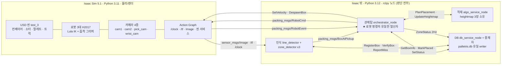
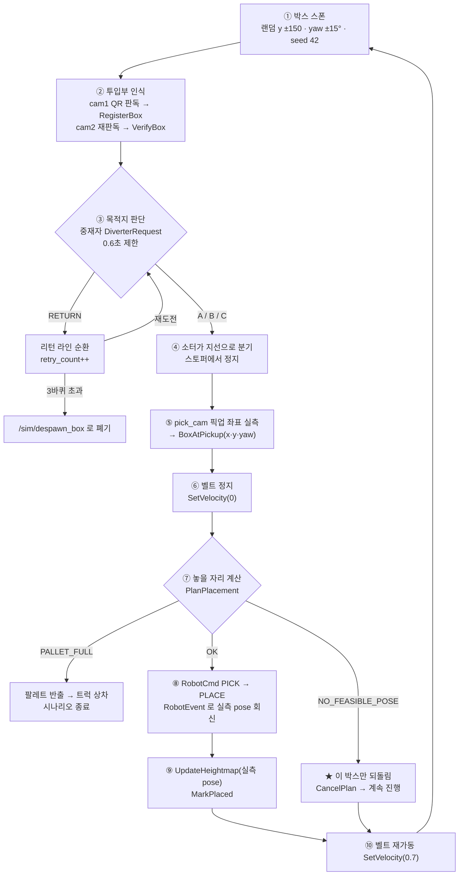
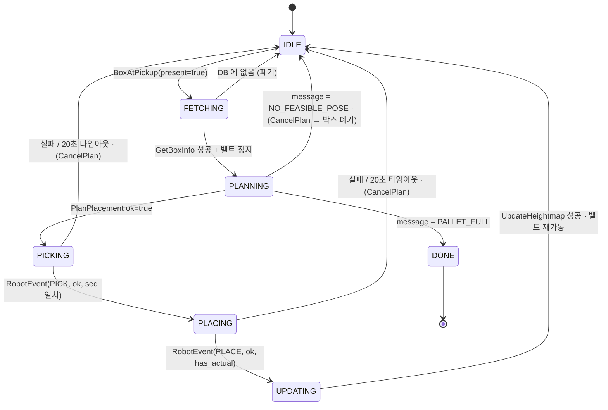
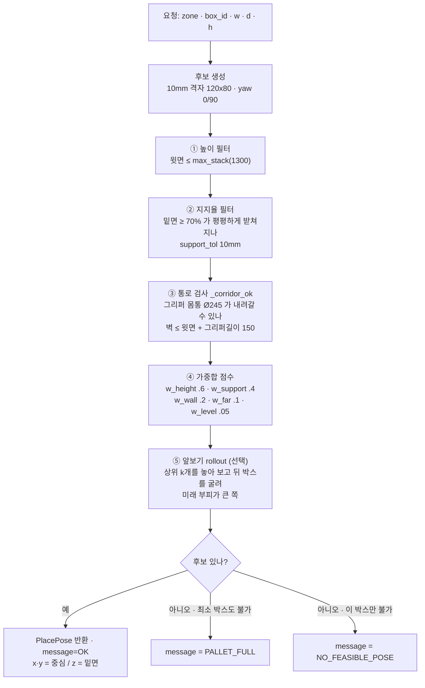

# Project Palletris — 시스템 설계 · 실행 안내

> 이 문서는 **설계 설명서**다 (구조 · 플로우차트 · 장비 · 인터페이스).
> **설치와 실행만 필요하면 [`../README.md`](../README.md) 를 봐라** — 그쪽이
> 시연 당일(2026-08-27) 기준으로 갱신된 정본 안내서다.
> 두 문서의 실행 절차가 다르면 `README.md` 를 따른다.

**스마트 물류창고 자율 팔레타이징 시스템** — Isaac Sim 디지털 트윈 위에서
컨베이어로 오는 택배 상자를 6축 로봇 팔이 집어, 3D 빈패킹 알고리즘이 계산한 자리에
쌓고, 팔레트째 트럭으로 반출한다.

> [두산로보틱스] 지능형 로보틱스 엔지니어 · 협동-3
> 디지털 트윈 기반 로봇 자동화 시뮬레이션 시스템 구현 (6일 캡스톤)

| 지표 | 결과 |
|---|---|
| 적재율 (Isaac 실측 · 3시드 평균) | **75.5 %** (시드별 80.3 / 73.1 / 73.2) |
| 베이스라인(단순 순차 DBLF) 대비 | **+30.6 %p** (39.7 % → 70.3 %, 시드 20개) |
| 사이클 타임 | **8.2 ~ 10.6 s** (초기 18.3 s) |
| 최고 적재 높이 | **1300 mm** (팔레트 상면 기준 · 9~10단) |
| 종료 조건 | 3시드 전부 `PALLET_FULL` — 자리 부족이 아니라 포화 |
| 계획 재현성 | 4/4 완전 동일 (개수·적재율·배치 좌표까지) |

---

## 목차

1. [시스템 설계](#1-시스템-설계)
2. [플로우 차트](#2-플로우-차트)
3. [운영체제 · 실행 환경](#3-운영체제--실행-환경)
4. [사용 장비](#4-사용-장비)
5. [의존성](#5-의존성)
6. [설치 · 빌드](#6-설치--빌드)
7. [실행 순서](#7-실행-순서)
8. [검증 스크립트](#8-검증-스크립트)
9. [저장소 구조](#9-저장소-구조)
10. [팀](#10-팀)

---

## 1. 시스템 설계

### 1-1. 전체 구조 — Isaac 안과 밖

Isaac Sim 내장 파이썬은 **3.11**, ROS 2 Jazzy 는 **3.12** 다. 같은 프로세스에서
섞을 수 없으므로 **판단 로직은 전부 Isaac 밖**에 둔다. 둘을 잇는 통로는
**ROS 2 하나뿐**이다 — Action Graph 의 C/rcl 백엔드가 파이썬 버전 차이를 우회한다.



### 1-2. 노드 구성

| 노드 | 개수 | 패키지 | 하는 일 | **하지 않는 일** |
|---|---|---|---|---|
| **관제탑** `orchestrator_node` | **1** | `palletris_orchestrator` | 구역 3개의 상태머신을 한 프로세스가 든다. **로봇 명령의 유일한 발신자** | 자리 계산 |
| 구역 인식 `zone_detector` | **3** | `packing_vision` | `pick_cam` 으로 픽업 좌표(x·y·yaw) 실측 → `BoxAtPickup` | 로봇 명령 |
| 라인 인식 `line_detector` | 1 | `packing_vision` | `cam1` 판독 → `RegisterBox`, `cam2` 재판독 → `VerifyBox` | 로봇 명령 |
| 적재 알고리즘 `algo_service_node` | 1 | `packing_algo` | heightmap 3장 소유 · 배치 좌표 계산 | **`/robot/cmd` 발행 금지** |
| DB + 중재자 `db_service_node` | 1 | `packing_db` | `palletris.db` 를 여는 **유일한** 프로세스 · 목적지 배분 | |

> **관제탑은 하나다.** 구역이 셋이어도 프로세스를 늘리지 않는다 — 상태머신이라
> 하나여야 명령이 겹치지 않는다. 반대로 **구역 인식은 셋으로 나눈다** — 이미지
> 추론이라 한 프로세스에 몰면 파이썬 GIL 때문에 세 구역이 줄을 서서 돈다.

### 1-3. 인터페이스 — 전용 타입만 쓴다

토픽에 `std_msgs/String` + JSON 을 쓰지 않는다. 전부 `packing_msgs` 전용 타입이다.

**토픽 8종**

| 토픽 | 타입 | 방향 |
|---|---|---|
| `/clock` | `rosgraph_msgs/Clock` | Isaac → 전원 |
| `/tf` · `/tf_static` | `tf2_msgs/TFMessage` | Isaac → 전원 |
| `/cam1/rgb` · `/cam2/rgb` · `/pick_cam_{a,b,c}/rgb` (+ `camera_info`) | `sensor_msgs/Image` · `CameraInfo` | Isaac → 인식 |
| `/zone_{a,b,c}/box_at_pickup` | `packing_msgs/BoxAtPickup` | 인식 → 관제탑 |
| `/zone_{a,b,c}/robot/cmd` | `packing_msgs/RobotCmd` | 관제탑 → 로봇 |
| `/zone_{a,b,c}/robot/event` | `packing_msgs/RobotEvent` | 로봇 → 관제탑 |
| `/zone_{a,b,c}/status` | `packing_msgs/ZoneStatus` (2 Hz) | 관제탑 → 중재자·모니터링 |
| `/metrics/summary` | `packing_msgs/MetricsSummary` (1 Hz) | DB → 모니터링 |

**서비스 17종**

| 서버 | 서비스 |
|---|---|
| `algo` | `/algo/plan_placement` · `/algo/update_heightmap` · `/algo/cancel_plan` · `/algo/reset_heightmap` |
| `db` | `/db/register_box` · `/db/get_box_info` · `/db/verify_box` · `/db/set_status` · `/db/mark_placed` · `/db/zone_queue` · `/db/report_miss` |
| 중재자 | `/diverter/request` · `/diverter/decide` |
| 씬(Isaac) | `/conveyor/set_velocity` · `/sim/despawn_box` · `/sim/set_spawn_enabled` · `/sim/swap_pallet` |

**반드시 지킬 규약 5개**

1. **모든 노드에 `use_sim_time:=true`.** 없으면 tf 조회가 전부 실패한다.
   ⚠ 반대로 `/clock` 발행자가 없는데 `true` 면 **모든 타이머가 멎는다** — 노드는
   살아 있고 에러도 없는데 로봇 20초 타임아웃 감시까지 죽는다. Isaac 을 먼저 띄운다.
2. **`RobotCmd.seq` 를 `RobotEvent.seq` 가 그대로 되돌려준다.** 없으면 타임아웃 뒤
   늦게 온 이전 응답을 새 박스의 결과로 오인한다.
3. **`has_actual == true` 일 때만 `actual_*` 를 `UpdateHeightmap` 에 넣는다.**
   계획값을 되보내면 오차가 누적돼 알고리즘은 1300 안이라 믿는데 실물이 넘는다.
4. **`DiverterRequest` 는 응답 제한 0.6 초.** 일반 서비스 타임아웃 2.0 초를 쓰면
   답이 올 때 박스가 이미 분기점을 지나 있다.
5. **카메라 토픽 QoS 는 `qos_profile_sensor_data`(BEST_EFFORT).** 기본 RELIABLE 로
   구독하면 이미지가 하나도 안 온다.

---

## 2. 플로우 차트

### 2-1. 박스 1개 사이클 (시나리오)



> **★ `NO_FEASIBLE_POSE` ≠ `PALLET_FULL`.** 앞은 *이 박스만* 자리가 없다는 뜻이고,
> 뒤는 가장 작은 박스로도 후보가 없다는 뜻이다. 첫 `NO_FEASIBLE_POSE` 에서
> 종료하면 팔레트가 반만 찬 채 데모가 멈춘다.

### 2-2. 관제탑 상태머신 (구역당 1개, 총 3개 인스턴스)



**이탈 3경로** — `NO_FEASIBLE_POSE` · `PALLET_FULL` · 실패/타임아웃(**20 초**).
셋 다 `CancelPlan` 을 호출한 뒤 복귀한다. **노드는 절대 죽지 않는다.**

### 2-3. 적재 알고리즘 (`PlanPlacement` 안에서 일어나는 일)



---

## 3. 운영체제 · 실행 환경

| 항목 | 값 | 비고 |
|---|---|---|
| OS | **Ubuntu 24.04 LTS** | |
| 미들웨어 | **ROS 2 Jazzy Jalisco** (Python **3.12**) | `/opt/ros/jazzy` |
| 시뮬레이터 | **NVIDIA Isaac Sim 5.1** (내장 Python **3.11**) | `~/isaac-sim-5.1.0/python.sh` |
| DDS | Fast DDS + **유선 화이트리스트** | `scripts/fastdds_whitelist.xml` → `~/.ros/` |
| `ROS_DOMAIN_ID` | **115** (팀 전원 동일) | 틀리면 노드는 다 사는데 서로 안 보인다 |
| 워크스페이스 | `~/palletris_ws` | |
| 실행 형태 | **다중 PC** ROS 2 통신 (4대) | |
| 빌드 | `colcon build --symlink-install` | |
| DB | SQLite 3 (**WAL 모드**) | `palletris.db` — writer 는 `db_service_node` 하나뿐 |

> ⚠ **Isaac 내장 ROS 2 를 쓰면 안 된다.** `packing_msgs` 는 `/opt/ros/jazzy` 로
> 빌드돼 있어서 내장 배포판에 물리면 fastcdr ABI 가 달라 `symbol lookup error` 로
> 죽는다. `source install/setup.bash` 한 줄이 `AMENT_PREFIX_PATH` ·
> `LD_LIBRARY_PATH` · 배포판 일치 셋을 한꺼번에 해결한다.

---

## 4. 사용 장비

### 4-1. 로봇 · 엔드이펙터 (시뮬레이션 모델)

| 항목 | 값 | 근거 |
|---|---|---|
| 로봇 | **두산로보틱스 H2017** · 6축 협동로봇 | 두산 공식 대표 용도에 팔레타이징 포함 |
| 도달거리 | **1,700 mm** | 최원점 1,667 mm = 도달의 **86 %** (권장 상한 85 % 수준) |
| 가반하중 | 20 kg (그리퍼 자중 2 kg 제외 시 **유효 18 kg**) | |
| 자중 | 75 ~ 79 kg | 페데스탈 구조 설계에 반영 |
| 엔드이펙터 | **진공 흡착** Ø50 mm × **4 패드** | 실용 흡착력 **16 kgf** (진공 −60 kPa · 안전계수 3) |
| 그리퍼 치수 | 길이 **150 mm** · 몸통 **Ø245 mm** | ★ 통로 검사(`_corridor_ok`)의 기준값 |
| **실질 중량 상한** | **10 kg** | 가반이 아니라 **골판지 상판 강성**이 먼저 걸린다 |
| 페데스탈 | **900 mm** (test_3 씬은 1,700 mm) | 다층 적재 시 팔꿈치가 기둥을 치지 않는 최소 높이 |
| 대수 | **3 대** (구역 A · B · C) | |

> **왜 H2017 인가.** M0609(도달 900 mm)는 소요/도달 162 % 로 미달이고 유효 가반이
> 4 kg 이다. H2017 은 86 % 로 **팔레트 전체를 한 자세에서 덮어 턴테이블·리니어축이
> 필요 없다.**

### 4-2. 센서

| 카메라 | 위치 | 역할 |
|---|---|---|
| `cam1` | 컨베이어 x = 600 | 투입부 판독 — 크기 측정 · QR 운송장번호 → DB 등록 |
| `cam2` | 컨베이어 x = 1400 | 투입부 재판독 · 교차 검증 |
| **`pick_cam`** ×3 | 스토퍼 위 (y 0, z **2300**) 하향 | **픽업 좌표 실측** (x · y · yaw) |
| **`wrist_cam`** | 그리퍼 몸통 · offset (170, 0, 30) · tilt 18° | hand-eye — 집는 순간 확인 |

- 모델: **Intel RealSense D455** 상정 (외형 124 × 26 × 29 mm 하우징)
- 해상도 **1280 × 720** · HFOV **60°** · **30 Hz**
- 조명: 돔 라이트 `intensity: 100` — 오프스크린 렌더는 GUI 조명 리그를 못 받는다

### 4-3. 물류 설비 (씬 자산)

| 설비 | 사양 |
|---|---|
| 컨베이어 | 롤러 면 z = **800 mm** · 유효 폭 **1546 mm** · 속도 **0.5 m/s** (test_3: 0.7) |
| 소터 | 구역별 독립 컨베이어 3대 — 소터만 옆으로 돌려 지선으로 분기 |
| 리턴 라인 | 순환 루프 — 구역이 차면 한 바퀴 돌려 재도전 (**3바퀴 초과 시 폐기**) |
| 팔레트 | **1200(X) × 800(Y) × 두께 150 mm** · Y 로 3장 = 2400 |
| 최대 적재 | **1300 mm** (팔레트 **상면** 기준) = 트럭 내高 1600 − 팔레트 150 − 천장 여유 150 |
| 트럭 | 1톤 · 적재함 바닥 **2800 mm** · 내高 **1600 mm** · 바닥 높이(지면 대비) 850 |
| 가이드 벽 | 팔레트 바깥 5 mm · 두께 20 mm — **로봇 쪽과 픽업 쪽은 비운다** |

**적재 대상 — 우체국 표준 택배 상자 3종**

| 이름 | w × d × h (mm) | 질량 | 혼입비 |
|---|---|---|---|
| 3호 | 340 × 250 × 210 | 3 kg | 50 % |
| 4호 | 410 × 310 × 280 | 5 kg | 30 % |
| 5호 | 480 × 380 × 340 | 9 kg | 20 % |

> **z = 0 은 도크 바닥 = 트럭 적재함 바닥이다.** 야드 지면이 아니다(z = −850).
> 이 규약 덕분에 "팔레트를 들지 않고 밀어서 트럭에 넣는다"가 높이차 0 으로 이미
> 만족된다 — 79 kg 로봇을 1.6 m 구조물에 올리는 대안을 쓰지 않아도 된다.

### 4-4. 컴퓨팅 · 네트워크

| 노드 | IP | 역할 |
|---|---|---|
| PC1 | `10.10.0.1` | **Isaac Sim 전용** (`packing_sim` + 로봇 구동) |
| PC2 | `10.10.0.2` | `packing_db` — DB 서비스 · 인식 · 중재자 |
| PC3 | `10.10.0.3` | `packing_algo` |
| PC4 | `10.10.0.4` | 모니터링 · rqt · 로그 |

- **2.5G 스위치 + 고정 IP** · FastDDS 유선 화이트리스트 (실측 ping **0.25 ms**)
- Isaac 머신 CPU 를 렌더링/물리에 집중시켜 카메라 FPS 게이트(G3)에 유리
- 트랙 C·D 는 Isaac 없이 노트북에서 개발 가능 → GPU 3대로 아무도 대기하지 않음

---

## 5. 의존성

전체 목록과 근거는 [`requirements.txt`](requirements.txt) 에 있다.

**Isaac 밖 (ROS 2 노드 · Python 3.12)**

```bash
# apt 판 권장 — rosdep 이 package.xml 의 <exec_depend> 를 이 이름으로 찾는다
sudo apt install python3-numpy python3-scipy python3-opencv \
                 python3-yaml python3-matplotlib python3-pytest

# 또는
pip install -r requirements.txt
```

| 패키지 | 어디에 쓰나 |
|---|---|
| `numpy` | heightmap 120×80 int32 격자 |
| `scipy` | `maximum_filter1d` — 통로 검사의 슬라이딩 최대. `plan()` 2 ms 가 여기서 나온다 |
| `opencv-python` ≥4.7 | HSV 마스크 · `minAreaRect` (yaw) · `QRCodeDetector` / `QRCodeEncoder` |
| `PyYAML` | `system.yaml` 로더 |
| `matplotlib` | 리포트 그림 · 실시간 적재 뷰어 (**실행에는 불필요**) |
| `pytest` | 수용 테스트 |

**pip 로 넣지 않는 것**

| 이름 | 어디서 오나 |
|---|---|
| `rclpy` · `tf2_ros` · `sensor_msgs` · `geometry_msgs` | `sudo apt install ros-jazzy-desktop` |
| `packing_msgs` | 이 저장소 — `colcon build --packages-select packing_msgs` |
| `isaacsim` · `pxr`(USD) · `omni` | Isaac Sim 5.1 내장 (`python.sh` 로 실행할 때만 보인다) |
| `sqlite3` | 파이썬 표준 라이브러리 |

---

## 6. 설치 · 빌드

```bash
# 1) 클론
mkdir -p ~/palletris_ws && cd ~/palletris_ws
git clone https://github.com/ImymemineJ/Project_Palletris.git .

# 2) DDS 유선 화이트리스트 (다중 PC 필수)
mkdir -p ~/.ros && cp scripts/fastdds_whitelist.xml ~/.ros/
echo 'export FASTRTPS_DEFAULT_PROFILES_FILE=~/.ros/fastdds_whitelist.xml' >> ~/.bashrc
echo 'export ROS_DOMAIN_ID=115' >> ~/.bashrc

# 3) 의존성
sudo apt install python3-numpy python3-scipy python3-opencv python3-yaml python3-matplotlib
rosdep install --from-paths src --ignore-src -r -y

# 4) 빌드 — packing_msgs 를 먼저 (나머지가 전부 이것에 의존한다)
source /opt/ros/jazzy/setup.bash
colcon build --packages-select packing_msgs
source install/setup.bash
colcon build --symlink-install
source install/setup.bash

# 5) USD 씬 배포 — ★ git 에 USD 를 커밋하지 않는다 (수백 MB · merge 불가)
./scripts/sync_scene.sh            # 트랙 A 머신에서 rsync 로 뿌린다

# 6) 로봇 · 그리퍼 USD 생성 (USD 대신 "만드는 스크립트"를 커밋했다)
python3 scripts/import_h2017_usd.py     # ~/isaac_assets/h2017.usd
python3 scripts/build_gripper_usd.py    # h2017_suction.usd

# 7) 마스터 DB(정답지) + QR 라벨
ros2 run packing_db gen_master_db       # boxes_master · zone_map
python3 scripts/gen_qr_labels.py        # qr_labels/*.png
```

---

## 7. 실행 순서

### ★ 순서가 중요하다 — Isaac 을 **반드시 먼저** 띄운다

`launch` 가 `use_sim_time:=true` 를 강제하는데 `/clock` 발행자가 없으면 ROS 시계가
0 에 멎어 **모든 타이머가 안 뜬다.** ZoneStatus 발행도, `/metrics/summary` 도,
관제탑의 **로봇 20초 타임아웃 감시까지** 죽는다. 노드는 멀쩡히 살아 있고 에러도
안 나서 원인 찾기가 제일 어렵다.

### 터미널 1 — Isaac Sim (씬 + 로봇 3대 + ROS 2 브리지)

```bash
cd ~/palletris_ws && ./scripts/run_test3_ros.sh
```

껍데기가 프로세스 시작 **전에** 잡아야 하는 것 셋을 다 잡는다 — ROS 2 환경
(`AMENT_PREFIX_PATH` · `LD_LIBRARY_PATH` · 배포판 일치) · `ROS_DOMAIN_ID=115` ·
`PL_CONFIG_OVERLAY`. 환경변수는 kit 이 **시작 때만** 읽으므로 안에서 고쳐도 늦다.

| 환경변수 | 기본값 | 뜻 |
|---|---|---|
| `PL_ZONES` | `A,B,C` | 띄울 구역 (`PL_ZONES=B` 로 한 대만) |
| `PL_GUI` | `1` | `0` 이면 창 없이 (헤드리스는 실시간의 ~7배로 돈다) |
| `PL_SPAWN` | `8` | 박스 투입 간격(초). `0` = 안 넣는다 |
| `PL_STAGE` | `~/isaac_scenes/project_1/test_3.usd` | 씬 USD |
| `PL_CONFIG_OVERLAY` | `src/packing_bringup/config/test_3.yaml` | 좌표 오버레이 |

**떠야 하는 줄:**

```
[sim_main] 구역 A, B, C (다중)
[sim_main] 로봇 /World/robot_A  베이스 [-7596, 5076, 1700] mm
[ros_side] A — /zone_a/robot/cmd / /zone_a/robot/event
[ros_side] 배선 완료 — 명령 대기
```

> ⚠ **"로봇 베이스가 사양과 다르다" 가 뜨면 멈추고 볼 것** — 오버레이가 안 걸린
> 것이다. 그대로 두면 관제탑은 test1-1 좌표로 계획하고 Isaac 은 test_3 좌표로
> 움직인다. **경고 없이** 엉뚱한 자리에 놓는다.

### 터미널 2 — ROS 2 그래프 전체 (관제탑 · algo · db · 인식)

```bash
cd ~/palletris_ws
source /opt/ros/jazzy/setup.bash && source install/setup.bash
export ROS_DOMAIN_ID=115

ros2 launch packing_bringup bringup.launch.py \
  zones:="['a','b','c']" \
  pick_cam_ns:="['/pick_cam_a','/pick_cam_b','/pick_cam_c']" \
  config_overlay:=$PWD/src/packing_bringup/config/test_3.yaml
```

**launch 인자**

| 인자 | 기본값 | 뜻 |
|---|---|---|
| `zones` | `['a','b','c']` | 인식 노드를 띄울 구역 목록 |
| `pick_cam_ns` | `['/pick_cam_a','/pick_cam_b','/pick_cam_c']` | ★ `zones` 와 **순서·개수가 짝**이어야 한다 |
| `config_overlay` | `$PL_CONFIG_OVERLAY` | 3구역이면 **반드시** `test_3.yaml` |
| `use_sim_time` | `true` | Isaac 없이 돌릴 때만 `false` |
| `algo` / `db` / `vision` / `orchestrator` | `true` | 개별 노드 on/off |
| `log_level` | `info` | |

1구역(stage 1 · B 단독)으로 좁히려면 **셋을 같이** 좁힌다:

```bash
ros2 launch packing_bringup bringup.launch.py \
    zone:=b zones:="['b']" pick_cam_ns:="['/pick_cam']"
```

### 터미널 3 — 상태 확인

```bash
./scripts/ros_health.sh          # 계약(토픽·서비스)대로 누가 붙었나 한 장으로
watch -n2 -c ./scripts/ros_health.sh
```

| 표시 | 뜻 | 볼 곳 |
|---|---|---|
| `OK` | 발행자·구독자 둘 다 있다 | — |
| `pub0` | 내는 쪽이 안 떴다 | 그 토픽의 발행 노드 |
| **`sub0`** | **데이터는 나가는데 아무도 안 듣는다** | 받는 쪽 노드 / 구역 이름 오타 |

`sub0` 이 제일 위험하다 — **에러가 안 난다.**

```bash
ros2 topic echo /zone_b/status              # 한 구역 상태머신
ros2 topic echo /metrics/summary            # 지표 1 Hz
python3 scripts/report.py --watch           # 종료 지표 표 (2초마다)
python3 scripts/db_peek.py --box BOX001     # 박스 하나의 상태 전이 이력
ros2 run packing_algo live_view             # 실시간 3D 적재 뷰어
ros2 run rqt_image_view rqt_image_view      # 카메라 확인
```

### 실행 스크립트 요약

| 스크립트 | 무엇 |
|---|---|
| `scripts/run_test3_ros.sh` | **최종 구현** — Isaac `--ros`, 판단은 관제탑이 (터미널 1) |
| `scripts/run_test3.sh` | 데모 단독 실행 — `demo_stack15_test1_1.py` 로 Isaac 혼자 다 한다 |
| `scripts/run_demo.sh` | 1구역(test1-1) 데모 |
| `scripts/ros_health.sh` | ROS 그래프 계약 헬스체크 |
| `scripts/sync_scene.sh` | USD 씬 rsync 배포 (트랙 A 전용) |

> ⚠ `run_test3_ros.sh` 와 `run_test3.sh` 를 **동시에 띄우지 않는다.**

### 인식이 아직이면 — 손으로 박스 도착을 쏜다

```bash
ros2 service call /db/register_box packing_msgs/srv/RegisterBox \
  "{box_id: 'BOX001', size_w_mm: 340, size_d_mm: 250, size_h_mm: 210, color: 'red'}"

ros2 topic pub --once /zone_b/box_at_pickup packing_msgs/msg/BoxAtPickup \
  "{box_id: 'BOX001', present: true, x_mm: 9800, y_mm: 0, yaw_deg: 0.0}"
```

관제탑에서 이 순서가 보이면 성공이다:

```
[①→②] 박스 도착 → [②→③] 크기 → [③→④] 놓을 자리
[④→⑤] 집기 성공 → [⑤→⑥] 놓기 성공 → [⑥→①] 적재 n개
```

### 막혔을 때

| 증상 | 먼저 볼 것 |
|---|---|
| 관제탑이 `IDLE` 에서 안 움직인다 | `/zone_*/box_at_pickup` 발행자가 있나 |
| **타이머가 하나도 안 돈다** | `/clock` 발행자 0 — Isaac 을 먼저 띄웠나 |
| 이미지가 하나도 안 온다 | QoS 가 RELIABLE (BEST_EFFORT 여야 한다) |
| 카메라가 캄캄하다 | 돔 라이트 꺼짐 / **카메라가 형상 안에 파묻힘** |
| 팔이 엉뚱한 데로 간다 | **오버레이가 안 걸렸다** — 터미널 1 의 베이스 경고 확인 |
| 로봇 응답이 엉뚱한 박스 것으로 처리된다 | `seq` 검사 누락 |
| `database is locked` | `db_service_node` 외 프로세스가 `.db` 를 열었다 |
| 토픽이 안 보이는데 에러도 없다 | `ROS_DOMAIN_ID` 불일치 / 콜백 예외가 삼켜짐 |

전체 목록은 [`트러블슈팅.md`](트러블슈팅.md) 에 있다.

---

## 8. 검증 스크립트

게이팅 검증(G1~G7)과 실측 하네스는 전부 `scripts/` 에 커밋한다.

| 스크립트 | 무엇을 재나 | Isaac 필요 |
|---|---|---|
| `verify_reach.py` | **G1** 도달범위 11점 (팔레트 코너·상단) | ✗ |
| `verify_reach_isaac.py` | G1 의 Isaac/Lula 판 | ✓ |
| `verify_lula_ik.py` | **B1** Lula IK 기동 — Isaac 배선의 단일 출처 | ✓ |
| `verify_suction.py` | **B3** 흡착 grasp/release/is_holding · 흡착면↔상판 간극 | ✓ |
| `verify_cycle.py` | **시뮬 A** 픽→이송→플레이스 사이클타임·간섭·툴 기울기 | ✓ |
| `verify_link_clearance.py` | **팔 링크 대 적재물 간섭** (특히 `link_2`) | ✗ |
| `verify_transit_sweep_isaac.py` | **궤적 전체** 스윕 — 정지 자세 검사로는 안 잡힌다 | ✓ |
| `verify_belt_speed.py` | 벨트 이송속도 게이트 (`isaac-sim.sh --exec` 전용) | ✓ |
| `verify_vision.py` | **D 인식 전 구간** — Isaac 대역을 서서 카메라·tf 를 합성 | ✗ |
| `verify_db.py` | **D2** `/db/*` 7종 + 중재자. 실패 경로도 같이 친다 | ✗ |
| `verify_ros_graph.py` | **★ ROS 2 그래프 전 구간** — Isaac 이 하는 일 전부를 대신한다 | ✗ |
| `check_place_plan.py` | 배치 계획 프리플라이트 (`plan.json`) | ✗ |
| `summarize_runs.py` | `results/*.txt` → 조건·결과 비교표 한 줄 | ✗ |
| `report.py` | **D3** 종료 지표 — 발표의 "결과 수치" | ✗ |

```bash
# 수용 테스트 (회귀 방지)
colcon test --packages-select packing_algo packing_common packing_db packing_vision
colcon test-result --verbose
```

> **★ 계획 파라미터는 Isaac 으로 판정한다.** 데스크 지표와 Isaac 실측이 **부호까지
> 어긋난 적이 있다** — 데스크에서는 배치 실패가 박스 1개 손해지만, 실측에서는 실패
> 2건이 적재 3개를 깎았다(팔이 스택을 63 mm 밀고, 무너진 지형이 뒤 박스 자리까지
> 죽였다). **데스크 스윕은 후보를 좁히는 용도**이지 채택 판정이 아니다.

---

## 9. 저장소 구조

```
palletris_ws/
├─ src/
│  ├─ packing_msgs/          공용 인터페이스 (msg 7 · srv 17). 수정 = 팀 전원 재빌드
│  ├─ packing_common/        공용 라이브러리 — config · frames · units · ids
│  │                         ★ 복사 금지, import 한다
│  ├─ packing_bringup/       launch + config/system.yaml (★ 모든 숫자의 정본)
│  │                                 + config/test_3.yaml (3구역 좌표 오버레이)
│  ├─ packing_algo/     [C]  heightmap_core.py · algo_service_node.py
│  │                         extreme_point.py(대조군) · baseline.py · viz/report
│  ├─ packing_robot/    [B]  cycle.py(모션) · gripper.py(흡착) · cmd_adapter.py
│  │                         robot_node.py · fk.py · urdf/ · config/(Lula)
│  ├─ palletris_orchestrator/[B] orchestrator_node.py — 관제탑, 상태머신 7개
│  ├─ packing_vision/   [D]  vision_node.py · detect.py · geometry.py · label.py
│  │                         ★ 코어(detect/geometry/label)는 ROS 의존성 0
│  ├─ packing_db/       [D]  db_service_node.py(+중재자) · schema.sql
│  │                         gen_master_db.py · metrics.py · route.py
│  └─ packing_sim/      [A]  isaac/ — sim_main · spawner · conveyor_ctl
│                            robot_motion · camera_pick · ros_graph · ros_side
├─ scripts/                  검증 하네스 · 씬 빌드 도구 · 리포트
├─ docs/                     설계결정서 · 작업명세서 · 트랙별 가이드 · 발표 자료
├─ CLAUDE.md                 프로젝트 컨텍스트 (숫자의 정본은 system.yaml)
├─ 트러블슈팅.md              증상 → 원인 전체 기록
└─ requirements.txt
```

### 하지 말 것

- ❌ **`system.yaml` · `packing_msgs/` · 씬 USD 를 승인 없이 수정** (= 팀 전원 재빌드)
- ❌ **코드에 숫자 상수 박기** — 전부 `system.yaml` 에서 읽는다
- ❌ **컨베이어 bbox 값(1970 · 1213)을 사양으로 쓰기** — 롤러 면은 1546 · 800 이다
- ❌ **관제탑을 구역마다 띄우기** — 하나다
- ❌ 알고리즘·인식 노드에서 `/robot/cmd` 발행
- ❌ `spin_until_future_complete` 사용 — 콜백 안에서 부르면 **에러 없이 조용히 멈춘다**
- ❌ 토픽에 `std_msgs/String` + JSON 사용 — 전용 타입이 있다
- ❌ `random_seed: 42` 변경 — 베이스라인 비교가 깨진다
- ❌ USD 를 git 에 커밋 — 대신 **만드는 스크립트**를 커밋한다

---

## 10. 팀

| 트랙 | 담당 | 범위 |
|---|---|---|
| **A** | 김학민 | Isaac 씬 · 컨베이어/소터 · 카메라 · tf/clock · USD |
| **B** | 김병직 | 로봇 팔 제어 · 흡착 · 관제탑 · 사이클 최적화 |
| **C** | 정정인 | 3D 빈패킹 알고리즘 · heightmap · 성능 검증 |
| **D** | 민범진 | 비전/인식 · DB · 중재자 · 인터페이스 설계 |

**공용 파일을 바꿨으면 반드시 보고한다** — 4명이 다시 빌드해야 한다.

---

## 문서

| 문서 | 무엇 |
|---|---|
| [`CLAUDE.md`](CLAUDE.md) | 프로젝트 컨텍스트 · 좌표/치수 정본 요약 · 규약 |
| [`docs/작업명세서.md`](docs/작업명세서.md) | 인터페이스·수치의 **정본** |
| [`docs/설계결정서.md`](docs/설계결정서.md) | 설계 근거 (왜 그렇게 했나) |
| [`docs/코드_리딩가이드.md`](docs/코드_리딩가이드.md) | 시나리오를 따라 코드를 읽는 법 |
| [`docs/2026-08-26_3구역_통합실행.md`](docs/2026-08-26_3구역_통합실행.md) | 최종 통합 실행 순서 |
| [`docs/발표/`](docs/발표/) | 발표 자료 · 알고리즘 개선 과정 |
| [`트러블슈팅.md`](트러블슈팅.md) | 증상 → 원인 전체 기록 |
