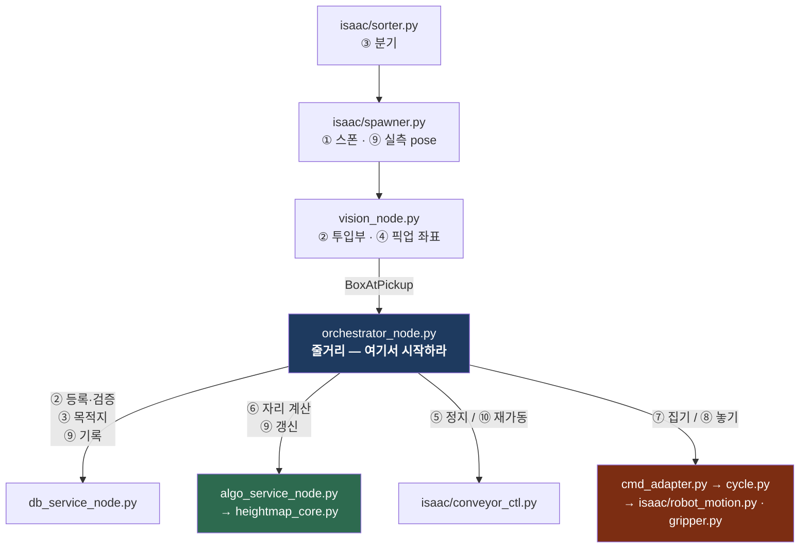

# 코드 리딩 가이드 — 시나리오를 따라 코드를 읽는 법

> Project Palletris · 2026-08-28
> **처음 이 저장소를 여는 사람을 위한 지도.** 파일이 100개가 넘지만
> **최종 시나리오가 지나가는 길은 20개뿐**이다. 나머지는 씬 빌드 도구·검증 하네스·폐기 경로다.

---

## 0. 먼저 알아야 할 것 3가지

### ① 시나리오는 10단계다

```
① 스폰 → ② 투입부 인식 → ③ 목적지·분기 → ④ 픽업 좌표 → ⑤ 벨트 정지
→ ⑥ 자리 계산 → ⑦ 집기 → ⑧ 놓기 → ⑨ 갱신·기록 → ⑩ 벨트 재가동 → ①
```

**최종 경로 파일마다 모듈 docstring 맨 위에 "시나리오에서의 위치" 배너**가 있다.
파일을 열면 그 파일이 몇 번을 맡는지, 누가 부르고 누구를 부르는지 바로 보인다.

### ② 코드가 두 세계로 갈려 있다

| | Isaac **안** | Isaac **밖** |
|---|---|---|
| 파이썬 | 3.11 (Isaac 내장) | 3.12 (ROS 2 Jazzy) |
| 하는 일 | **몸** — 물리·렌더·관절 구동·컨베이어 | **머리** — 판단 전부 |
| 디렉터리 | `src/packing_sim/isaac/` | 나머지 `src/*` |
| `packing_msgs` | ❌ import 불가 | ✅ |

같은 프로세스에서 못 섞이므로 **통로는 ROS 2 하나뿐**이다.
그래서 `ros_graph.py`(Action Graph)와 `ros_side.py`(배선)가 존재한다.

### ③ 숫자는 코드에 없다

전부 `src/packing_bringup/config/system.yaml` 에서 읽는다.
3구역 씬은 `test_3.yaml` 을 **그 위에 겹친다**(`PL_CONFIG_OVERLAY`).
**코드에서 상수를 찾지 말고 yaml 을 보라.**

---

## 1. 시나리오 단계 → 파일 지도

| 단계 | 무슨 일이 | 어느 파일 · 어느 함수 |
|:-:|:---|:---|
| **①** | 상자가 컨베이어에 나타난다 | `isaac/spawner.py` → `h_spawn_box` → `_spawn` |
| **②** | cam1 이 크기·QR 을 읽고 DB 에 등록 | `vision_node.py` → `LineDetector._on_cam1`<br/>`db_service_node.py` → `on_register` |
| **②′** | cam2 가 재판독해 교차 검증 | `vision_node.py` → `_on_cam2` → `on_verify` |
| **③** | 배송지로 담당 구역을 정한다 | `db_service_node.py` → `on_diverter` · `_zone_by_address` |
| **③′** | 소터가 지선으로 꺾는다 | `isaac/sorter.py` → `SorterCell.update` · `apply`<br/>`isaac/conveyor_ctl.py` → `set_sorter` |
| **④** | 스토퍼에 선 상자의 좌표를 잰다 | `vision_node.py` → `ZoneDetector._on_image`<br/>(씬 판: `isaac/spawner.py` → `h_pickup_check`)<br/>(카메라 판: `isaac/camera_pick.py` → `detect`) |
| **⑤** | 벨트를 세운다 | `orchestrator_node.py` → `call_set_velocity(0)`<br/>`isaac/conveyor_ctl.py` → `set_velocity` |
| **⑥** | 놓을 자리를 계산한다 | `algo_service_node.py` → `on_plan`<br/>**`heightmap_core.py` → `plan`** ★ |
| **⑦** | 집는다 | `orchestrator_node.py` → `send_robot_cmd(PICK)`<br/>`cmd_adapter.py` → `run_cmd` → `cycle.py` → `pick`<br/>`isaac/robot_motion.py` · `gripper.py` |
| **⑧** | 놓는다 | 같은 경로 · `cycle.py` → `place` |
| **⑨** | 실측 pose 로 갱신·기록 | `isaac/spawner.py` → `h_get_box_pose`<br/>**`heightmap_core.py` → `update`** ★<br/>`db_service_node.py` → `on_mark_placed` |
| **⑩** | 벨트를 다시 돌린다 | `orchestrator_node.py` → `reset_to_idle` |

---

## 2. 어디서부터 읽어야 하나 — 목적별 3개 경로

### 🅐 "전체가 어떻게 도는지" 알고 싶다 (30분)

```
1. docs/2026-08-26_3구역_통합실행.md   실행 순서 — 무엇이 몇 개 뜨는지
2. orchestrator_node.py                ★ 여기가 줄거리다. 상태 7개를 따라 읽는다
3. src/packing_msgs/msg/*.msg          주고받는 것의 전부. 10분이면 다 읽는다
4. bringup.launch.py                   누가 어떤 파라미터로 뜨는지
```

> **`orchestrator_node.py` 하나가 시나리오 전체의 목차다.**
> 이 파일은 아무것도 직접 하지 않는다 — 순서만 정한다.
> `IDLE → FETCHING → PLANNING → PICKING → PLACING → UPDATING` 각 구간에
> `[①→②]` 같은 로그가 찍혀 있어서, 실행 로그와 코드가 1:1로 붙는다.

### 🅑 "알고리즘이 궁금하다" (1시간)

```
1. heightmap_core.py 모듈 docstring    문제의 성격 · 상태 · plan 7단계
2. heightmap_core.plan()               후보 생성 → 필터 → 점수 → 선택
3. heightmap_core._corridor_ok()       ★ 이 프로젝트의 차별점
4. heightmap_core.update()             자기교정 · 멱등성
5. extreme_point.py                    대조군 (비교 기준선)
6. docs/발표/트랙C_알고리즘_개선과정.md   왜 이 형태가 됐는지
```

> **ROS·Isaac 의존성이 0** 이라 노트북에서 그대로 돌려볼 수 있다:
> ```bash
> PYTHONPATH=src/packing_algo:src/packing_common python3 -c "
> from packing_common.config import load
> from packing_algo.heightmap_core import HeightmapPacker
> pk = HeightmapPacker(load())
> print(pk.plan('BOX001', 340, 250, 210))"
> ```

### 🅒 "로봇이 어떻게 움직이는지" 알고 싶다 (1시간)

```
1. cycle.py 모듈 docstring + Cycle 클래스   한 사이클의 전부
2. cycle.py _run()                          벨트정지 → 접근 → 흡착 → 이송 → 해제
3. isaac/robot_motion.py _reach_done()      ★ 사이클 타임의 심장 (수렴 정체 판정)
4. gripper.py                               흡착 판정 · D6 조인트
5. cmd_adapter.py                           규약 3개가 사는 자리
```

---

## 3. 파일별 한 줄 설명 — 최종 경로 20개

### 🧠 판단 (Isaac 밖 · rclpy)

| 파일 | 단계 | 한 줄 |
|:---|:-:|:---|
| `palletris_orchestrator/orchestrator_node.py` | ①~⑩ | **줄거리.** 구역 3개 상태머신 · 로봇 명령의 유일한 발신자 |
| `packing_algo/algo_service_node.py` | ⑥⑨ | `/algo/*` 서비스 4종. 코어의 얇은 번역기 |
| `packing_algo/heightmap_core.py` | ⑥⑨ | **알고리즘 본체.** ROS 의존성 0 |
| `packing_algo/extreme_point.py` | ⑥ | 대조군 패커 (성능 비교 기준선) |
| `packing_db/db_service_node.py` | ②③⑨ | `.db` 유일 writer + 중재자 |
| `packing_db/metrics.py` | — | 지표 쿼리. **실시간 화면과 최종 보고서가 공유** |
| `packing_db/route.py` | ③ | 배송 순서·경로 (구역 배정의 뒷단) |
| `packing_vision/vision_node.py` | ②④ | 인식 노드 2종 (라인 1 · 구역 3) |
| `packing_vision/detect.py` | ②④ | 윤곽·yaw·QR — **코어, ROS 의존성 0** |
| `packing_vision/geometry.py` | ④ | 픽셀 → 월드 평면 역투영 |
| `packing_vision/label.py` | ②④ | QR 페이로드 규약 (만드는 쪽·읽는 쪽 공유) |

### 🦾 로봇 (경계)

| 파일 | 단계 | 한 줄 |
|:---|:-:|:---|
| `packing_robot/cycle.py` | ⑤⑦⑧⑩ | **한 사이클 전체.** 전송에 의존하지 않는다 |
| `packing_robot/cmd_adapter.py` | ⑦⑧ | `RobotCmd → Cycle → RobotEvent`. **규약 3개가 사는 자리** |
| `packing_robot/gripper.py` | ⑦⑧ | 흡착·해제 판정 · 간극 실측 |
| `packing_robot/robot_node.py` | ⑦⑧ | (과도기) 토픽 ↔ Cycle. 최종은 `ros_side` |

### 🖥️ 몸 (Isaac 안 · Python 3.11)

| 파일 | 단계 | 한 줄 |
|:---|:-:|:---|
| `isaac/sim_main.py` | 전체 | 씬을 열고 틱을 돈다. **틱 순서가 중요하다** |
| `isaac/ros_side.py` | ⑦⑧ | Isaac 안의 ROS 2 배선. **워커 스레드가 모션을 돌린다** |
| `isaac/ros_graph.py` | 전체 | Action Graph — Isaac ↔ ROS 2 **유일한 통로** |
| `isaac/spawner.py` | ①④⑨ | **라인 위 상자의 유일한 장부** |
| `isaac/conveyor_ctl.py` | ③⑤⑩ | 벨트 속도 (scale.x 로 나눠 쓴다) |
| `isaac/sorter.py` | ③ | 소터 셀 — 직진/배출 전환 |
| `isaac/camera_pick.py` | ④ | 픽업 좌표의 **카메라 판** |
| `isaac/robot_motion.py` | ⑦⑧ | IK · 웨이포인트 보간 · 도착 판정 |
| `isaac/mainq.py` | 전체 | **USD 쓰기를 메인 스레드로.** 없으면 스테이지가 깨진다 |

### 🔧 공용

| 파일 | 한 줄 |
|:---|:---|
| `packing_common/config.py` | `system.yaml` 로더 (+ 오버레이) |
| `packing_common/frames.py` | **좌표 규약의 정본** — 중심 vs 밑면 |
| `packing_common/units.py` | mm ↔ m. **직접 `/1000` 금지** |
| `packing_common/ids.py` | 운송장번호 규칙 (`BOX%03d`) |

---

## 4. ⚠️ 읽다가 헷갈리기 쉬운 5곳

### ① 같은 질문에 답이 둘이다 — 픽업 좌표

| | 무엇 | 성격 |
|---|---|---|
| `spawner.h_pickup_check` | 씬 프림에서 자세를 그대로 읽는다 | **ground truth** — 검증용 |
| `camera_pick.detect` | depth 로 본 것만 쓴다 | 실물에 있는 것 |
| `vision_node.ZoneDetector` | RGB + tf 로 역투영 | **최종 경로** |

셋 다 살아 있다. 나란히 찍으면 **인식 오차가 그대로 보인다.**

### ② `robot_node.py` 와 `ros_side.py` 가 같은 일을 한다

과도기(소켓)와 최종(ROS 2 직결)의 두 경로다.
**둘 다 `cmd_adapter.run_cmd` 하나를 부른다** — 그래서 전송이 바뀌어도 규약은 안 바뀐다.
데모 기준선(`demo_stack15`)이 소켓 경로에 물려 있어 아직 지우지 않았다.

### ③ `pallet.width/depth` 가 설정마다 뒤바뀐다

| | width (X) | depth (Y) |
|---|---|---|
| `system.yaml` (test1-1) | 1200 | 800 |
| `test_3.yaml` (3구역) | **800** | **1200** |

지선 방향이 달라서 팔레트가 90° 돌아 있다.
**숫자를 코드에 박으면 한쪽이 반드시 틀린다.**

### ④ `PlacePose.z_mm` 은 **밑면**이다

`x_mm`·`y_mm` 은 중심인데 `z_mm` 만 밑면이다.
변환은 반드시 `packing_common/frames.py` 를 거친다.
중심으로 오해하면 **상자가 팔레트에 절반 파묻힌다.**

### ⑤ 폐기된 코드가 남아 있다

| 남아 있는 것 | 왜 |
|---|---|
| `isaac/sim_server.py` | 소켓 서버. **김학민 소유라 임의로 안 지운다.** 새 코드에서 import 금지 |
| `packing_robot/rmpflow_controller.py` | 정상상태 오차 15 mm 로 기각. 장애물 회피가 필요해지면 다시 볼 설정 |
| `packing_sim/archive/` | 씬 수리 도구 아카이브 |
| `packing_sim/*.py` (isaac/ 밖) | 씬 빌드·수리 일회성 도구. 최종 경로가 아니다 |

> 옛 코드나 옛 요약에 `localhost:8765` · `SimServer` · `std_msgs/String` 이 보이면
> **폐기된 버전이다.** 참고하지 말 것.

---

## 5. 코드에 심어 둔 표시 읽는 법

| 표시 | 뜻 |
|:---|:---|
| `★` | **이걸 모르면 버그를 만든다.** 규약·함정·실측 근거 |
| `★★` | 그중에서도 특히 위험한 것 (조용히 망가지는 종류) |
| `⚠` | 하면 안 되는 것 · 되돌아온 실패 |
| `[실측]` · `(실측 2026-08-xx)` | 재서 확인한 값. 추측이 아니다 |
| `— 실측` 없는 숫자 | `system.yaml` 정본이거나 사양서 값 |
| `# ── ① … ──` | 시나리오 단계 구분 (orchestrator) |

> **주석 밀도가 높은 것은 의도한 것이다.** 이 프로젝트의 버그는 대부분
> **에러가 안 나는 종류**였다 — 토픽 이름이 어긋나고, 콜백 예외가 삼켜지고,
> 좌표가 h/2 만큼 밀린다. 그런 것은 코드를 봐서는 안 보이므로,
> **"왜 이렇게 했는지"를 그 자리에 적어 두는 것 말고는 방법이 없다.**

---

## 6. 직접 돌려 보기 — Isaac 없이

```bash
# 알고리즘 코어
PYTHONPATH=src/packing_algo:src/packing_common python3 -c "
from packing_common.config import load
from packing_algo.heightmap_core import HeightmapPacker
pk = HeightmapPacker(load())
ok, pose, score, msg = pk.plan('BOX001', 340, 250, 210)
print(msg, pose)"

# 수용 테스트
colcon test --packages-select packing_algo packing_common packing_vision packing_db

# ROS 그래프 전 구간 (Isaac 대역을 스크립트가 선다)
ros2 launch packing_bringup bringup.launch.py use_sim_time:=false
python3 scripts/verify_ros_graph.py
```

---

## 7. 한 장 요약


